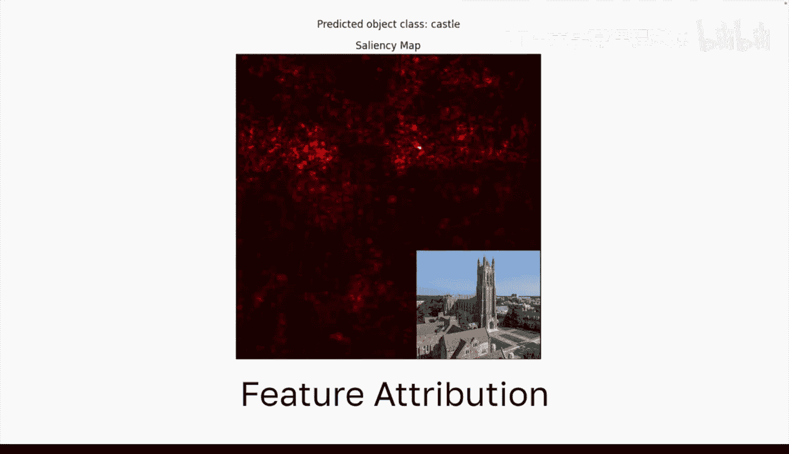
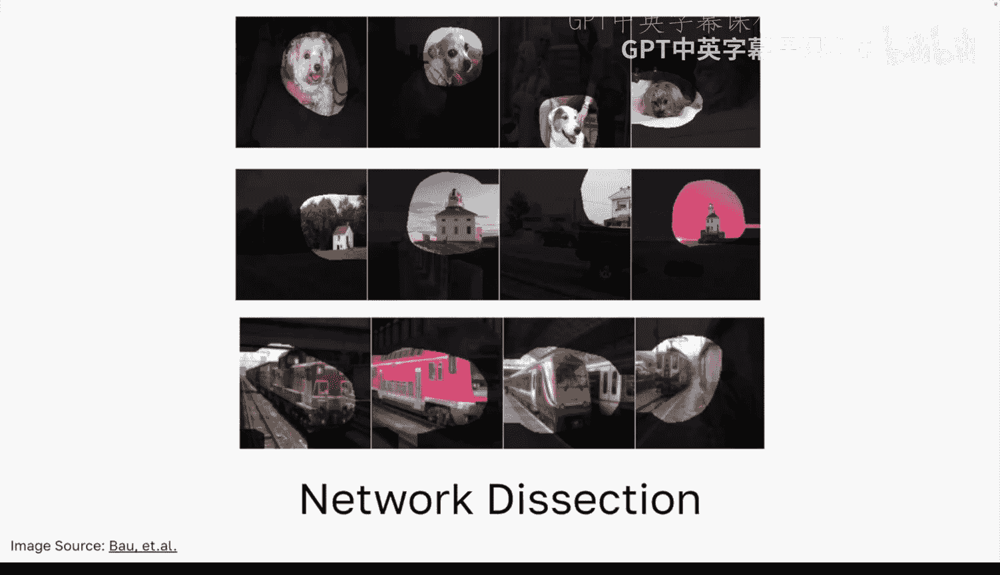
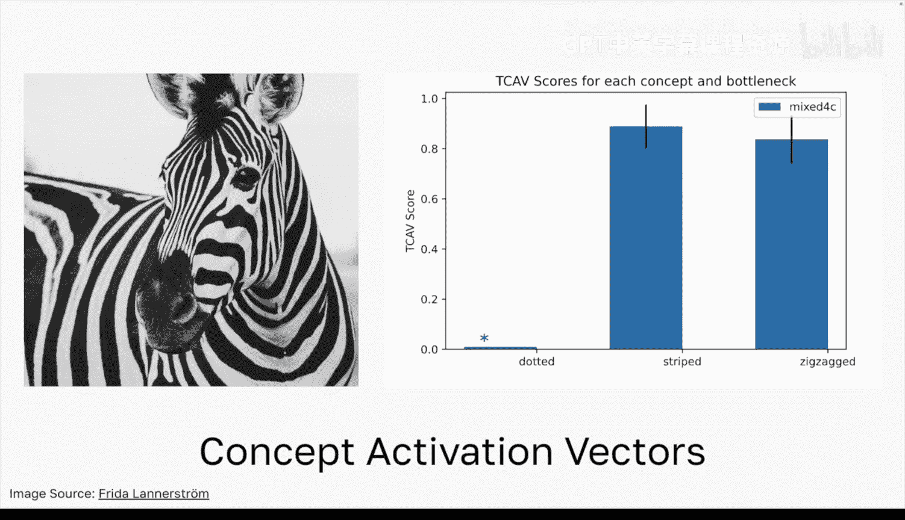
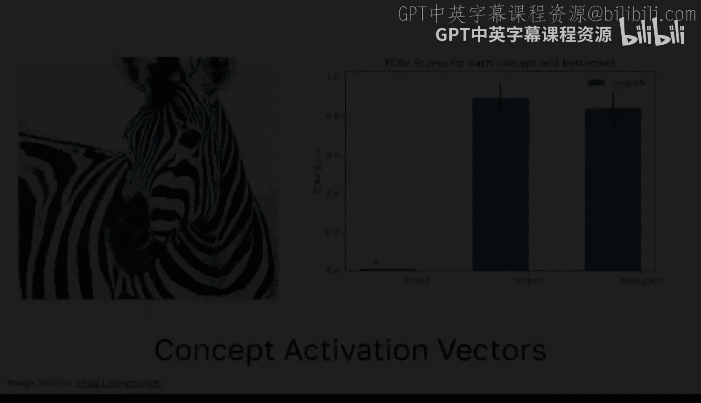

# 杜克大学《可解释人工智能｜Explainable AI (XAI)》中英字幕 p09 09_02_03_深度神经网络解释.zh_en -BV1HnrBBmEon_p9-

Neurural networks are our quintessential black box model。 Fortunately。

 there are a number of methods to explain neural networks。 Each of these has its own pros and cons。

 and I encourage you to continue in the specialization to learn more about the pros and cons associated with each of these approaches and how to implement them yourself。

 Mes for explaining neural networks include feature visualization。 feature attribution。

 network dissection and concept activation vectors。😊。

We can use an approach called feature visualization to visualize what is happening inside of a neural network。

 Feature visualization is the process of making learn features in a neural network explicit。

 It answers the question， what does this neuron channel or layer see。

In this visualization from Google's article introducing the approach in 2017。

 we can see different feature visualizations at the neuron level。

 the channel level and the layer level。 in terms of implementation。 First。

 we create images via optimization we start with random noise to obtain meaningful visualizations。

 we put constraints on the image with feature visualization。

 we are looking to maximize the activation of a neuron。

This gives us sometimes meaningful interpretations of visualizing what features neurons are tuned for。

 Sometimes we end up with some pretty weird stuff， As you can see with this visualization。

 which shows dog faces。Feature attribution indicates how much each feature in your model contributes to a prediction for an instance。

Sliency maps are a feature attribution method for images。

 Here is an example of a saency map for the Duke Chapel for the predicted object class of Catle。

Network dissection， introduced in 2017， links human concepts with individual neural network units。

 The implementation of network dissection is fairly straightforward。 First。

 get images with human labeled visual concepts。 These should be pixel wise labeled images with concepts of different abstraction levels。

Second， measure CNN channel activations for images， and lastly。

 get the alignment of activations and labeled concepts。

This method can be used to probe any convolutional layer In this image from the original paper。

 we can see mass of the concepts relating to dog， house and train。

Concept activation vectors are a numerical representation of a concept in the activation space of a neural network layer。

 Test with concept activation vectors or Tcab was first introduced in 2018。 For any given concept。

 Tc measures the extent of that concept's influence on the model's prediction for a certain class。

 Here， we look at the class zebra， and the concepts dotted， striped and zigzagged。

 We're exploring a layer in our neural network called mixed4 C。 You can see on the right。

 the Tc score for each concept is displayed on the bar chart。 As one might expect。

 the Tcav scores are high for concept striped and zigzagged for the zebra class。

 but very low for the concept dotted。😊。

