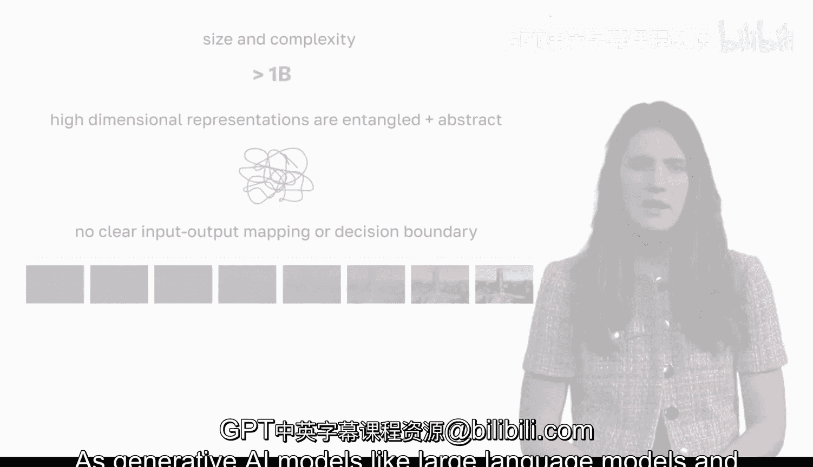
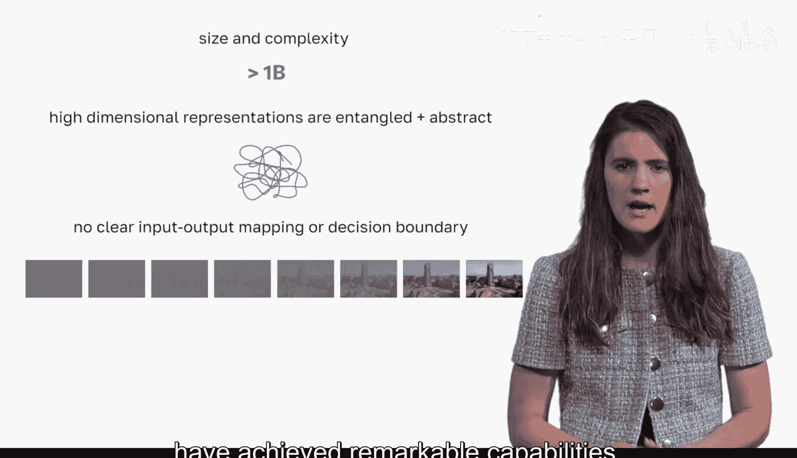
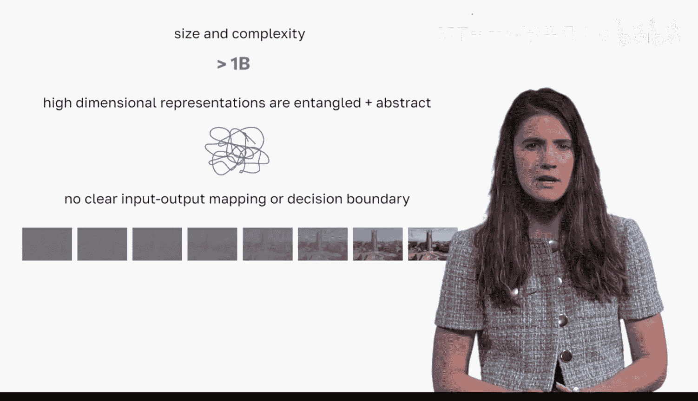
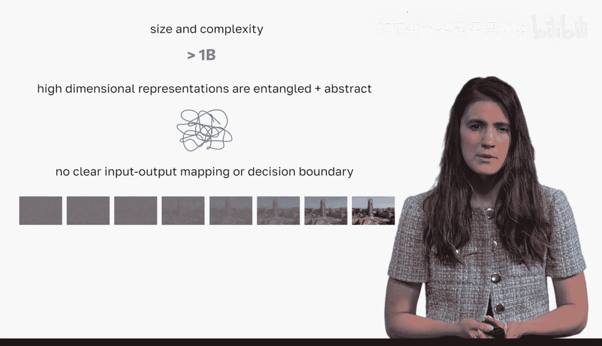
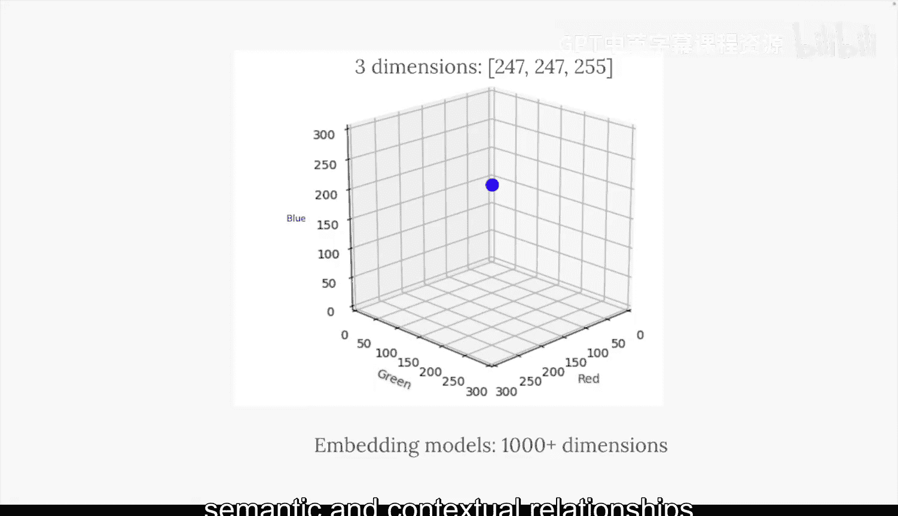

# 杜克大学《可解释人工智能｜Explainable AI (XAI)》中英字幕 p10 10_02_01_解释生成式人工智能.zh_en -BV1HnrBBmEon_p10-

As generative AI models like large language models and diffusion models for image generation have achieved remarkable capabilities。

 explaining their behavior presents unique challenges， despite their impressive performance。

 these models are extremely complex and opaque making them difficult to interpret the sheer size and complex of large language models like G4 with an unknown number of parameters likely in the trillions make tracing their reasoning intractable。

 they learn highdiional distributed representations that are entangled and abstract for generative models like diffusion models。

 there is no clear input output mapping or decision boundary the process of generating an image via diffusion starts with random noise the models learn complex distributions over high dimensional data like images or text in their latent spaces more in latent spaces in just a moment。

 which allows them to generate images aligned with a text or imagebased input This lack of transparency can be problematic when such models are used。

For high stakes applications like medical report generation or creative media synthesis impacting human users。

As generative models become increasingly powerful and widely adopted。

 the ability to interpret and explain their behavior becomes crucial for several reasons。

 Transpar and accountability。 These models can produce highly realistic and creative images。

 but their inner workings are often opaque black boxes。

 Expplainable AI techniques help shed light on the reasoning behind the generated images。

 Pro transparency and accountability， which is essential for building trust in these systems。

Biaas and fairness， like other AI models， image generators can perpetuate societal biases encoded in their training data or inherent undesirable biases from internet sources。

Explainability methods can help identify and mitigate these biases。

 promoting fairness and responsible use of the technology。

Creative control and iteration explanations of how the models interpret prompts and generate specific visual elements can empower artists and creators to refine their prompts。

 experiment with different approaches， and achieve their desired artistic vision more effectively。

Safety and ethical considerations as these metal become more capable of generating highly realistic and potentially harmful content。

 explainability can help identify and mitigate risks such as the generation of explicit or illegal content。

 deep fakes or other misuses of the technology。😊，And model improvement insights from explainability techniques can inform the development of better image generation models by revealing strengths。

 weaknesses， and areas for improvement in the model architecture， training data。

 or optimization objectives。

Let's take a step back and review latent space。 As we discussed at the beginning of this module。

 we convert human understandable information like language and images into numbers。

 and a machine can understand One way to do this is to take a lot of data and find when similar concepts are close together semantically and contextually。

 For example， the word bank in bank of the river should be close semantically to shore and riverside。

 Given the context of river。 And the word bank in deposited money at the bank should be semantically closer to financial institution。

 Given the context of money in bank。 We basically take these concepts and squeeze them into a fixed lung vector or series of numbers that represents all of this information。

We are familiar with a simple plot where we can take a point and map it into space。

 This point has two dimensions， x and y， perhaps we can imagine a 3D plot like the one here。

 where we can plot a point with3 dimensions， x， Y， and z。

Now imagine plotting a vector with1 thousand or more dimensions。

This multidisional space onto which concepts are mapped is called embedding or latent space。

 The interesting thing about a latent space is that we can map different information sources like text and images to the same latent space。

 as long as we have a data set that connects them together。

 like a large data set of images and captions from the Internet。😊，However。

 if it is hard for us to understand relationships in three dimensions like this plot I am showing here。

 imagine how difficult it is for us to comprehend semantic and contextual relationships between complex concepts and multimodal data。

For the remainder of this module， we will be focused on generative language models。

 commonly known as large language models or LLMs， however。

 explainability in generative image models is very fascinating。

 like the latent space guided perturbations of a GAN model shown here。

The counterfactual explanations of a diffusion model shown here。

An interesting feature attribution methods shown here from Park et all。

While this is not a major topic in this course， we will do a deep dive into explainability of generative image models in the explainable machine learning course later in this specialization。

