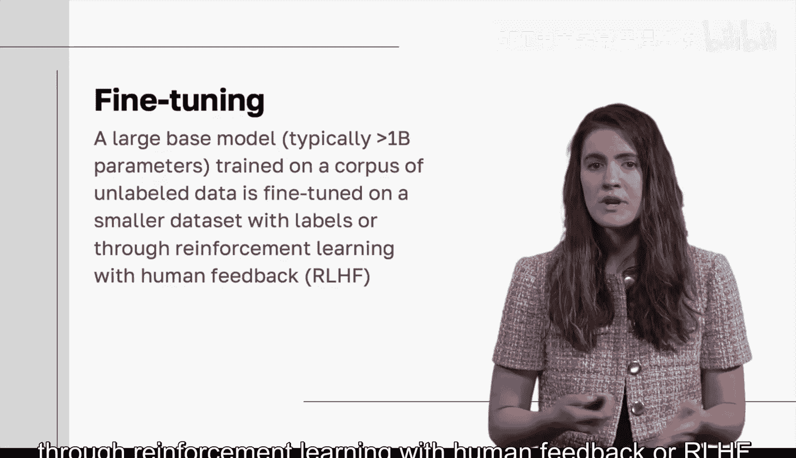
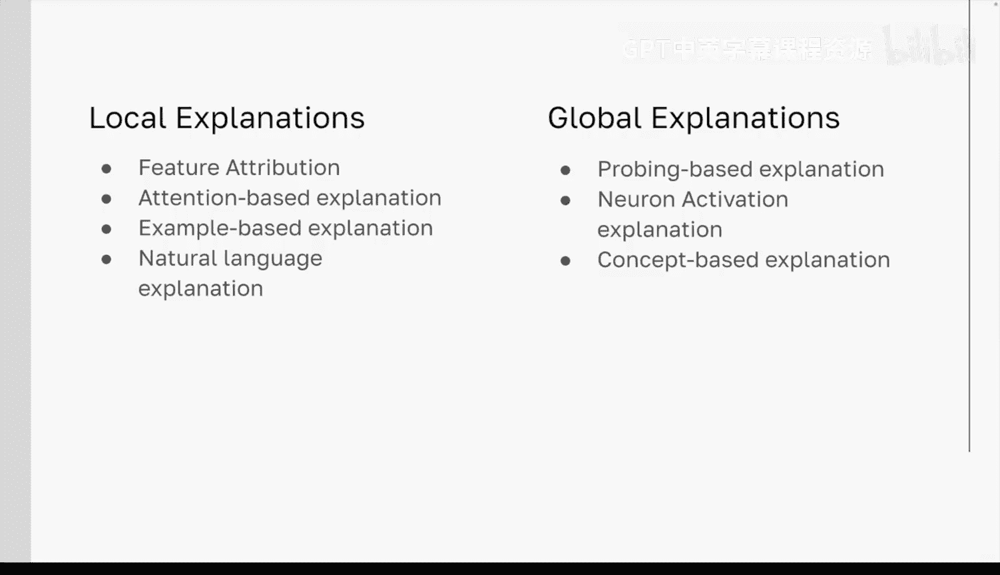
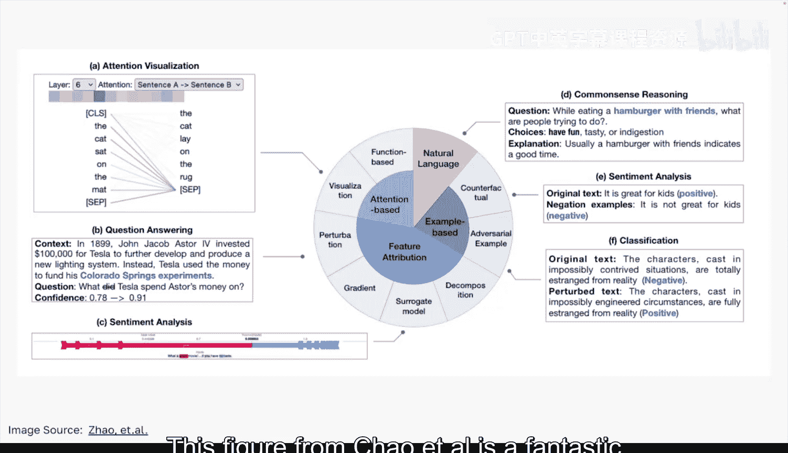
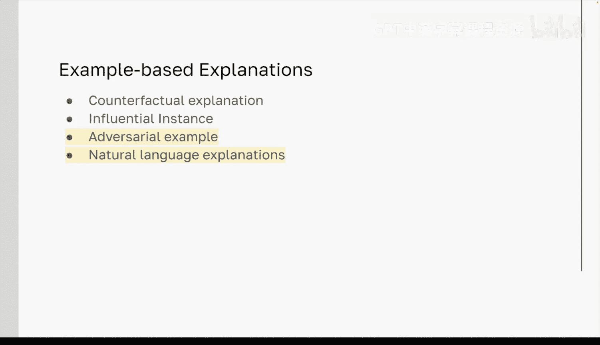
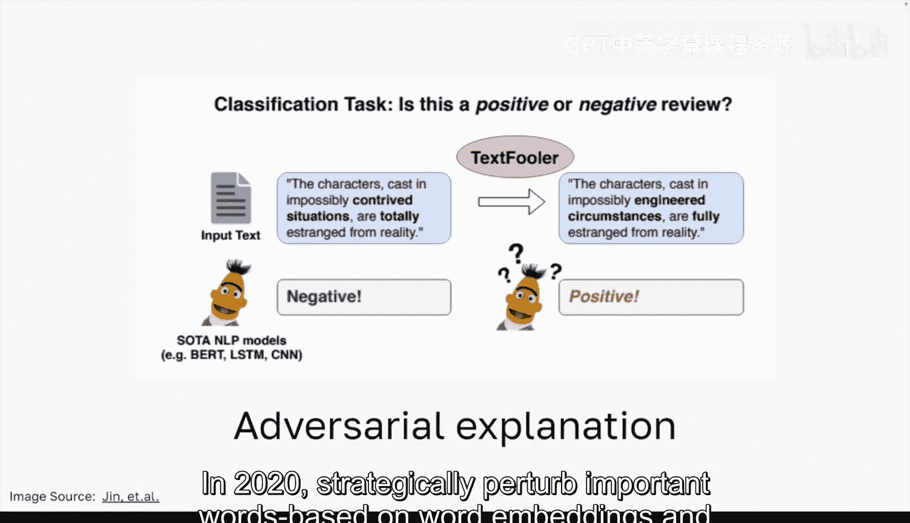
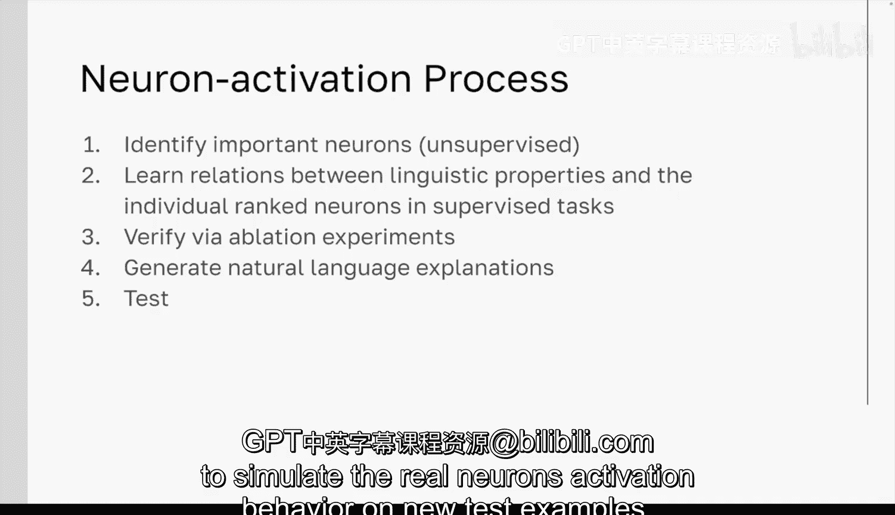

# 杜克大学《可解释人工智能｜Explainable AI (XAI)》中英字幕 p12 12_02_03_XAI在大语言模型微调中的应用.zh_en -BV1HnrBBmEon_p12-

Let's begin by reviewing fine tuning in LLM fine tuning， a large base model。

 typically which has greater than 1 billion parameters that is trained on a corpus of unlabeled data。

 is fine tuned on a smaller data set with labels or through reinforcement learning with human feedback or RLHF。

This can be visualized by this figure。 We have a large scale text corpus that is used for unsupervised pretraining of a base model like Lama 2。

 B models are usually not very good at producing adequate responses。

 It is usually necessary to do some kind of fine tuning in order to have a model that provides useful results to do this with the base model。

 we perform supervised fine tuning and or reinforcement learning with human feedback with a smaller fine tuning data set to create our assistant model like Lama 2 chat。

😊，We can break down explanations in LLM fine tuning into local and global explanations。

 where local explanations explain a specific prediction or set of predictions and global explanations attempt to provide a global explanation of the model。

Local explanations we will discuss include feature attribution， attention based explanation。

 example based explanation， and natural language explanation。

Global explanations we will discuss include probing based explanation， neuron activation explanation。

 and concept based explanation。If you plan to take the explainable machine learning course in this specialization。

 we will cover many of these explanation approaches。

This figure from Chow et all is a fantastic breakdown of our local explanations。

 Let's dive into the details。😊。

There are currently four primary feature attribution approaches to explainability in LLMs First。

 perturbation based explanation。 This is where you perturb input examples by removing。

 masking or altering input features， this can be embedding vectors， hidden units， words or tokens。

 and then you evaluate model output changes。Next is gradient based explanation。

 This is where you determine the importance of each input feature by analyzing the partial derivatives of the output with respect to each input dimension。

 The magnitude of the derivatives reflects the sensitivity of the output to changes in the input In gradients are the primary approach to gradient based explanation in LLMs。

 Next is Shap， we briefly discuss Shap in an overview of X AI methods。 gen at all。

 and others adapt to Shap to transformer based language models in 2023。

 transSp mainly focuses on adapting Shap to subward text input and providing sequential visualization explanations。

Finally， decomposition based methods， decomposition techniques aim to break down the relevance score into linear contributions from the input。

 an example of this is layer wise relevance propagation or LRP。

The next local explanation for LLM fine tuning is example based explanation。

 counterfactual explanations reveal what would have happened based on certain observed input changes。

 Influential instances characterize the influence of individual training samples by measuring how much they affect the loss on test points。

Topics we will cover today include adversarial examples and natural language explanations。

Neurural models are highly vulnerable to carefully crafted small modifications in the input data that can drastically alter the model's predictions。

 despite being nearly imperceptible to humans。 These are called adversarial examples。

 Advversarial examples expose areas where models fail and are used during training to improve model robustness and accuracy。

😊。

Early adversarial example generation focused on word level manipulations like errors。

 removals and insertions， more advanced methods like text Foer from Jean et All in 2020 strategically pertbed important words based on word embeddings and semantic similarity。

State of the art approaches to adversarial examples in large language models。

 leverage masked language models and adopt a mask then infill procedure for token level perturbations like replacement。

 insertion and merging。A recent method called semi from W at All 2022 proposes a more general framework operating directly on embedding spaces like knowledge and contextualized semantics。

 It iteratively optimizes perturbed embeddings to meet attack goals。

 A visualization of semi attack is shown here in table 1。

 replacingpl a blue word with a red adversarial one。

 misleads the correct prediction to a wrong class will not fooling a human。

The last local explanation we will discuss is natural language explanation。

 This is where we explain a model's decision making on an input sequence with generated text。

 The approach is to train a language model using both original textual data and human annotated explanations。

Recently， this has been done for a variety of dataset sets and tasks。

 as shown here in the table from Low at All， a paper in 2019 introduced the common sense explanations or CO E data set and used it to train language models to automatically generate explanations that can be used during training in inference。

 Similarlyly， a more recent study in 2022 looked at few shot out of domain transfer learning of natural language explanations from a parent task with many natural language explanations to a child task。

Let's now discuss global explanations。 concept based explanations allow us to map the inputs to a set of concepts and measure important scores of each predefined concept to model predictions。

 Testing concept activation vectors is an example of this。

Two global explanations used in explainable LLM in fine tuning， probing based explanations。

 and neuron activation explanations will be the topics we will cover in more detail。

In probing based explanation， we can look at either classifier based probing or parameter free probing in classifier based probing。

 the process is first freeze LLM parameters， then generate representations from the LLM。 Next。

 train a shallow classifier on those representations to predict linguistic properties。

 If you are probing for syntax， you are looking at things like parts of speech。

 morphology or dependencies。Alternatively， if you are probing for semantics。

 you are examining coreences， entities and relations。😊。

Pararameter free probing evaluates an LLM directly on tailored data sets without a classifier。

It's important to note that like many of these approaches。

 probing validity is debated by researchers， high performance may not mean true linguistic understanding by LLMs。

Neuron activation analysis examines individual neurons or dimensions rather than the whole vector space。

 it involves two steps， one， identifying important neurons and two。

 learning relations between linguistic properties and neurons。

The lack of ground truth annotations makes evaluating component level explanations challenging。

This figure shows an example of neuron activation explanation。

 which looks at the activation visualization of the 131st neuron in the fifth layer of GPT2。

The process of neuron activation explanation is shown here。 First。

 identify important neurons in an unsupervised manner。

 This involves ranking neurons based on metrics like correlation measurements。

 learned weights or using supervised classification methods。Next。

 learn relations between linguistic properties and the individual rank neurons in supervised tasks。

Then verify the importance of the ranked neurons quantitatively via ablation experiments like masking and erasure。

With LLMs， generate natural language explanations that summarize the patterns and texts that trigger high activation for a given neuron。

Finally， evaluate the quality of the natural language explanations by testing how well they allow the model to simulate the real neurons activation behavior on new test examples。

