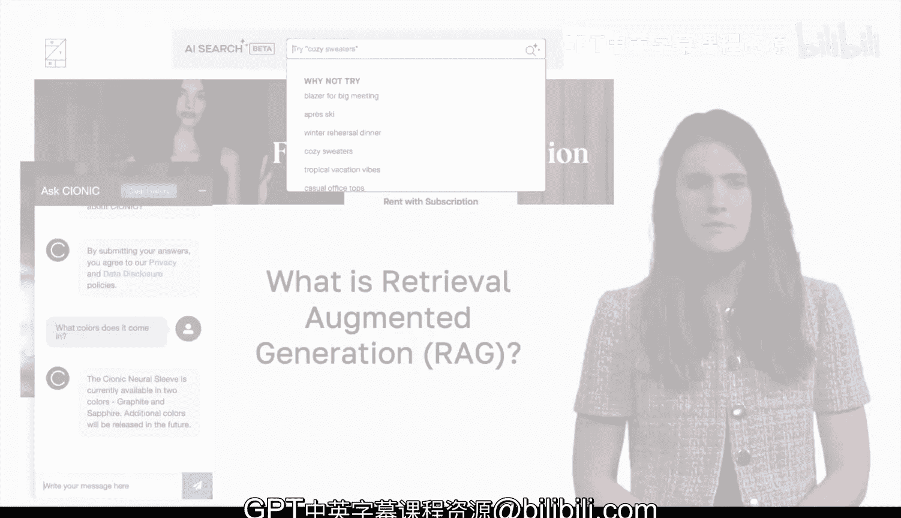
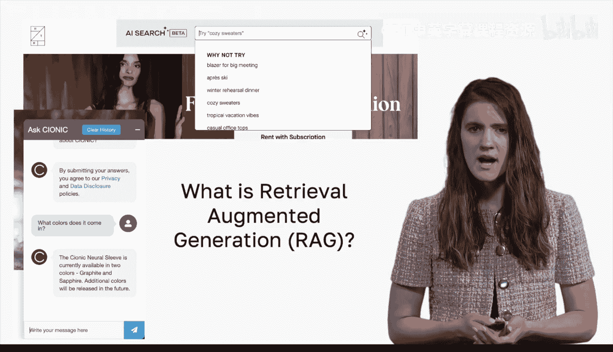
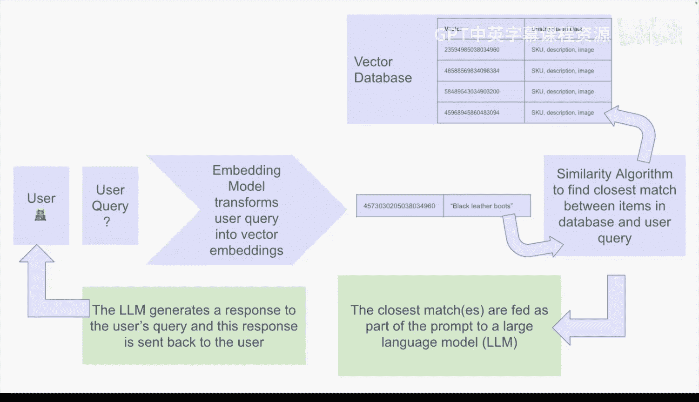
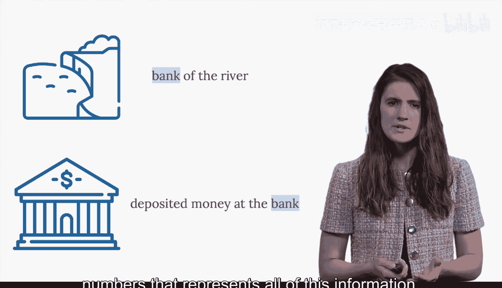
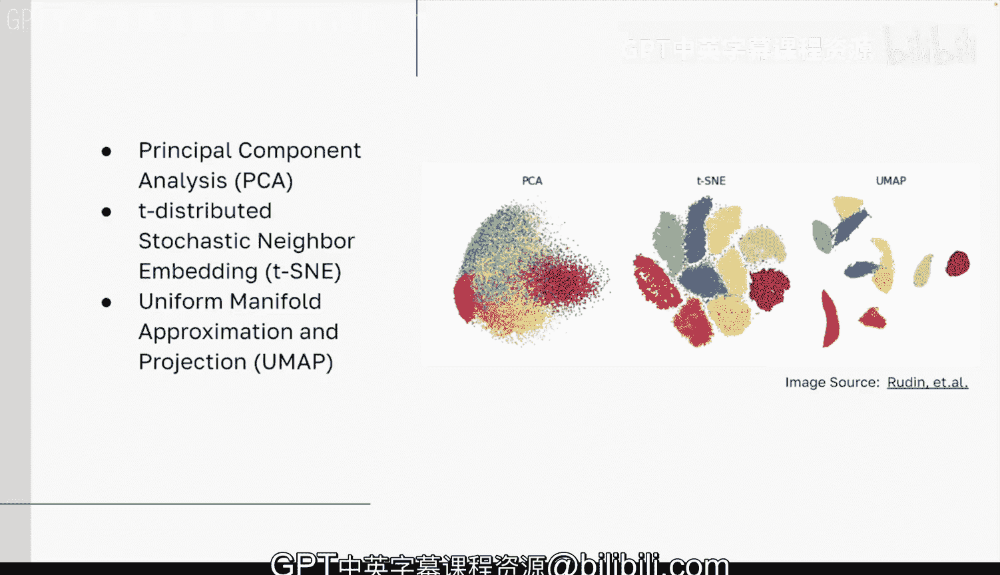

# 杜克大学《可解释人工智能｜Explainable AI (XAI)》中英字幕 p14 14_02_05_XAI在知识增强与检索增强生成中的作用.zh_en -BV1HnrBBmEon_p14-

As we jump into X AI in LLM knowledge augmentation， we have to first define knowledge augmentation。

 We are going to talk about a specific type of knowledge augmentation called Retrieval augmented generation or RaG RaG is how most customized chatbot works like the Scionic chatbot shown on the right screenshot It has applications in search。

 as you can see here in the rent the runway AI search feature shown on the screenshot on the bottom of this slide。

It is also the basis of Open AI's assistant if you have used that API。

We are going to first define RAG， discuss its application for XAI， then explore XAI in RAG。

This is the pipeline for retrieval augmented generation。

 we are going to break down each of these components。

Let's take a step back and review embeddings。 As we discussed at the beginning of this module。

 we convert human understandable information， like language and images into numbers that a machine can understand。

 One way to do this is to take a lot of data and find when similar concepts are close together semantically and contextually。

 For example， the word bank in bank of the river should be close semantically to shore and riverside。

 Given the context of river。 And the word bank in deposited money at the bank should be semantically closer to financial institution。

 Given the context of money in bank。 We basically want to take these concepts and squeeze them into a fixed length vector or series of numbers that represents all of this information。

Embbeddingians are a method of converting textual information into vectors of real numbers。

 capturing semantic and syntactic aspects of the data。 They capture semantic relationships。

 making it possible for words with similar meanings to have similar representations。

 Key features of embeddingians include dimensionality reduction。 It reduces the complexity of data。

 It captures semantics It encodes meaning based on word usage and context。 and distance measures。

 You can use similarity and meaning。 It often correlates with proximity in vector space。

Andbeddings are mapped into a multidimensional space that we call embedding or latent space。

 In this image， you can see a multimodal embedding space where captions from a large data set of images were embedded with a multimodal embedding model called C and visualized using a method called Umap。

 which we will cover later on。 It's interesting to note the human labeled clusters of concepts like people and clothes on the right side of the image。

 housing on the bottom， places on the right and art and animals near the top。

 A few concepts from 12 million captions embedded include kitchens and dining rooms。

 which are close together in multidimensional embedding space。😊。

The first concept of our ragg pipeline utilizes embeddings。

 A vector database is where vector embeddings are stored。

 You typically take a bunch of unstructured data like Pdfs。

 I or videos and embed some portion of that data using an embedding model that transforms data into vector embeddings。

 Here I am using an example from rent or runway， where each item in their fashion database is embedded as a vector。

 One thing to note here is that the embedding model determines your vector length or a number of dimensions。

 For example， Open AIs Eta002 embedding model had a vector length of 1536。

The next component of our RAg pipeline also uses embeddings when the user asks a question。

 the text is transformed into a vector embedding the same embedding model you use to create your vector database。

 For example， if my user query is black leather boots。

 the Mac query will be embedded using my embedding model and I will have a vector embedding that represents that query。

Now I connect the pieces。 I match the user query embedding to my vector database using a similarity algorithm。

 A similarity algorithm is used to find closest matches to the user query in the vector database。

 You can use any distance metric here， such as Euclidean distance。 However。

 most people building ragg pipelines use cosine similarity。 cosine similarity as scale andvari。

 so it can measure the similarity of vectors regardless of the magnitude。

 So it's more suitable for high dimensional spaces due to its focus on an angle rather than an absolute distance。

 which can be affected by the cursive dimensionality。

 and it is interpretable because values are bounded between negative one and one。Now。

 all we have to do is add a large language model back into the loop to do the generation part of our Rag pipeline to recap Rag。

 you have a vector database that is created by embedding your unstructured data。

 You have a user query that is also embedded using the same embedding model as the one used to create your vector database。

 You use a similarity algorithm to find the closest matches between items in your vector database in your user query。

 The closest matches are then incorporated into your prompt and sent to the LLM。

 The LLM generates a response to the user's query， and this response is sent back to the user。

This is， of course， a very simple example。 Some ragg pipelines have a more agent structure with an LLM in the loop making explicit decisions。

 some have multiple databases， and some have reranking algorithms or algorithms to rera your similarity algorithm results to improve the matches fed into the generative part that LLM。

While not inherently explainably I， this source grounding we get with RaG gives users insights into the knowledge base powering the LLM's responses。

 It allows them to verify the factual accuracy， understanding the model's reasoning process and gain confidence that the generations are grounded in real world data rather than in pure hallucination。

This transparency can foster trust and make the powerful capabilities of LLMs more accessible and actionable。

At this point， you may be thinking， what are ways in which we can improve explainability of the rag system itself。

 One way is by making embedding spaces more explainable through visualization。

 We already saw an example of this on the embedding slide where I showed the visualization of the image captions embedded using clip。

Before we jump into visualizing latent space， a quick review。

 we are familiar with a simple plot where we can take a point and map it into space。

 The point has two dimensions， X and Y。 Perhaps we can imagine a 3D plot like the one here。

 where we can plot a point with three dimensions， X， Y and Z。

Now imagine plotting a vector with 100 or more dimensions。

This multidial space onto which concepts are mapped is called embedding or latent space。

 The interesting thing about a latent space is that we can map different information sources like text and images to the same latent space。

 as long as we have a data set that connects them together。

 like a large dataset set of images and captions from the Internet。😊，However。

 if it is hard for us to understand relationships in three dimensions like this plot I'm showing here。

 imagine how difficult it is for us to comprehend semantic and contextual relationships between complex concepts and multimodal data。

So how do we go about visualizing the latent space with so many dimensions。

 can we make any meaningful interpretations of the latent space。

 There are a few methods that are typically used for dimensionality reduction in visualization that we harness for visualizing embeddings。

 These are Ty projections， PC A and U maps。Let's go through a brief summary of each of these approaches to visualizing latent space。

 you will get to explore these in a reading and follow up discussion。

 which will be an exploration using Project TensorFlow's embedding projector。First。

 principal component analysis or PCA。 The focus is on capturing global linear relationships in the data。

 you should use PCA to simplify and find global linear relationships and patterns in the data。Next。

 T distributed stochastic neighbor embedding or Tney。

 This involves constructing a lower dimensional representation where similar data points are placed closer together。

 You should use Tne to emphasize visual visualization， reveal local patterns and clusters。

And uniform Manifold approximation and projection or UMap。

 UMap uses manifold learning a nonlinear dimensionality reduction technique to understand the underlying structure or shape of the data。

 It focuses on capturing complex nonlinear relationships in the data。

 you should use Umap to preserve local structure and handle complex nonlinear relationships。

