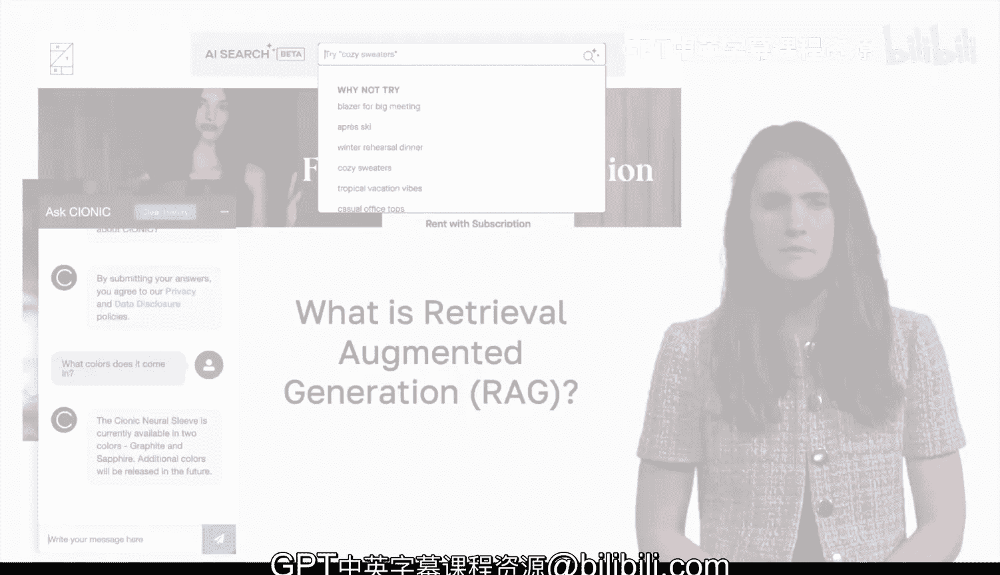
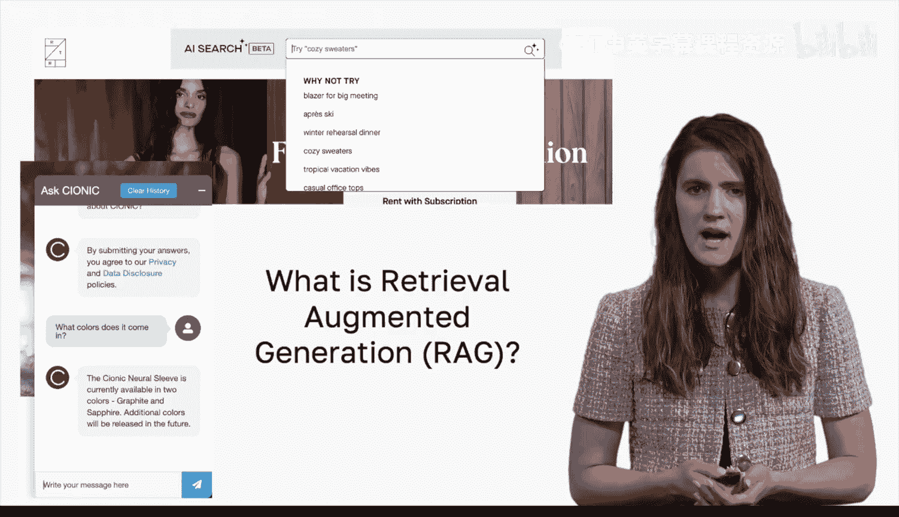
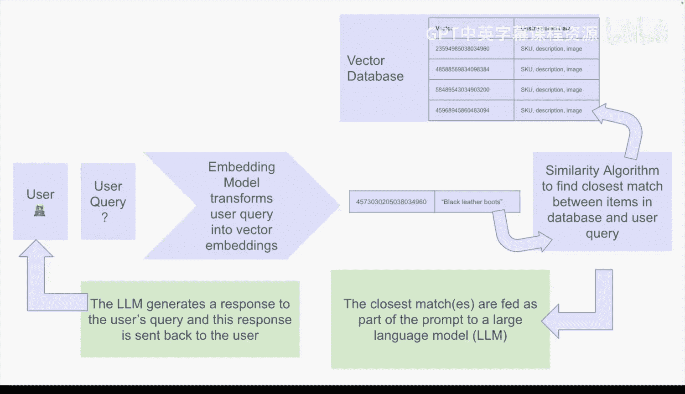
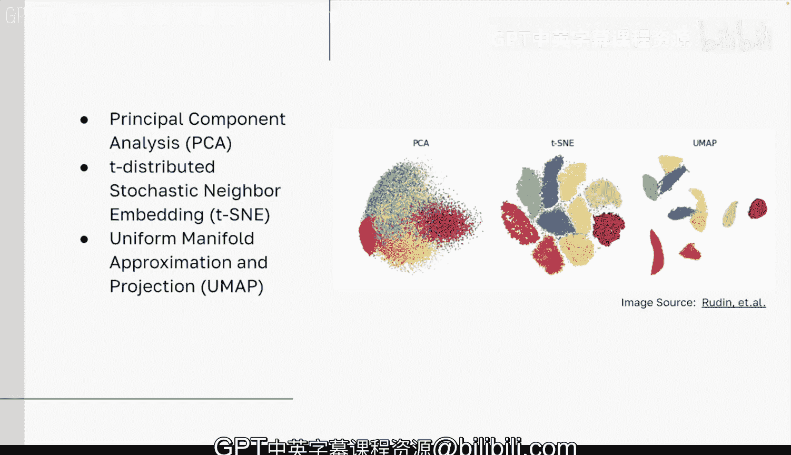

# 可解释人工智能：14：XAI在知识增强与检索增强生成中的作用

在本节课中，我们将学习可解释人工智能在大型语言模型知识增强领域的应用。我们将重点探讨一种特定的知识增强方法——检索增强生成，并了解如何通过可视化嵌入空间等技术来提升其可解释性。

## 什么是知识增强与检索增强生成

上一节我们介绍了XAI的基本概念，本节中我们来看看它在知识增强中的应用。首先需要定义知识增强。

我们将讨论一种特定类型的知识增强，称为检索增强生成。检索增强生成是大多数定制化聊天机器人的工作原理，例如右侧截图中展示的Scionic聊天机器人。它在搜索领域也有应用，正如本页幻灯片底部截图所示的Rent the Runway AI搜索功能。如果你使用过OpenAI的助手API，它也是其基础。

我们将首先定义检索增强生成，讨论其在可解释人工智能中的应用，然后探索检索增强生成中的可解释人工智能技术。

## 检索增强生成流程

这是检索增强生成的流程。我们将分解其中的每一个组成部分。

## 回顾嵌入技术

在深入流程之前，让我们先回顾一下嵌入技术。正如我们在本模块开始时讨论的，我们需要将人类可理解的信息（如语言和图像）转换为机器可以理解的数字。

实现这一点的一种方法是获取大量数据，并找出在语义和上下文上相似的概念何时彼此接近。例如，在“河岸”语境中的“bank”一词，在语义上应更接近“shore”和“riverside”。而在“在银行存钱”语境中的“bank”一词，在语义上应更接近“金融机构”。

我们本质上希望提取这些概念，并将它们压缩成一个固定长度的向量或一系列数字，以代表所有这些信息。

## 嵌入的定义与特性

嵌入是一种将文本信息转换为实数向量的方法，能够捕捉数据的语义和句法方面。它们捕捉语义关系，使得具有相似含义的单词能够拥有相似的表示。

嵌入的关键特性包括：
*   **降维**：它降低了数据的复杂性。
*   **语义捕捉**：它根据单词的使用和上下文对含义进行编码。
*   **距离度量**：你可以使用相似性，而含义通常与向量空间中的邻近性相关。

嵌入被映射到一个我们称为嵌入空间或潜在空间的多维空间中。在这张图片中，你可以看到一个多模态嵌入空间，其中来自大型图像数据集的大量标题通过一个名为CLIP的多模态嵌入模型进行了嵌入，并使用一种我们稍后将介绍的名为UMAP的方法进行了可视化。有趣的是，图片右侧显示了人工标记的概念簇，如“人物和服装”，底部是“住房”，右侧是“地点”，顶部附近是“艺术和动物”。从1200万个嵌入的标题中提取的一些概念包括“厨房”和“餐厅”，它们在多维嵌入空间中彼此接近。

## 构建向量数据库

我们检索增强生成流程的第一个概念利用了嵌入技术。向量数据库是存储向量嵌入的地方。

通常，你会获取大量非结构化数据，如PDF、图像或视频，并使用一个嵌入模型将数据的某些部分转换为向量嵌入。这里我使用Rent the Runway的一个例子，他们时尚数据库中的每个商品都被嵌入为一个向量。需要注意的一点是，嵌入模型决定了你的向量长度或维度数量。例如，OpenAI的`text-embedding-ada-002`嵌入模型的向量长度为1536。

## 处理用户查询

我们检索增强生成流程的下一个组成部分同样在用户提问时使用嵌入技术。用户查询的文本被转换为向量嵌入，使用的嵌入模型与创建向量数据库时使用的模型相同。

例如，如果我的用户查询是“黑色皮靴”，那么该查询将使用我的嵌入模型进行嵌入，我将得到一个代表该查询的向量嵌入。

## 匹配与生成

现在我将各个部分连接起来。我使用相似性算法将用户查询嵌入与我的向量数据库进行匹配。相似性算法用于在向量数据库中查找与用户查询最接近的匹配项。

你可以在这里使用任何距离度量，例如欧几里得距离。然而，大多数构建检索增强生成流程的人使用余弦相似度。余弦相似度具有尺度不变性，因此无论向量大小如何，它都能测量向量的相似性。由于它关注的是角度而非绝对距离（绝对距离可能受到维度诅咒的影响），因此它更适用于高维空间。并且它具有可解释性，因为其值被限定在-1和1之间。

现在，我们只需要将大型语言模型重新引入循环中，以完成我们检索增强生成流程的生成部分。总结一下检索增强生成：
1.  你有一个通过嵌入非结构化数据创建的向量数据库。
2.  你有一个用户查询，它也使用与创建向量数据库相同的嵌入模型进行了嵌入。
3.  你使用相似性算法在向量数据库中的条目和你的用户查询之间找到最接近的匹配项。
4.  这些最接近的匹配项随后被整合到你的提示中，并发送给大型语言模型。
5.  大型语言模型生成对用户查询的响应，并将此响应发送回用户。

当然，这是一个非常简单的例子。一些检索增强生成流程具有更智能的代理结构，其中包含一个在循环中做出明确决策的大型语言模型；一些拥有多个数据库；还有一些拥有重新排序算法或算法来重新评估你的相似性算法结果，以改进输入到大型语言模型生成部分的匹配项。

## 检索增强生成的可解释性优势

虽然检索增强生成本身并非天生具有可解释性，但它通过“来源追溯”为用户提供了洞察力，让他们了解支撑大型语言模型响应的知识库。它允许用户验证事实准确性，理解模型的推理过程，并确信生成的内容是基于真实世界数据而非纯粹的幻觉。

这种透明度可以培养信任，并使大型语言模型的强大能力更易于理解和付诸实践。

此时，你可能会想，有哪些方法可以提高检索增强生成系统本身的可解释性？一种方法是通过可视化使嵌入空间更具可解释性。我们已经在嵌入技术的幻灯片上看到了一个例子，其中展示了使用CLIP嵌入的图像标题的可视化。

## 可视化潜在空间的挑战

在深入可视化潜在空间之前，快速回顾一下。我们熟悉简单的二维图，可以取一个点并将其映射到空间中。这个点有两个维度，X和Y。也许我们可以想象一个像这里展示的三维图，我们可以绘制一个具有三个维度（X、Y和Z）的点。

现在想象绘制一个具有100个或更多维度的向量。这个映射概念的多维空间被称为嵌入空间或潜在空间。潜在空间的一个有趣之处在于，只要我们有将它们连接在一起的数据集（例如来自互联网的大量图像和标题数据集），我们就可以将不同的信息源（如文本和图像）映射到同一个潜在空间。

然而，如果我们很难理解像这里展示的这样的三维图中的关系，那么想象一下，理解复杂概念和多模态数据之间的语义和上下文关系对我们来说是多么困难。

## 可视化高维潜在空间的方法

那么，我们如何可视化具有如此多维度的潜在空间呢？我们能否对潜在空间做出任何有意义的解释？有几种通常用于降维和可视化的方法，我们可以利用它们来可视化嵌入。这些方法是t-SNE投影、PCA和UMAP。

以下是这些可视化潜在空间方法的简要总结，你将在阅读和后续讨论中探索它们，这将是一次使用TensorFlow的Embedding Projector工具进行的探索。

以下是每种方法的简要说明：
*   **主成分分析**：其重点是捕捉数据中的全局线性关系。你应该使用PCA来简化和发现数据中的全局线性关系和模式。
*   **t-分布随机邻域嵌入**：这涉及构建一个低维表示，其中相似的数据点被放置得更近。你应该使用t-SNE来强调可视化，揭示局部模式和聚类。
*   **均匀流形近似与投影**：UMAP使用流形学习（一种非线性降维技术）来理解数据的基础结构或形状。它专注于捕捉数据中复杂的非线性关系。你应该使用UMAP来保留局部结构并处理复杂的非线性关系。

## 总结

本节课中，我们一起学习了可解释人工智能在检索增强生成中的应用。我们首先定义了检索增强生成的流程，包括创建向量数据库、处理用户查询、进行相似性匹配以及利用大型语言模型生成回答。接着，我们探讨了如何通过可视化嵌入空间（例如使用PCA、t-SNE和UMAP等技术）来提升检索增强生成系统的可解释性，从而帮助用户理解模型的知识来源和推理过程，增强对生成结果的信任。