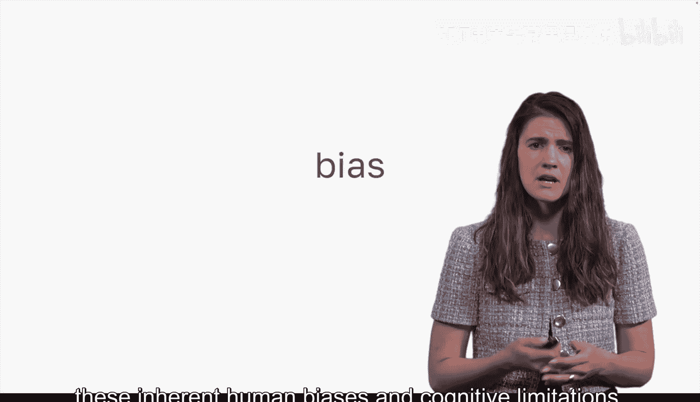
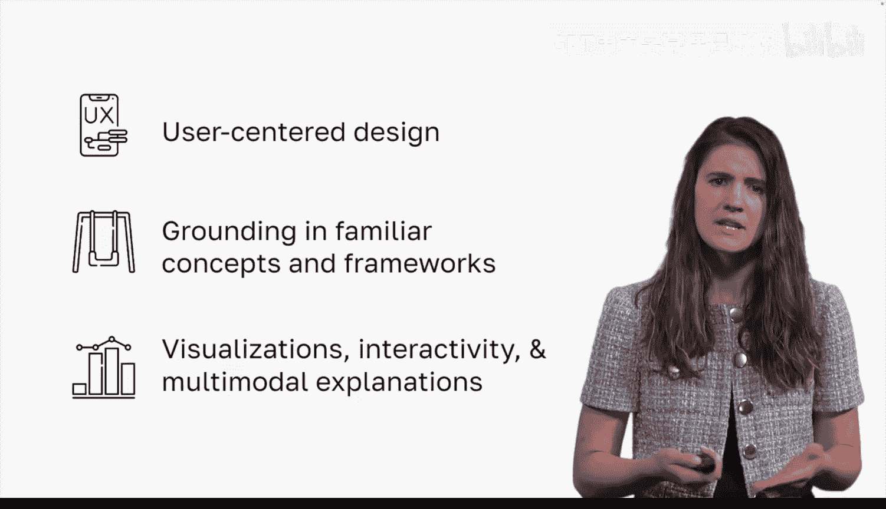
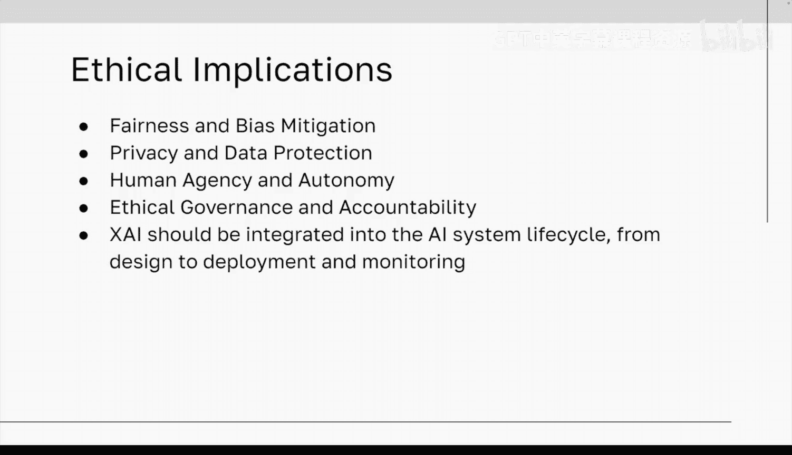

# 杜克大学《可解释人工智能｜Explainable AI (XAI)》中英字幕 p15 15_02_07_新兴趋势、开放挑战与考量.zh_en -BV1HnrBBmEon_p15-

Yeah。

The field of explainable AI is rapidly evolving with several emerging trends in research directions。

 Multimodal and multimedia X AI aims to develop techniques for interpreting AI systems that process multiple data modalities like images。

 text and audio together。 This has applications in areas like multimedia content analysis in human robot interaction。

 explainplainable reinforcement learning and decision making focuses on enhancing the transparency of sequential decision making policies and strategies learned by reinforcement learning agents operating in complex environments。

😊，As AI becomes more decentralized with federated learning and on device models。

 explainable federated and decentralized AI explores privacy preserving explanations without sharing full model details。

There is growing interest in integrating XAI with other AI paradigms like causal AI to provide robust counterfactual explanations or neuroymbolic AI to extract explicit symbolic rules augmenting neural explanations。

While technical solutions for explainable AI continue to advance。

 there are significant sociotechnical hurdles that must be addressed for the effective adoption and use of these technologies in practice。

 Fostering public trust and acceptance is crucial。 A lack of understanding and familiarity with AI can breed distrust and skepticism towards opaque black box model decisions that seem inexplicable。

 X AI has a vital role to play here in demystifying these systems and making their reasoning。

 transparent and inable。 However， generating explanations that are simple and comprehensible enough to truly build trust while still being accurate and faithful representations is an immense challenge。

 Real world case studies showcasing the tangible benefits of X AI for high stakes。

 consequential decisions can help increase public confidence。

Even when explanations are provided through XAI， humans are still susceptible to cognitive biases that can significantly impact how these explanations are interpreted and acted upon。

 as we discussed earlier in this module。Confirmation bias may cause people to favor or fixate on explanations that align with their pre existinging beliefs or hypotheses。

 while discounting contradictory evidence。 The illusion of explanatory depth。

 where people overestimate their true depth of understanding from shallow explanations can also lead to overconfid and comprehending the full complexity behind an AI system's reasoning。

Limitations in statistical literacy and ability to reason with uncertainty can distort how probabilistic explanations involving confidence scores or error estimates are perceived。

XAI systems must be designed to carefully account for and mitigate the effects of these inherent human biases and cognitive limitations。

Developing truly user centered and intuitive interfaces for communicating explanations from AI systems is paramount。

 These explanatory interfaces need to be adapted to the target users's background knowledge。

 needs and areas of domain expertise。A user centered design process。

 engaging diverse stakeholders like subject matter experts， impacted communities。

 and non technical end users is critical。Visualizations。

 interactivity and multimodal explanation techniques beyond just text can significantly enhance human interpretability。

 but accessibility considerations like language requirements。

 disabilities and varying digital literacy levels across users must also be incorporated。

Iterative cycles of refinement driven by continuous user feedback and real world field studies will be essential for creating usable。

 trusted， and widely adopted XI tools and interfaces。Fundamentally。

 there remains a gap between the mathematical formalisms and abstractions leveraged in the technical methods for X AI and how humans intuitively perceive。

 reason about and internalize explanations。 current X AI approaches often produce instance based explanations or highlight feature importances。

 which do not naturally translate into the higher level of rationales that make sense to humans。

Rounding explanations and familiar analogies， concepts and causal frameworks that align with how people construct mental models can go a long way in bridging this divide。

 integratingeg these human mental models， prior knowledge and intuitive representations directly into X AI pipelines is an emerging research direction。

 In some contexts， having knowledgeable human mediators to communicate and translate the technical explanations may aid in interpretability。

By thoughtfully addressing these sociotechical factors in tandem with advancing the mathematical and computational foundations of explainable AI。

 we can fully utilize XAI as an enabler of trustworthy。

 human centered artificial intelligence systems。

As AI systems become increasingly embedded into critical decision making processes that impact human lives。

 the ethical implications of XAI are paramount。 One of the key benefits of XAI is its potential to identify and mitigate biases in AI models by exposing the factors that influence in AI systems decisions。

 X AI can help uncover and address biases that may stem from historical data or algorithmic flaws。

 This can promote fairness and non-discrimination。 ensuring that AI driven decisions are not unjustly skewed against certain groups or individuals。

While transparency is crucial， we must also consider the privacy implications of providing explanations。

 particularly when sensitive personal data is involved。

There is a delicate balance to be struck between maintaining individuals privacy and providing meaningful explanations。

 Rebu privacy preserving techniques and guidelines for responsible disclosure of explanations are essential to ensure that personal information is not compromised in the pursuit of transparency。

As we increasingly rely on AI systems to aid decision making。

 there is a risk of over reliance on their explanations。

 potentially diminishing human agency and autonomy。

 It is crucial to ensure that individuals understand and critically evaluate the explanations provided by X AI systems rather than blindly accepting them。

Explainable AI can play a pivotal role in promoting accountability and responsibility for AI driven decisions by providing clear and interpretable explanations。

 XAI can help identify and attribute responsibility for errors or harmful outcomes。 however。

 this also necessitates the development of ethical guidelines。

 regulatory frameworks and auditing mechanisms to ensure the responsible development and deployment of explainable AI systems。

XAI should be treated as an integral part of the full AI system lifecycle from design to deployment and monitoring explanations need to be continuously reevaluated and updated as models evolve to maintain faithfulness。

Documentation and model cards capturing intended use。

 known limitations and uncertainty estimates are recommended。

The path towards trustworthy and responsible AI lies in our ability to balance transparency。

 fairness， privacy and human agency。 The ethical implications of XAI must be carefully considered and addressed and incorporating feedback from affected stakeholders。

 domain experts and ethicists into XAI processes is necessary。

To drive progress in X AI， developing robust evaluation frameworks and benchmarks is essential。

 we need standardized evaluation criteria， metrics and benchmarks that holistically assess X AI techniques across dimensions like accuracy。

 fidelity， consistency and human interpretability。While computational metrics for faithfulness exist。

 approaches like human user studies and trials to assess subjective interpretability of explanations must also be adopted。

A key bottleneck is the lack of high quality， standardized X AI data sets。

 spanning different domains， tasks and modalities to facilitate reproducible evaluations and fair comparisons。

 Alternative evaluation paradigms like interactive X AI。

 where the explanation is optimized based on user feedback may better capture usability and effectiveness of explanations。

😊。

