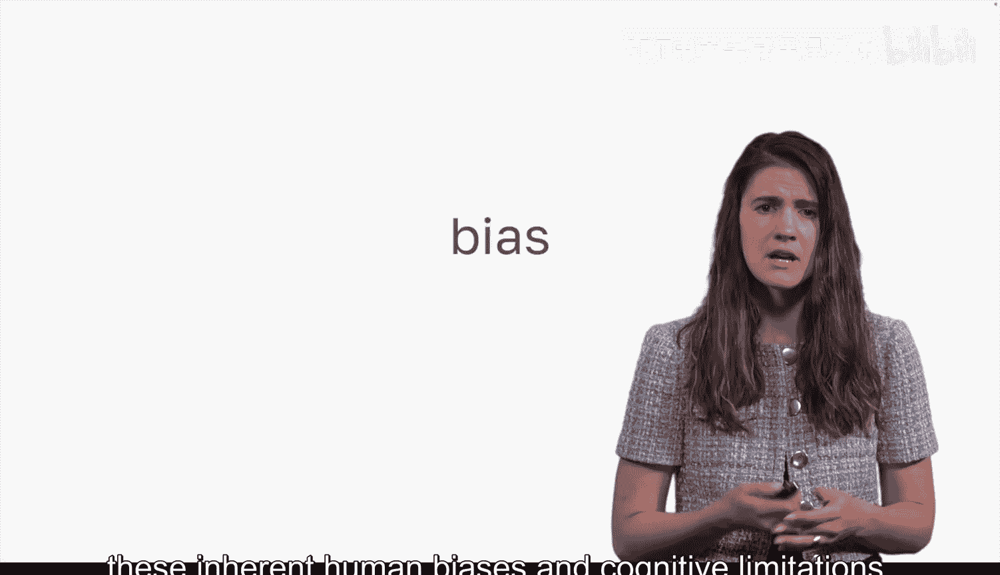
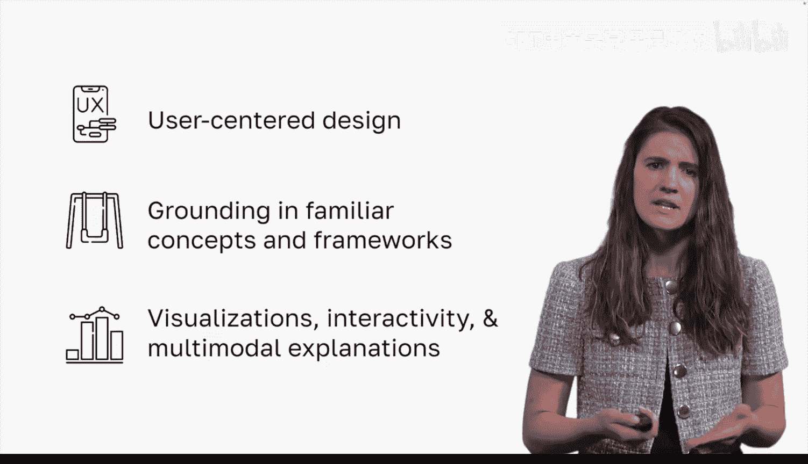
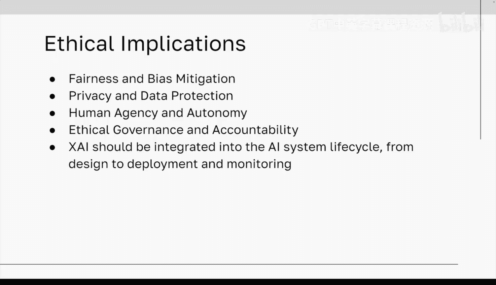

# 可解释人工智能 (XAI)：15：新兴趋势、开放挑战与考量

在本节课中，我们将探讨可解释人工智能领域的新兴研究方向，并深入分析其在技术、社会、伦理和评估方面所面临的开放挑战与重要考量。理解这些趋势和挑战对于负责任地开发和应用XAI技术至关重要。

## 🚀 新兴研究方向

上一节我们介绍了XAI的基本概念，本节中我们来看看该领域正在快速发展的几个前沿方向。

以下是当前XAI研究的几个关键趋势：

*   **多模态与多媒体XAI**：旨在开发解释能够同时处理多种数据模态（如图像、文本和音频）的AI系统的技术。其应用领域包括多媒体内容分析和人机交互。
*   **可解释的强化学习与决策**：专注于增强在复杂环境中运行的强化学习智能体所习得的序列决策策略和策略的透明度。
*   **可解释的联邦与去中心化AI**：随着联邦学习和设备端模型使AI变得更加去中心化，该方向探索在不共享完整模型细节的情况下提供隐私保护的解释方法。
*   **XAI与其他AI范式的融合**：将XAI与因果AI结合以提供鲁棒的反事实解释，或与神经符号AI结合以提取明确的符号规则来增强神经解释，正受到越来越多的关注。

## 🧠 社会技术挑战

尽管XAI的技术解决方案在不断进步，但在实践中有效采用和使用这些技术仍面临重大的社会技术障碍。

### 建立公众信任

培养公众的信任和接受度至关重要。对AI缺乏了解和熟悉会滋生对不透明的“黑箱”模型决策的不信任和怀疑。XAI在揭开这些系统的神秘面纱、使其推理过程透明易懂方面扮演着重要角色。然而，生成既简单易懂以真正建立信任，又准确忠实地反映模型行为的解释，是一个巨大的挑战。展示XAI在高风险、关键决策中带来切实益处的真实案例研究有助于增强公众信心。

### 认知偏差的影响

即使通过XAI提供了解释，人类仍然容易受到认知偏差的影响，这会显著影响解释被理解和采取行动的方式。确认偏差可能导致人们偏爱或固守那些符合其既有信念的解释，而忽视矛盾的证据。解释深度错觉，即人们从浅显的解释中高估了自己的真实理解深度，也可能导致过度自信，并妨碍理解AI系统推理背后的全部复杂性。统计素养的不足和处理不确定性的能力有限，会扭曲人们对涉及置信度分数或误差估计的概率性解释的感知。XAI系统的设计必须仔细考虑并减轻这些固有人类偏见和认知局限的影响。

### 设计以用户为中心的解释界面

开发真正以用户为中心、直观的界面来传达AI系统的解释至关重要。这些解释界面需要适应目标用户的背景知识、需求和专业领域。一个包含领域专家、受影响社区和非技术终端用户等不同利益相关者的用户中心设计过程至关重要。超越纯文本的可视化、交互性和多模态解释技术可以显著增强人类可解释性，但也必须考虑语言要求、残障人士需求以及用户间数字素养水平差异等可访问性因素。由持续的用户反馈和真实世界实地研究驱动的迭代改进周期，对于创建可用、可信且被广泛采用的XAI工具和界面至关重要。

### 弥合技术与人类理解的鸿沟

从根本上说，XAI技术方法中利用的数学形式化与抽象，与人类直观感知、推理和内化解释的方式之间仍然存在差距。当前的XAI方法通常产生基于实例的解释或突出特征重要性，这些并不能自然地转化为对人类有意义的高层逻辑。将解释与人们构建心智模型的方式相一致、使用熟悉的类比、概念和因果框架结合起来，对于弥合这一鸿沟大有裨益。将人类心智模型、先验知识和直观表征直接整合到XAI流程中是一个新兴的研究方向。在某些情境下，由知识渊博的人类中介来沟通和翻译技术解释可能有助于提高可解释性。

通过深思熟虑地应对这些社会技术因素，同时推进可解释AI的数学和计算基础，我们可以充分发挥XAI作为可信赖、以人为本的人工智能系统赋能者的作用。

## ⚖️ 伦理考量

随着AI系统日益嵌入影响人类生活的关键决策过程，XAI的伦理影响至关重要。

### 公平性与偏见缓解

XAI的关键益处之一是其通过揭示影响AI系统决策的因素来识别和缓解AI模型中偏见的潜力。XAI有助于发现和解决可能源于历史数据或算法缺陷的偏见。这可以促进公平和非歧视，确保AI驱动的决策不会不公正地偏向某些群体或个人。

### 隐私与透明度平衡

虽然透明度至关重要，但我们也必须考虑提供解释所带来的隐私影响，尤其是在涉及敏感个人数据时。在维护个人隐私和提供有意义的解释之间需要取得微妙的平衡。开发隐私保护技术和负责任的解释披露指南对于确保在追求透明度的过程中不泄露个人信息至关重要。

### 人类能动性与责任归属

随着我们越来越依赖AI系统辅助决策，存在过度依赖其解释的风险，这可能会削弱人类的能动性和自主权。确保个人理解并批判性地评估XAI系统提供的解释，而不是盲目接受，这一点至关重要。通过提供清晰可解释的解释，XAI可以在促进对AI驱动决策的问责和责任归属方面发挥关键作用。XAI有助于识别错误或有害结果的责任归属。然而，这也需要制定伦理准则、监管框架和审计机制，以确保可解释AI系统的负责任开发和部署。

### 全生命周期整合

XAI应被视为从设计到部署和监控的完整AI系统生命周期中不可或缺的一部分。随着模型的演进，需要持续重新评估和更新解释以保持忠实性。建议使用记录预期用途、已知局限性和不确定性估计的文档和模型卡片。通往可信赖和负责任AI的道路在于我们平衡透明度、公平性、隐私和人类能动性的能力。必须仔细考虑和解决XAI的伦理影响，并将受影响利益相关者、领域专家和伦理学家的反馈纳入XAI流程是必要的。

## 📊 评估框架与基准

为了推动XAI的进步，开发稳健的评估框架和基准至关重要。

我们需要标准化的评估标准、指标和基准，从准确性、忠实性、一致性和人类可解释性等多个维度全面评估XAI技术。虽然存在用于评估忠实性的计算指标，但也必须采用人类用户研究和试验等方法来评估解释的主观可解释性。一个关键瓶颈是缺乏跨越不同领域、任务和模态的高质量、标准化XAI数据集，以促进可重复的评估和公平的比较。像交互式XAI这样的替代评估范式，即根据用户反馈优化解释，可能更好地捕捉解释的可用性和有效性。

## 🎯 总结

本节课中我们一起学习了可解释人工智能领域的新兴趋势，包括多模态XAI和可解释强化学习等方向。我们深入探讨了在建立公众信任、克服认知偏差、设计用户界面以及弥合人机理解鸿沟方面面临的社会技术挑战。同时，我们也分析了XAI在促进公平、平衡隐私与透明度、维护人类能动性以及明确责任归属等方面的关键伦理考量。最后，我们认识到建立全面的评估框架和基准对于推动该领域发展的重要性。理解这些趋势和挑战是构建真正可信赖、负责任且以人为本的人工智能系统的关键一步。