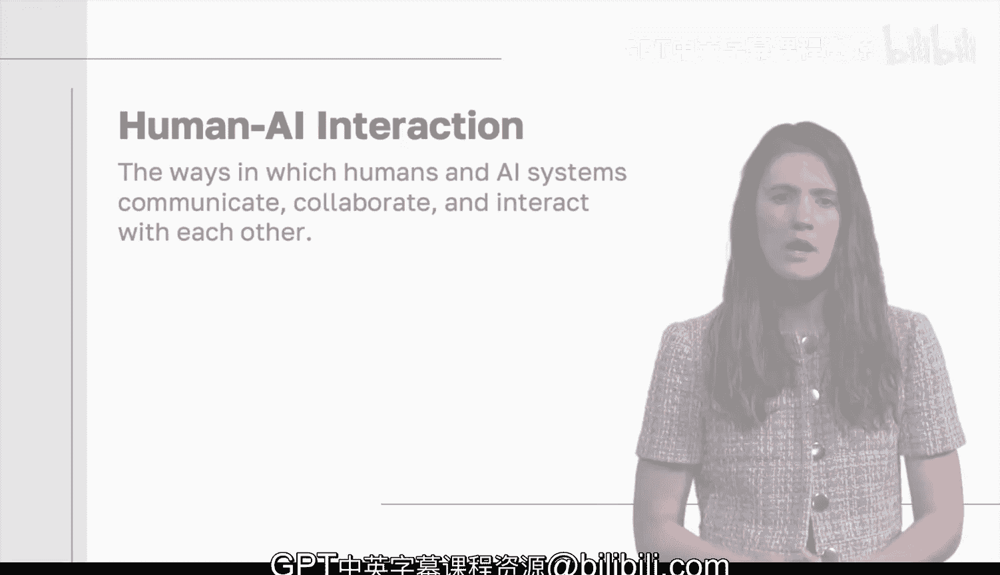
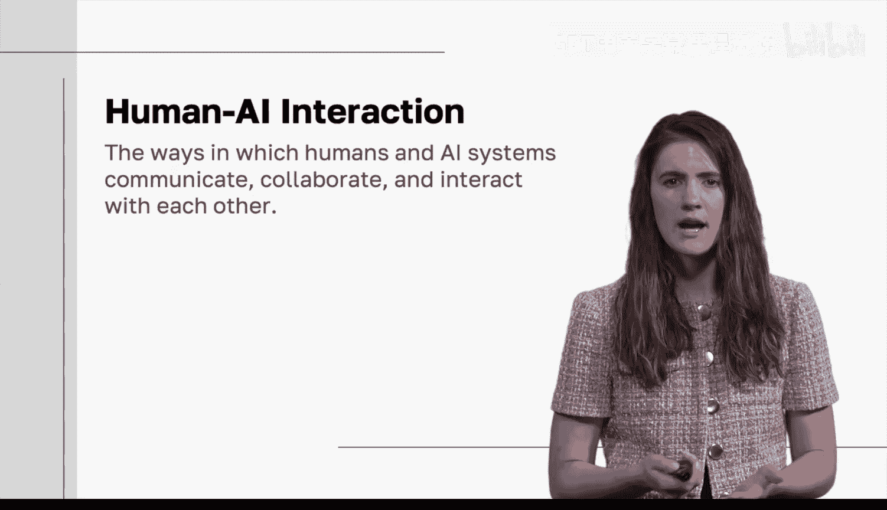
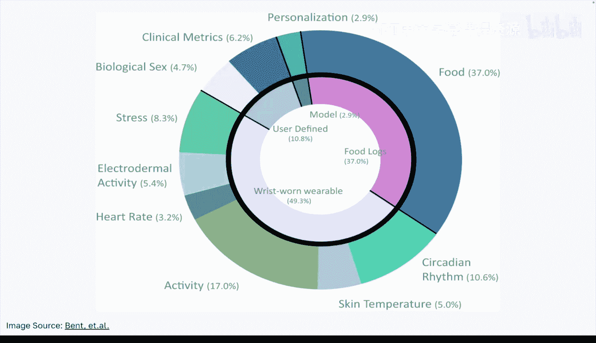
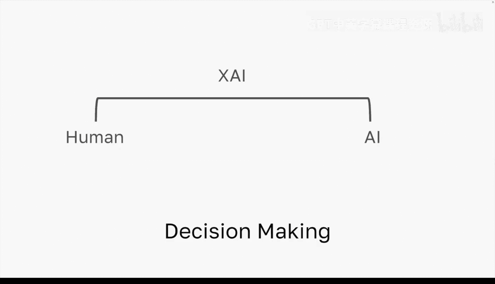
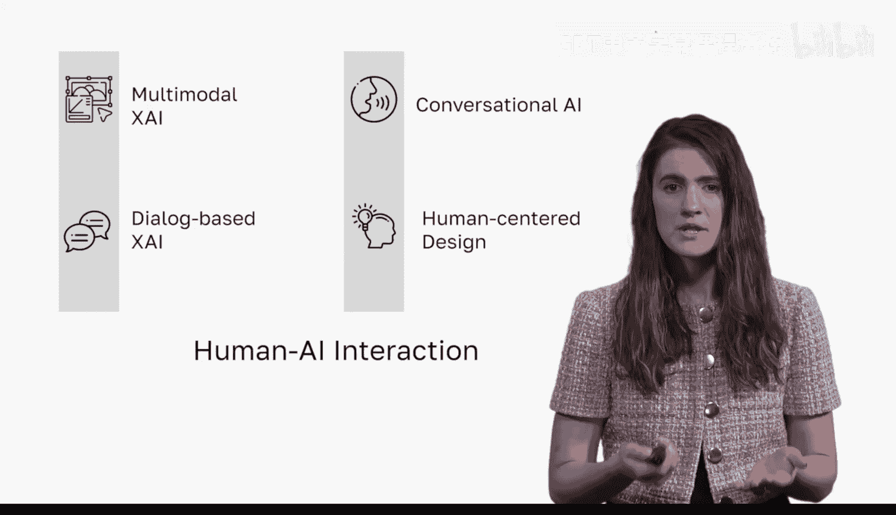
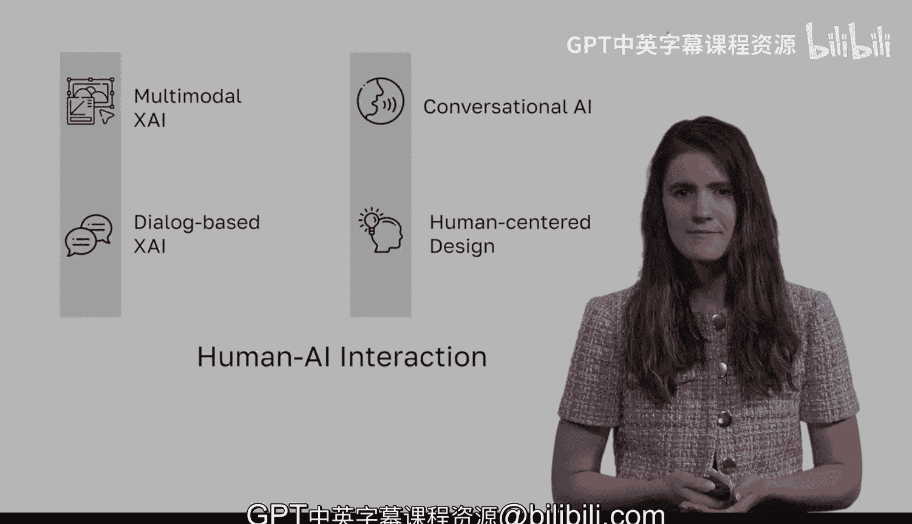

# 杜克大学《可解释人工智能｜Explainable AI (XAI)》中英字幕 p16 16_03_01_人机交互.zh_en -BV1HnrBBmEon_p16-

Human AI interaction refers to the ways in which humans and AI systems communicate。

 Collaborate and interact with each other。 It encompasses the design principles。

 interface modalities and techniques that enable effective exchanges between humans and AI systems。

 Let's consider some ways in which humans and AI can interact。

In medical diagnosis and treatment planning， AI systems can assist doctors by analyzing patient data and providing diagnostic recommendations。

 XAI techniques like feature importance， visualization can highlight the key factors that influenced the AI's diagnosis。

 allowing doctors to understand and validate the reasoning。

 and doctors can collaborate with the AI by providing additional context or domain knowledge。

 and the AI can update its recommendations accordingly。

In financial decision making， AI models developed with large amounts of financial data could assist financial advisors by providing recommendations or risk assessments。

 X AI methods like local interpretable model agnostic explanations or Lyme can explain the AI's decisions by highlighting the most influential features for a specific prediction。

 Financial advisors can then use these explanations to understand the AI's reasoning。

 combining with their own expertise and make more informed decisions in collaboration with the AI。😊。

Another high risk domain that we have previously discussed is in loan applications。

 AI models that evaluate loan applications or credit worthiness can be used with XAI techniques like rule extraction。

 which can generate human readable rules that capture the AI's decision logic。

 helping loan officers understand and explain the decisions to applicants。

Our last example is in manufacturing maintenance in manufacturing。

 AI systems can analyze sensor data and predict when machines or components are likely to fail。

 allowing for proactive maintenance， XI methods like counterfactual explanations can show how tweaking certain input features could have led to a different prediction。

 helping manufacturing engineers understand the underlying patterns and causal relationships。

 Manuacturing engineers can validate these explanations when making their recommendations。

In all of these examples， XAI methods help bridge the gap between human and AI decision making by providing transparency and interpretability。

 enabling effective collaboration， and ensuring that the AI's decisions are trustworthy， fair。

 and aligned with human values and domain knowledge。

Research in the human AI interaction space is rapidly evolving。

Currentt trends include multimodalx AI or providing explanations through multiple modalities。

 such as natural language， visualizations and interactive interfaces。

 This aims to make explanations more intuitive and accessible to humans。

There is also work being done to create more interactive XAI systems that can engage in a dialogue with users。

Allowing them to ask follow up questions and receive clarifications on the explanations provided。

 here's an example of what this could look like where you can interact with the model and exchange dialogue with it on explanations。

Conversational like AI aims to make the interaction more natural and collaborative。

 One component of this is effective computing， which involves developing AI systems that can recognize。

 interpret， and respond to human emotions， social cues and nonverbal behaviors。

 This involves research on emotion recognition， social signal analysis and generating appropriate responses from AI agents。

Another area of research that is integral in human AI interaction and the success of XAI systems in production is human centered AI design。

 or developing methodologies and guidelines for designing AI systems that prioritize human needs。

 values and ethical considerations。 This involves research on human centered design principles。

 user experience or UX evaluation and participatory design approaches。

