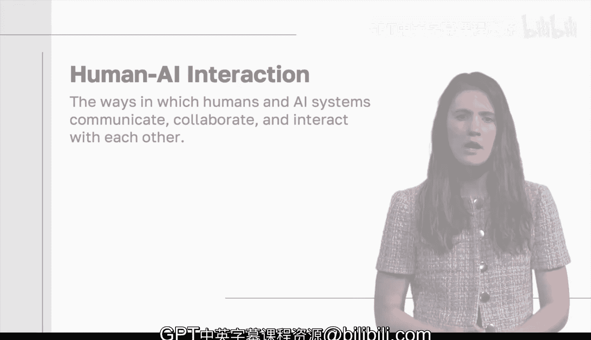
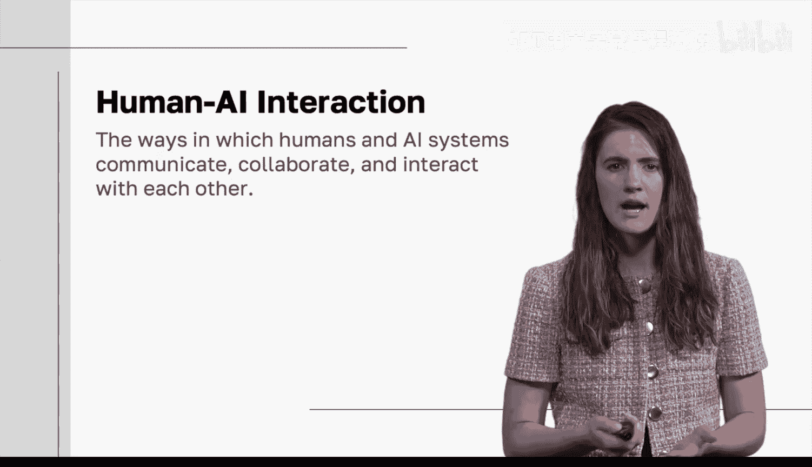
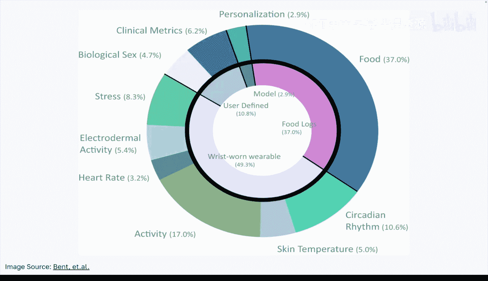
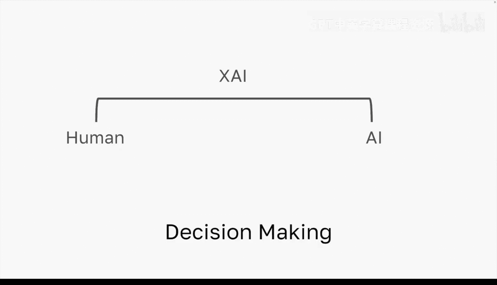
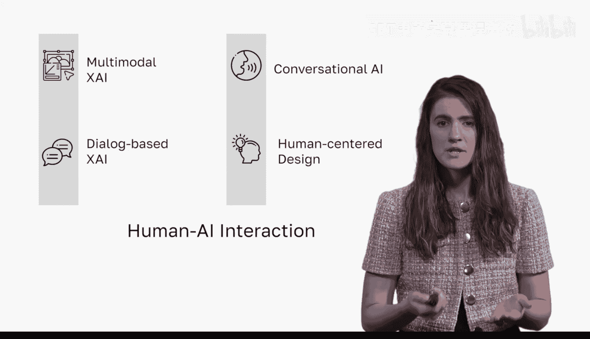
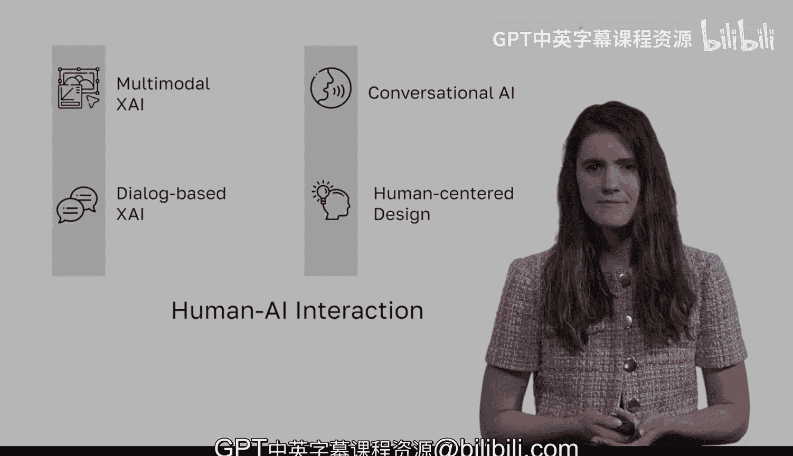

# 可解释人工智能 (XAI)：16：人机交互 🤖

在本节课中，我们将要学习人机交互（Human-AI Interaction）的概念。人机交互指的是人类与人工智能系统之间进行沟通、协作和互动的方式。它涵盖了设计原则、界面模式和技术，旨在实现人类与AI系统之间的有效交流。

上一节我们介绍了可解释人工智能的基本概念，本节中我们来看看人类与AI系统是如何具体协作的。

## 人机交互的应用场景

以下是几个关键领域中，人类与AI系统通过XAI技术进行协作的具体方式。

*   **医疗诊断与治疗规划**：AI系统可以分析患者数据并提供诊断建议，辅助医生工作。XAI技术（如特征重要性可视化）可以突出显示影响AI诊断的关键因素，让医生理解并验证其推理过程。医生可以与AI协作，提供额外的背景信息或领域知识，AI则可以据此更新其建议。
*   **金融决策**：基于大量金融数据开发的AI模型可以为金融顾问提供建议或风险评估。XAI方法（如局部可解释模型无关解释，即 **LIME**）可以通过突出显示对特定预测最有影响力的特征来解释AI的决策。金融顾问可以利用这些解释来理解AI的推理，结合自身专业知识，与AI协作做出更明智的决策。
*   **贷款申请**：评估贷款申请或信用度的AI模型可以与XAI技术（如规则提取）结合使用。规则提取可以生成易于人类理解的规则，捕捉AI的决策逻辑，帮助信贷员理解决策并向申请人解释。
*   **制造业维护**：AI系统可以分析传感器数据，预测机器或部件可能发生故障的时间，从而实现主动维护。XAI方法（如反事实解释）可以展示调整某些输入特征如何导致不同的预测结果，帮助制造工程师理解潜在的模式和因果关系。制造工程师在提出建议时可以验证这些解释。

在所有这些例子中，XAI方法通过提供透明度和可解释性，帮助弥合人类与AI决策之间的差距，实现有效协作，并确保AI的决策是可信、公平且符合人类价值观和领域知识的。

## 人机交互的研究趋势

上一节我们看到了XAI在具体场景中的应用，本节中我们来看看该领域当前的研究方向与发展趋势。人机交互领域的研究正在快速发展。

以下是当前的一些主要研究趋势：

*   **多模态可解释人工智能**：旨在通过多种模态（如自然语言、可视化和交互界面）提供解释，使解释对人类而言更直观、更易理解。
*   **交互式XAI系统**：致力于创建更具交互性的XAI系统，使其能够与用户进行对话，允许用户就提供的解释提出后续问题并获得澄清。对话式AI旨在使交互更加自然和协作。
*   **情感计算**：这是交互式AI的重要组成部分，涉及开发能够识别、解释和响应人类情感、社交线索和非语言行为的AI系统。这包括情感识别、社交信号分析以及AI代理生成适当响应的研究。
*   **以人为本的AI设计**：这是人机交互和XAI系统在生产中成功应用不可或缺的研究领域。它涉及开发设计AI系统的方法和指南，优先考虑人类需求、价值观和伦理考量。这包括以人为本的设计原则、用户体验评估和参与式设计方法的研究。

本节课中我们一起学习了人机交互的核心概念，了解了XAI技术如何在医疗、金融、信贷和制造等多个高风险领域促进人类与AI的有效协作。我们还探讨了该领域的前沿研究方向，包括多模态解释、交互式对话系统、情感计算和以人为本的设计。理解这些内容对于构建可信、公平且能与人类专家顺畅协作的AI系统至关重要。