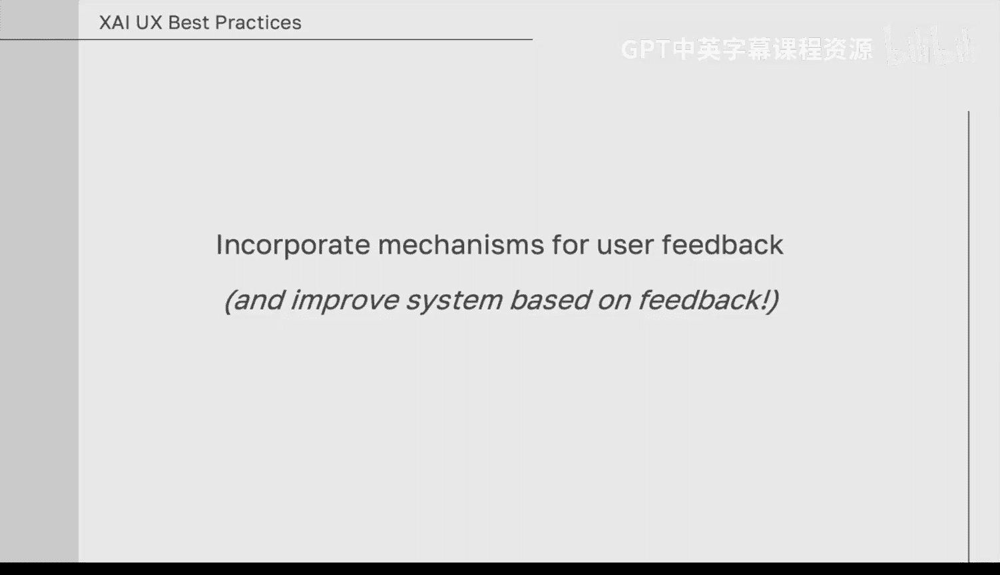

# 杜克大学《可解释人工智能｜Explainable AI (XAI)》中英字幕 p17 17_03_02_用户体验考量与最佳实践.zh_en -BV1HnrBBmEon_p17-

Yeah。

When developing explainable AI or XAI systems， there are several important user experience UX considerations to ensure effective human AI interaction。

First， explanation， modality and representation， the modality and format in which explanations are presented should align with user preferences and cognitive abilities。

 This can involve natural language explanations， visualizations。

 interactive interfaces or a combination of modalities， depending on the desired user experience。

A natural language interface with humans may be more appropriate from a virtual assistant like Alexa or Siri who could explain why they couldn't understand or execute a particular command in natural language。

Alternatively， in a self driving car system， visual saliency maps may be more appropriate。

 as they can be used to highlight the most important regions of an image that influenced their object detection。

 providing visual feedback to the user。The second UX consideration we will discuss is explanation level and granularity。

X AI system should be designed with the end user in mind。

 Novice users may require higher level explanations。

 while experts might prefer more technical and granular explanations。

 If there is to be a variety of experience levels in end users。

 perhaps allow users to adjust the level of detail and granularity of explanations based on their expertise and information needs。

For example， a healthcare AI system may provide high level explanations for patients about a diagnosis。

 while offering more detailed technical explanations for medical professionals。

Or an AI power trading platform may allow financial analysts to adjust the level of detail and explanations for investment recommendations based on their expertise。

When designing the UX for XI systems， ensure that explanations are transparent。

 easily understandable and interpretable by users。They should be free from technical jargon。

Or opaque representations。And should align with human mental models and domain knowledge。

Explanation should be tailored to the specific context and use case。

 providing relevant information that assist users in their decision making or task at hand。

 For example， an AI system for crop yield prediction should provide explanations focused on the most relevant environmental and agricultural factors for the particular region in which it is being used。

XAI interfaces should enable interactive exploration。

 allowing users to probe for additional information。

 ask follow up questions or adjust parameters to better understand the AI's reasoning and decision making process。

 an AI system for legal document analysis， for example。

 should enable users to ask follow up questions to examine the reasoning behind specific clauses or interpretations。

XAI System should help users build appropriate trust in the AI by providing accurate and reliable explanations。

Acknowledging the system's limitations。And enabling human oversight and control when necessary。

 especially true in high risk domains like healthcare。

 AI systems should acknowledge limitations and recommend human expert review when appropriate。

XAI interfaces should seamlessly integrate with users' existing workflows and tools。

 minimizing disruption and cognitive load， an AI powered email prioritization system should be seamlessly integrated into a user's current email client providing explanations for message importance within the familiar interface If it is not a seamless experience。

 most people won't use it。XAI interfaces should be accessible to users with diverse abilities and backgrounds。

Ensuring that explanations are understandable and usable by a wide range of users。 For example。

 AI chatbot should provide explanations in multiple language and use speech or text to speech capabilities for users with visual impairments。

 Another example， an AI system for financial advising should use simple language and visual aids to make explanations more accessible to users with varying levels of financial literacy。

😊，The final UX consideration we will discuss today is user feedback and adaptation XAA system should incorporate mechanisms for users to provide feedback on the quality and usefulness of explanations and adapt or improve explanations based on this feedback。

