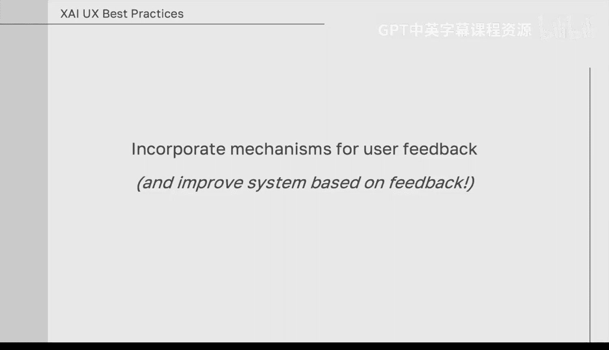

# 可解释人工智能 (XAI)：17：用户体验考量与最佳实践 🎯

在本节课中，我们将学习开发可解释人工智能系统时，需要重点考虑的用户体验因素与最佳实践。这些考量旨在确保人机交互的有效性，让解释真正服务于用户。

---

## 概述

开发可解释人工智能系统时，必须重视用户体验。这涉及多个方面，包括解释的呈现方式、详细程度、透明度、交互性、信任建立、工作流整合、可访问性以及用户反馈机制。接下来，我们将逐一探讨这些关键考量。

---

## 解释的模态与呈现方式

解释的呈现模态和格式应与用户的偏好和认知能力相匹配。这可以包括自然语言解释、可视化图表、交互式界面或多种模态的组合，具体取决于期望的用户体验。

以下是两种常见的模态示例：

*   **自然语言解释**：对于像Alexa或Siri这样的虚拟助手，自然语言界面可能更合适。它们可以用自然语言解释为何无法理解或执行某个特定指令。
*   **视觉显著性图**：在自动驾驶汽车系统中，视觉显著性图可能更合适。它们可以用来高亮显示影响物体检测的图像中最关键的区域，为用户提供视觉反馈。

---

## 解释的层级与粒度

上一节我们讨论了如何呈现解释，本节中我们来看看解释的详细程度应如何设计。

XAI系统的设计应以最终用户为中心。新手用户可能需要更高层次的解释，而专家可能更喜欢更技术性和更细致的解释。如果最终用户群体经验水平不一，或许应允许用户根据其专业知识和信息需求，调整解释的详细程度和粒度。

以下是两个应用场景：

*   **医疗AI系统**：可以为患者提供关于诊断的高层次解释，同时为医疗专业人员提供更详细的技术性解释。
*   **AI驱动的交易平台**：可以允许金融分析师根据其专业知识，调整投资建议解释的详细程度。

---

## 透明度与可理解性

设计XAI系统的用户体验时，应确保解释对用户是透明、易于理解和解释的。解释应避免使用技术术语或不透明的表述，并应与人类的思维模型和领域知识保持一致。

解释应针对特定的上下文和用例进行定制，提供相关信息以协助用户进行决策或完成手头任务。例如，一个用于作物产量预测的AI系统，应提供侧重于其使用特定区域最相关的环境和农业因素的解释。

---

## 交互式探索

XAI界面应支持交互式探索，允许用户探查更多信息、提出后续问题或调整参数，以更好地理解AI的推理和决策过程。

例如，一个用于法律文件分析的AI系统，应使用户能够提出后续问题，以检查特定条款或解释背后的推理。

---

## 信任与可控性

XAI系统应通过提供准确可靠的解释、承认系统局限性以及在必要时允许人工监督和控制，来帮助用户建立对AI的适当信任。

这在医疗等高风险领域尤为重要。AI系统应承认其局限性，并在适当时建议由人类专家进行审查。

---

## 工作流整合

XAI界面应与用户现有的工作流程和工具无缝集成，最大限度地减少干扰和认知负荷。

例如，一个AI驱动的邮件优先级排序系统，应无缝集成到用户当前的电子邮件客户端中，在熟悉的界面内提供关于邮件重要性的解释。如果体验不流畅，大多数人就不会使用它。

---

## 可访问性

XAI界面应可供具有不同能力和背景的用户访问，确保解释能被广泛的用户理解和使用。

以下是两个例子：

*   **AI聊天机器人**：应提供多种语言的解释，并为视障用户使用语音或文本转语音功能。
*   **AI财务顾问系统**：应使用简单的语言和视觉辅助工具，使解释对不同金融知识水平的用户更具可访问性。

---

## 用户反馈与自适应

今天我们将讨论的最后一个用户体验考量是用户反馈与自适应。

XAI系统应包含相应的机制，让用户能够就解释的质量和有用性提供反馈，并基于此反馈调整或改进解释。

---

## 总结

本节课中，我们一起学习了设计可解释人工智能系统时需关注的八大用户体验考量：**解释的模态与呈现方式**、**解释的层级与粒度**、**透明度与可理解性**、**交互式探索**、**信任与可控性**、**工作流整合**、**可访问性**以及**用户反馈与自适应**。将这些原则融入设计，是构建真正有用、可信且用户友好的AI系统的关键。