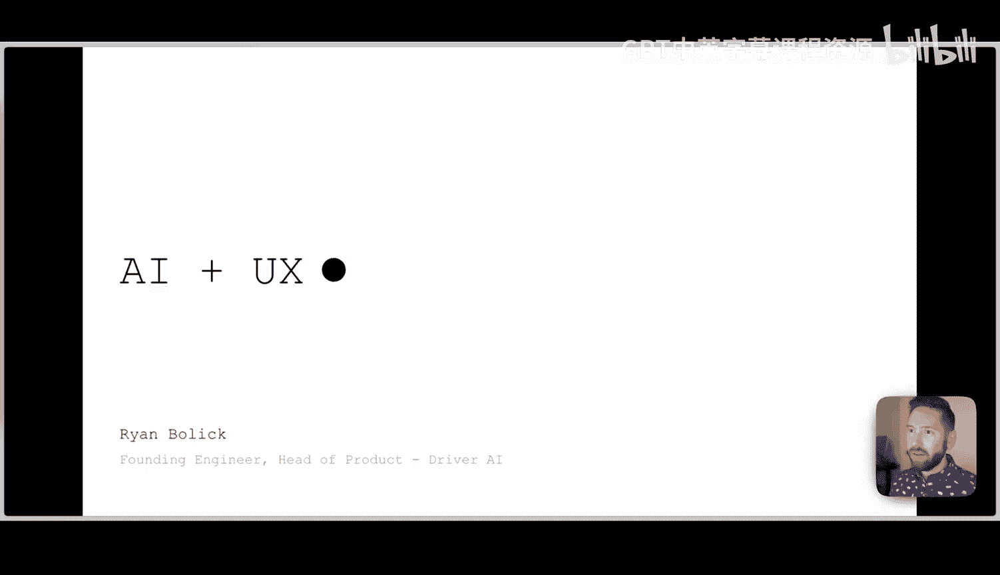
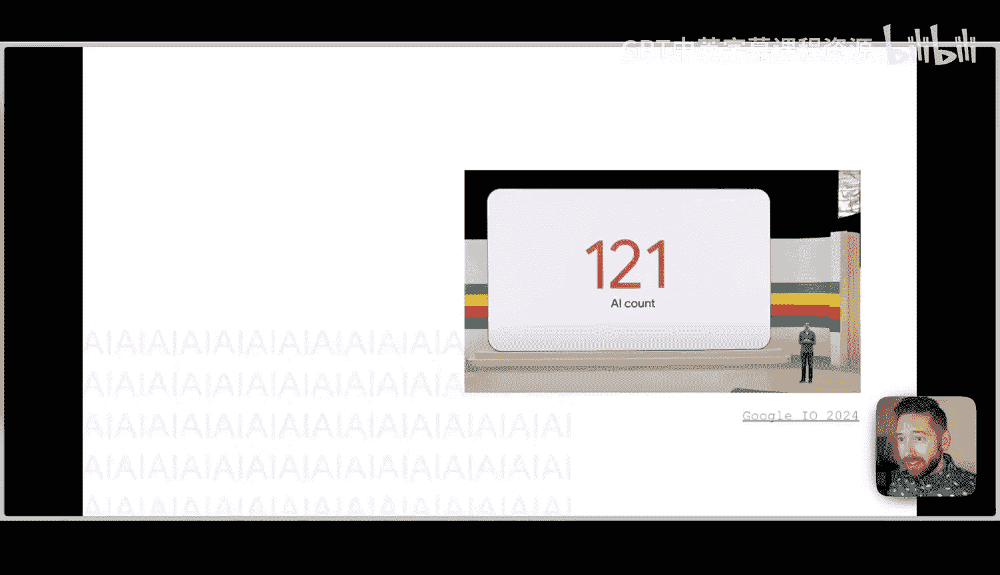
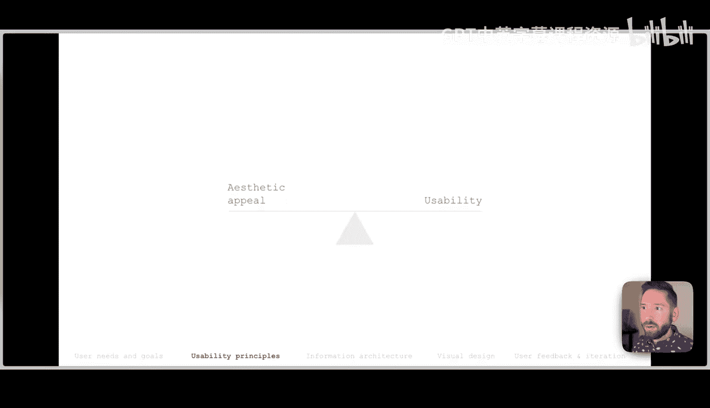
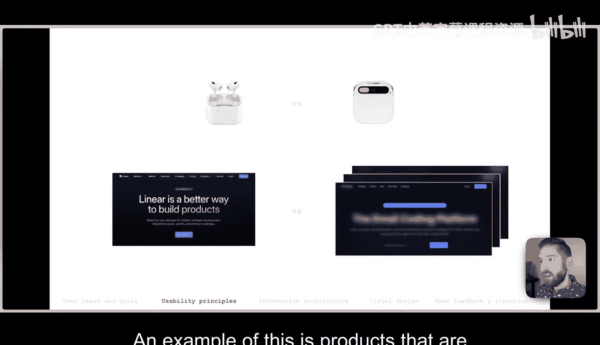
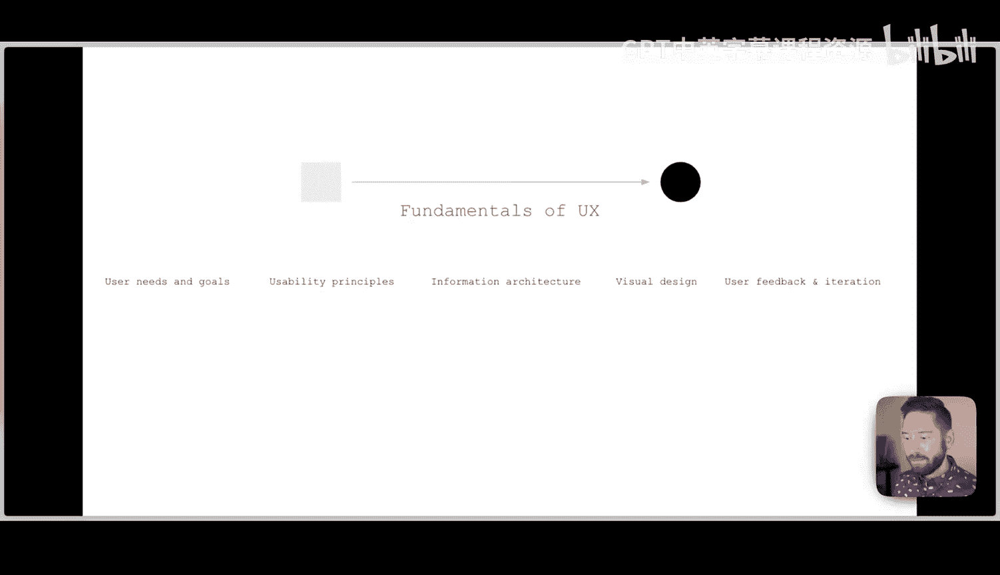

# 杜克大学《可解释人工智能｜Explainable AI (XAI)》中英字幕 p18 18_03_03_客座讲座：AI用户体验——Driver产品负责人Ryan Bolick.zh_en -BV1HnrBBmEon_p18-

In today's rapidly evolving tech landscape， a crucial question emerges。

 Can user experience be the key to unlocking the full potential of AI tools and making your products stand out。

😊，I'm Ryan Bullock， founding engineer and head of product at Drive AI With a background in engineering and industrial design。

 I've been at the forefront of designing software and AI products for over five years。In this video。

 we'll explore how to apply user centric design principles to give your AI based product a competitive edge。

AI is the new buzzword。It seems everyone is marketing their products around AI。

Google said it a number of times in just a short presentation at IO。

Generative technology and the tools to use it are extremely accessible。

 meaning more people than ever can build and deploy apps。 This is great。😊，However。

 it is hard to differentiate。And even harder to solve real problems for real people。

So how do we get here？To a differentiated product。With the user experience。

 commonly referred to as UX。We'll go over the fundamentals and how you can apply UX principles to the projects and products that you work on。

This is going to be centered around digital experiences。But can really apply to anything。

The first step when designing is to identify a problem or need。

This means understanding your potential users， specifically their problems， needs， and goals。

To get started， you need to do research。Go into this with an open mind， be cognizant of your biases。

 and let the conclusions guide you。Empathy is critical here。

There are several user research methods such as surveys， interviews， primary source research。

 and studying market trends。One of the most effective methods I've found is a ride along or field study。

This involves observing users in their natural environment。

 either passively or actively asking questions。It puts the user in a more relaxed and natural state。

 leading to more genuine insights。For example， with interviews， people tend to say the quote。

 correctrect answer as opposed to their real one。I've done this many times by asking people to screen record themselves using a product with the option to narrate。

This can be done with anywhere from three to 10 people to get actionable results。

I might follow up with a few of them for a live session where ask questions while they use the product。

Let's look at this in context of something many people have tried at least a few times in the last year。

A chatbot application。I would conduct a ride along for a chatbot by giving the participant a task that is relevant to them。

 such as gathering information for a journal paper。

Taking notes and recording the session leads to insights about what is working well and what could improve。

Pay attention to not just what they say， but what they do。In my experience。

 body language tells a huge percentage of the story。

Your notes will boil down to what the true user needs are。

The problems that you can help solve through design。

To ensure that user needs remain a priority throughout the design process， I employ user personas。

These are fictional or real characters that represent different types of users identified during research。

They help the whole team understand who we are designing for。

 allowing for more user centric product development。

It's typical for them to center around your product or sorry， your target audience。

And let's for this example， target students at Duke University。

Often the insights apply to more than just that target group。

 but it helps to stay focused and moving forward， especially in the early stages。

Stick to the facts and stay grounded in characteristics or trends related to what you're working on。

For example， a particular persona should not be about their demographics。

 but instead what they're trying to accomplish， the problems they encounter and their motivations。

It's important to reference these throughout the product development cycle。

 even at the end when you think you're done。I typically keep my personas page near the top of my FIigA document。

The personas boil down to the user needs。These encompass the common problems and goals and highlight what's important to design for。

Think of these like engineering requirements， we need to do X so Y can happen。

To address these needs effectively， it's crucial to understand usability principles。

Designing with real people in mind ensures that your product meets their expectations。

Innovation should leverage familiar frameworks and interaction patterns that users are comfortable with。

By focusing on ease of use， you can enhance user adoption and satisfaction。

 making your product more successful。You want to ensure that your product follows key usability principles。

 consistency， familiarity， feedback， and control。Ensuring that interfaces are predictable and familiar helps users navigate with ease。

Think about the products that you use every day。What is similar between them。

 do common patterns emerge， even if the interface or UI looks a little different？

Take these insights into what you build。Providing clear。

 immediate feedback reinforces user confidence。Think about error messages while writing code。

 the more verbose they are， the easier it is to use that language。

The same goes for users trying to accomplish something in your app。

Don't be afraid to add explanations， tips and tricks， or pointers。

 even if it means adding more text to the page。Giving users control。

 such as the ability to customize a theme or achieve something in more than one way makes them feel a part of the product and can result in stronger emotional connection。

These principles help ensure that your designs are intuitive and easy to use for a diverse range of users。

To validate you are using them effectively， don't be afraid to show your ideas to others early and often。

Their initial reactions and feedback are critical to know if you're on the right path。

You can also do this yourself， but I find it less reliable。

A way around that is to put the project down for a little while。

 then come back to it and try to use what you just made without thinking about it too hard。

Was it intuitive or not？Coming back to the chat application。

 it looks like there are ways we can improve consistency， familiarity， feedback， and control。

So some feedback。Changing model types gives them different results。

 and it's difficult to pinpoint why。There is no control with how to view or search through past chats leading to redundant research。

Proms are not familiar and it's an interaction pattern that they're not quite used to。

 so where do you do and start？Suggestive prompts are almost never relevant and they lack feedback from previous use。

The takeaways begin to surface now as a new or updated user interface。

This is where you really start to get into the design of what you're building。Often。

 a point of contention arises， aesthetic appeal versus usability。

There's no one size fits all solution here。But I recommend focusing on usability first。

 then aesthetics。

There are many products and websites that try to copy the aesthetics of others。

An example of this is products that are inspired by Apple's design language or a linear marketing site。

Before trying to create something that looks beautiful。

 it's essential to validate usability through low fidelity and medium fidelity wireframes。

Low fidelity wireframes are created with sketches on paper or basic digital tools。

They help visualize the basic structure and lay out quickly and cost effectively。

They focus on content， placement， navigation flow， and overall layout。

 allowing for rapid iteration and feedback。Once the basic structure is validated。

 medium fidelity wireframes add more detail and refinement。

 these wireframes focus on detailed layouts， refine navigation and basic interactions。

Enabling enhanced usability testing and some more precise feedback。

By using low fidelity and medium fidelity wireframes。

 you can identify and resolve usability issues early。

 ensuring that your design is user centric and solves the problems encompassed in your personas and user needs。

An integral part of this process is establishing a solid information architecture。

Information architecture involves organizing and structuring content logically and intuitively。

 ensuring users can easily find the information they need。

Effective implementation enhances the overall user experience by creating a clear and coherent structure that guides users through the application or website seamlessly。

It's one of the biggest things that will keep users coming back。As you refine your wireframes。

 pay close attention to how information is categorized and presented to support user tasks and goals efficiently。

For complex interfaces， I prioritize clarity and simplicity。

Breaking down information into manageable chunks and using progressive disclosure techniques allows users to find what they need without feeling overwhelmed。

Consistent labeling and intuitive navigation paths are critical。

As is ensuring that the most important information is readily accessible。Tools like FGma， Figjam。

 Miro， and Lucci chartt can help stakeholders visualize the architecture。

This typically manifests as a diagram that explains user journeys that accomplish specific tasks based on user needs。

Don't be afraid to use something like Google Slides， too。

 A lot of quality communication can be done with it。I made this information， architecture， diagram。

 and FIig jamm to convey a possible flow update for our new app。For a chatbot application。

Now that we have thought about who the users are， patterns of use that would alleviate their problems and how we might organize the app。

 we're ready to start a visual design。Starting from our basic chat application。

 we can combine our user needs and information architecture diagram into a lobe to a medium fidelity Moco。

I do this in a few ways， drawing out a piece of paper。

 using a slide tool like Google Slidelis or a Figma without its deep future set。

Try not to worry about quality here， the goal is to get your thoughts documented。

It can be intimidating to try to mock up the entire application。

 so I let myself stay focused by working on smaller chunks at the time。

Here's a good example of where I'm just focusing on。

The intro to the writing experience for our new app。

 and I'm not worried about the larger layout or secondary flows。

I found that it's valuable to write down the quote" badd ideas。

 they get  cleared from your mental bandwidth and serve as a comparison to why certain designs might work more effectively。

Start getting feedback from your most trusted stakeholders at this point。

You're going to want to try to make several iterations to test out your thoughts and ideas。

Once you have a more solid insight and direction for your mockups。

 it's time to lean into the visuals and aesthetics。

There time there are some basic principles that guide visual design。

I use all of these when trying to build an interface。This looks like a lot。

 and when you get into all the details， it's a very interesting world。However。

 you come across these every day， so the first step is to recognize what they are so you can use them to your advantage。

A few key ones are color。Use color strategically to convey meaning。

 influence mood and create visual heart in your interface。 This can vary by region。

Another one is contrast， employee contrast to enhance readability and ensure that key elements stand out。

 making the interface more accessible。Hierarchy， establish visual hierarchy to guide users through content seamlessly。

Prioritizing important information and actions。Tyography。

 choose typography that balances readability with aesthetic peel， keep font sizes large。

 and use one to three font sizes per section。And lastly， negative space。

Utilize negative space effectively to create a clean。

 breathable layout that improves readability and user experience。This one is so important。

 Don't feel intimidated to create a design that doesn't cover the whole page。

 doesn't have to be dense。As you build an interface， you have two main options。

 start from scratch or use an existing library。If you work for a company with a brand language。

 that decision is simpler as they will likely have something to launch from。However。

 you need to ensure that your new designs align to the existing branding。

Study the way that they use those principles of design and try to mimic them。Typically。

 I would recommend you start from a UI library， it keeps you from sweating the smallest of details to help you stay focused。

These have a huge range， but there are many high quality open source ones。

They give you the building box to create interfaces。 Think buttons， inputs， lists， dialogues。

 and more。I've been using Tawind UI in my recent designs， and I also recommend Chadsen， material UI。

 Next UI and Radix。When designing your high fidelity prototype and building your project。

 it's crucial to prioritize accessibility。This ensures inclusivity for all users。

 regardless of their abilities and frankly， makes a better design overall。

This involves creating scalable fonts， high contrast colors。

 and enabling keyboard navigation to make your interface perceivable and operable。

Incorporating all text for images， maintaining readable text with sufficient contrast and size。

 and designing with keyboard only navigation in mind。Additionally。

 use clear and simple language and provide understandable instructions and feedback。

Reference web standards such as WCAG for more details。

This high fidelity mockup uses repetition so users know what the tabs at the top do。

 keeps color contrast for text above recommended levels and implements hierarchy to guide users。

Through specific actions。Along the way， you're going to need to use user feedback to inform iteration cycles。

I typically get feedback by putting my designs in front of anyone that will let me。

This spans from sheets of paper on a table to a fully fleshed figma prototype that feels like a live app。

It's important to document how users react to your designs。

Those first impressions and questions that come across as comments are just so valuable。

I like to make specific notes on what needs to change on the next iteration。As you make iterations。

 especially on a tool like Figma， do not delete your old designs。If you want to work off them。

 just copy and paste them and start working from the duplicate I can't emphasize enough how important it is to have a log of your past designs。

You never know when you did to circle back to something you did a few weeks ago。

Don't rely on virgin histories， they're hard to navigate anyway。

Iterating is tough because it means evolving to something new and ideally improved。

It's important to let feedback inform you so that you don't hold your own design sacred。

Designs are like code， you might have thought it was amazing while writing that function。

 but a year later it looks like it could use some love。

Letting your bias fall to the wayside will help you build towards something really great。

Sometimes you begin designing a product or feature in one way。

 and user feedback takes you in an entirely different direction。In the star up world。

 I experience this frequently。 We fearlessly release our ideas so we know what is working and what needs to be abandoned or improved。

Driver AI is the new way to write technical documentation。

But you wouldn't know that based on our current marketing site。

This is because we released a small experiment that lets users guide our LLM to write documents with your code base as a source。

We expected it to be a minor feature。Didn't realize how big of an impact this would make for our existing users。

It's led to our current major efforts， which is to redesign the entire application around this concept。

I would not have predicted this when we first pitched the idea。

 but now it's shaping our future and help secure our latest funding around。

So get your ideas out there， you never know。Let's come back to the chatbot application。

Do you think you have the tools now to redesign it yourself？

Here's a version of what I envision a design could look like。 It uses familiar patterns。

 accessible design while innovating by helping people leverage new technology to do new things。

Certainly， there is more work and iteration to be had。

 We can always find more users to interview and test to run。😊。

Your project is either incomplete or obsolete。But UX will help you make it just a little better every day。

Thank you。

