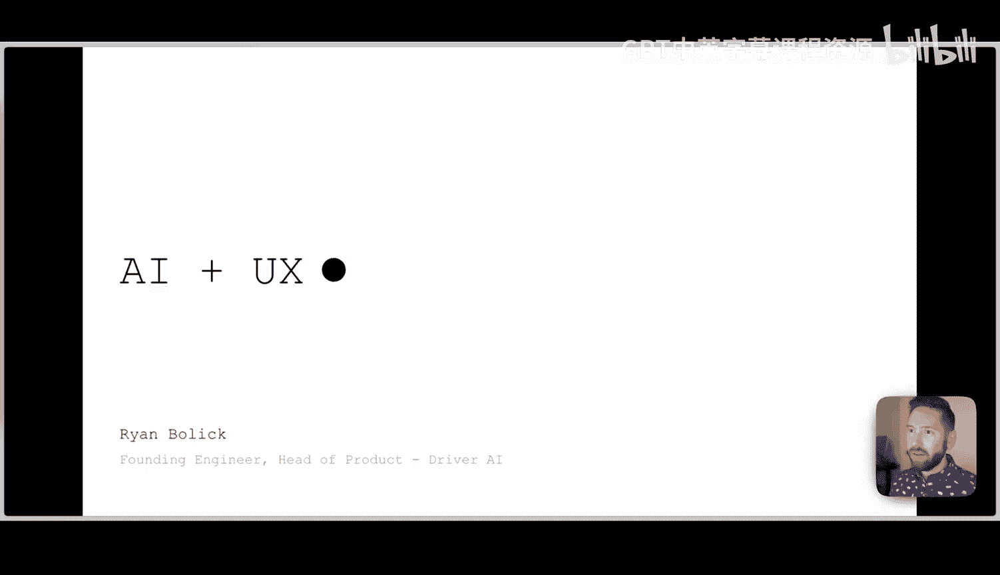
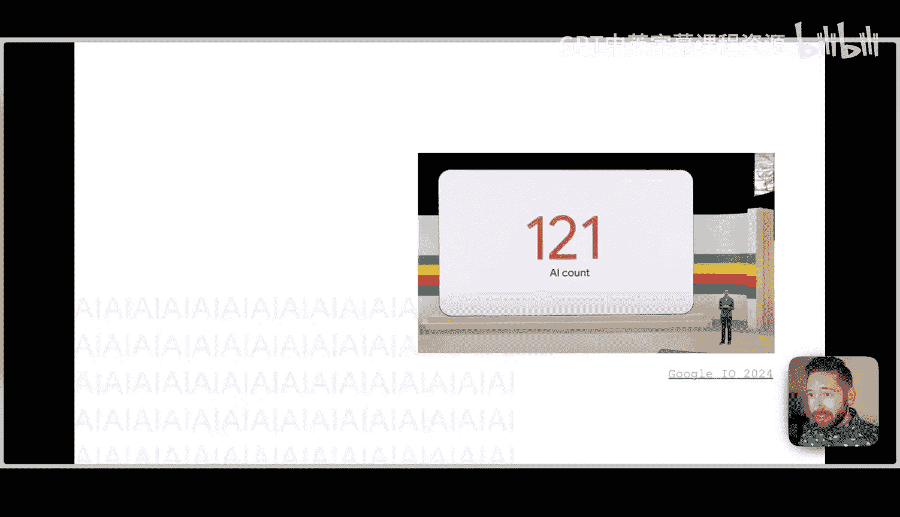
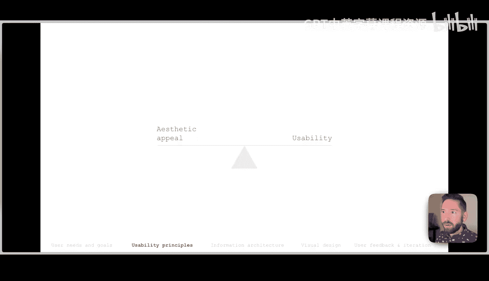
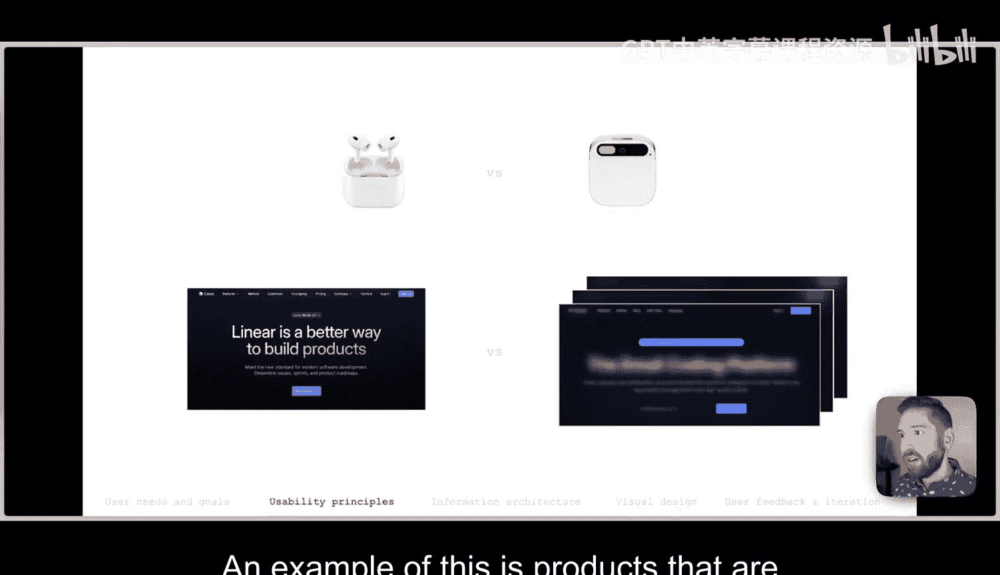
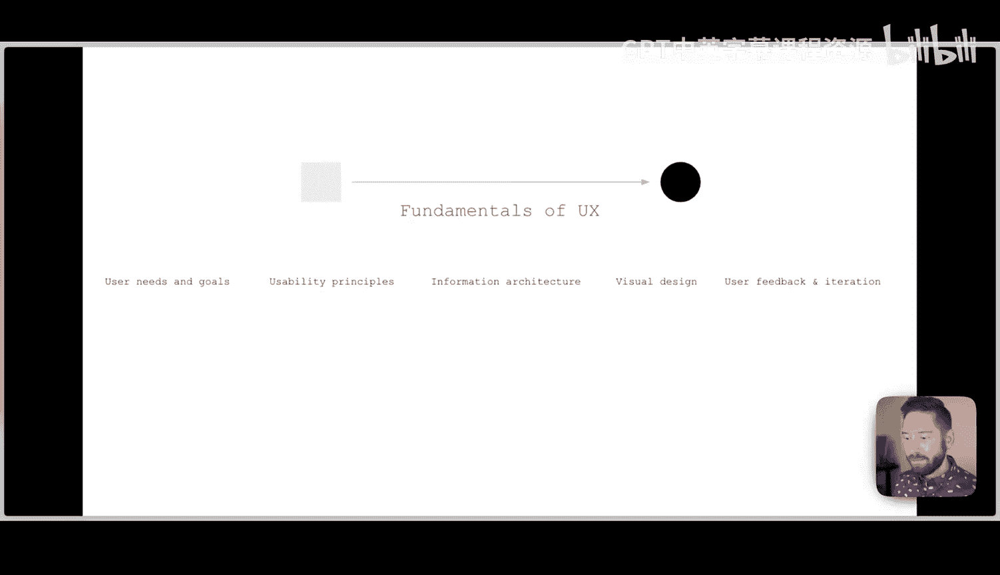

# 可解释人工智能 (XAI)：18：AI用户体验——Driver产品负责人Ryan Bolick

在本节课中，我们将探讨如何将用户体验（UX）设计原则应用于人工智能产品，从而在竞争激烈的市场中脱颖而出，并真正解决用户的实际问题。

## 概述

在当今快速发展的技术领域，一个关键问题浮现出来：用户体验能否成为释放AI工具全部潜力、并使你的产品脱颖而出的关键？本节课程将介绍以用户为中心的设计流程，从问题识别到高保真原型迭代，帮助你构建更具竞争力的AI产品。

## 识别问题与用户需求

设计的第一步是识别问题或需求。这意味着理解你的潜在用户，特别是他们的问题、需求和目标。

要开始这项工作，你需要进行研究。保持开放的心态，意识到自己的偏见，并让研究结论来引导你。同理心在这里至关重要。

以下是几种用户研究方法：
*   **调查问卷**：收集大量用户的定量数据。
*   **用户访谈**：深入了解少数用户的动机和感受。
*   **一手资料研究**：分析现有数据和报告。
*   **市场趋势研究**：了解行业动态。
*   **实地观察/跟访**：在用户自然环境中观察其行为，这是获取真实洞察的有效方法。

例如，在访谈中，人们倾向于说出他们认为“正确”的答案，而非真实想法。通过让用户录屏并口述使用产品的过程，可以观察到更真实的行为和反应。通常，对3到10人进行此类研究就能获得可操作的见解。

## 创建用户画像

为了确保用户需求在整个设计过程中始终是优先事项，我使用**用户画像**。这些是基于研究发现的、代表不同类型用户的虚构或真实角色。

用户画像有助于整个团队理解我们为谁而设计，从而实现更以用户为中心的产品开发。它们应围绕目标受众构建。例如，针对杜克大学的学生创建画像。画像应聚焦于用户试图完成的任务、遇到的问题及其动机，而非人口统计学特征。

在开发周期中，应持续参考这些画像。它们最终归结为用户需求，涵盖了共同的问题和目标，并指明了设计的重点。可以将其视为工程需求：我们需要实现X，以便Y能够发生。

## 理解可用性原则

为了有效满足这些需求，理解可用性原则至关重要。为真实用户设计能确保产品符合他们的期望。创新应利用用户熟悉且舒适的框架和交互模式。

通过关注易用性，你可以提高用户的采纳率和满意度，从而使产品更成功。你需要确保产品遵循关键的可用性原则：**一致性、熟悉度、反馈和控制**。

*   **一致性**：确保界面可预测且熟悉，帮助用户轻松导航。
*   **熟悉度**：借鉴日常产品中的常见模式。
*   **反馈**：提供清晰、即时的反馈以增强用户信心。例如，详细的错误信息。
*   **控制**：给予用户控制感，如自定义主题或以多种方式完成任务，这能增强用户的情感连接。

这些原则有助于确保你的设计对多样化用户群体而言是直观且易用的。为了验证你是否有效运用了它们，应尽早并经常向他人展示你的想法。

## 从线框图到信息架构

现在，洞察开始浮现，指向一个新的或更新的用户界面。这是你真正开始进入所构建产品设计的阶段。这里常出现一个争议点：审美吸引力与可用性。虽然没有放之四海而皆准的解决方案，但我建议**先关注可用性，再考虑美学**。

在尝试创建美观的设计之前，必须通过低保真和中保真线框图来验证可用性。

*   **低保真线框图**：用纸笔草图或基础数字工具创建，用于快速、低成本地可视化基本结构和布局。
*   **中保真线框图**：在基本结构验证后添加更多细节，关注精细布局、优化导航和基本交互。

使用线框图可以早期发现并解决可用性问题，确保设计以用户为中心。这个过程的一个组成部分是建立坚实的**信息架构**，即逻辑且直观地组织和构建内容，确保用户能轻松找到所需信息。

对于复杂界面，我优先考虑清晰和简洁。将信息分解为可管理的部分，并使用渐进式披露技术。一致的标签和直观的导航路径至关重要。可以使用Figma、Figma Jam、Miro或Lucidchart等工具来可视化架构，通常表现为解释基于用户需求完成特定任务的用户旅程图。

## 视觉设计与高保真原型

在思考了用户是谁、能缓解其问题的使用模式以及如何组织应用之后，我们已准备好开始视觉设计。从基础线框图出发，结合用户需求和信息架构图，开始创建中保真模型。

有几种方法可以做到这一点：在纸上绘制、使用Google Slides等幻灯片工具，或使用功能简单的Figma文件。此时不要担心质量，目标是记录你的想法。为了让工作保持专注，我每次只处理较小的部分。

在获得更坚实的洞察和方向后，就该深入视觉和美学了。有一些基本原则可以指导视觉设计：
*   **色彩**：策略性地使用色彩来传达含义、影响情绪并创造视觉层次。
*   **对比度**：运用对比度来增强可读性，并确保关键元素突出。
*   **层次结构**：建立视觉层次以无缝引导用户浏览内容。
*   **排版**：选择平衡可读性与美感的字体，保持字体大小足够大。
*   **负空间**：有效利用负空间来创建干净、通透的布局。

构建界面时，你有两个主要选择：从零开始或使用现有组件库。通常，我建议从UI组件库开始，这能让你避免纠结于微小细节。有许多高质量的开源库，如Tailwind UI、Chakra UI、Material UI、Next UI和Radix。

在设计高保真原型和构建项目时，必须优先考虑**可访问性**。这涉及创建可缩放的字体、高对比度色彩以及支持键盘导航。参考WCAG等网络标准获取更多细节。

## 迭代与反馈循环

在整个过程中，你需要利用用户反馈来指导迭代周期。我通常通过向任何愿意的人展示我的设计来获取反馈，范围从桌上的纸片到感觉像真实应用的高保真Figma原型。记录用户对你的设计的反应至关重要，第一印象和即时的疑问非常有价值。

在进行迭代时，尤其是在Figma等工具上，**不要删除旧设计**。如果需要基于它们工作，请复制并开始修改副本。保留过去设计的记录非常重要，因为你永远不知道何时需要回溯几周前的想法。

迭代是艰难的，因为它意味着向新的、理想情况下更好的方向演进。重要的是让反馈来引导你，而不是固守自己的设计。设计就像代码，你在编写某个功能时可能觉得它很棒，但一年后回头看，可能发现它需要改进。有时你以一种方式开始设计产品或功能，而用户反馈会将你引向完全不同的方向。

## 总结

在本节课中，我们一起学习了如何将用户体验设计流程应用于AI产品。我们从识别真实用户需求和研究方法开始，接着探讨了创建用户画像、遵循核心可用性原则的重要性。然后，我们介绍了通过线框图和信息架构来构建产品骨架，并深入了视觉设计原则和高保真原型的创建。最后，我们强调了基于用户反馈进行持续迭代的关键性。请记住，你的项目要么未完成，要么已过时，但UX设计能帮助你每天让它变得更好一点。