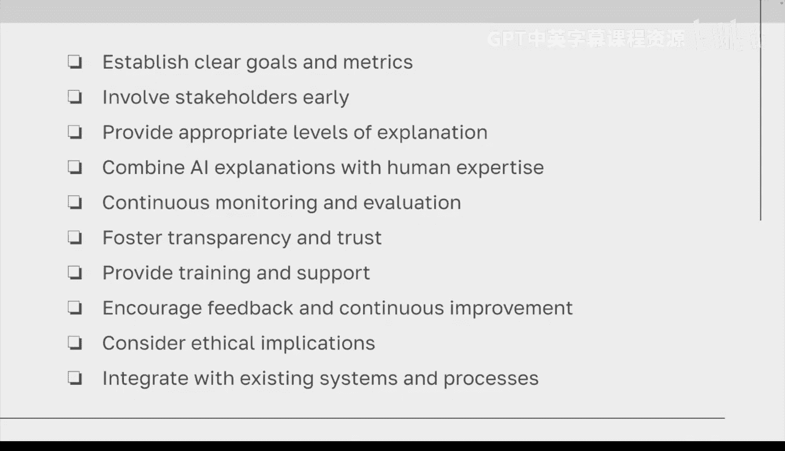

# 杜克大学《可解释人工智能｜Explainable AI (XAI)》中英字幕 p19 19_03_04_将XAI集成到决策流程中.zh_en -BV1HnrBBmEon_p19-

As we consider developing X AI systems and discuss human AI interaction。

 it is critical to discuss best practices for integrating AI explanations into decision making processes。

Let's go through 10 best practices for integrating XI explanations into decision making processes。

Establish clear goals and metrics should define the specific objectives for using AI explanations in the decision making process and establish metrics to evaluate their effectiveness and impact on decision quality and fairness。

Involve stakeholders early。 engage relevant stakeholders， including subject matter experts。

 decision makers and end users early in the process of designing and deploying the X AI system。

 Their input can help ensure that the explanations are tailored to their needs and aligned with their mental models。

 involving domain experts and stakeholders in the decision making process can also provide context and ensure that AI explanations are interpretable and relevant to the specific domain。

Provide appropriate levels of explanation。 offerer multiple levels of explanation granularity to cater to different stakeholders expertise and information needs。

 Decion makers may require high level summaries， While domain experts might need more detailed technical explanations。

Combine AI explanations with human expertise， En decision makers to consider AI explanations in conjunction with their own domain knowledge。

 experience and intuition AI explanation should complement， not replace human expertise。

Continuous monitoring and evaluation。 The performance and outputs of AI systems should be continuously monitored and evaluated。

 particularly when used in high stakes decision making scenarios。

 I governance frameworks and processes for monitoring and auditing the AI explanations and their impact on decision making。

 This helps identify potential biases， errors or unintended consequences early on。

Foster transparency and trust。 Proote transparency by making the AI explanations accessible and understandable to all stakeholders involved in the decision making process。

 This can help build trust in the AI system and its recommendations。And provide training and support。

 provide training and education to decision makers and stakeholders on how to interpret and effectively utilize AI explanations in the decision making process。

 Off training and support resources to help decision makers understand and effectively utilize AI explanations in their workflows。

 This can include guidelines， best practices and opportunities for hands on practice。

Foster collaboration and knowledge sharing among AI developers。

 domain experts and decision makers to continuously improve the integration of AI explanations into decision making processes。

And encourage feedback and continuous improvement， implement mechanisms for stakeholders to provide feedback on the clarity。

 relevance and usefulness of AI explanations， regularly review and improve the AI system's performance。

 explanations and integration into the decision making process based on feedback and evolving best practices。

😊，And consider ethical implications， assess and address potential ethical concerns related to the use of AI explanations in decision making。

 such as fairness， accountability and privacy。 ensure that the explanations are unbiased。

 respect individual rights and align with organizational values。

And integrate with existing systems and processes， seamlessly integrate the X I system with existing decision making tools。

 workflows and processes to minimize disruption and promote adoption。

