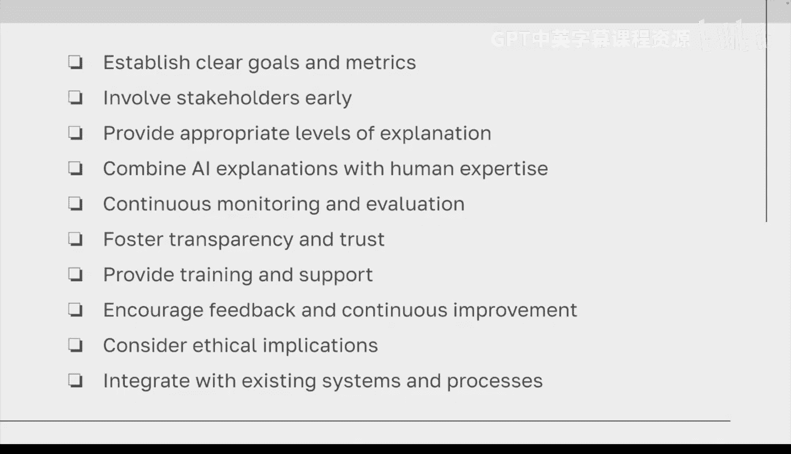

# 可解释人工智能：19：将XAI集成到决策流程中的十大最佳实践

在本节课中，我们将学习如何将可解释人工智能（XAI）的解读有效集成到决策流程中。我们将探讨十个关键的最佳实践，以确保AI解释能提升决策质量、公平性和透明度。

---

上一节我们讨论了人机交互的重要性，本节中我们来看看如何将XAI的解读整合到实际的决策流程中。以下是整合AI解释到决策流程中的十大最佳实践。

1.  **确立清晰的目标与指标**
    应明确在决策流程中使用AI解释的具体目标，并建立指标来评估其有效性以及对决策质量和公平性的影响。

2.  **尽早让利益相关者参与**
    在设计及部署XAI系统的早期阶段，就应让相关利益相关者参与进来，包括领域专家、决策者和最终用户。他们的意见有助于确保解释符合其需求并与他们的心智模型保持一致。让领域专家和利益相关者参与决策过程，还能提供背景信息，确保AI解释在特定领域内是可理解和相关的。

3.  **提供适当层级的解释**
    提供多个层级的解释粒度，以满足不同利益相关者的专业水平和信息需求。决策者可能需要高层级的摘要，而领域专家则可能需要更详细的技术解释。

4.  **结合AI解释与人类专业知识**
    应使决策者能够结合自身的领域知识、经验和直觉来考量AI解释。AI解释应**补充而非取代**人类专业知识。

5.  **持续监控与评估**
    应持续监控和评估AI系统的性能与输出，尤其是在高风险决策场景中。建立用于监控和审计AI解释及其对决策影响的治理框架与流程。这有助于及早发现潜在的偏见、错误或意外后果。

6.  **促进透明度与信任**
    通过让参与决策过程的所有利益相关者都能访问和理解AI解释，来促进透明度。这有助于建立对AI系统及其建议的信任。

7.  **提供培训与支持**
    为决策者和利益相关者提供关于如何解读及有效利用AI解释进行决策的培训和教育。提供培训和支持资源，帮助决策者理解并在其工作流程中有效利用AI解释。这可以包括指南、最佳实践和动手实践的机会。

8.  **鼓励反馈与持续改进**
    建立机制，让利益相关者能够就AI解释的清晰度、相关性和实用性提供反馈。根据反馈和不断发展的最佳实践，定期审查并改进AI系统的性能、解释及其与决策流程的集成。

9.  **考量伦理影响**
    评估并解决在决策中使用AI解释可能引发的伦理问题，例如公平性、问责制和隐私。确保解释是无偏见的，尊重个人权利，并符合组织的价值观。

10. **与现有系统和流程集成**
    将XAI系统无缝集成到现有的决策工具、工作流程和过程中，以最小化干扰并促进采用。

---

本节课中，我们一起学习了将XAI集成到决策流程中的十大核心最佳实践。这些实践涵盖了从目标设定、利益相关者参与到持续监控与伦理考量的全过程，旨在确保AI解释能够真正赋能人类决策者，提升决策的可靠性、公平性和透明度。