# 杜克大学《可解释人工智能｜Explainable AI (XAI)》中英字幕 p20 20_03_05_指导案例研究：决策制定.zh_en -BV1HnrBBmEon_p20-

🎼，🎼，Yeah。

Now let's walk through a real world example that illustrates the applications of these best practices for integrating AI explanations into decision making processes。

 a large financial institution wants to incorporate an AI system for loan approval decisions with the goal of improving efficiency。

 consistency and fairness in the lending process。First， they establish clear goals and metrics。

The goal is to improve the accuracy and fairness of loan approval decisions while maintaining high levels of transparency and accountability metricss to evaluate the goal include decision accuracy。

 loan default rates， fairness metrics， for example， disparate impact。

 time to decision and stakeholder satisfaction。

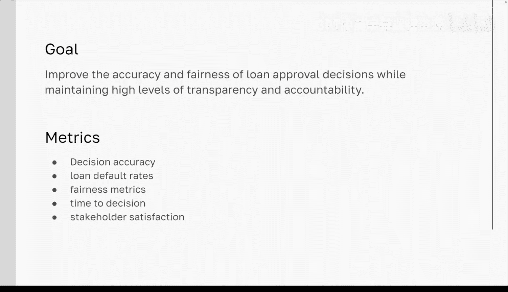

Second， they involve stakeholders early。 They engage with loan officers， credit analysts。

 compliance officers and customer representatives in the design and development of the X AI system。

They gather their input on the most important factors in loan decisions。

 desired explanation formats and usability requirements。

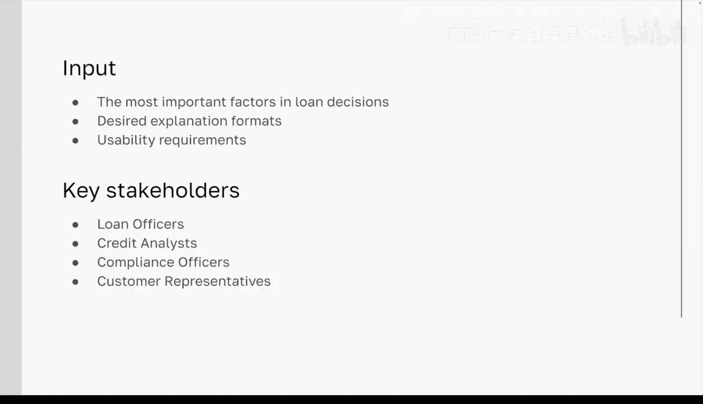

Next， they provide appropriate levels of explanation。

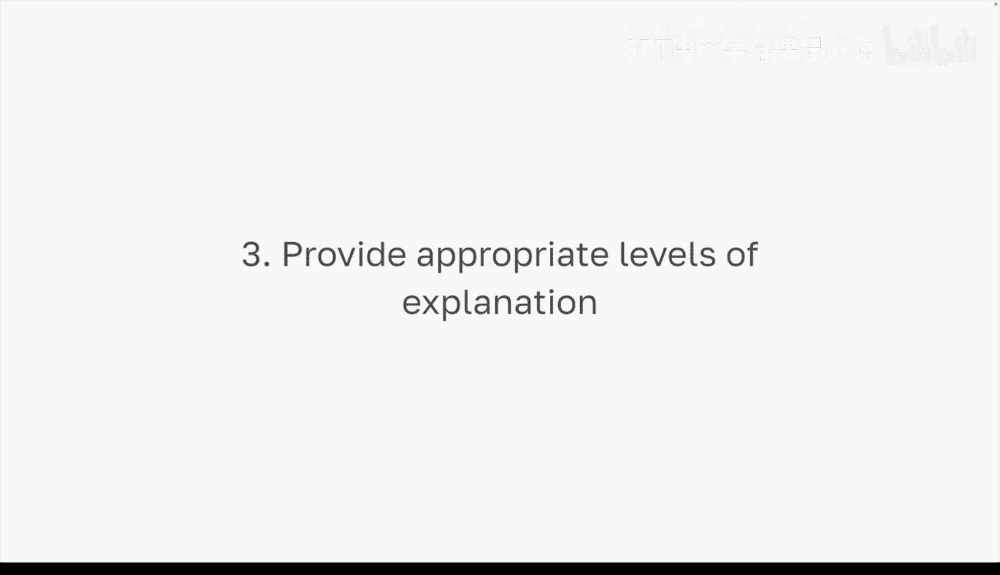

For customers， they have high level explanations in natural language。

 explaining the key reasons for approval or denial。For loanne officers。

 they shared detailed explanations， highlighting the most influential features and their impact on the decision。

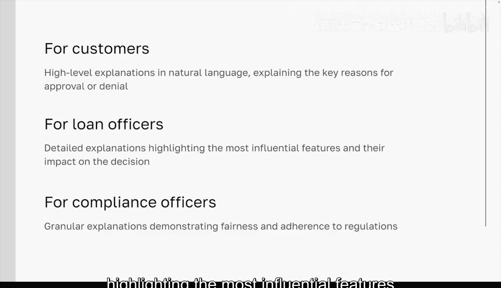

And for compliance officers， they use granular explanations。

 demonstrating fairness and adherence to regulations。

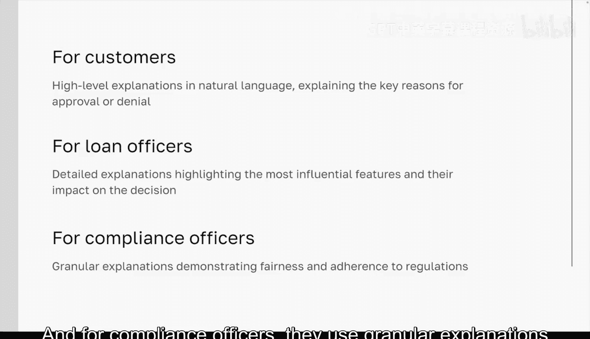

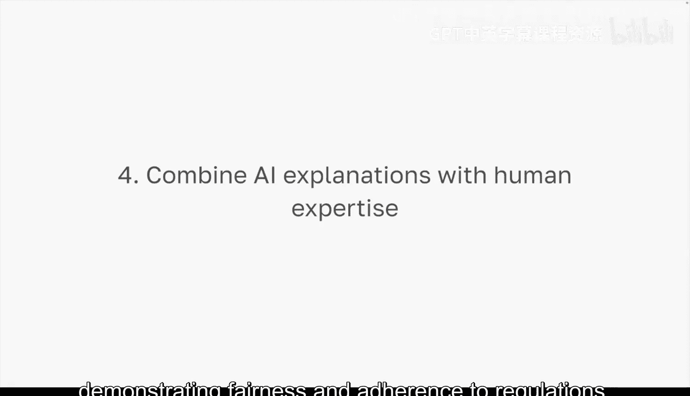

Next， they make sure to combine AI explanations with human expertise。

 Loan officers can use the AI explanations as guidance。

 but also incorporate their own judgment and customer specific context。

 Credit analysts can review complex cases and provide additional input to the AI system。

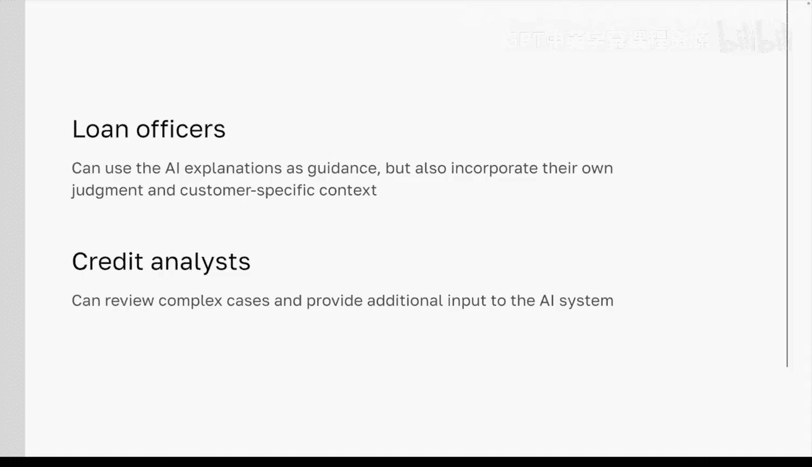

Next， they establish continuous monitoring and evaluation。

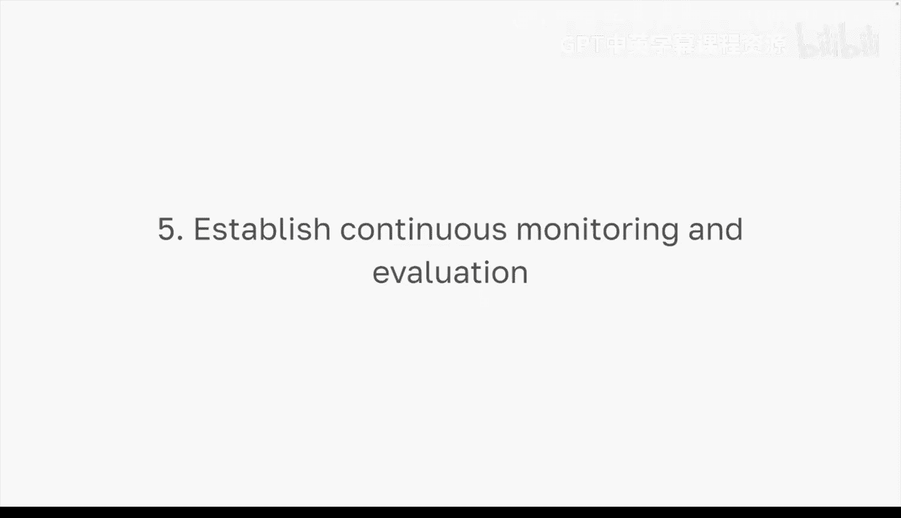

They implement a governance committee with representatives from different stakeholder groups to monitor the AI system's performance and decisions。

 They conduct regular audits to identify potential biases or inconsistencies in the AI explanations。

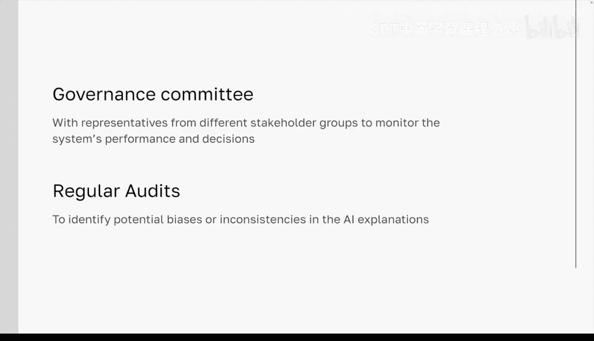

Next， they seek to foster transparency and trust by making the AI explanations accessible to customers。

 loan officers and regulators through a secure portal interface。

 and they clearly communicate the capabilities， limitations。

 and decision making processes of the AI system。

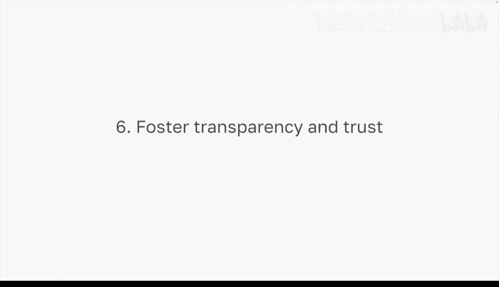

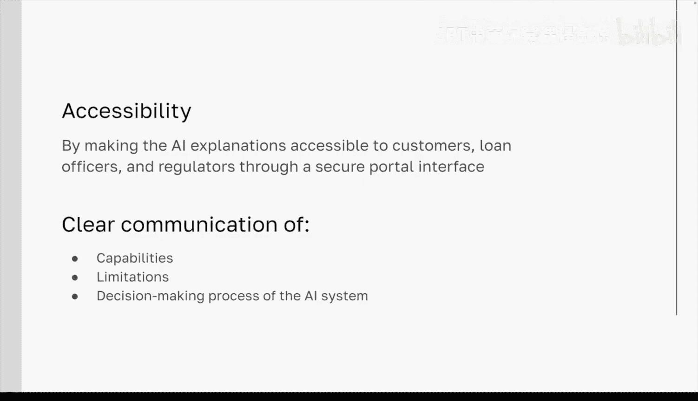

They provide training and support。

They offer training sessions for loan officers on how to interpret and effectively utilize the AI explanations in their decision making process。

 and they develop user guides， frequently asked questions and support channels for stakeholders to address questions or concerns。

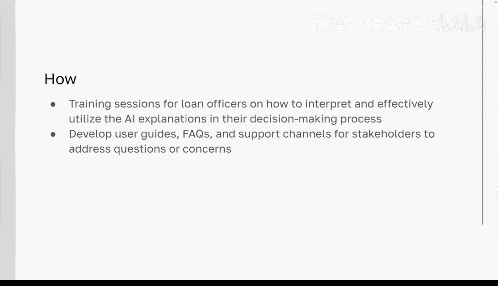

They encourage feedback and continuous improvement。By implementing feedback mechanisms for customers。

 loan officers and other stakeholders to provide input on the clarity and usefulness of the AI explanations and continuously refining and updating the AI system based on this feedback and evolving regulatory requirements。

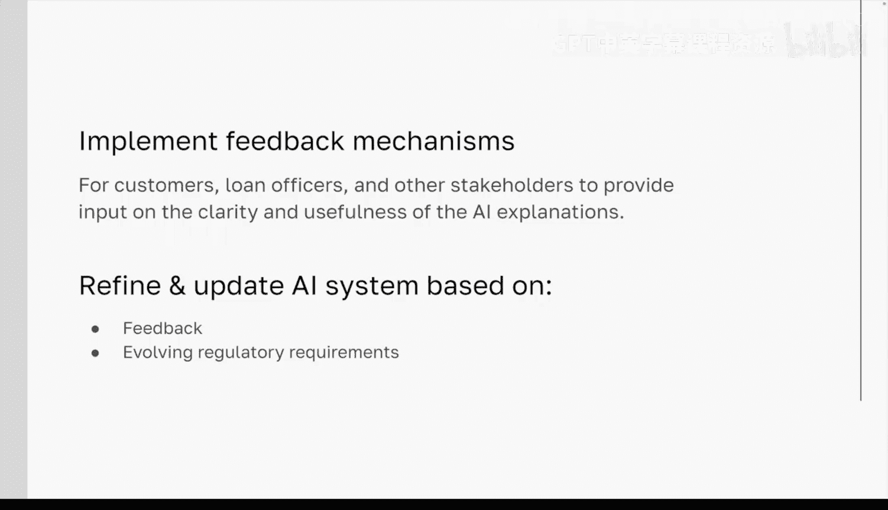

They consider ethical implications by conducting fairness audits to ensure that the AI explanations and decisions are free from discriminatory biases based on protected characteristics like race。

 gender or age， and they implement privacy safeguards to protect customer data and ensure secure storage and usage of explanations。

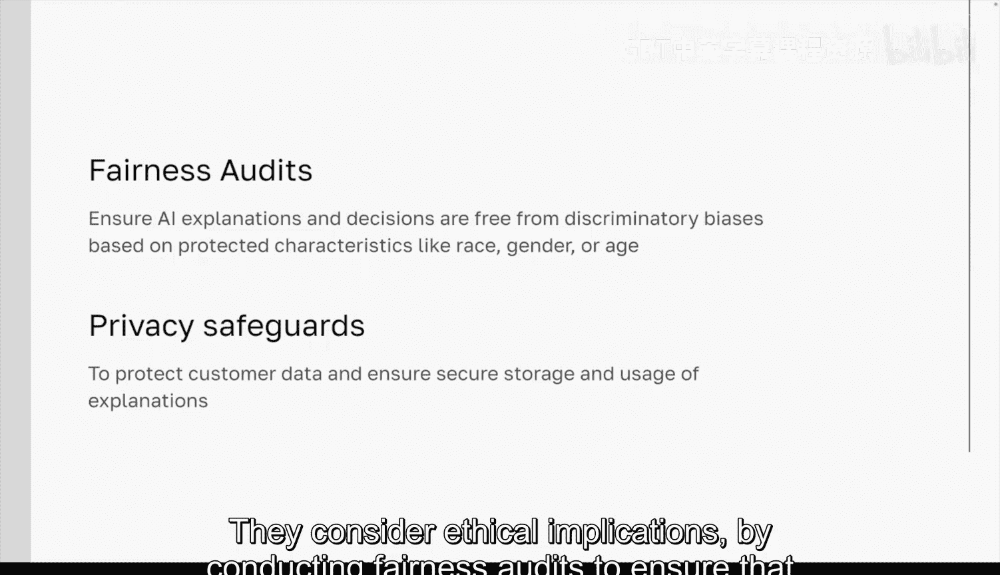

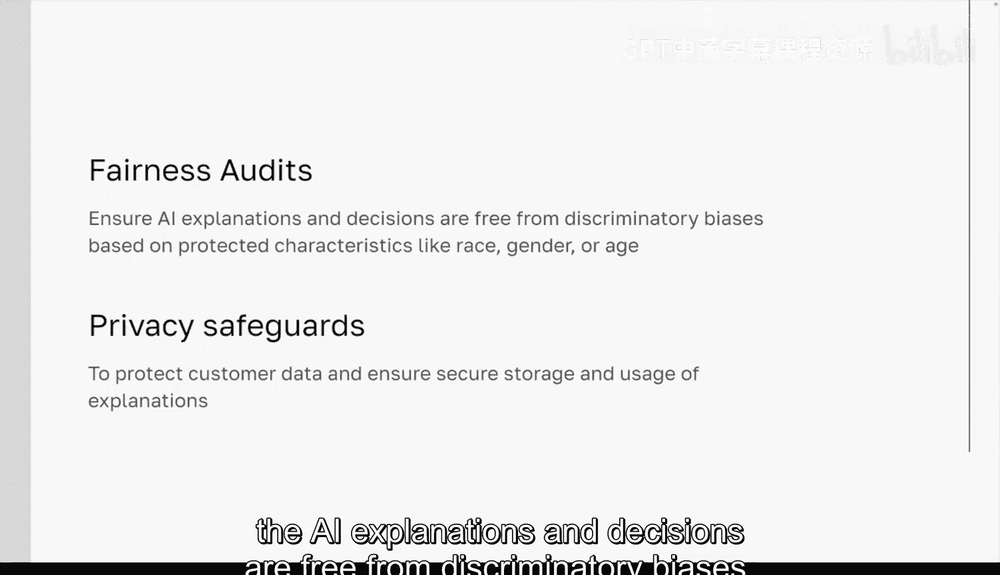

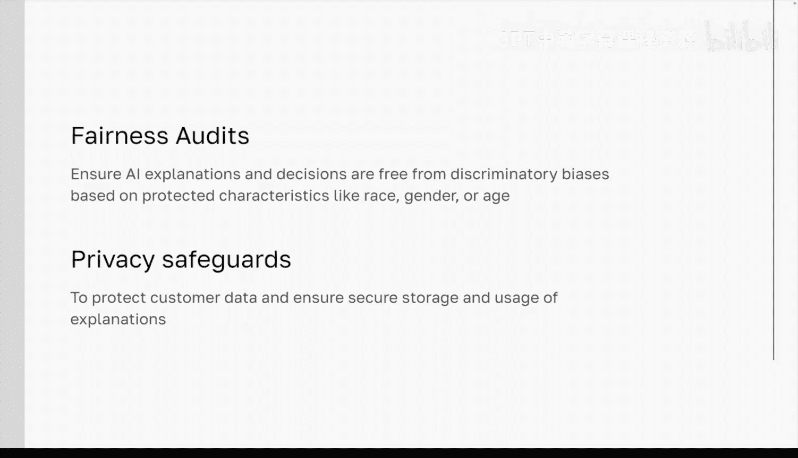

Finally， they integrate with existing systems and processes。

 they integrate the XAI system with the financial institution's existing loan application software。

 credit scoring tools and decision making workflows。

 they ensure seamless data exchange and compatibility with existing systems and processes。

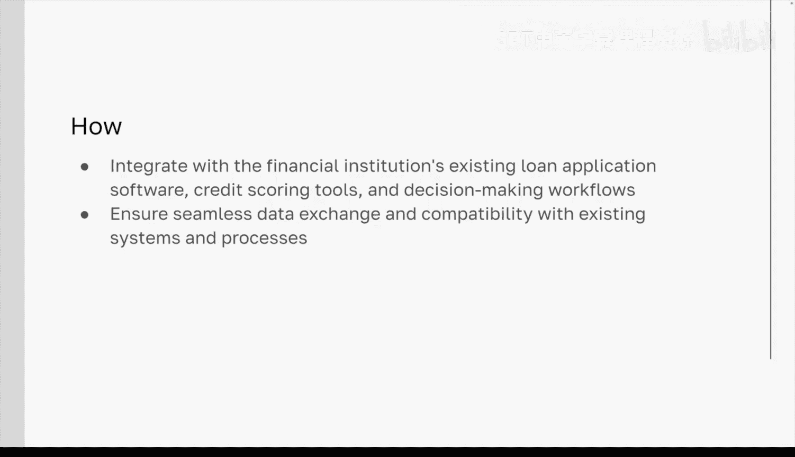

As you can see， there are a number of considerations to be made when integrating AI explanations into decision making processes。

 careful consideration of these will allow organizations to effectively leverage AI explanations to enhance decision making processes while ensuring transparency。

 accountability， and alignment with human values and expertise。

