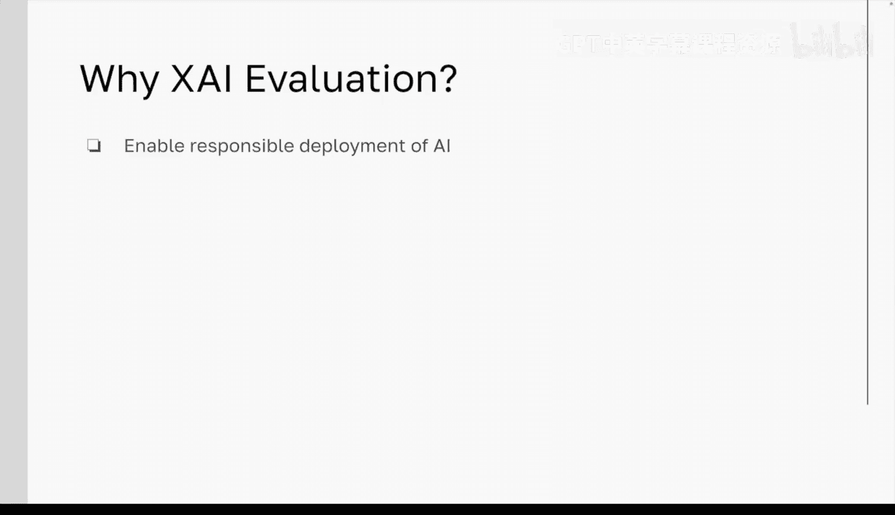
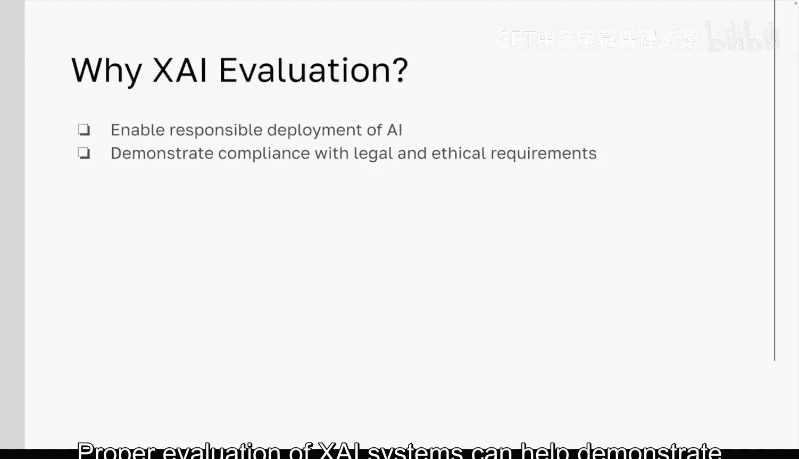
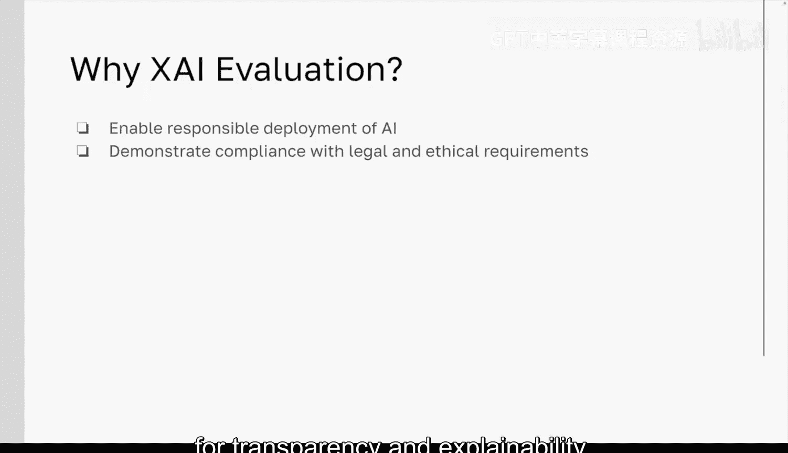
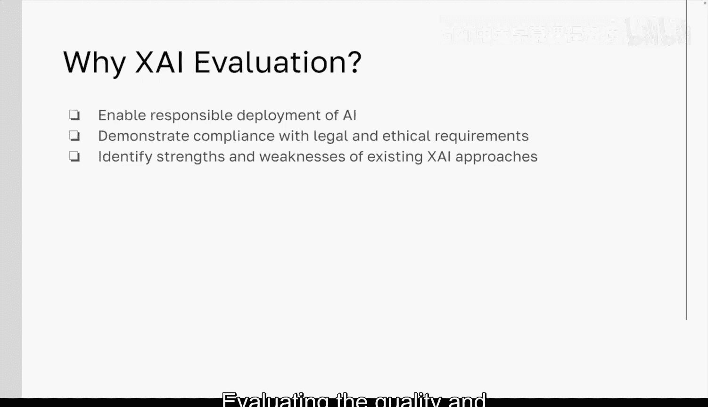
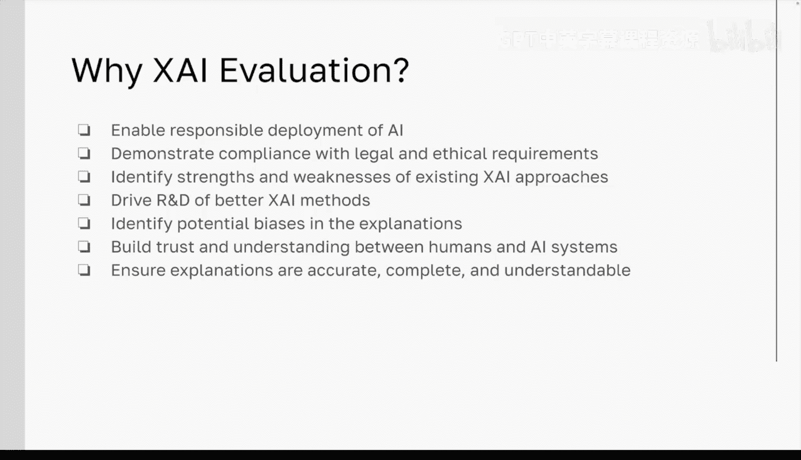
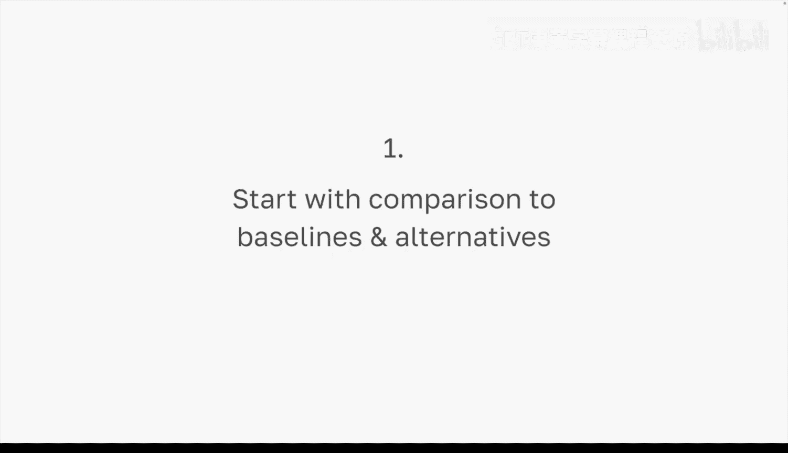
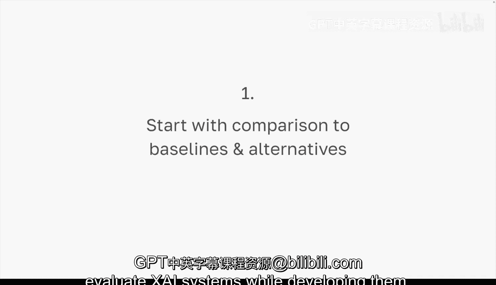

# 杜克大学《可解释人工智能｜Explainable AI (XAI)》中英字幕 p21 21_03_01_XAI评估的重要性与介绍.zh_en -BV1HnrBBmEon_p21-

Before we talk about implementation of XAI evaluation， let's talk about why it's important。

As AI systems become more prevalent in high stakes domains like healthcare， finance。

 and criminal justice， there is an increasing need for accountability and compliance with regulations and ethical guidelines。

Proper evaluation of X AI systems can help demonstrate compliance with legal and ethical requirements for transparency and explainability。

 enabling responsible deployment of AI technologies。

Evaluating the quality and effectiveness of explanations is also necessary to drive the development of better X AI techniques and methods。

 rigorous evaluation frameworks and benchmarks can help identify strengths and weaknesses of existing approaches。

 guiding research efforts towards improving the explainability and interpretability of AI systems。😊。

XAI evaluation can help identify potential biases or unfair treatment of different groups or subpopulations in the explanations made by the XAI system by evaluating the consistency and fairness of explanations across diverse data sets or subgroups。

 steps can be taken to mitigate biases and ensure equitable treatment。Finally。

 XI systems aim to provide explanations for the decisions made by AI models。

 which is essential for building trust and understanding between humans and these systems。

 properper evaluation helps ensure that the explanations generated are accurate。

 complete and easily understandable， promoting transparency and fostering trust in the AI systems decision making process。

It is important to note that evaluation of XII is an evolving field of study。

 new evaluation criteria， metrics and data sets are coming out regularly。

 the list in this module is not exhaustive。There are a number of common types of X AI system evaluation。

 This is in addition to a comparison with baselines or alternative methods in which one compares the performance and quality of explanations generated by different XAI techniques or against baseline methods。

 this should always be done during your evaluation process。

Now， let's dive into some of the ways in which we evaluate X AI systems while developing them。

