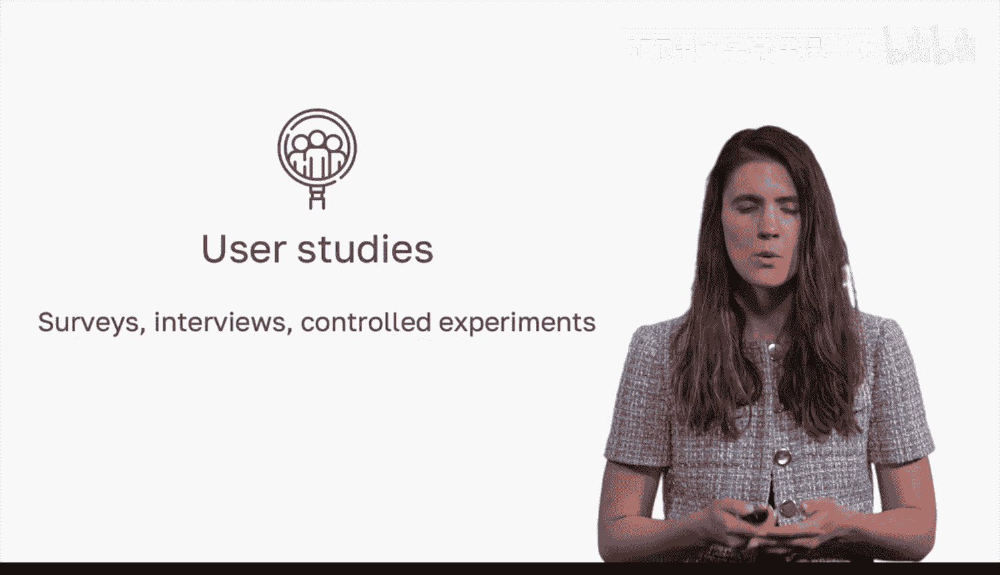
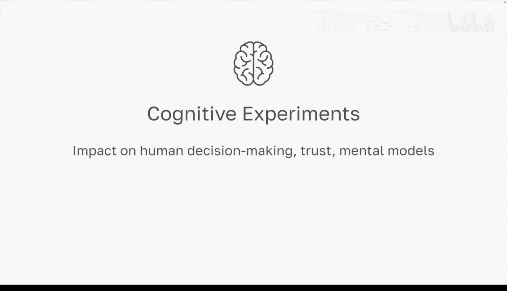
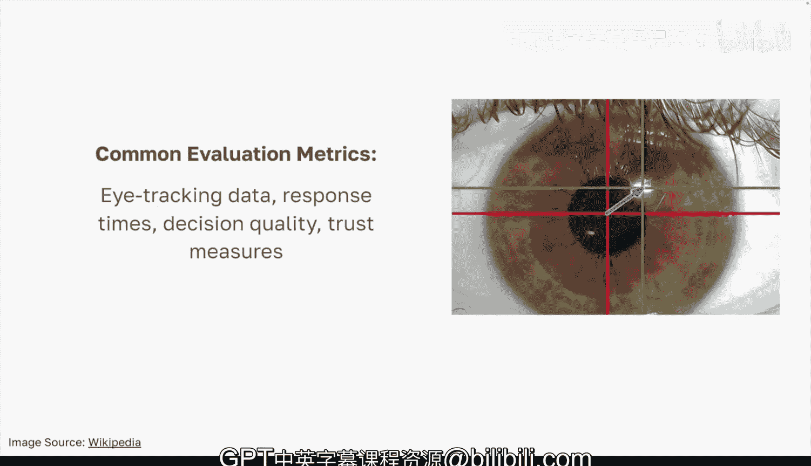

# 可解释人工智能 (XAI)：22：人工评估 👥

在本节课中，我们将要学习如何对可解释人工智能系统进行人工评估。人工评估是衡量XAI系统有效性的关键环节，它关注于人类用户如何理解、信任并利用系统提供的解释。

上一节我们介绍了XAI系统评估的重要性，本节中我们来看看具体如何进行人工评估。人工评估通常从开发者自身评估解释的质量开始。当你构建希望人类能有效交互的XAI系统时，让他人评估你的系统是必不可少的。通过用户研究和认知实验，你可以全面评估你的XAI系统。

## 用户研究 📋

用户研究是人工评估的核心方法之一，它涉及最终用户或领域专家通过调查、访谈或受控实验来评估解释的质量、可理解性和有用性。

以下是用户研究中常见的评估指标：

*   **李克特量表**：这是一种用于量化回答的技术，通过对一系列陈述的同意程度进行评分来汇总响应。你可能见过多种形式，常见的一种是“同意、非常同意、不同意、非常不同意或既不同意也不反对”的问题。
*   **评分分数**：直接对解释的某个方面（如清晰度、帮助性）进行打分。
*   **任务绩效指标**：例如，用户在获得解释后完成任务的速度或准确率。
*   **定性反馈**：通过开放式问题或访谈收集的详细文字反馈。

## 认知实验 🧠

另一种人工评估方法是认知实验，它旨在评估解释对人类认知过程的影响，例如解释如何影响人类的决策、信任或心智模型。

以下是认知实验中典型的评估指标：

*   **眼动追踪数据**：分析用户在查看解释时的视觉注意力分布。
*   **响应时间**：测量用户在看到解释后做出决策所需的时间。
*   **决策质量**：评估用户在获得解释后所做决策的正确性或合理性。
*   **信任度量**：通过问卷或行为指标来衡量用户对系统的信任程度变化。

本节课中我们一起学习了XAI系统人工评估的两种主要方法：用户研究和认知实验。用户研究侧重于通过量表、评分和任务表现来评估解释的实用性和可理解性；而认知实验则更深入地探究解释如何影响人类的认知过程，如注意力、决策速度和信任度。综合运用这些方法，可以全面评估XAI系统是否真正达到了“可解释”的目标。