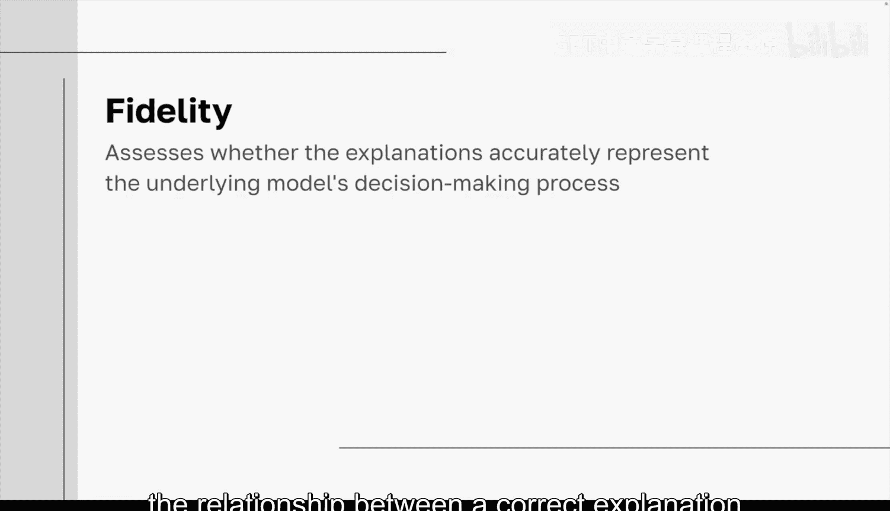
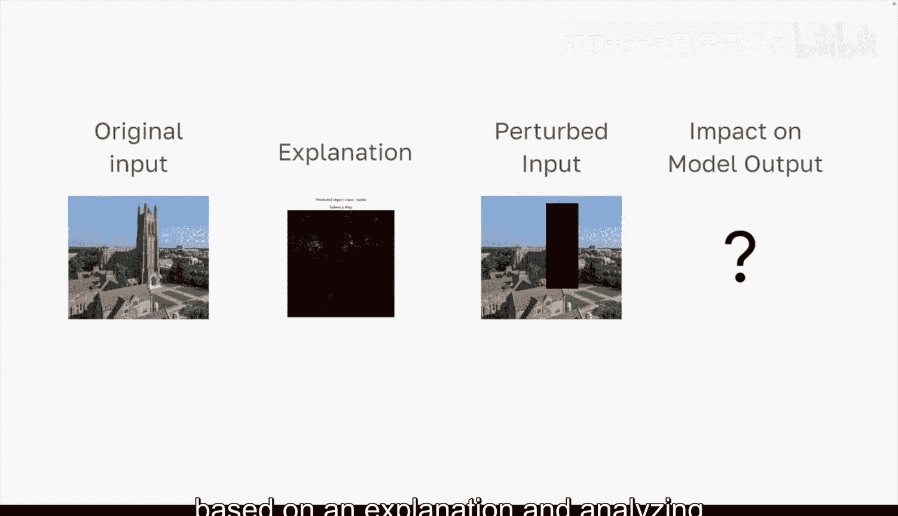
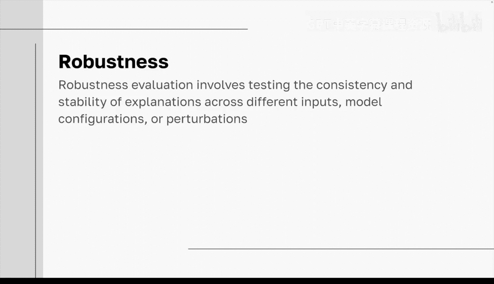
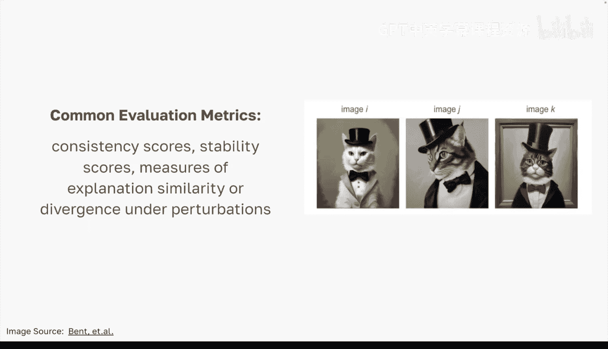

# 杜克大学《可解释人工智能｜Explainable AI (XAI)》中英字幕 p23 23_03_03_功能评估.zh_en -BV1HnrBBmEon_p23-

Another type of XAI evaluation is referred to as functional evaluation。

 which includes fidelity and robustness evaluations。

Fidelity or faithfulness evaluation assesses whether the explanations accurately represent the underlying model's decision making process。

The main limitation to c fidelity is the inability to have a ground truth of the real explanation to overcome this challenge。

 most people rely on assumptions about the relationship between a correct explanation and the model to measure fidelity。

Current evaluation methods measuring fidelity involve perturbing the input based on an explanation and analyzing the resulting differences in the output of the AI model。

For example， one key evaluation metric for XAI fidelity evaluation is area over the perturbation curve or AOPC。

 which measures the change in classifier output as pixels are sequentially perturbed or flipped in binary images or set to a different value for RGB images。

In order of their relevance， as estimated by the explanation method。

The assumption of this evaluation metric is that perturbation of relevant input variables should lead to a steeper decline of the prediction score than perturbation on the less important ones。

There are a number of similar metrics assessing fidelity that involve the perturbation of the original input and a relative comparison across outputs。

In addition to measuring fidelity， infidelity can also be calculated to do this。

 the expected mean square between the difference in the output when a region is perturbed and the importance of these regions multiplied by the amount of perturbation is calculated。

Unfortunately， the different evaluation metrics for fidelity often disagree。

 leading to what is referred to by researchers as the disagreement problem。

This is an active area of research that is likely to evolve。Like fidelity。

 robustness is a functional evaluation method for X AI。

 Research has shown that a small perturbation can change the interpretation while keeping the model's prediction unchanged。

 Robbusness evaluation involves testing the consistency and stability of explanations across different inputs。

 model configurations or perturbations。😊。

Common evaluation metrics for robustness evaluation include various types of consistency scores。

 stability scores， and measures of explanation similarity or divergence under perturbations。

X AI techniques are heterogeneous， so no existing evaluation methods are generic enough to be applicable to all。

 That's why it's really important to ensure you are following best practices for the X AI technique you are using and your domain of interest。

