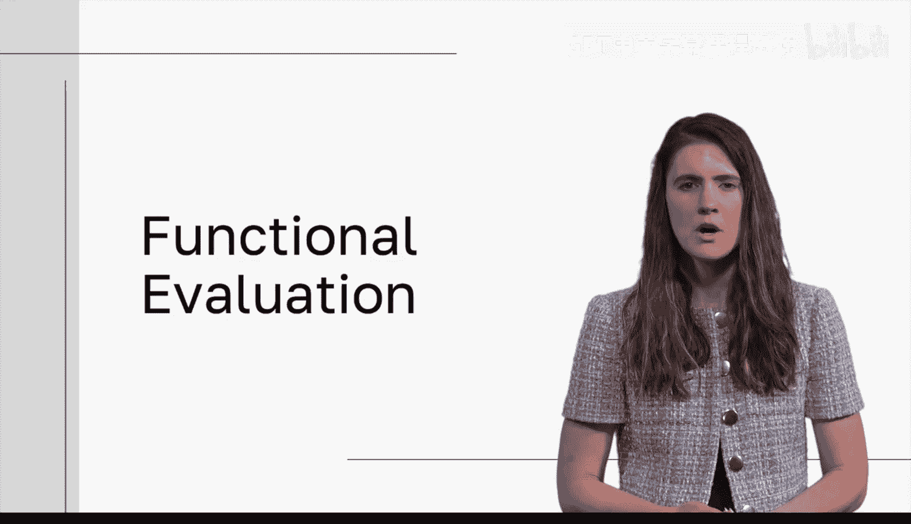
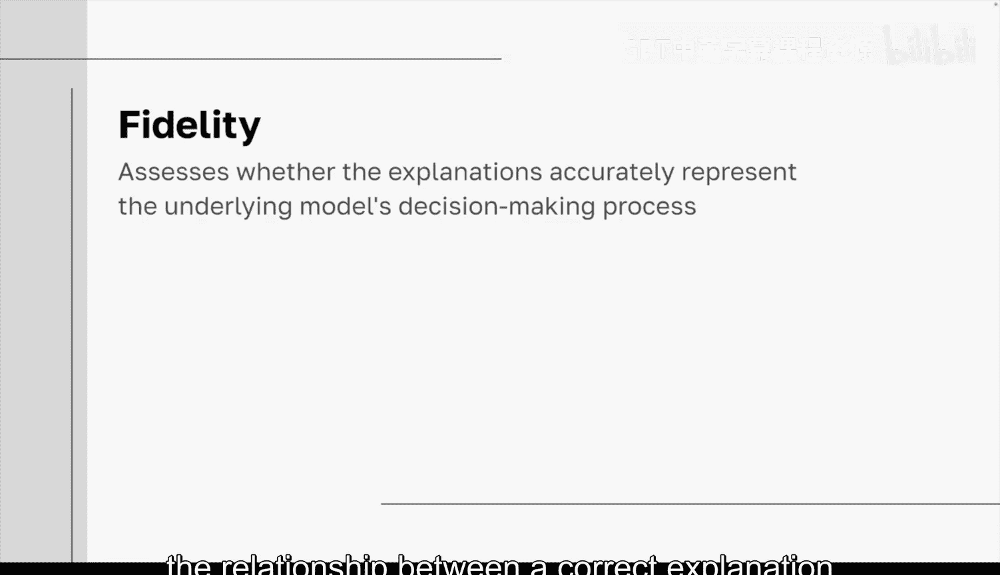
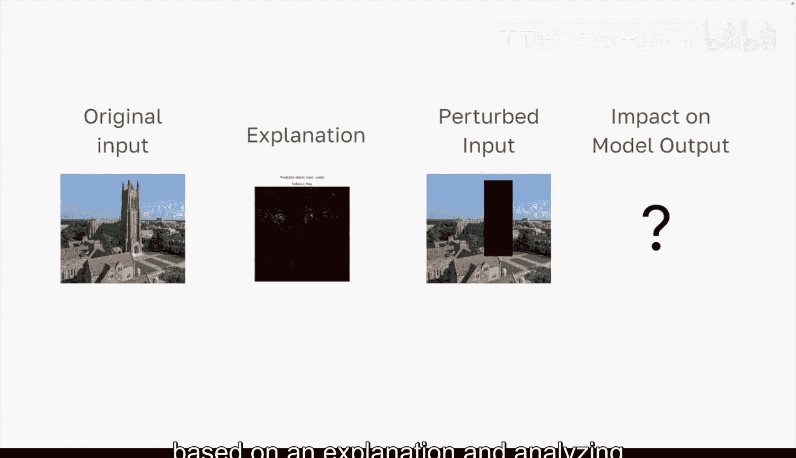
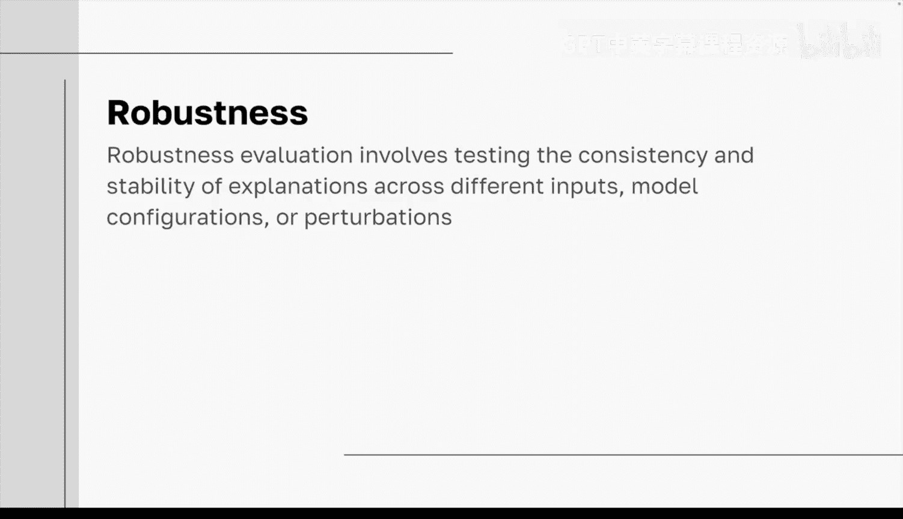
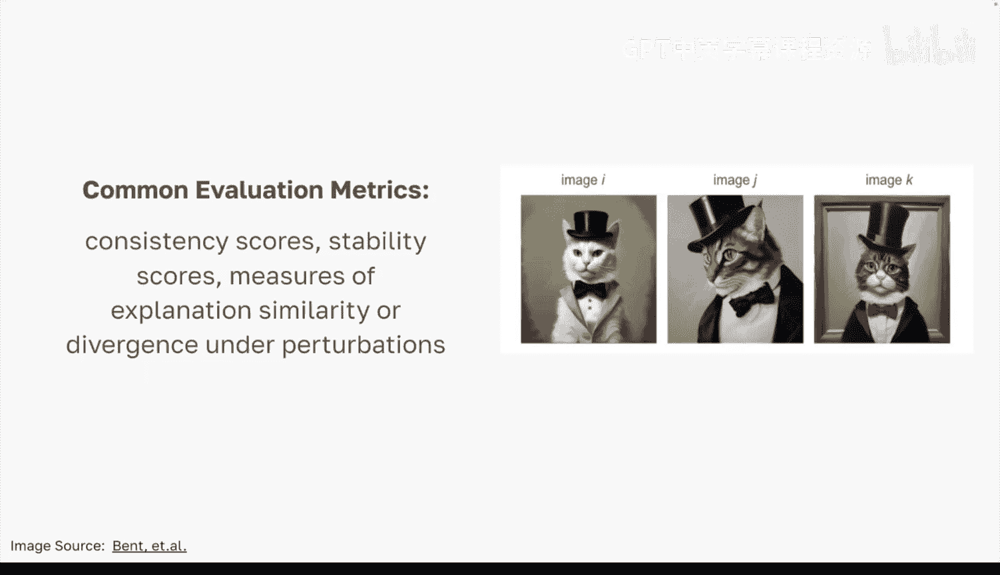

# 可解释人工智能：23：功能评估 🧪

在本节课中，我们将学习可解释人工智能（XAI）的另一种评估类型——功能评估。功能评估主要包含**保真度**和**鲁棒性**评估，它们旨在检验解释方法是否真实反映了模型的内在决策过程，以及解释结果是否稳定可靠。

---

## 保真度评估

上一节我们介绍了XAI评估的总体框架，本节中我们来看看功能评估的第一个核心部分：保真度评估。保真度评估旨在判断解释是否准确地代表了底层模型的决策过程。其主要挑战在于，我们无法获得一个“真实解释”作为标准答案。因此，研究者通常依赖于关于“正确解释”与模型行为之间关系的假设来进行衡量。

当前衡量保真度的方法，通常涉及基于解释对输入进行扰动，然后分析AI模型输出的变化。

以下是几种常见的保真度评估方法：

*   **扰动曲线下面积**：这是一个关键的评估指标。其基本思想是，按照解释方法估计出的**相关性顺序**，依次扰动输入特征（例如，在二值图像中翻转像素，或在RGB图像中改变像素值），并观察分类器输出分数的变化。其核心假设是：扰动相关性高的特征，应比扰动相关性低的特征导致预测分数更急剧的下降。
    *   **公式**：`AOPC = 1/N * Σ [f(x) - f(x_perturbed)]`，其中`f`是模型，`x`是原始输入，`x_perturbed`是扰动后的输入，求和按相关性从高到低进行。
*   **不忠实度**：除了直接衡量保真度，也可以计算其反面——不忠实度。其计算方法是：当某个区域被扰动时，模型输出的变化量与该区域的重要性权重乘以扰动幅度之积的**期望均方误差**。
    *   **公式**：`INFD(Φ, f, x) = E_I [(I^T Φ(x) - (f(x) - f(x_I)))^2]`，其中`Φ(x)`是解释器给出的重要性图，`I`是随机掩码向量，`x_I`是被掩码`I`扰动后的输入。

遗憾的是，不同的保真度评估指标常常会得出不一致的结论，这被研究者称为“不一致性问题”。这是一个活跃的研究领域，未来可能会有所发展。

---

## 鲁棒性评估

与保真度类似，鲁棒性也是一种XAI的功能评估方法。研究表明，微小的输入扰动可能在保持模型预测不变的情况下，显著改变解释结果。鲁棒性评估旨在测试解释在不同输入、模型配置或扰动下的**一致性**和**稳定性**。

常见的鲁棒性评估指标包括各种类型的一致性分数、稳定性分数，以及在扰动下解释的相似性或差异度度量。

---

## 评估实践与挑战

XAI技术多种多样，因此目前没有一种通用的评估方法适用于所有情况。这就是为什么确保遵循你所使用的XAI技术及其应用领域的最佳实践至关重要。

---

本节课中，我们一起学习了XAI功能评估的两个核心方面：**保真度**与**鲁棒性**。我们了解了通过扰动输入来评估解释**忠实性**的方法（如AOPC），以及衡量解释**稳定性**的重要性。最后，我们认识到由于XAI技术的异质性，选择与特定技术和领域相匹配的评估方法是成功应用的关键。