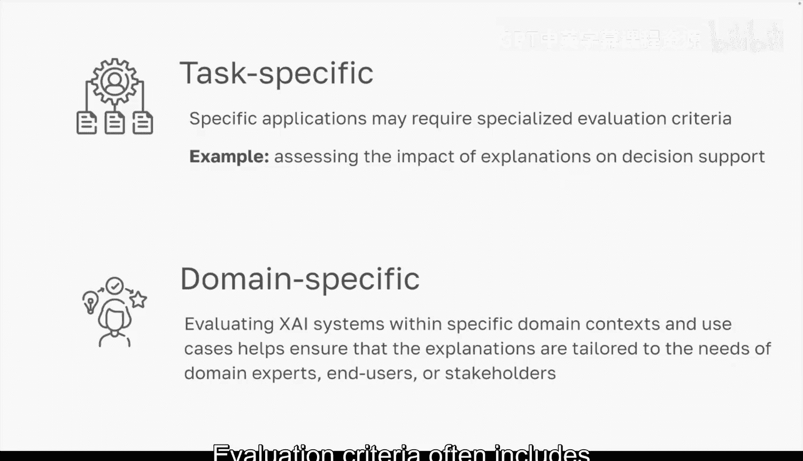

# 杜克大学《可解释人工智能｜Explainable AI (XAI)》中英字幕 p24 24_03_04_代理任务、公平性、专业化评估.zh_en -BV1HnrBBmEon_p24-

The next type of XAI evaluation we will discuss is proxy tasks。

 which includes synthetic or simplified tasks and benchmark data sets。

Synthetic or simplified tasks involve the evaluation of the performance of XI systems on carefully designed tasks or data sets that isolate specific aspects of explanation generation or interpretation。

 accuracy， precision， recall F1 score， those are all common evaluation metrics when performing an evaluation using synthetic or simplified tasks。

Another evaluation to be aware of is benchmark datas。

 where XAI systems are evaluated on publicly available benchmark data sets that are tailored for specific domains or explanation types。

There are a number of benchmark dataset sets and toolkits for XAI， such as XAI Ben。

 a library for benchmarking feature attribution techniques， an X MRRC。

 a benchmark for the explainability evaluation of machine reading comprehension U these benchmarks is a great place to start if you are new to evaluating XI methods。

 because you can easily find tools and documentation for implementation。😊。

There are not currently benchmarks for many XAI techniques。

 but this is another area of active research and development。

A very important evaluation of X AI systems is an evaluation of fairness and bias。

 We have already talked about the challenges and limitations of bias and fairness in AI systems。

 and specifically X AI systems。One way to evaluate fairness and bias in X AI is subgroup evaluation in subgroup evaluation。

 The focus is on evaluating the consistency and fairness of explanations across different subgroups or protected attributes like gender。

 race or age。 Staistic parity measures computed across different subgroups serve as metrics for evaluation。

😊，Finally， specific applications may require specialized evaluation criteria。

Assessing the impact of explanations on the performance of a specific task or application such as decision support。

 debugging or model improvement may be needed metricss for task specificific evaluation could include decision accuracy。

 model improvement or domain specific performance measures。

 different domains and applications may have varying requirements for explanations。

 evaluatingating XI systems within specific domain context and use cases helps ensure that the explanations are tailored to the needs of domain experts and users or stakeholders。

 enhancing their usefulness and applicability， evaluating the quality and usefulness of explanations within the context of a particular domain or use case often involves domain experts。

Evaluation criteria often includes rating scales， agreement scores。

 and qualitative feedback from these domain experts。

