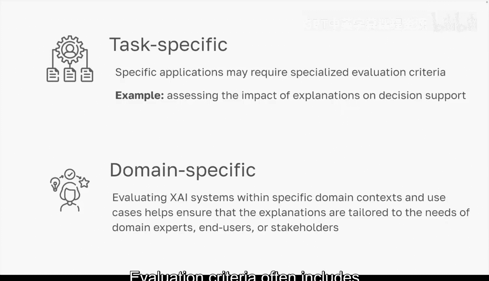

# 可解释人工智能 (XAI)：第24讲：代理任务、公平性与专业化评估

在本节课中，我们将探讨可解释人工智能（XAI）的另外几种评估方法。我们将重点介绍代理任务评估、公平性与偏见评估，以及针对特定应用的专业化评估。理解这些评估维度对于全面衡量XAI系统的有效性和可靠性至关重要。

## 代理任务评估

上一节我们讨论了基于人类的评估方法，本节中我们来看看另一种重要的评估类型：代理任务评估。代理任务评估主要包括两种形式：合成或简化任务，以及基准数据集。

以下是代理任务评估的具体内容：

*   **合成或简化任务**：这种方法通过在精心设计的任务或数据集上评估XAI系统的性能，来**隔离**解释生成或解释理解的特定方面。常见的评估指标包括**准确率**、**精确率**、**召回率**和**F1分数**。
*   **基准数据集**：这种方法在公开可用的基准数据集上评估XAI系统，这些数据集通常为特定领域或解释类型量身定制。

目前已有一些XAI领域的基准数据集和工具包，例如：

*   **XAI-Ben**：一个用于基准测试特征归因技术的库。
*   **X-MRC**：一个用于评估机器阅读理解模型可解释性的基准。

如果你刚开始评估XAI方法，使用这些基准是一个很好的起点，因为你可以轻松找到相关的工具和实现文档。不过，目前并非所有XAI技术都有现成的基准，这也是一个活跃的研究和发展领域。

## 公平性与偏见评估

接下来，我们探讨一个至关重要的评估方面：公平性与偏见评估。我们之前已经讨论过AI系统，特别是XAI系统中存在的偏见与公平性挑战和局限。

评估XAI公平性与偏见的一种方法是**子群评估**。在子群评估中，重点在于评估解释在不同子群或受保护属性（如性别、种族或年龄）间的**一致性**和**公平性**。在不同子群间计算的**统计奇偶性度量**可以作为评估的指标。

## 专业化评估

最后，特定的应用场景可能需要**专业化的评估标准**。评估解释对特定任务或应用（如决策支持、调试或模型改进）性能的影响可能是必要的。

任务专业化评估的指标可能包括：

*   **决策准确率**
*   **模型改进程度**
*   **特定领域的性能度量**

不同的领域和应用对解释可能有不同的要求。在特定的领域背景和用例中评估XAI系统，有助于确保解释能满足领域专家、用户或利益相关者的需求，从而增强其**有用性**和**适用性**。

在特定领域或用例背景下评估解释的质量和有用性，通常需要领域专家的参与。评估标准通常包括来自这些领域专家的**评分量表**、**一致性分数**和**定性反馈**。

---

在本节课中，我们一起学习了XAI的三种关键评估方法。我们了解了如何通过代理任务（合成任务和基准数据集）来量化评估解释方法；探讨了评估解释在不同群体间公平性的重要性及其方法（子群评估）；最后，我们认识到针对特定应用的专业化评估对于确保解释在实际场景中的实用价值至关重要。综合运用这些评估方法，才能对XAI系统做出全面而有效的评判。