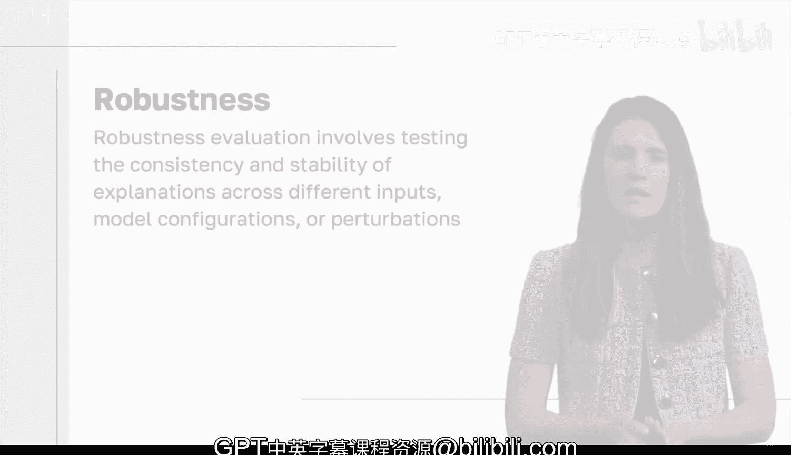
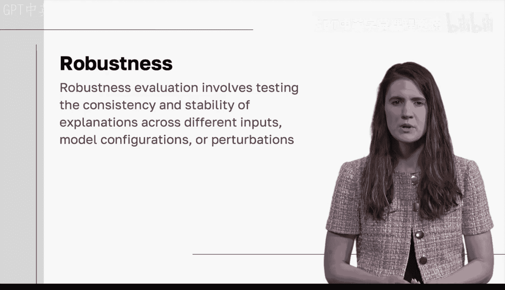
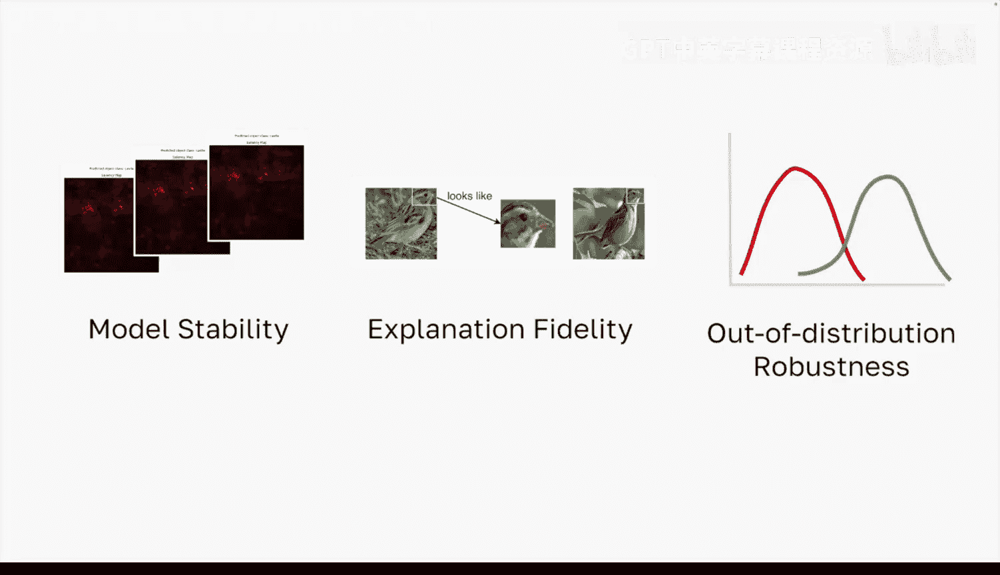
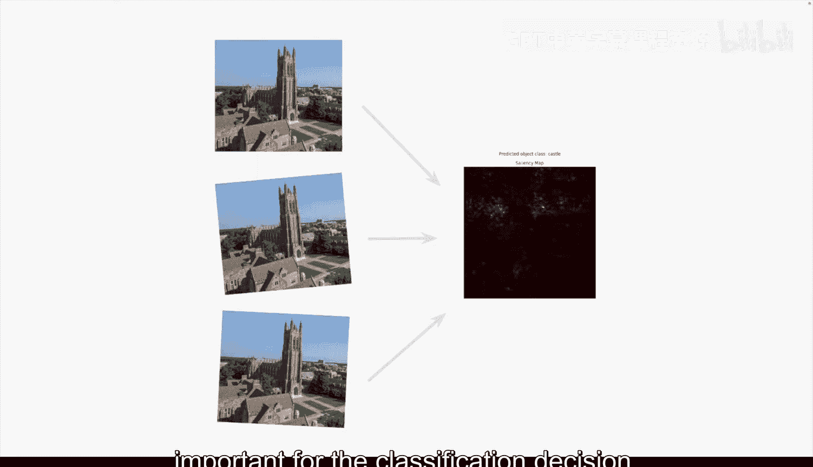
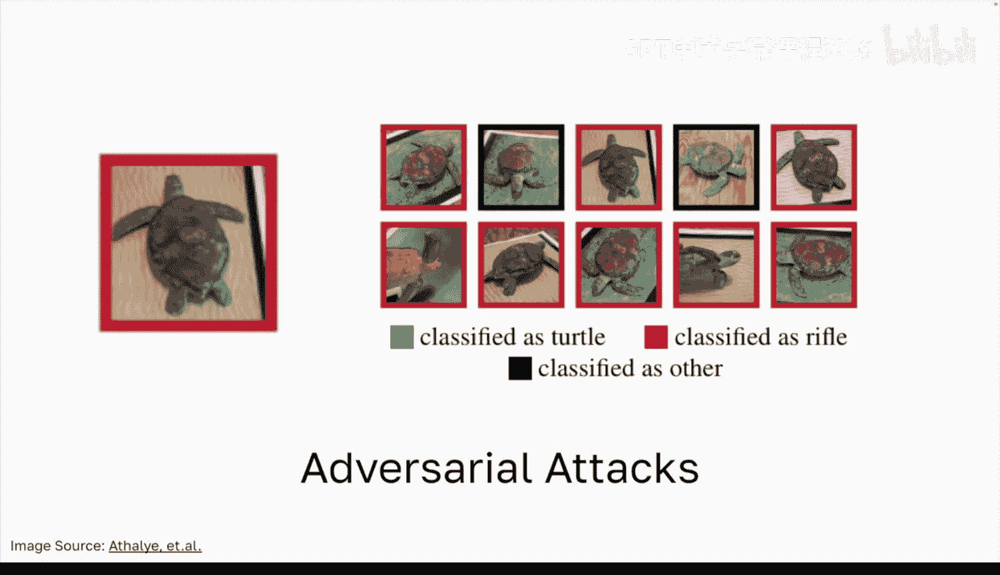
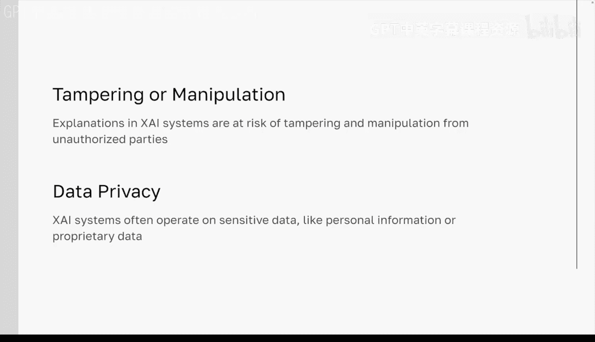
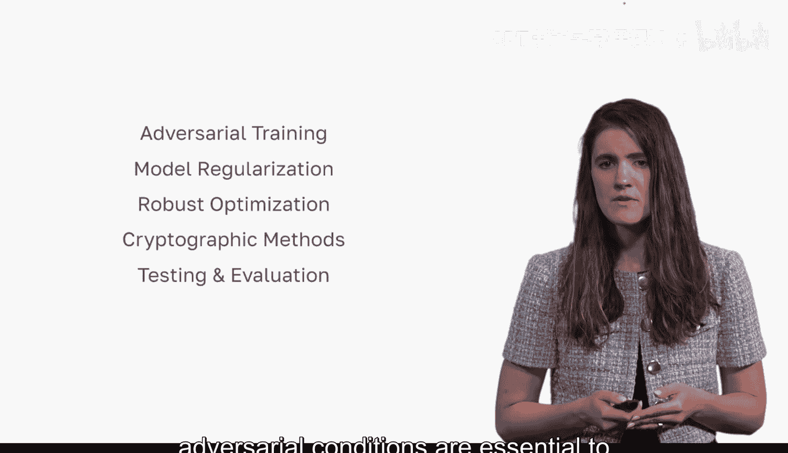
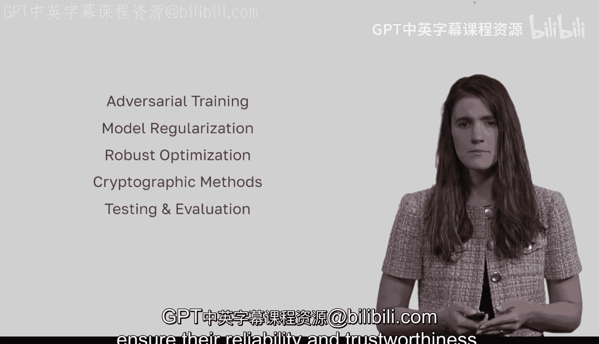

# 杜克大学《可解释人工智能｜Explainable AI (XAI)》中英字幕 p25 25_03_01_XAI安全与鲁棒性介绍.zh_en -BV1HnrBBmEon_p25-

In the evaluation section， we already introduced robustness。

 Robbusness evaluation involves testing the consistency and stability of explanations across different inputs。

 model configurations or perturbations。😊。

When we think about robustness in XAI systems， we need to consider model stability。

 which ensures that small variations in the input do not drastically change the explanations。

 explanation fidelity， which ensures that the explanations accurately reflect the model's true reasoning and out of distribution robustness。

 which ensures that the XI system can still provide useful explanations。

 even for inputs that deviate from the training distribution。

X AI system should provide consistent and reliable explanations。

 even in the presence of small perturbations in the input data or model parameters。

 This ensures that the explanations are trustworthy and do not change drastically due to minor variations。

 Let's consider an X AI system for image classification where the explanations are generated based on the activations of the convolutional layers in the neural network。

 If the input image is slightly perturbed， for example。

 by adding a small amount of noise or rotating the image by a few degrees。

 a stable X AI system should provide similar explanations highlighting the same or very similar regions of the image as being important for the classification decision。

The explanations provided by X AI system should accurately reflect the true reasoning behind the model's predictions。

 If the explanations are misleading or inaccurate， they can lead to incorrect interpretations and potentially harmful decisions。

 Let's consider an X AI system for loan approval decisions。

 where the explanations are based on feature important scores。

If the model is truly relying heavily on the applicant's income and credit score for its predictions。

 but the X Ai system highlights irrelevant features like the applicant's age or gender as been important。

 this would be a violation of explanation， fidelity。

 Such inaccurate explanations could lead to biased decisions and potential legal issues。

X AI system should be able to handle inputs that are outside the distribution of the training data and provide meaningful explanations。

 rather than failing or producing unreliable results。

 Let's consider an X AI system for natural language processing tasks such as sentiment analysis or named entity recognition。

 The system was trained on a corpus of news articles and social media posts。

 If the system encounters a highly technical document or a text written in a very different style。

 for example， legal documents or scientific papers。

 a robust X AI system should still be able to provide reasonable explanations for its predictions。

 rather than failing or producing nonsensical explanations。

Security considerations are critical when developing a robust XAI system。

 there are a number of security concerns with XAI techniques that need to be addressed。

These include adversarial attacks where an attacker crafts carefully designed input data to manipulate the model's output or the explanations provided by the X AI system。

 Here is an image of a 3D printed turtle that is itself an adversarial attack。

 The way this turtle was created， tricks the model and to classifying it as a rifle in different orientations。

Robust X AI system should be able to detect and mitigate these attacks。 In some cases。

 an attacker may attempt to extract or replicate the underlying machine learning model by probing the X AI system with carefully crafted inputs and analyzing the explanations。

XAI system should be designed to prevent or mitigate such model extraction attacks。

The explanations provided by X AI systems should be protected from tampering or manipulation by unauthorized parties。

 X AI systems often operate on sensitive data， such as personal information or proprietary data。

 appropriate measures should be taken to ensure data privacy and protection。

To address these robustness and security concerns， developers of XxiI systems employ various techniques such as adversarial training。

 model regularization， robust optimization and cryptographic methods。

Rigorrous testing and evaluation of X AI methods under different scenarios and adversarial conditions are essential to ensure their reliability and trustworthiness。

