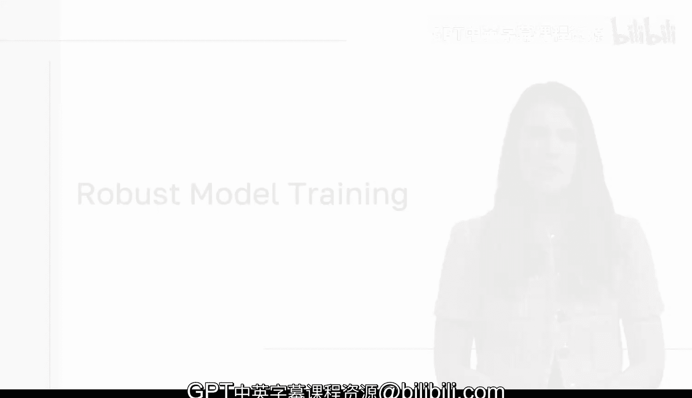
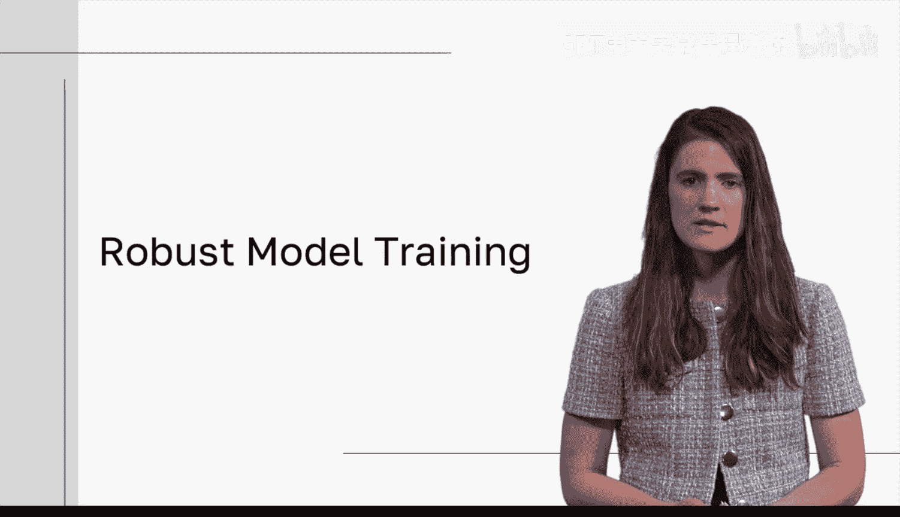
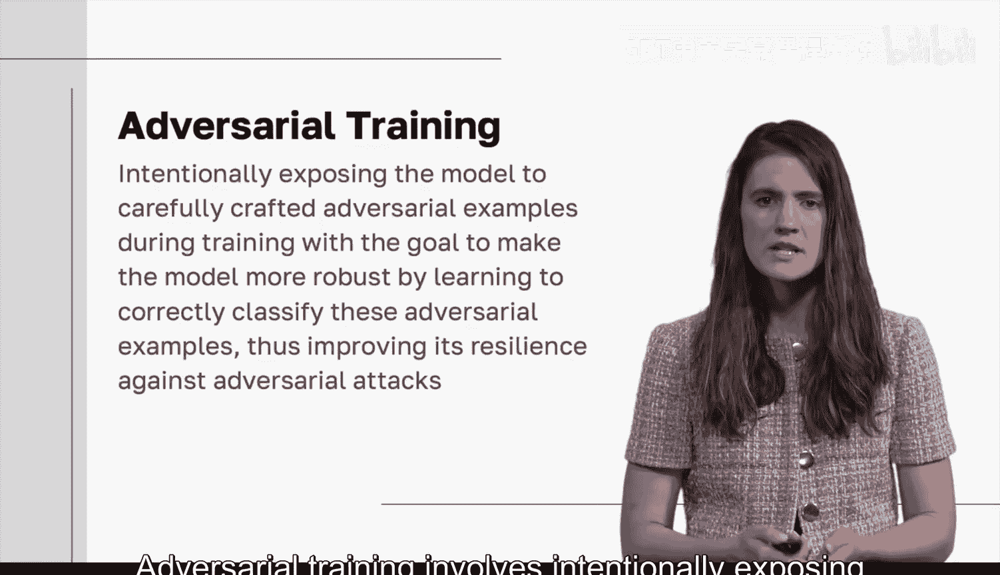
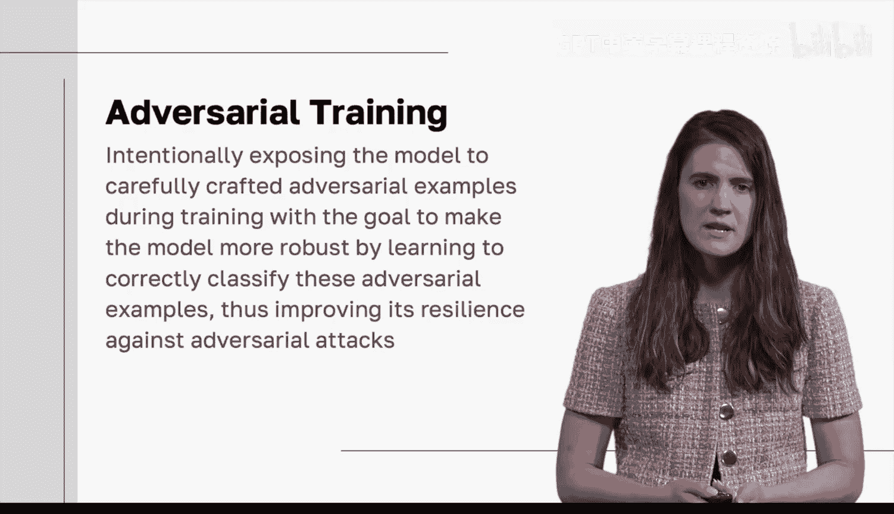
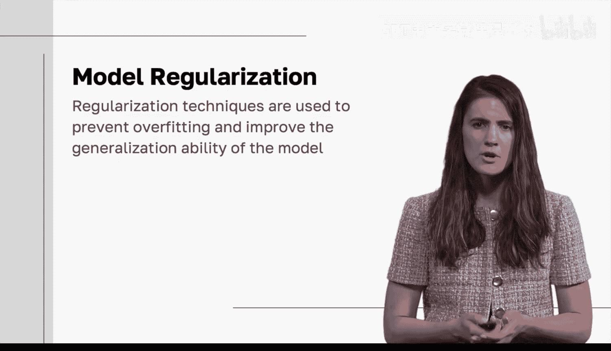
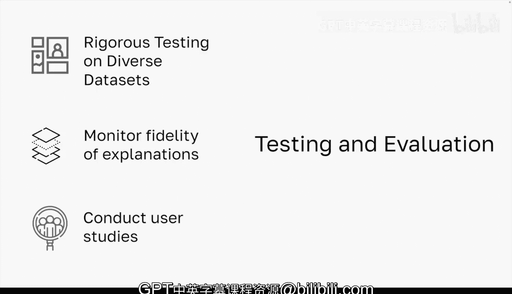

# 杜克大学《可解释人工智能｜Explainable AI (XAI)》中英字幕 p26 26_03_02_鲁棒模型训练.zh_en -BV1HnrBBmEon_p26-

In robust model training， there are a number of methods that can be used to increase robustness。

These include adversarial training techniques to improve the model's robustness against adversarial attacks。

Adversarial training involves intentionally exposing the model to carefully crafted adversarial examples during training。

 The goal is to make the model more robust by learning to correctly classify these adversarial examples。

 thus improving its resilience against adversarial attacks。😊。

Model regularization is another method used during training to improve model generalization and stability。

 Regization techniques are used to prevent overfitting and improve the generalization ability of the model。

 Common methods include L 1， L 2 regularization， drop out and early stopping。By reducing overfitting。

 the Xxi I system becomes more stable and less sensitive to small perturbations in the input data。

 improving its robustness。😊。

L 1 Reg or Lasso as a penalty equal to the absolute value of the magnitude of coefficients。

 This encourages sparsity in the model where many coefficients become exactly 0。

Theres also L2 regular， which is called Ridge。 This adds a penalty equal to the square of the magnitude of coefficients。

 This encourages a small， but non zero coefficient。

Drop out is when you randomly drop neurons during training to prevent overfitting。

 During each training step， each neuron has a probability of being ignored。

 This forces the network to not rely on any specific neurons， promoting redundancy。

Early stopping stops training when the performance on a validation set stops improving。

 This prevents overfitting by stopping at the point where the model generalizes best。

Robust optimization techniques aim to find model parameters that optimize performance under various perturbations or uncertainties。

 This can involve formulating the optimization problem with additional constraints or objective terms that account for worse case scenarios or adversarial perturbations。

😊，While the former examples may not work for all of the X AI methods we have discussed。

 this next one will。 It is so important to perform rigorous testing and evaluation on diverse dataset sets。

 including out of distribution and adversarial examples。

 quantifyntifying and monitoring the fidelity of explanations can be done using a sensitivity analysis or perturbation based evaluation。

As we talked about in the previous section on evaluation。

 assessing the consistency and fidelity of explanations across multiple runs and inputs and conducting user studies to evaluate the interpretability and usefulness of the explanations allows us to identify potential vulnerabilities。

 weaknesses or inconsistencies in the XAI system。

