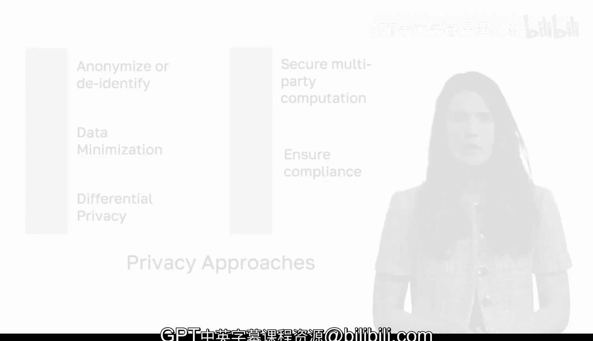
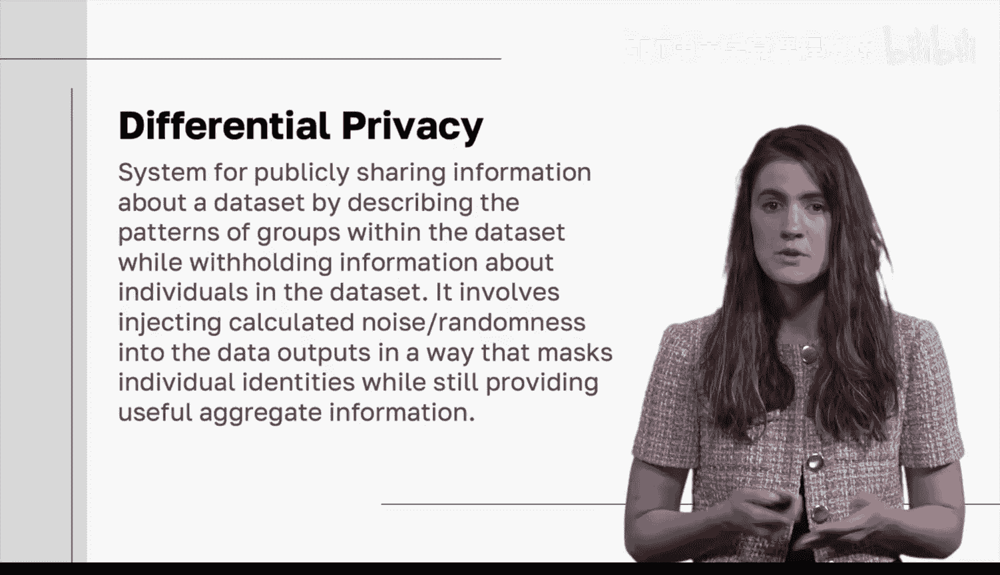
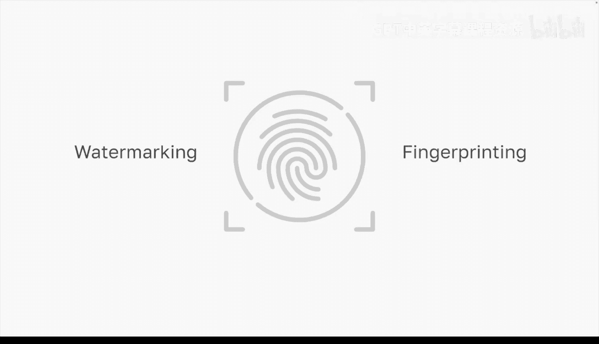
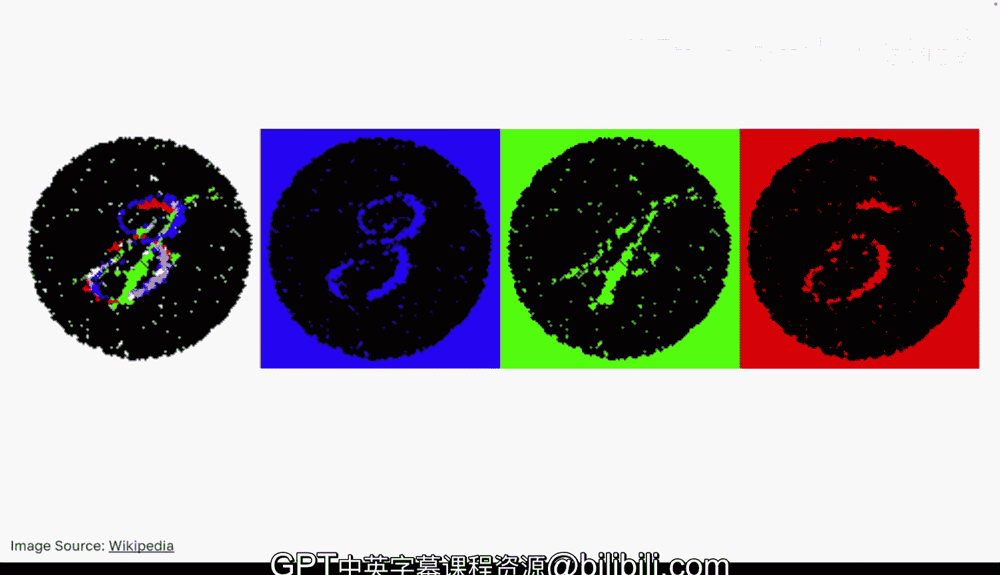

# 杜克大学《可解释人工智能｜Explainable AI (XAI)》中英字幕 p27 27_03_03_数据隐私与保护.zh_en -BV1HnrBBmEon_p27-

XAI systems often operate on sensitive data， such as personal information or proprietary data to generate explanations ways to protect data privacy include anonymizing or deidentifying personal data before processing it in an XAI system。

 implementing data minimization principles， implementing privacy preserving techniques such as differential privacy or secure multiparty computation to protect sensitive data used by the XAI system and ensuring compliance with relevant data protection regulations and guidelines for your company。

 industry and application domain。Data minimization refers to only collecting。

 using and retaining the minimum amount of personal data required to accomplish a specific purpose。

 It limits the risk of sensitive data breaches and privacy violations in the context of explainable AI data minimization protocols would restrict the collection and use of personal data for model training and explanation generation to only what is absolutely necessary。

 Any personally identifiable information not required for the AI's functioning would be removed or obfuscated。

Differential privacy is a system for publicly sharing information about a data set by describing the patterns of groups within the data set and withholding information about individuals in the data set。

 It involves injecting calculated noise or randomness into the data outputs in a way that masks individual identities while still providing useful aggregate information。

Differential privacy can be applied to the data used by the XAI system or the explanations generated to protect the privacy of individuals whose data is used。

By adding controlled noise to the explanations or the intermediate computations。

 differential privacy can prevent the leakage of individual level information while still providing meaningful aggregate explanations。

Differential privacy is particularly useful in scenarios where data needs to be shared or analyzed while preserving the privacy of individuals in that data set。

 such as in census data， medical records， or location data。

Secure multiparty computation， or NPC is a cryptographic technique that allows multiple parties to jointly compute a function over their private data inputs while keeping those inputs confidential from each other and from any third party。

 MPC can enable secure computation of explanations by allowing different parties to jointly compute the explanations for a model without disclosing their private data to each other or a third party。

 This is relevant in settings where the data needed for generating explanations is distributed across multiple organizations or parties。

 and they need to preserve data confidentiality。😊，In addition to data privacy and protection。

 it is important to ensure secure communication by implementing secure communication channels like encryption and digital signatures to prevent tampering or interception of explanations during transmission。

 using techniques like water marking or finger printing can also help ensure the integrity and providence of explanations。

Water marking is the process of embedding a unique。

 imperceptible mark or signal into the explanations generated by the X AI system。

 This mark serves as a digital water mark， similar to the water marks used in digital images or documents。

Finger printinging is a related technique that involves embedding a unique identifying mark or fingerprint into the explanations generated by the X AI system。

 Unlike watermarks， which are designed to be imperceptible。

 fingerprints are often visible or easily extractable from the explanation。

 Both water marking and finger printing techniques can be implemented using various methods。

 such as embedding specific patterns or sequences in the explanation text。

 modifying the statistical properties of the explanation。

 or leveraging cryptographic techniques like digital signatures or stganography。

Here， the same image viewed by white， blue， green and red lights revealed different hidden numbers。

 This is an example of stganography。 Steganography is a really fascinating technique used to conceal secret information within another digital medium。

 such as text or images。 For example， in textual explanations。

 Steganography can be used to hide a watermark or finger print within the text itself。

 This can be done by modifying the least significant bits of certain characters。

 Adjusting the spacing or formatting of the text， or using techniques like line shift coding or word shift coding。

 The hidden information is imperceptible to human readers。

 but can be detected and extracted by author parties using the appropriate key or algorithm。😊。

If the X A I system generates visual explanations， such as saliency maps or attention， heat maps。

 there are a number of steganography techniques and transforms that can be used to embed water marks or fingerprints within the image data。

 This ensures that X C I systems are protected from tampering or manipulation by unauthorized parties。

