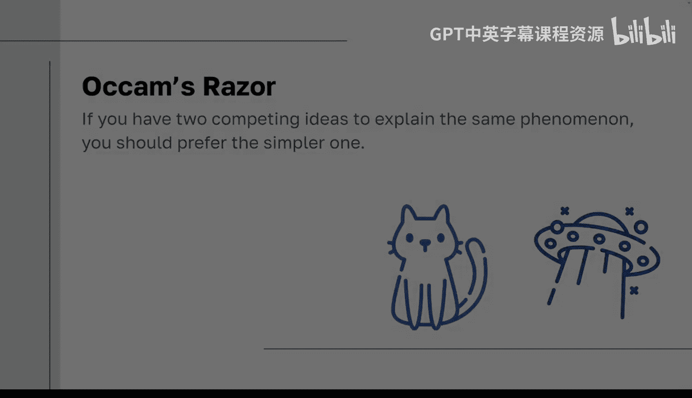

# 杜克大学《可解释人工智能｜Explainable AI (XAI)》中英字幕 p30 01_01_01_可解释机器学习导论.zh_en -BV1HnrBBmEon_p30-

To kick off our course on interpretable machine learning， let's talk about why it is important。

 I'll illustrate this with a few scenarios。You submit your resume to a company that uses an AI algorithm to select people to interview。

 You are not selected， even though your resume is a perfect match with the skills and requirements posted in the job description。

You reach out to the company's recruiting team and they can't tell you why your application didn't make the cut because the model only gave an output with no explanation。

It turns out that they used current employee resumes in their training process。

 and many of the current employees had bocce ball as a skill in their resume。 You did not。

 and you didn't make the cut， despite boy ball not being a part of the job description or necessary skill set for the job。

 Now， replace boy ball with a specific gender or ethnicity。You applied for a loan you were denied。

 despite having an excellent credit score。 when you call the bank。

 they admit that they are now using an AI algorithm to process loan applications。

 and they aren't sure why your loan was denied。You go to the hospital are triage using an AI algorithm。

 You are sent to the back of the line and required to wait three hours for treatment。

 while kids with a cold are seen right away。 The AI algorithm is using information about your socioeconomic status to triage you。

 even though that data wasn't seen as important by the engineers training the algorithm so they just left it in。

These examples， while fictional， are based in reality， recruitment。

 finances and healthcare are three high stakes domains that are actively using AI tools。

How about a real example In 2023， the Detroit police used facial recognition technology。

 a computer vision machine learning model and falsely identified Portorsia Woodruff as a car jackcking suspect。

 She was arrested while eight months pregnant for a crime she did not commit。

Why did the models identify Portia as the suspect， They were unable to determine the reasons the model identified her picture。

These are just a few examples of where a lack of understanding around a model's decisions can have significant consequences。

And that is where we are going to kick off our introduction to interpretable machine learning。

 The rationale for interpretable machine learning can be represented by this quote from Plato。

 A good decision is based on knowledge and not on numbers。What do I mean by this。

 We can plot ice cream sales by month。 We can also plot shark attacks by month。

 When you look at these plots， you may ask the question。

 does eating ice cream cause shark attacks From a purely numeric perspective。

 These two seem to be quite correlated with one another。

 So you might conclude that eating ice cream does cause shark attacks。

But when drawing this conclusion， we are ignoring our knowledge。

 specifically our knowledge about seasonal temperature fluctuations and their impacts on both people eating ice cream and people entering the ocean。

 Our conclusion is then quite different。 While these two events are correlated。

 we know one does not cause the other。😊，In the context of explainable AI or X AI and interpretable machine learning。

 interpretable machine learning is defined as developing machine learning models that are inherently understandable and self explanatory。

This is typically done using transparent modeling techniques like linear regression。

 decision trees or rule based models。The main idea behind interpretable machine learning is allowing the internal logic and decision making processes of the model to be interpretable without needing additional explanation methods。

There is some overlap between interpretable machine learning and explainable AI or X AI。

 but they are not exactly the same。 Interpreable machine learning focuses specifically on developing machine learning models and techniques that are inherently interpretable or self explanatory。

 Examples include linear and logistic regression， decision trees and rule based models。

The goal is to make the model itself transparently understandable without the need for additional explanations。

Explainable AI or X AI is a broader field that aims to make any AI system。

 including opaque deep learning models more explainable。

 It involves developing techniques to explain the outputs and decisions of black box AI models after they are trained。

 Examples include Shap， Ly， saliency maps and concept activation vectors。😊。

The goal is to generate posttoc explanations for an existing model's behavior。

The TLDR is that interpretable machine learning focuses on inherently transparent models from the start。

XAI focuses on explaining previously trained complex models after the fact。

Interpreable machine learning is a subset of the broader XAI field。

 which also covers explainability techniques for any AI system。

The two fields are related and often used together。

 as even interpretable models may need additional explanations。

 While complex models can be made more interpretable through X AI methods。

Let's look at some examples of interpretable machine learning models that we will dive deeper into over the course of this module。

 Line models like linear regression and logistic regression are highly interpretable as their predictions are based on a weighted sum of input features。

The coefficients directly indicate the importance and directionality of each feature。

Enforcing sparsity， for example， via lasso or elastic net regularization can enhance interpretability by driving coefficients of irrelevant features to 0。

 effectively performing feature selection。And generalized models try to solve some of the problems with linear regression。

 For example， Generalized additive models combine linear models with nonlinear feature transformations while maintaining an additive and interpretable structure。

 showing how each feature shape impacts predictions。

Decision trees like cart and ghost are also intrinsically interpretable models。

 Their hierarchical tree structure of if， then else。

 decision rules provides a natural way to trace how predictions are made for different instances based on their future values。

Rule based models encode knowledge in the form of human readable rules like if age is greater than 65 and medication equals x。

 then risk equals high。 Rule extraction techniques can also be applied to learn interpretable rules that approximate black box model behavior。

We will also explore inherently interpretable neural networks。

 prototype based networks like ProtoP integrate prototypes or examples into the neural network。

 monotonic constraints like those used in a monotonic neural network architecture。

 we will explore in this course， ensure model predictions vary in a consistent direction as features change。

 aligning with human intuitions。New representation networks like the Kmograve Arnold Network or Can have introduced alternatives to weights using spine representations while sacrificing some flexibility。

 these interpretable machine learning approaches can be invaluable in domains like health care。

 finance and critical decision making systems where being able to understand and inspect model reasoning is paramount。

This is a non exhaustive list。 Other inherently interpretable machine learning models include Bayesian models。

 Can nearest neighbors and linear discriminant analysis。

In a current landscape dazzled by the results of generative AI。

 many problems can be solved using an interpretable model。

 and I recommend that interpretable models be included in the models you are evaluating for your use case。

Something that I put in practice， both teaching AI in the classroom and when building products with AI is the principle of Ohamm's razor。

 Oham's razor states that if you have two competing ideas to explain the same phenomenon。

 you should prefer the simpler one。 For example， you hear a sound in the middle of the night and form two hypotheses。

 First is that your cat knock something off the table。

 The second is that aliens landed on your roof and are now invading your house。

The simpler of the two hypotheses that your cat knocked something off the table。

 So that is the one you should prefer， according to Oham's razor。In the context of AI。

 if you have two AI models that perform similarly on your evaluation criteria。

 you should prefer the simpler， more interpretable one at a minimum。

 you should always consider the simplest approach and provide rationale on why you need an approach that is more complex。

