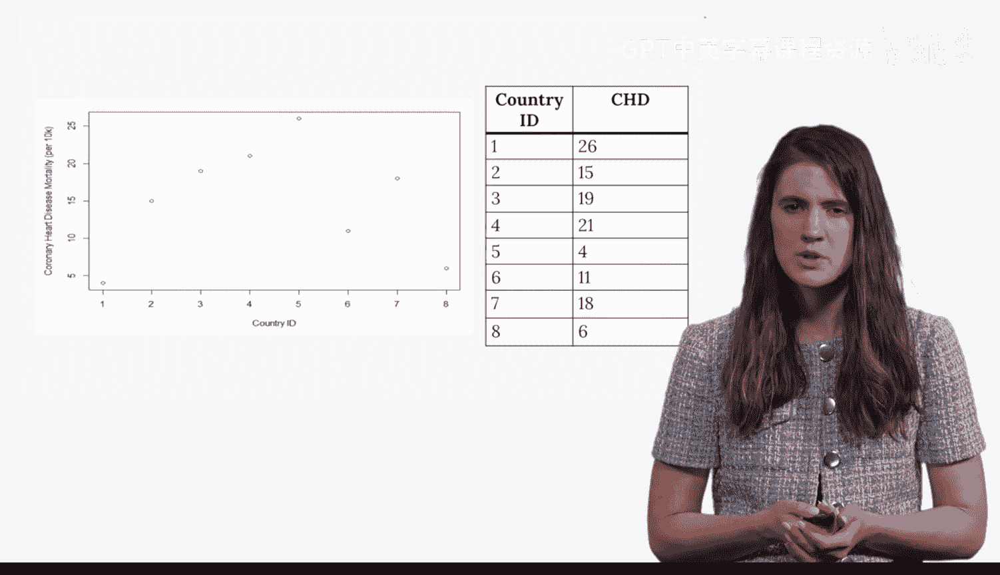
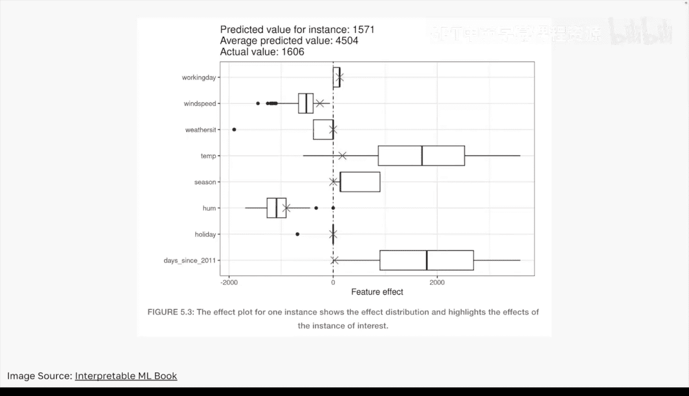
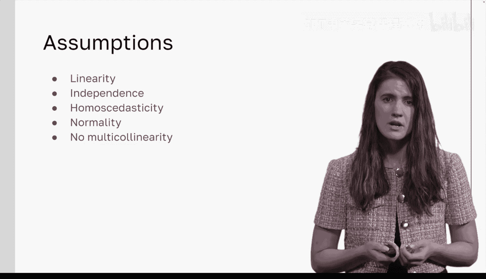
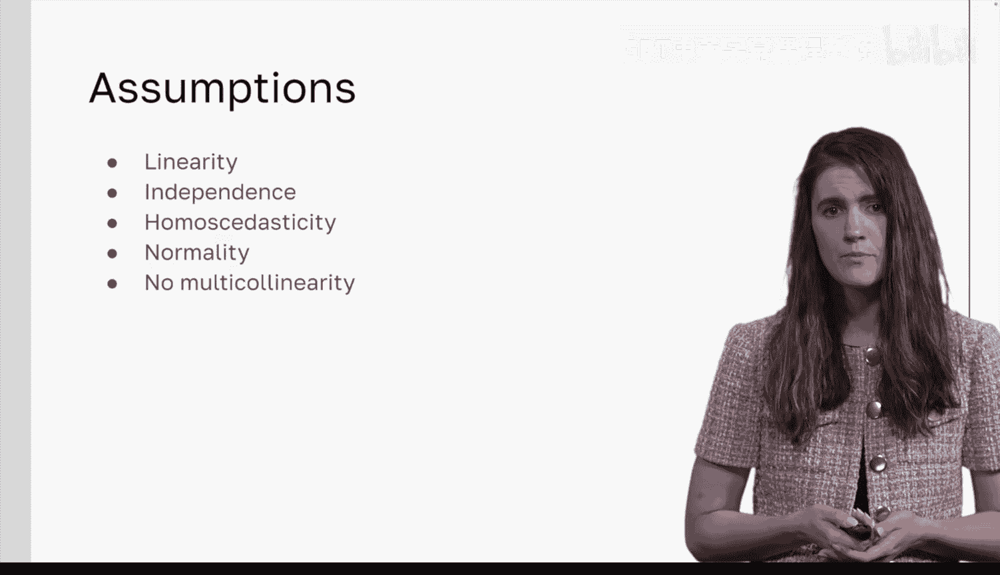
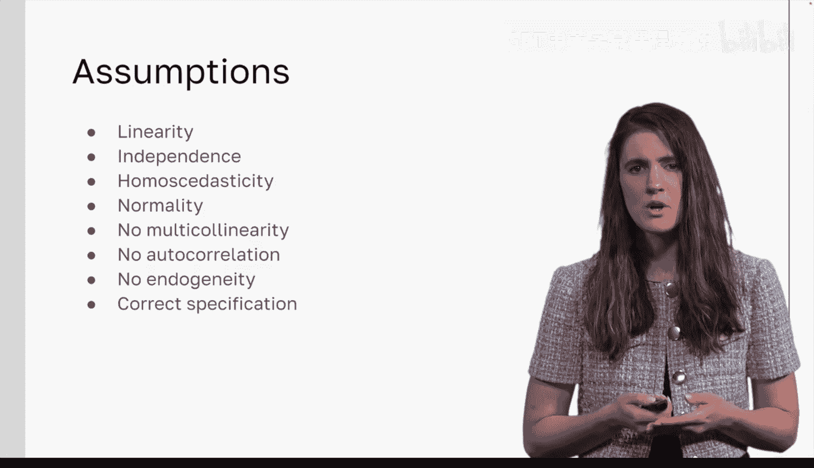
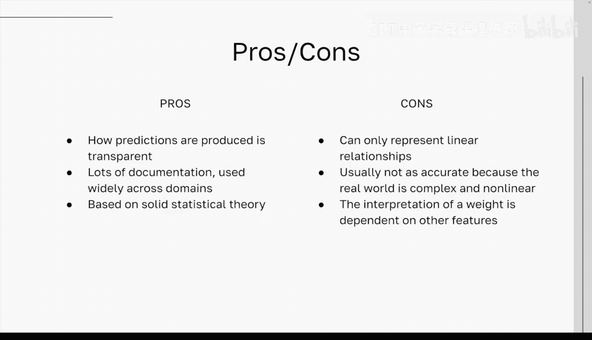

# 杜克大学《可解释人工智能｜Explainable AI (XAI)》中英字幕 p31 02_01_01_线性回归.zh_en -BV1HnrBBmEon_p31-

We are going to examine the different components of linear regression using a data set based on the seven countries study。

 which examine factors that affect cardiovascular disease around the world and note that this data set will based on the study is simulated data。

Let's consider the relationship between coronary heart disease mortality and the arbitrary I D assigned to each country。

 Since the I D column is chosen arbitrarily， we would not expect it to have a strong relationship with coronary heart disease mortality。

 A scatter plot of the two variables confirms our hypothesis。

 There is not a strong linear relationship between these columns。

Let's plot a line over these points。 Since we have hypothesized that there is no relationship between the variables。

 Let's draw a line with a slope of 0， indicating no relationship。

Now we are going to determine the vertical distance between each point and the line we just drew。

 Start by drawinging arrows from the line to each point。

If we examine the distances between the line and the point。

 we will see that some points are very close to the line。 For example， plus 3 and -4。

 and some are very far away like plus 11 and -9。 For one point， it is exactly in the line。

 and we see that the distance is 0。These vertical distances from the line to each point are called residuals for data points above the line。

 the residual is positive， and for data points below the line， the residual is negative。

If we consider the line a prediction of where points should be。

 based on our hypothesis that there should be no relationship between our variables。

 the residuals are just the observed y values or points minus the predicted y values， the line。

One way to think about residuals is that they are how far the data falls from the line。Now。

 let's add up all of the residuals above the line and all of the residuals below the line。

 We will see that the positive residuals above the line add up to be 24 and the negative residuals below the line add up to be negative 24。

 If your line is truly a line of best fit， your residuals will always sum to 0。😊。

The problem with residuals is that we don't know the absolute differences from the line。

 Our solution to this is to square the residuals。 This gives us absolute differences。

 This also emphasizes large deviations。By summing up these squared residuals。

 we get a good estimate of the error。 The error being the difference between the observed value and the predicted value。

 We call this the sum of squared residuals or sum of squared errors。 SS E。

 You may also hear this referred to as the residual sum of squares。

The goal of linear regression is to create a linear model that minimizes the sum of squared residuals。

So let's go back to our data。 We now want to look at another variable and examine its relationship on coronary heart disease mortality。

 This variable smoking is the average cigarettes per adult per day in that country。

If we plot coronary heart disease mortality against average cigarettes per adult per day。

 we will see a strong linear relationship。In simple linear regression。

 we attempt a number of best fit lines until we find the one that minimizes the sum of squared errors below。

 you can see a visual representation of these different lines examined for each line。

 The sum of squared errors is calculated。 The line with the lowest sum of squared errors is the line of best fit。

 Here。 it is shown as the red line。This is called ordinary least squares。

 The goal of which is to find the line or hyperplane in higher dimensions that best fits the observable data points by minimizing the sum of squared residuals。

Ordinary least squares relies on several assumptions。

 The relationship between the predictors and outcomes is linear。

 Observations are independent of one another。Residiguals have constant variance across all levels of predictors。

 which is called homooskyasticity， and residuals are normally distributed。

Regression is just a methodology used for modeling and analysis of numerical data In regression。

 relationships between two or more variables are evaluated。 Reion can be used for prediction。

 estimation， hypothesis testing and modeling causal relationships。

If we look at the terminology for simple linear regression。

 we will find an equation not unlike our standard y equals M x plus B equation from primary school。

 The y is called the dependent variable outcome variable or response variable。

 The X is called the independent variable， predictor variable。

 explanatory variable or regressiongressor variable。 beta n is referred to as the intercept。

 and beta 1 is the slope。 and epsilon is the random variable。

 The slope and intercept beta 1 and beta not respectively are also called the regression coefficients。

Let's go back to our previous example。 We have determined that the equation of our simple linear regression to be y equals 0。

25 plus 2。41 x。 Let's ask ourselves a couple of interpretation questions to make sure we understand our equation for simple linear regression。

What is the interpretation that beta 1 equals 2。41？

If we had a ninth country with an average cigarettes per adult per day equal to 20。

 what would you predict the mortality rate to be？The interpretation that beta 1 equals 2。

41 is that this is the expected change in coronary heart disease mortality with a one unit change in average cigarettes per adult per day。

The answer to the second question can be found using our equation。

 We find the expected value of y to be 48。45。We have examined simple linear regression。

 and we can determine the relationship between our outcome variable and regressor variable。

 But what if we had other potential regressor variables， such as average age of the population。

 average amount of saturated fat consumed。Minutes of exercise daily， on average。

 or the country's favorite number。This is where multiple linear regression comes in。

 Multi linear regression is the same as simple linear regression。 But instead of fitting a line。

 if it's a hyperplane， which separates multiple variables。

 And now we have a regression coefficient for each of the regressiongressor variables。

 as shown below。😊，This allows you to predict an outcome variable using many different variables。

 all of which may have an effect on the outcome。 In this example， age， diet， Saurated fat。

 exercise and smoking may all have an effect on the coronary heart disease mortality in a country。

 And we want to include all of these in our model of linear regression。

The inherent interpretability of linear regression allows us to understand how the model is making its predictions and which features are most important for determining the output。

 We can evaluate the coefficients to identify the most influential features and gain insights into the underlying patterns in the data。

 The coefficients or beta values in the linear regression equation provide insight into the relationship between each input feature and the target variable。

 specifically the sign， whether it's positive or negative of a coefficient indicates whether the associated feature has a positive or negative relationship with the target variable。

😊，And the magnitude of a coefficient represents the strength of that relationship。

 Lager coefficients indicate a stronger influence of that feature on the target variable。

The specific interpretation depends on the type of feature。

 Take the standard form of our linear regression equation。 If x is numerical。

 increasing x by one unit changes the estimated outcome by beta 1。If x is binary。

 changing x from 0 to 1 changes the estimated outcome by beta 1。If x is categorical。

 this can be handled in different ways。 One solution is that if x is a categorical feature。

 each category is one hot encoded， and thus each column is treated as a binary feature。

 or changing x from 0 to 1 changes the estimated outcome by beta 1。

This is how to think about interpreting the intercept。 for an instance。

 with all numerical feature values equal to 0 and the categorical feature values equal to the reference categories 0。

 The model prediction is the intercept weight， beta not。This is usually not relevant。

 It's really only relevant when features have been standardized。

 Then the intercept is the predicted outcome of an instance where all features are at their mean value。

We can also calculate the feature importance of features in linear regression。

 which is simply the absolute value of a feature' T statistic。

 The T statistic is the estimated weight scaled with its standard error。😊。

A couple of things to keep in mind is that the importance of a feature increases with increasing weight and the more variance the estimated weight has。

 the less sure we are about the correct value than the less important that feature is。

We can create visualizations to help us better understand the model。

 Two common ways are a weight plot and an effect plot。For the effect plot， you calculate the effects。

 which is the weight per feature times the feature value of an instance。

You can also show individual predictions on an effect plot， as we have shown here。

 This is done by taking a specific instance， and plotting its specific feature values multiplied by the weight of those features。

 This can be a great way to understand what is happening in individual predictions and compare them to the model。

 as a whole。😊。

And here we have an incredibly large challenge with linear regression and has many， many assumptions。

 in the real world， these assumptions are often violated。

 This is why we have variations of linear regression。

 which we're going to talk about later in this module。😊。

Here are a few of linear regressions assumptions。

Linearity， the relationship between the dependent variable Y and the independent variable X is linear。

 If this assumption is violated， nonlinear models may be more appropriate。

 The more nonlinearities and interactions there are。

 the less accurate the linear model will be and the less truthful the explanations become。

Independence， the observations in the data set are independent of each other。

 There should be no correlation between the residual errors of the observations。Homokeasticasticity。

 the variance of the residual errors， the errors between the predicted and actual values is constant across all values of the independent variables。

 If this assumption is violated， heteroskeasticasticity， the model may be inefficient or biased。

Normalality， the residual errors follow a normal distribution。

 This assumption is especially important for hypothesis testing and confidence interval estimation。

No multicollinearity。 The independent variables should not be highly correlated with each other。

 High multicollineity can lead to unstable estimates of the coefficients。

No autocorlation， the residual errors and the regression are not correlated with each other。

 autocorrelation can lead to inefficient estimates and invalid hypothesis testing。No endogeneity。

 The independent variables are not correlated with the error term。

 Endogeneity can lead to bias coefficient estimates。Correct specification。

 The regression model is correctly specified， and there are no relevant variables omitted from the model。

More interpretable models have fewer features， in real life applications we often have hundreds or even thousands of features。

 so how do we handle this？One well established way to introduce sparsity into your models。

 Sprsity essentially means fewer features。There are several methods for doing this。

 among the most popular is Lasso， or at least absolute shrinkage and selection operator。

Laso performs feature selection and regularization of the selected feature weights when applied to a linear regression model。

 It works like this。 It penalizes large weights， causing weights to shrink。

 and many of them to shrink all the way to 0， removing those features from the model。

 Viewewer features equal a more interpretable model。😊。

Let's evaluate the pros and cons of linear regression for interpretable machine learning。

 How predictions are produced is transparent， Ma it easy for humans to understand。

 There is also a lot of documentation out there in linear regression and is widely used across domains。

 So there is a large community of people working with linear regression models。

 It's also based on solid statistical theory。On the other hand。

 it can only be used to represent linear relationships because of this。

 it is usually not as accurate in real world applications。

 because the real world is complex and nonlinear。 Also。

 the interpretation of a weight is dependent on other features。

