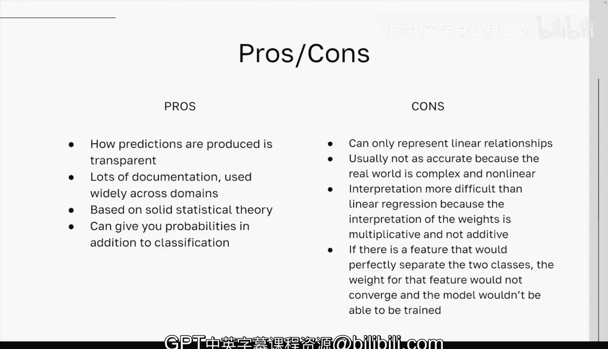

# 杜克大学《可解释人工智能｜Explainable AI (XAI)》中英字幕 p32 03_01_02_逻辑回归.zh_en -BV1HnrBBmEon_p32-

For classification problems， we would prefer to work with probabilities between 0 and 1。

 So what we can do is take the linear regression equation and wrap it in a logistic function。

 which basically squeezes the output of a linear equation between 0 and 1。

You can see this in the equation for logistic regression。

 where we take our linear regression equation and put it inside a logistic function to map our output into probabilities。

We can think of the logistic regression model as a linear model for the log odds。

 What are the log odds。 Well， the odds are just the probability or likelihood of a particular outcome。

 In our case， the probability of binary class 1。 The log odds is simply the log of the odds。

 as shown in the top equation。 The top equation should look familiar。

 Its just the logistic regression equation from the previous slide rearranged。

Let's figure out how to interpret this equation。 First。

 apply the exponential function to both sides of the equation。 That gives us our second equation。Now。

 what happens when we increase one of the feature values by unit 1。

 Let's compare what happens when we increase one of the feature values by one。

 But instead of looking at the difference， we look at the ratio of the two predictions。

 which looks like the third equation。Which we can simplify using the exponent rule into the equation at the bottom。

 which turns out to be very simple and easy to understand。

We have shown that a change in feature J by one unit changes the odds ratio by a factor of exponent B sub J。

A quick interlude for some terminology that can be confusing。

The logistic function is used to model the probability of a binary outcome in logistic regression。

 It transforms the linear combination of the input features into a probability value between 0 and 1。

The logict function is the inverse of the logistic function。

 It transforms the probability of the binary outcome back into the log odds。

 a linear scale In this equation， P or rh is the probability of the outcome occurring。

Log odds refer to the logarithm of the odds of the probability of an event occurring。

 The odds themselves are the ratio of the probability of the event occurring to the probability of the event not occurring。

 This is essentially the same as the logic function。

The coefficients learned by logistic regression directly represent the change in the log odds of the outcome for a unit increase in the corresponding predictor variable。

 while holding all other variables constant。 This direct relationship between the coefficients and the predictors makes it easier to understand the relative importance and impact of each feature on the outcome。

 The exponential of the coefficients and logistic regression， gives the odds ratios。

 which are intuitive measures of the association between the predictor variables and the outcome。

 odds ratios greater than one indicate a positive association and values less than one indicate a negative association。

😊，By examining the magnitude and sign of the coefficients。

 logistic regression provides insight into the relative importance of each feature in the model。

Features with larger coefficient values in absolute terms have a greater influence on the predicted outcome。

Just like in linear regression， the interpretation depends on the type of feature。

 If x sub J is numerical， increasing x sub J by one unit changes the estimated odds change by a factor of exponent of beta sub1。

If x sub j is binary， changing x sub j from0 to 1 changes the estimated odds change by a factor of xonent beta sub 1。

If x is categorical with multiple categories， there are different ways to handle this。

 similar to linear regression。 One solution is that if x sub j is a categorical feature。

 each category is one hot encoded， and thus each column is treated as a binary feature。

 or changing x sub j from0 to1 changes the estimated odds changed by a factor of xonent of beta sub 1。

Our intercept interpretation is， again， not usually relevant。

 but the interpretation is that for an instance， with all numerical feature values equal to 0 and the categorical feature values equal to the reference categories or0。

 the estimated odds are exponent of beta sub not。😊。

Logistic regression also has a number of assumptions to be aware of。Linearity。

 it assumes a linear relationship between the predictor variables or their transformations and the log odds or logicit of the outcome variables。

No multicollineity。 The predictor variables should not be highly correlated with each other。

 High multicollineity can lead to unstable and unreliable coefficient estimates。

 making the model difficult to interpret。Independence of observations。

 the observations or data points should be independent of each other。

 This assumption is violated if there is some form of clustering or hierarchical structure in the data。

 For example， repeated measurements or data collected from related individuals。

No influential outliers should not be unduly influenced by outliers or extreme data points。

 this can significantly impact the coefficient estimates and model fit。Absence of perfect separation。

 in the case of a binary outcome variable， there should not be a single predictor or a combination of predictors that can perfectly separate the two outcome classes。

 Perf separation can lead to numerical issues and unreliable parameter estimates。

Large sample size Lo regression generally requires a relatively large sample size。

 especially when there are many predictor variables to ensure reliable and stable coefficient estimates。

We have been talking about binary classification with logistic regression。

 we can extend logistic regression to classify multiple classes。

 which is called multiomial regression。Let's evaluate the pros and cons of logistic regression for interpretable machine learning。

 Like linear regression。 how predictions are produced is transparent。

 making it easy for humans to understand。 There is also a lot of documentation out there on logistic regression。

 and is used widely across domains。 So there's a large community of people working with logistic regression models。

 Logistic regression is also based on solid statistical theory。😊。

An advantage specific to logistic regression is that it can give you probabilities in addition to classification。

However， like linear regression， it can only be used to represent linear relationships。

 which is usually not as accurate because of the complexities and nonlinearities common in real world applications。

 Interpretation is more difficult than linear regression because the interpretation of the weights is multiplicative and not additive。

If there is a feature that could perfectly separate the two classes。

 the logistic regression model can no longer be trained， why。

 because the weight for that feature would not converge because the optimal weight would be infinite。

