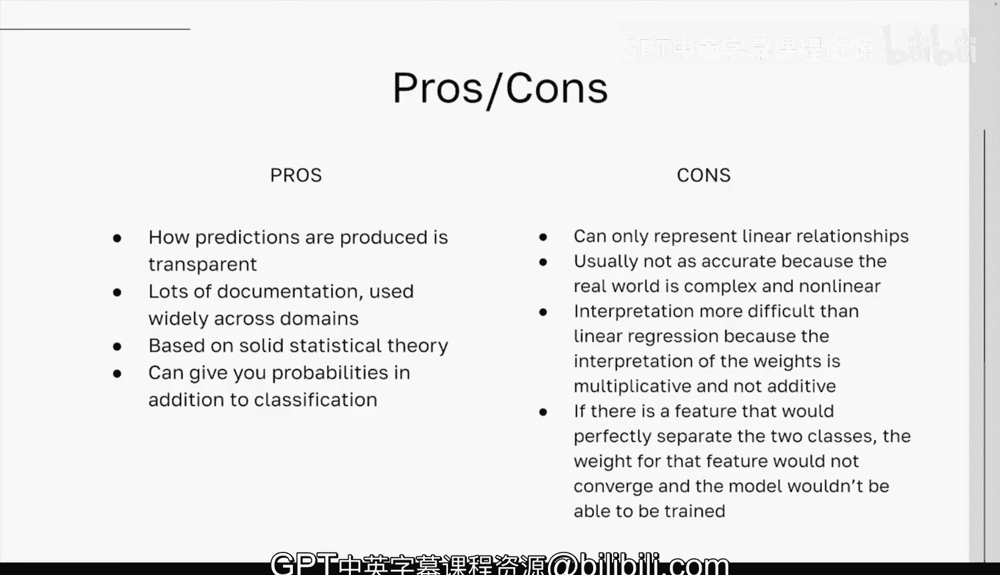

# 可解释人工智能：03_01_02：逻辑回归 📊

在本节课中，我们将要学习逻辑回归模型。这是一种广泛用于分类问题的线性模型，它通过一个特殊的函数将线性回归的输出映射为概率，从而进行预测。

---

## 从线性回归到概率预测

上一节我们介绍了线性回归用于预测连续值。对于分类问题，我们更希望得到介于0和1之间的概率值。

因此，我们可以采取的做法是：将线性回归方程包裹在一个逻辑函数中。这个函数本质上将线性方程的输出“挤压”在0和1之间。

你可以在逻辑回归的方程中看到这一点：

**`P(Y=1|X) = σ(β₀ + β₁X₁ + ... + βₙXₙ)`**

其中，σ 代表逻辑函数（Sigmoid函数）。我们取线性回归方程，并将其放入逻辑函数中，从而将输出映射为概率。

---

## 理解逻辑回归：对数几率

我们可以将逻辑回归模型视为对数几率的线性模型。

什么是对数几率？首先，几率是指某个特定结果发生的概率或可能性。在我们的二元分类案例中，即类别1发生的概率。对数几率就是几率的对数，如顶部方程所示。

顶部方程看起来应该很熟悉，它只是上一张幻灯片中逻辑回归方程的重新排列。

让我们来解读这个方程。首先，对等式两边同时应用指数函数，得到第二个方程。

现在，当我们把某个特征值增加1个单位时会发生什么？我们比较增加前后的情况。我们不关注差值，而是关注两个预测值的比率，这看起来像第三个方程。

我们可以利用指数法则将其简化为底部的方程，结果变得非常简单易懂：

**`odds_new / odds_old = exp(βⱼ)`**

我们已经证明，特征 J 增加一个单位，会使几率比改变 `exp(βⱼ)` 倍。

---

## 关键术语解析

这里有一些容易混淆的术语，我们快速解释一下：

*   **逻辑函数**：在逻辑回归中用于模拟二元结果概率的函数。它将输入特征的线性组合转换为0到1之间的概率值。
*   **Logit函数**：逻辑函数的反函数。它将二元结果的概率转换回对数几率（线性尺度）。在方程 **`logit(p) = ln(p/(1-p))`** 中，p 是结果发生的概率。
*   **对数几率**：指事件发生概率的几率的对数。几率本身是事件发生概率与不发生概率的比值。这与Logit函数本质相同。

---

## 系数的解释

逻辑回归学习到的系数，直接代表了在保持其他变量不变的情况下，对应预测变量每增加一个单位，结果的对数几率的变化量。系数与预测变量之间的这种直接关系，使得我们更容易理解每个特征对结果的相对重要性和影响。

逻辑回归系数的指数，给出了**几率比**，这是衡量预测变量与结果之间关联性的直观指标。几率比大于1表示正相关，小于1表示负相关。

通过检查系数的大小和符号，逻辑回归可以揭示模型中每个特征的相对重要性。绝对值较大的系数对预测结果的影响更大。

与线性回归类似，解释取决于特征的类型：

以下是不同特征类型下系数的具体解释：

*   **数值特征**：如果 `Xⱼ` 是数值型，`Xⱼ` 增加一个单位，估计的几率会改变 `exp(βⱼ)` 倍。
*   **二元特征**：如果 `Xⱼ` 是二元型（0/1），将 `Xⱼ` 从0变为1，估计的几率会改变 `exp(βⱼ)` 倍。
*   **分类特征**：如果 `Xⱼ` 是具有多个类别的分类特征，处理方法与线性回归类似。一种解决方案是对每个类别进行独热编码，这样每一列都被视为一个二元特征。那么，将特定类别从0变为1，估计的几率会改变对应系数 `β` 的指数倍。

关于截距的解释，通常不具实际意义，但其含义是：对于一个所有数值特征为0、分类特征为参考类别（或编码为0）的实例，其估计的几率为 `exp(β₀)`。

---

## 逻辑回归的假设

逻辑回归也有一些需要了解的假设：

以下是逻辑回归模型的主要前提条件：

*   **线性**：它假设预测变量（或其变换）与结果变量的对数几率（Logit）之间存在线性关系。
*   **无多重共线性**：预测变量之间不应高度相关。高度的多重共线性会导致系数估计不稳定、不可靠，使模型难以解释。
*   **观测值独立**：观测值或数据点应彼此独立。如果数据中存在某种聚类或层次结构（例如，重复测量或从相关个体收集的数据），则违反此假设。
*   **无强影响异常值**：模型不应受到异常值或极端数据点的过度影响，否则会显著影响系数估计和模型拟合。
*   **无完全分离**：对于二元结果变量，不应存在单个预测变量或预测变量组合能够完美区分两个结果类别的情况。完全分离会导致数值问题和不可靠的参数估计。
*   **大样本量**：逻辑回归通常需要相对较大的样本量，尤其是在有许多预测变量的情况下，以确保系数估计的可靠性和稳定性。

---

## 扩展与优缺点

我们一直在讨论用于二元分类的逻辑回归。我们可以将其扩展以分类多个类别，这被称为**多项逻辑回归**。

让我们评估一下逻辑回归在可解释机器学习中的优缺点。

与线性回归一样，其产生预测的过程是透明的，易于人类理解。关于逻辑回归的文档资料非常多，且在各个领域广泛应用，因此有一个庞大的用户社区。逻辑回归也建立在坚实的统计理论基础上。

逻辑回归特有的一个优点是，除了分类，它还能给出概率。

然而，与线性回归类似，它只能表示线性关系，这通常不如更复杂的模型准确，因为现实应用中的复杂性和非线性很常见。其解释比线性回归更困难，因为权重的解释是乘性的而非加性的。

如果存在一个可以完美区分两个类别的特征，逻辑回归模型将无法被训练。原因是该特征的权重不会收敛，因为最优权重将是无穷大。

---

本节课中我们一起学习了逻辑回归模型。我们了解了它如何通过对数几率将线性模型应用于分类问题，掌握了其系数和几率比的解释方法，认识了模型的前提假设，并分析了其在可解释机器学习中的优势与局限。逻辑回归因其简单性和可解释性，仍然是分类任务中的一个重要基础工具。