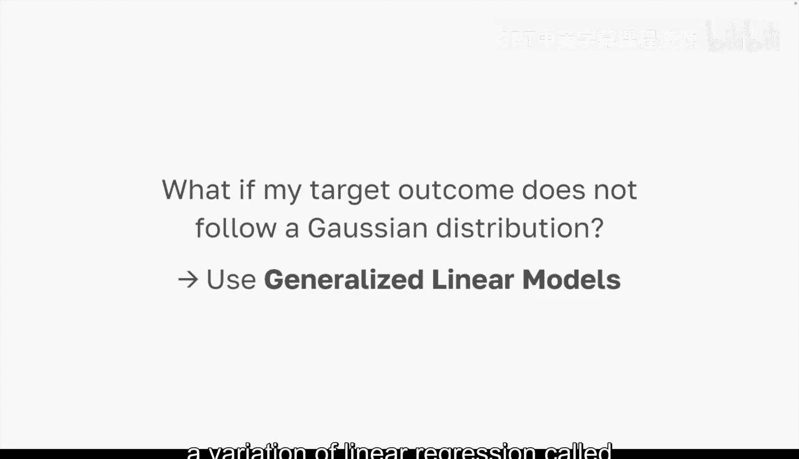
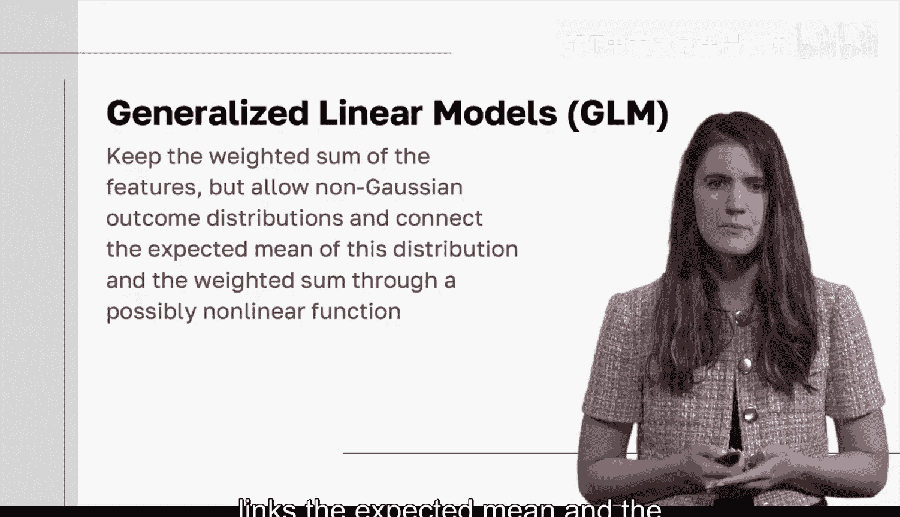
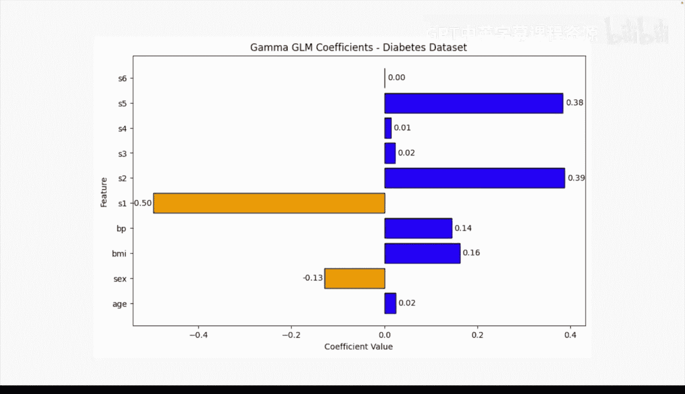
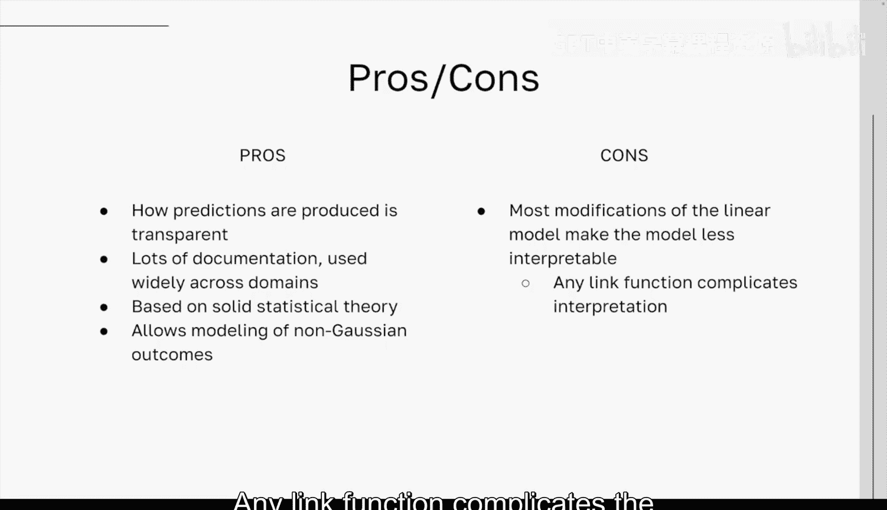

# 杜克大学《可解释人工智能｜Explainable AI (XAI)》中英字幕 p33 04_01_01_广义线性模型.zh_en -BV1HnrBBmEon_p33-

We have a problem with linear regression。 That is the assumption of normality。

 Linear regression assumes the target outcome， given the features， follows a Gaussian distribution。

This assumption excludes cases such as when the outcome is a category like prediabetes versus healthy account like number of cats。

 The time to the occurrence of an event or a very skewed outcome with few。

 very few high values like household income。If your target outcome does not follow a Gaussian distribution。

 you can use a variation of linear regression called generalized linear models or GLM。

 The idea behind GLMs is that you keep the weighted sum of the features but allow non Gaussian outcome distributions and connect the expected mean of this distribution and the weighted sum through a possibly nonlinear function。

And we have already seen an example of a GLM。 Logistic regression is a popular example of a GLM。

 Logistic regression assumes a benoulli distribution for the outcome and links the expected mean and the weighted sum using the logic function。

Here's the general form of the equation for GLMs。 There are three components of the equation。

The link function， G。The weighted sum x transpose beta， this is the linear regression equation。

 and a probability distribution from the exponential family that defines E Y。

 which is the expectation of the outcome Y。The logistic regression model is a GLM that assumes a Bnoulli distribution and uses the logic function as the link function。

 The mean of the binomial distribution used in logistic regression is a probability that y is one。

The assumed distribution， together with the link function。

 determines how the estimated feature weights are interpreted。 for an example of this。

 return to the logistic regression lecture。Here is an example of feature coefficients from the diabetes data set visualized in a Sha like plot。

 you will learn how to do this in the code demo。

Let's evaluate the pros and cons of generalizing linear models for interpretable machine learning。

Just like linear regression， how predictions are produced is transparent。

 making it easy for humans to understand。 There is also a lot of documentation out there for G Lms。

 and it is used widely across domains。 So there's a large community of people working with them。

GLMs are also based on solid statistical theory。GL Ms allow modeling of non gausian outcomes。

 making them more applicable for real world applications。 However。

 most modifications of the linear model make the model less interpretable。

 Any link function complicates the interpretation like we saw in logistic regression。

