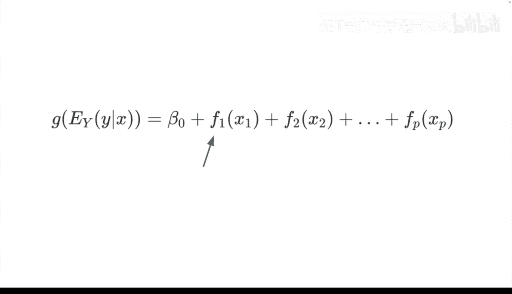
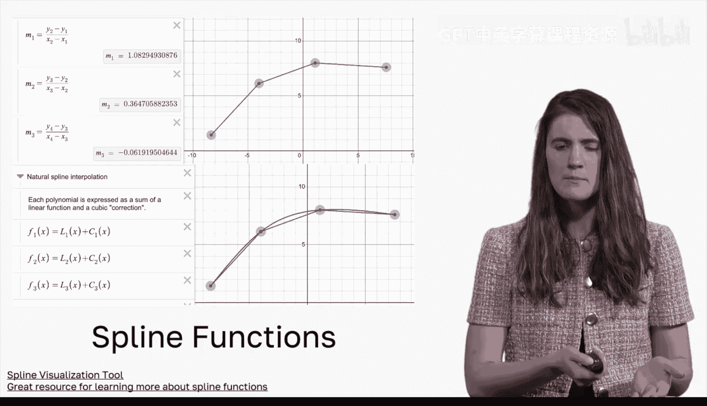
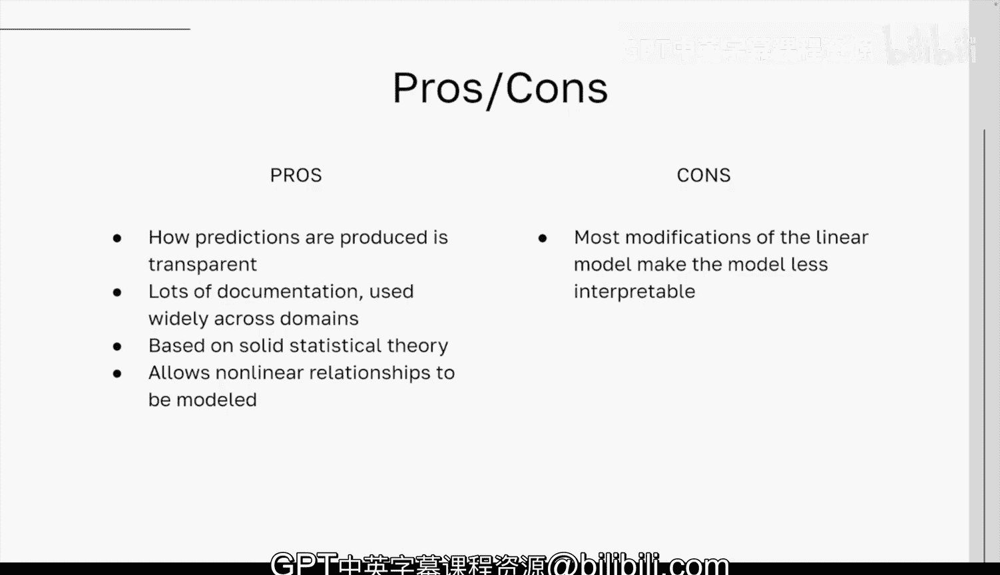

# 杜克大学《可解释人工智能｜Explainable AI (XAI)》中英字幕 p34 05_01_02_广义可加模型.zh_en -BV1HnrBBmEon_p34-

We have a problem with linear regression。 That is the assumption of linearity。

 Linear regression assumes that the true relationship between the features and outcomes is linear。

But we know most real world applications are not linear。

What if the relationship between our features and outcome is not linear？We have a few options。

 we could transform the feature， take the logarithm of it。We could categorize the feature。

 or we could use generalized additive models or Gms。 Let's talk about Gms。

The intuition behind Gams is quite simple。 Gams assume that the outcome can be modeled by a sum of arbitrary functions of each feature。

 Gam is still a sum of feature effects， but now it gives the option to allow nonlinear relationships between some features and the output and linear effects still work。

 too。😊，F sub J x sub J takes the form of the familiar x subj beta subj。

 when a relationship between the feature and output is linear。The equation should look familiar。

 we are now just replacing our weights beta with functions。

How do we go about learning these nonlinear functions through spine functions。

 Splinlines are constructed from simpler basis functions and used to approximate more complex functions。

 as shown in the figure here， this curve is an approximation using a set of three simple linear functions。

 I've included a link in the resources with a great reading to learn more about spine functions for those interested in diving deeper。

😊。

Let's evaluate the pros and cons of generalized additive models for interpretable machine learning。

 Just like linear regression and G Lms， how predictions are produced is transparent。

 making it easy for humans to understand。 There is also a lot of documentation out there for Gams。

 and it is used widely across domains。 So there is a large community of people working with them。😊。

Gams are also based on solid statistical theory。 GAms allow modeling of nonlinear feature outcome relationships。

 making them more applicable for real world applications。 However， similar to GLM's。

 most modifications of the linear model make the model less interpretable。

 which is something for us to be thoughtful about。

