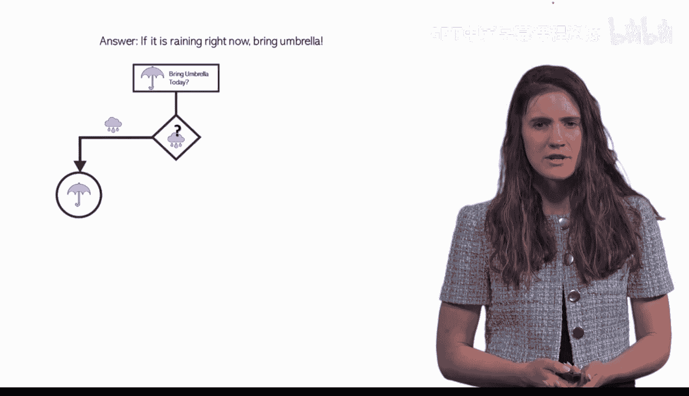
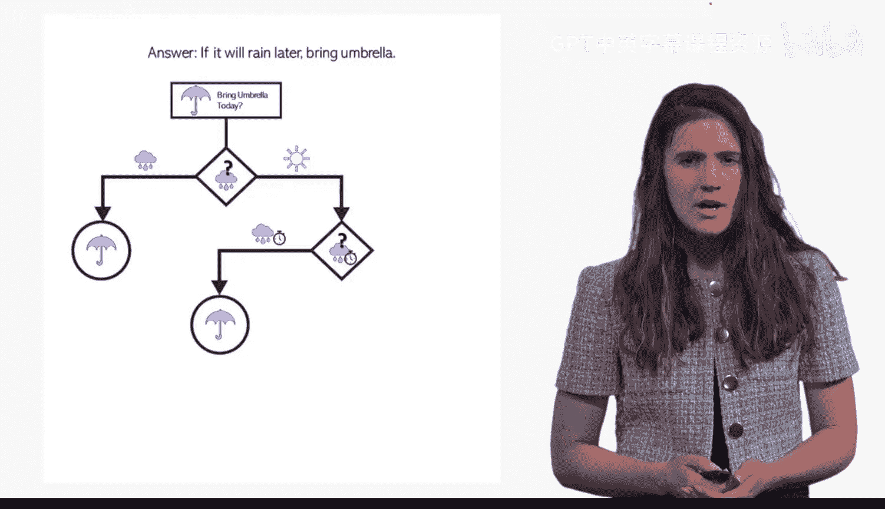
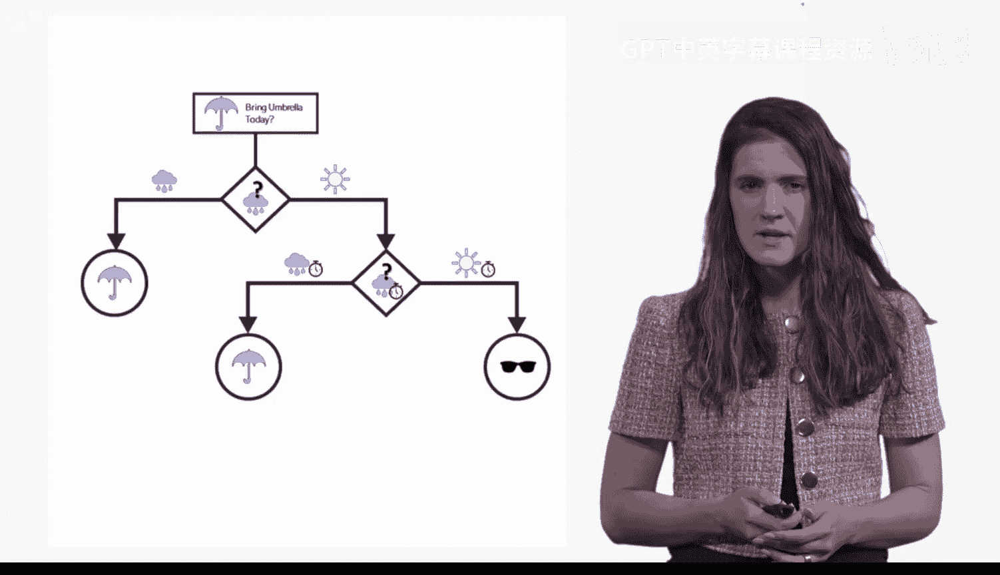
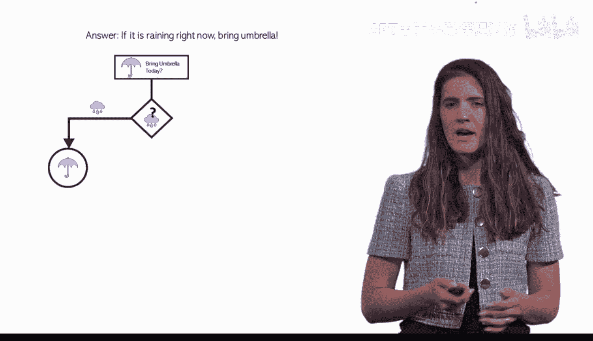
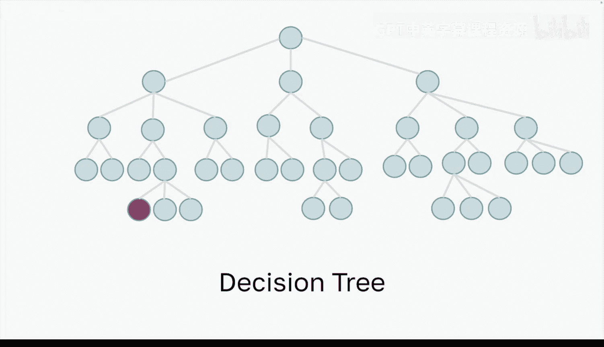
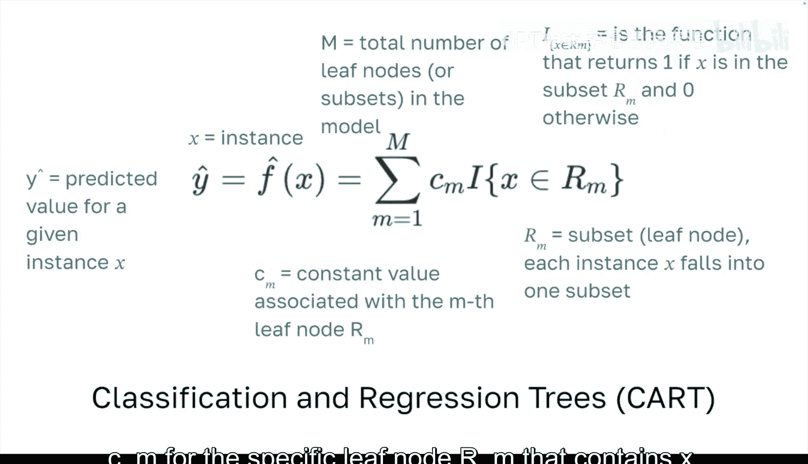
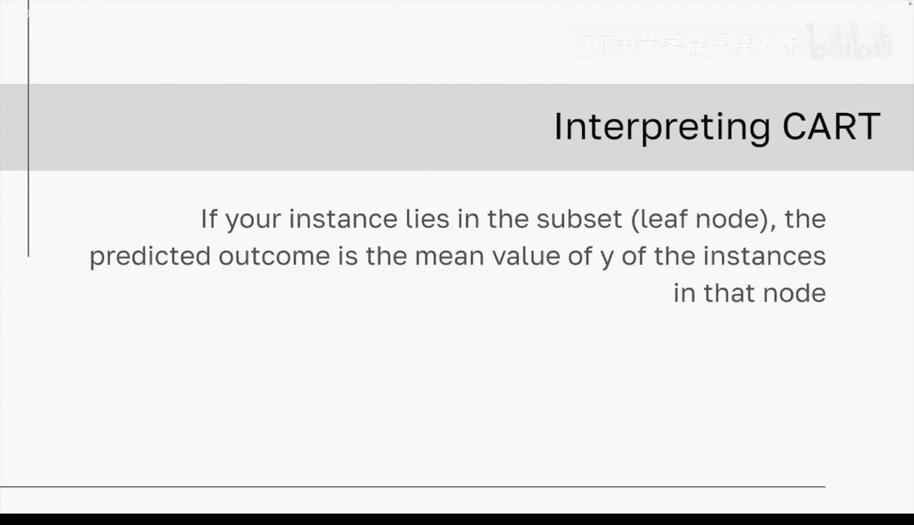
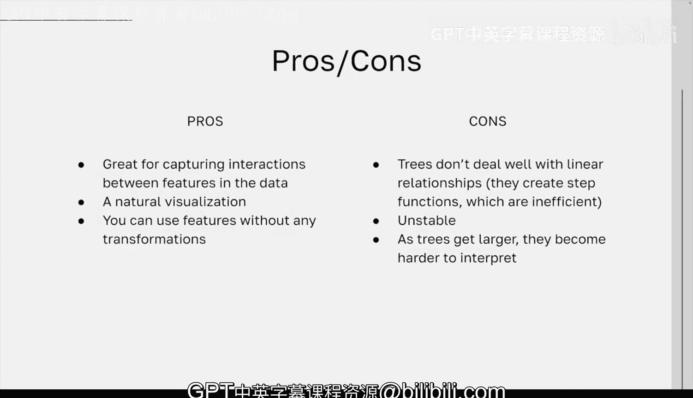

# 杜克大学《可解释人工智能｜Explainable AI (XAI)》中英字幕 p35 06_02_01_决策树.zh_en -BV1HnrBBmEon_p35-

It is extremely easy to understand the intuition of tree based models via illustration of a decision you make frequently。

 such as the question， should I bring an umbrella to day， which is illustrated in this gift。

 You ask the question， is it raining right now， If it is， bring an umbrella， If it is sunny。

 you then ask the question， will it rain later， If yes， you bring an umbrella， If no， you don't。

Treebase models work in this intuitive way， Trebase models split the data multiple times based on certain cutoff values and the features。

 different subsets of the dataset set are created through this splitting。

 with each instance belonging to one subset。The intermediate subsets are found at the internal or split nodes。

The terminal， also known as leaf nodes， are the final subsets。

 the ones that tell you whether you should bring your umbrella or not。

To predict the outcome in each leaf node， the average outcome of the training data in this node is used。

 Decion tree based models can be used for either classification or regression due to their intuitiveness and interpretability。

 Decion trees are widely used across many domains。

While there are a number of algorithms for decision trees。

 the most widely known one is definitely CAt or the classification and regressionion T algorithm。

 here's the equation for the cart algorithm。If x is our instance and Y hat is the predicted value for a given instance X for each of the M leaf nodes。

 R sub M， we multiply the constant value C sub M， the average target value in the leaf node by an indicator function。

 which is one if x falls into the leaf node R sub M and 0 otherwise。 this way。

 the sum effectively picks out the constant C sub M for the specific leaf node R sub M that contains x。

 giving the predicted value Y hat。

The implementation of the cart algorithm starts with the splitting of the data into different subsets based on feature values。

 CAt determines the cutoff point for a feature that minimizes the variance verb a or Ginny index for classification of the target variable。

The variance measures how spread out the target values are around the mean in a node。

 The Ginny index measures the impurity or class distribution in a node。

This process of splitting is done recursively at each node。

 the algorithm selects the best feature and the best value of that feature to split the data based on some criterion。

 like the Gini impurity for classification or the mean squared error for regression。

ME is used as the criterion in the CAt algorithm for regression tasks because it directly measures the variance within subsets by minimizing MSE。

 the algorithm effectively minimizes the variance of the target values within each subset。

 leading to more homogeneous and accurate predictions。

The recursive splitting continues until a stopping criterion is met。

 such as reaching a maximum tree depth， having a minimum number of instances in a node。

 or when further splitting does not significantly reduce the impurity or variance。

Once the tree is constructed， each leaf node R subM contains a subset of the training instances for regression trees。

 the predicted value Y hat， for an instance x that falls into the leaf node R subM is the average of the target values of the training instances in R subM。

How we interpret cart， if your instance lies in the subset leaf node。

 the predicted outcome is the mean value of y of the instances in that node。

 If we want to examine feature importance， we look at all the splits for which the feature was used。

 measure how much it is reduced the variance or Ginny index compared to the parent node。

The sum of all importances is scaled to 100， so each importance can be interpreted as share of the overall model importance。

We can also decompose our trees。 You can track a decision through the tree and explain a prediction by the contributions added at each decision note。

 The prediction for an instance， is the mean target value plus the sum of contributions from splits from root to terminal node note here that we are interested in the feature contributions。

 not the split contributions and a feature can be used from multiple splits or not at all。

 we can sum the contributions of each of the features。

 and this provides an interpretation of how much each feature contributed to the prediction。

Let's evaluate the pros and cons of decision trees for interpretable machine learning Tbase models are great for capturing interactions between features and the data they provided natural intuitive visualization。

 and you can use features without any transformations。However。

 trees don't handle linear relationships well。 Instead， they create step functions。

 which are inefficient for linear relationships。 They are also unstable。

 Small changes in the training dataset set can create a completely different tree。 Why。

 Because each split depends on the parent split。 If a different feature is selected as the first split feature。

 the entire tree structure will be changed。And as trees get larger， they become harder to interpret。

