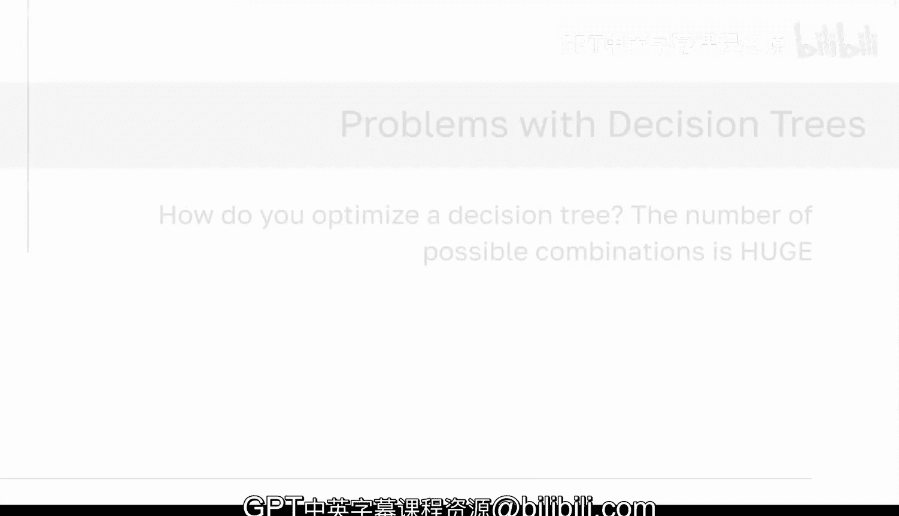
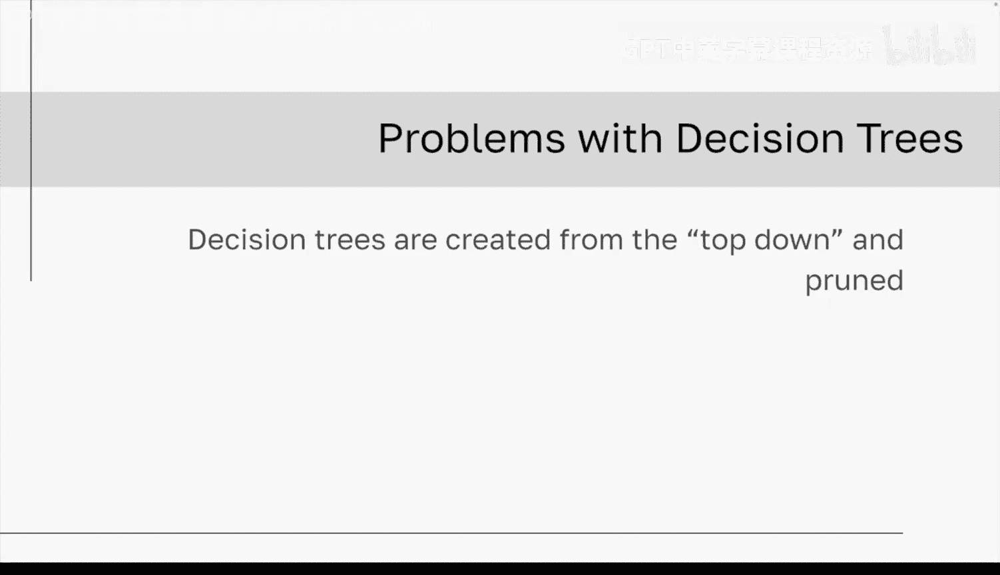
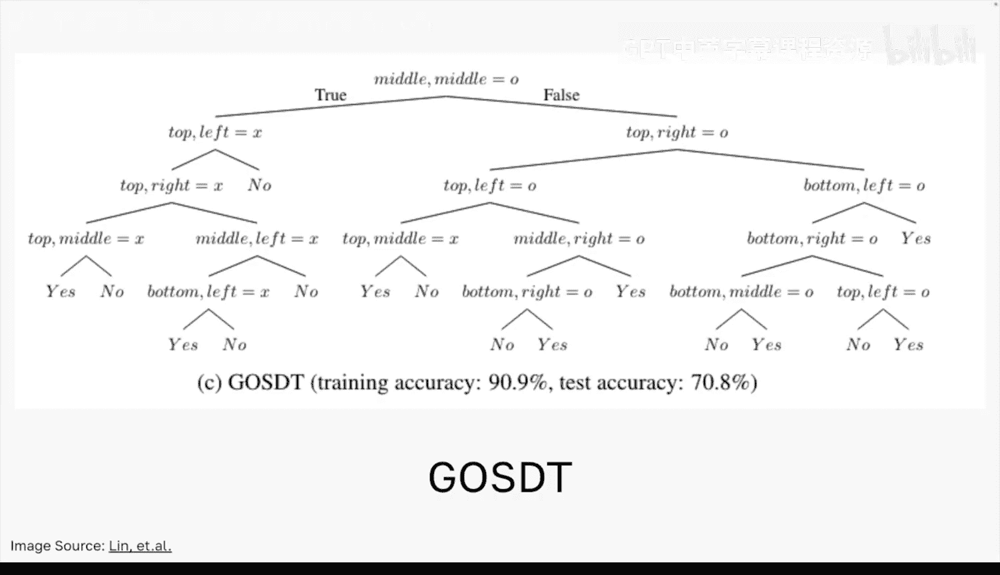
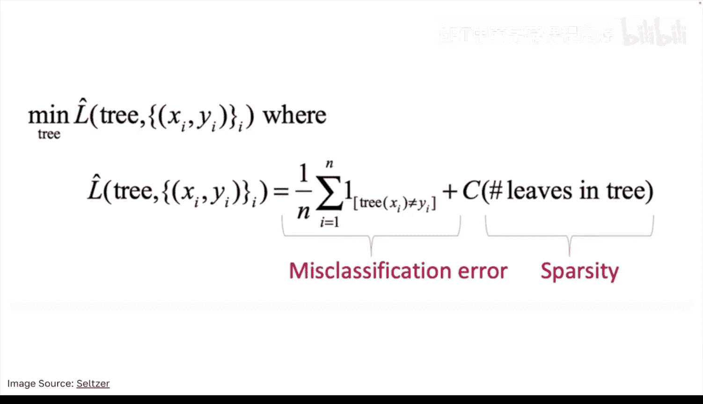
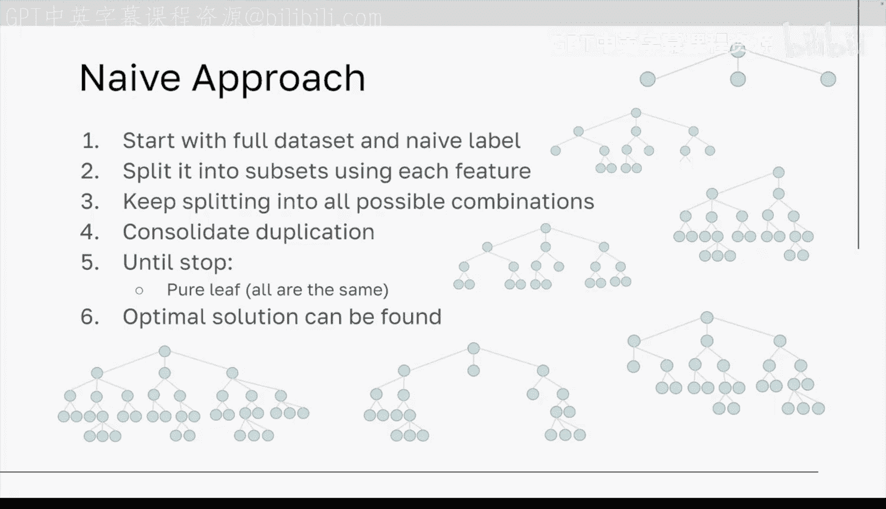
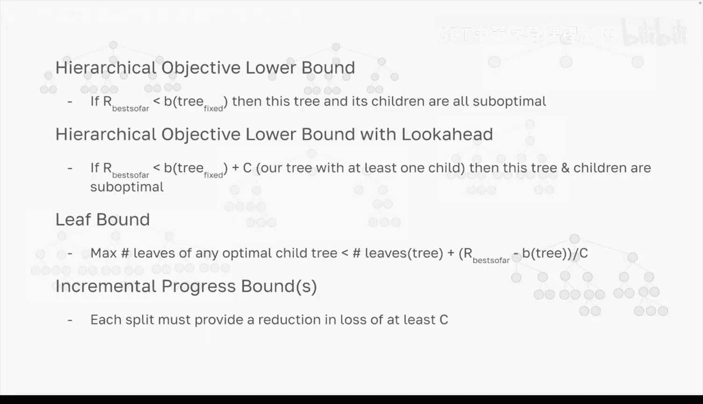
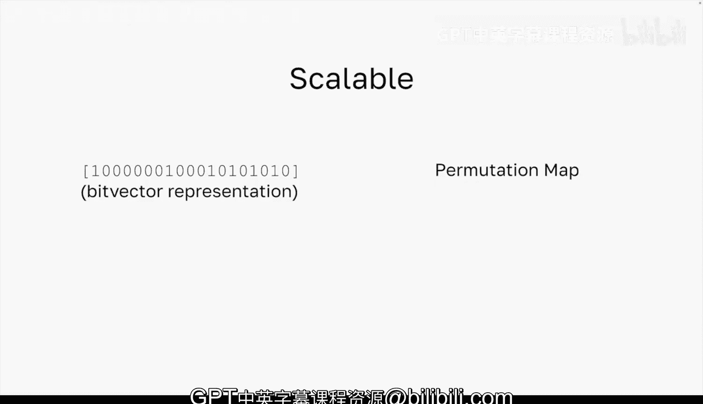

# 杜克大学《可解释人工智能｜Explainable AI (XAI)》中英字幕 p36 07_02_02_稀疏决策树.zh_en -BV1HnrBBmEon_p36-

We have previously discussed the challenge of instability in decision trees。

 Small changes in the training dataset set can create a completely different tree。 Why。

 because each split depends on the parent split。 If a different feature is selected as the first split feature。

 the entire tree structure will be changed。 So there is the question of how to optimize a decision tree。

 the number of possible combinations is huge， Another challenge is that decision trees are created from the top down and pruned。

 This means that if you make a mistake at the top that will propagate through your whole model。

Towards solving these problems in 2022， Lynn at all introduced generalized and scalable optimal sparse decision trees or GOSSDT pronounced Ghost。

 Ghost uses both analytical bound theorems to bound the decision tree search space and computational efficiencies to enable scalability and speed。

Ghost is quite simple， minimize an objective that is a function of tree and data over all possible trees you can construct on this data。

 We want to minimize both the misclassification error and the number of leaves to encourage sparsity and thus interpretability。

A naive approach to finding the optimal decision tree may look like this。

 start with a full data set and split it into subsets using each feature。

 split into all possible combinations， remove duplicates。

 and keep going until some stopping criteria such as having all your decision trees be the same from this you have all the possible combinations and now you can find the optimal solution。

But this search space becomes huge very quickly。 This is where ghost comes in。

 ghosts can be summarized into branch and bound。The idea is to reduce that search space of all decision trees。

 10 analytical bounds are proposed in the paper to reduce the search space。

 analytical bounds help in efficiently pruning the search space。

 thereby speeding up the process of finding the optimal decision tree。

Let's break down a few analytical bounds from the ghost paper。Hierarchical objective lower bound。

 This bound helps to prune suboptimal trees early in the search process。

 Our best so far is the objective value， for example。

 loss or error found so far And B tree fixed is the lower bound of the objective value for the current fixed tree structure。

If the best objective value found so far， our best so far is less than the lower bound of the objective value for the current fixed tree structure。

 B tree fixed than this tree and all of its children。

 All trees that can be obtained by further splitting this tree are suboptimal。

 This means they will not yield a better solution than what we have already found。

 so we can prune this subtre from the search。Herarchical objective lower bound with look ahead。

 This bound enhances the previous one by considering potential improvements from future splits。

 Look ahead。 R best so far is the best objective value found so far。

 B tree fixed is the lower bound of the objective value for the current fixed tree structure and C is a constant representing the minimum reduction in loss required by split。

😊，If the best objective value found so far， our best so far is less than the sum of the lower bound of the objective value for the current fixed tree structure B tree fixed and the constant C representing potential improvement from one additional split。

 then this tree and all of its children are suboptimal。

 Even if we consider the best possible improvement from one additional split。

 this tree cannot yield a better solution than what we have already found。Leaf bound。

 This bound limits the number of leaves in the child trees。

 helping to control the complexity of the search。 C is a constant representing the minimum reduction in loss required by split and number of leaves tree is the number of leaves in the current tree。

 The maximum number of leaves of any optimal child tree must be less than the number of leaves in the current tree plus R best so far minus B of tree divided by C。

 This means that the number of leaves in an optimal child tree is constrained by the current trees number of leaves。

 and the potential improvement in the objective value。Incremental progress bounds。

 This bound ensures that each split in the tree contributes to a significant reduction in the objective value。

 C is a constant representing the minimum reduction in loss required by a split。

 Each split must provide a reduction in loss of at least C。

 This ensures that any split made during the tree construction process must contribute meaningfully to improving the objective value。

 thereby preventing unnecessary splits that do not significantly enhance the tree's performance。

Another impressive aspect of ghost is that it is scalable。

 This is due to its bit vector representation， which represents each subproblem by its contents as bit vectors。

 making computation fast and its data structure that tracks permutations。

 This creates a permutation map that can be used to discover identical trees already evaluated。😊。

