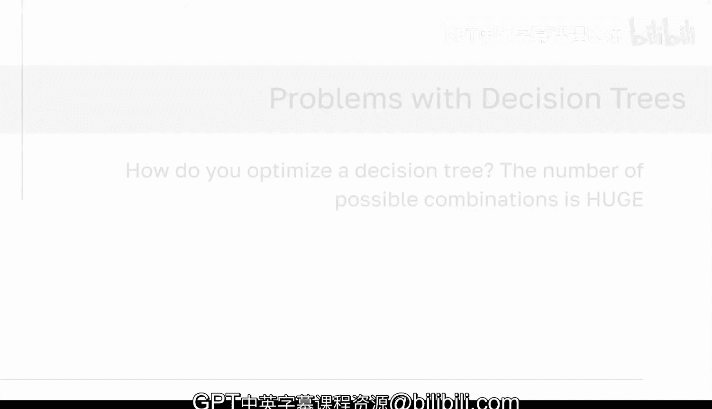
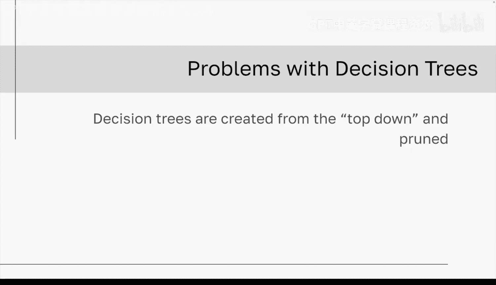
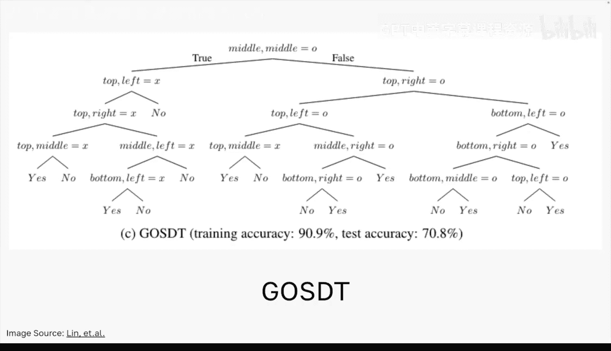
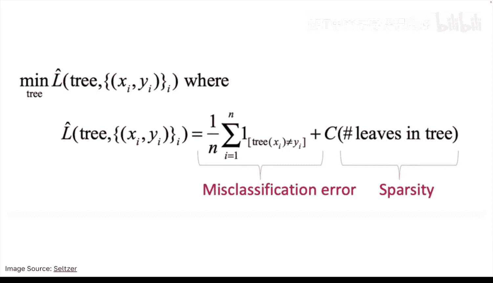
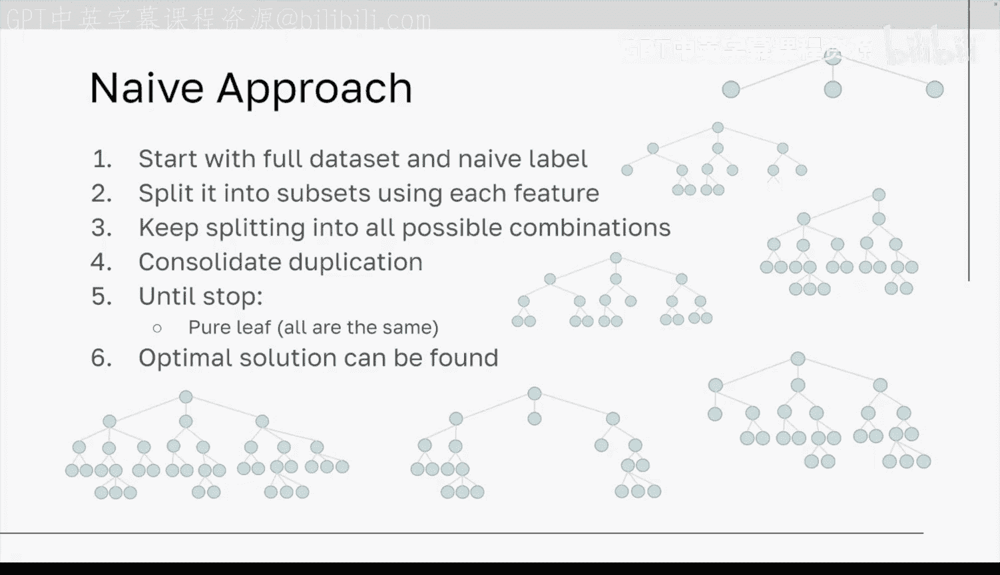
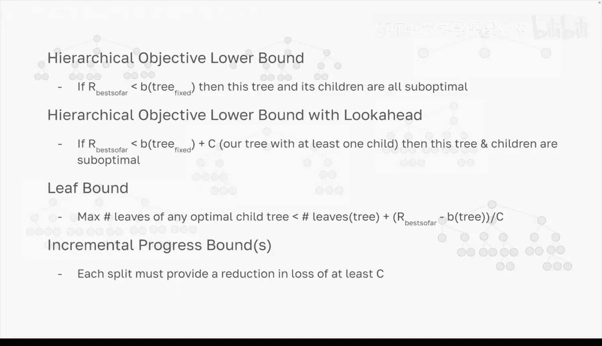
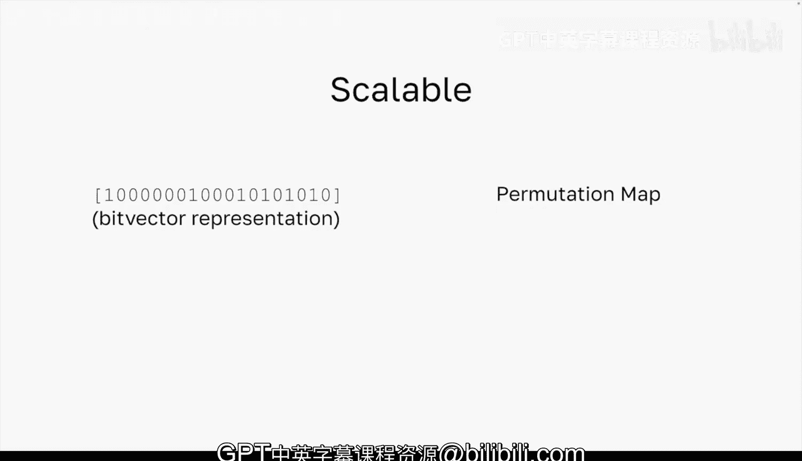

# 可解释人工智能：07_02_02：稀疏决策树 🌳

在本节课中，我们将要学习一种名为“广义可扩展最优稀疏决策树”（GOSSDT，简称Ghost）的先进方法。该方法旨在解决传统决策树模型面临的不稳定性和搜索空间过大的问题，通过引入分析边界定理和高效的计算策略，来寻找最优且易于解释的稀疏决策树模型。

---

## 决策树的挑战

上一节我们介绍了决策树模型的基本概念。本节中我们来看看传统决策树构建方法面临的两个主要挑战。

第一个挑战是**不稳定性**。训练数据集的微小变化可能导致生成完全不同的树结构。这是因为决策树的每一次分裂都依赖于其父节点的分裂。如果选择不同的特征作为首次分裂特征，整个树的结构都会随之改变。

第二个挑战是**优化困难**。决策树可能的组合数量极其庞大。同时，决策树通常采用自顶向下的方式构建并进行剪枝。这意味着，如果在顶层分裂时出现错误，这个错误会传播到整个模型中。

---

## GOSSDT（Ghost）方法简介

为了解决上述问题，Lynn等人在2022年提出了广义可扩展最优稀疏决策树（GOSSDT，读作“Ghost”）。

Ghost方法结合了**分析边界定理**来约束决策树的搜索空间，并采用了**计算效率优化**以实现方法的可扩展性和高速度。

---

## Ghost的核心目标

Ghost方法的核心思想非常简单：在所有可能构建的树结构中，最小化一个关于树和数据的**目标函数**。

该目标函数旨在同时最小化**误分类误差**和**叶子节点数量**。最小化叶子节点数量是为了鼓励模型的稀疏性，从而提升其可解释性。其目标可以形式化表示为：

**目标：** 最小化 `损失(树, 数据) + λ * 叶子节点数(树)`

其中，λ 是一个控制稀疏性权重的超参数。

---

## 寻找最优决策树的朴素方法

在深入Ghost的优化策略之前，我们先理解一下寻找最优决策树的朴素方法。

以下是该方法的步骤：
1.  从完整数据集开始。
2.  使用每个特征将数据集分割成子集。
3.  分割所有可能的组合，并移除重复项。
4.  持续进行分割，直到满足某个停止标准（例如，所有决策树都相同）。
5.  此时，你得到了所有可能的树组合，现在可以从中找到最优解。

然而，这种方法的搜索空间会迅速变得极其庞大，导致计算不可行。

---

## Ghost的关键：分支定界法

这正是Ghost方法的用武之地。Ghost的核心可以总结为**分支定界法**。其理念是减少所有可能决策树的搜索空间。

原论文提出了**10种分析边界**来有效剪枝搜索空间。这些分析边界帮助高效地修剪搜索空间，从而加速寻找最优决策树的过程。

让我们来分解Ghost论文中的几个关键分析边界：

**1. 分层目标下界**
此边界有助于在搜索过程早期剪枝次优的树。
*   `R_best_sofar`：截至目前找到的最佳目标值（例如，最小损失或误差）。
*   `B(tree_fixed)`：当前固定树结构的目标值下界。

**规则：** 如果 `R_best_sofar < B(tree_fixed)`，那么这棵树及其所有子节点（即通过进一步分割此树可获得的所有树）都是次优的。这意味着它们无法产生比我们已经找到的更好的解，因此我们可以从搜索中剪枝掉这棵子树。

**2. 带前瞻的分层目标下界**
此边界通过考虑未来分裂可能带来的改进，增强了前一个边界。
*   `C`：一个常数，代表一次分裂所需的最小损失减少量。

**规则：** 如果 `R_best_sofar < B(tree_fixed) + C`，那么即使考虑一次额外分裂可能带来的最佳改进，这棵树及其所有子节点也无法产生更好的解，因此可以被剪枝。

**3. 叶子节点边界**
此边界限制了子树的叶子节点数量，有助于控制搜索的复杂度。
*   `|leaves(tree)|`：当前树的叶子节点数量。

**规则：** 任何最优子树的**最大叶子节点数**必须小于 `|leaves(tree)| + (R_best_sofar - B(tree)) / C`。这意味着最优子树的叶子节点数受到当前树叶节点数以及目标值潜在改进量的约束。

**4. 增量进展边界**
此边界确保树中的每次分裂都对目标值的减少有显著贡献。

**规则：** 每次分裂必须提供至少为 `C` 的损失减少量。这确保了在树构建过程中进行的任何分裂都必须对改进目标值有实质性贡献，从而防止了那些不能显著提升树性能的不必要分裂。

---

## Ghost的可扩展性

Ghost另一个令人印象深刻的方面是它的**可扩展性**。

这主要归功于两点：
1.  **位向量表示**：它使用位向量来表示每个子问题的内容，使得计算非常快速。
2.  **跟踪排列的数据结构**：这创建了一个排列映射，可用于发现已经评估过的相同树结构，避免重复计算。

---

## 总结

本节课中，我们一起学习了GOSSDT（Ghost）方法。我们首先回顾了传统决策树面临的不稳定性和优化难题。接着，我们介绍了Ghost方法如何通过最小化误分类误差和叶子节点数的目标函数，来寻求最优稀疏决策树。然后，我们探讨了Ghost利用**分支定界法**和多种**分析边界**（如分层目标下界、叶子节点边界等）来大幅缩减搜索空间、提升效率的核心机制。最后，我们了解了Ghost凭借位向量表示和排列跟踪数据结构实现的可扩展性优势。Ghost为构建稳定、最优且易于解释的决策树模型提供了一个强大的框架。