# 杜克大学《可解释人工智能｜Explainable AI (XAI)》中英字幕 p37 08_02_01_决策规则.zh_en -BV1HnrBBmEon_p37-

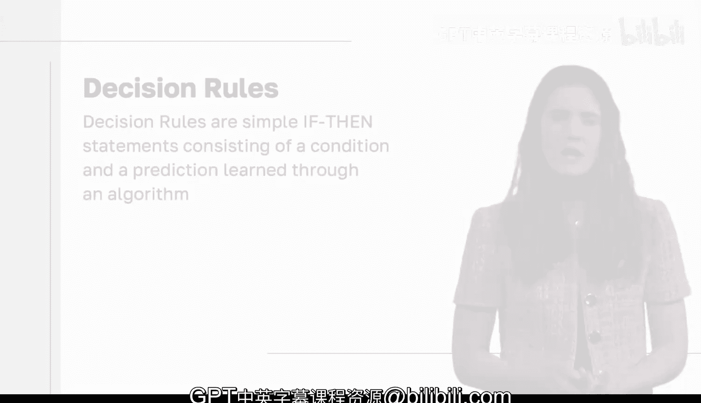

Decision rules are simple， if then statements consisting of a condition and a prediction。

Predictions can be made from a single decision rule or a combination of several rules。

 Decion trees are learned through an algorithm。

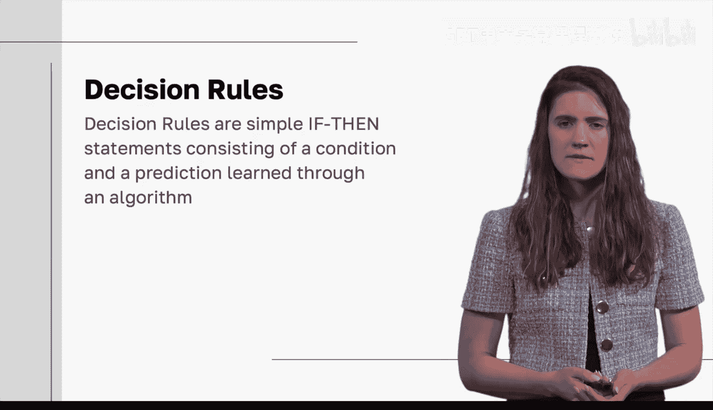

One important concept when implementing decision rules is the trade off between coverage and support and accuracy and confidence support or coverage is the percentage of instances to which the condition of a rule applies。

Accuracy is the measure of how accurate the rule is in predicting the correct class for the instances to which the condition of the rule applies。

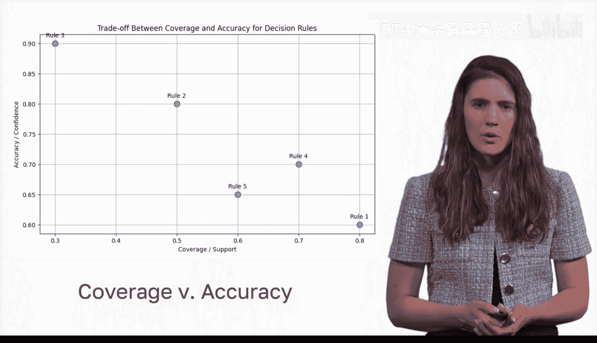

One challenge to implementing decision rules is determining how to combine multiple rules strategies for combining multiple rules include decision lists and decision sets。

Decision lists introduce an order to the decision rules。 If the condition of the first rule is true。

 for an instance， we use the prediction of the first rule。 If not。

 we go to the next rule and check if it applies and so on。

 This solves the problem of overlapping rules by only returning the prediction of the first rule in the list that applies。

And decision sets in decision sets， the rules are either mutually exclusive。

 or there is a strategy for resolving conflicts， such as majority voting。

 which may be weighted by the individual rule acuracies or other quality measures for decision sets。

 One thing to note is that interpretability may suffer when several rules apply。

We also need to consider what to do when no rule applies to an instance。

 one strategy we can employ in this case is a default rule or a rule that applies when no other rule applies。

 The prediction of the default rule is typically the most frequent class of the data points。

 which are not covered by other rules。

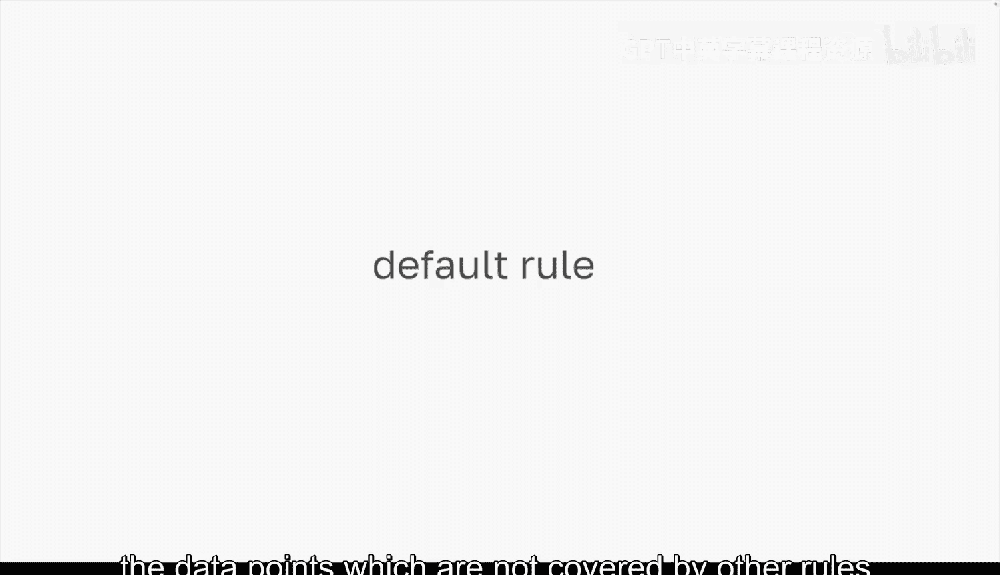

There are many algorithms for learning decision rules。

 This is a list of some of the common procedures and algorithms。

 but there are many others to explore。 We will talk about a few of these algorithms in more detail。

 and we have an entire lecture focused on rule fit。

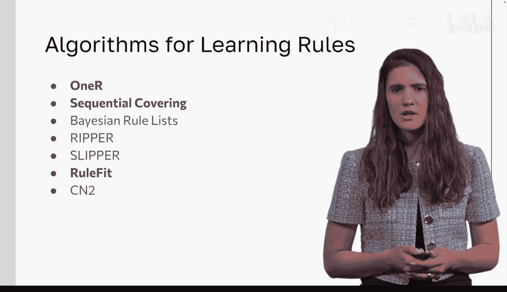

One R is a very simple and usually used as benchmarks for other methods from all of the features。

1 R selects the one that carries the most information about the outcome of interest and creates decision rules from this feature。

One process of implementing 1 R starts with discretizing our continuous features。

 it's important here to choose appropriate intervals for the data and domain of interest。

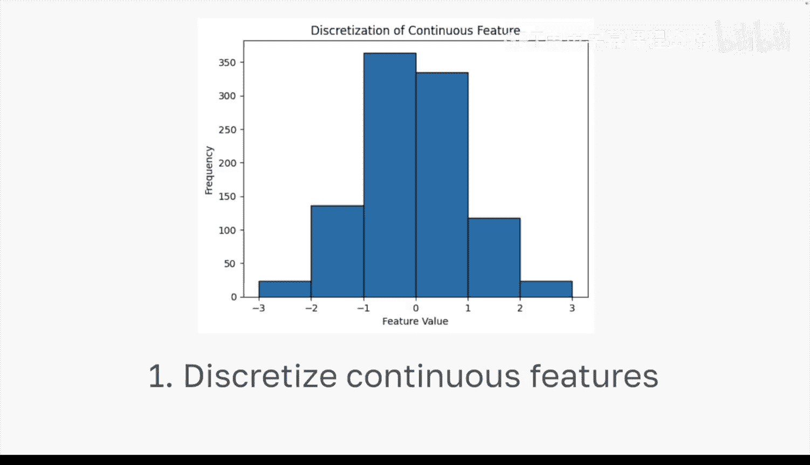

Then for each feature， create a cross table between the feature values and the outcome that is categorical。

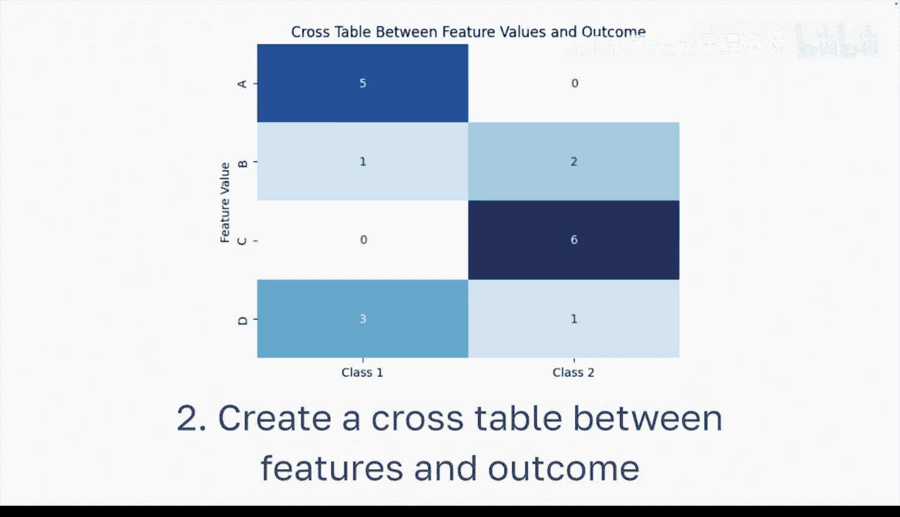

For each value of the feature， create a rule which predicts the most frequent class of the instances that have this specific feature value。

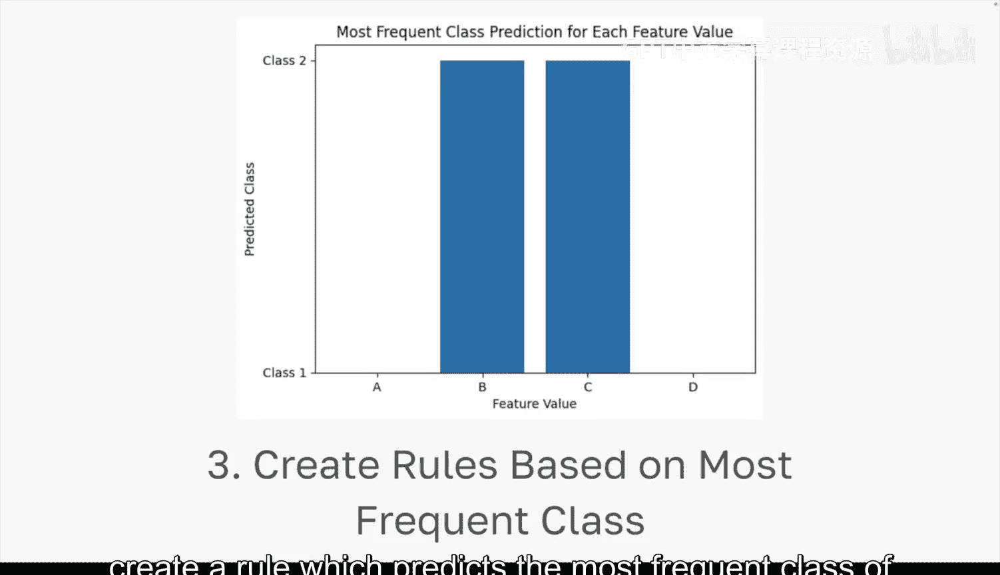

Then calculate the total error of the rules for the feature。

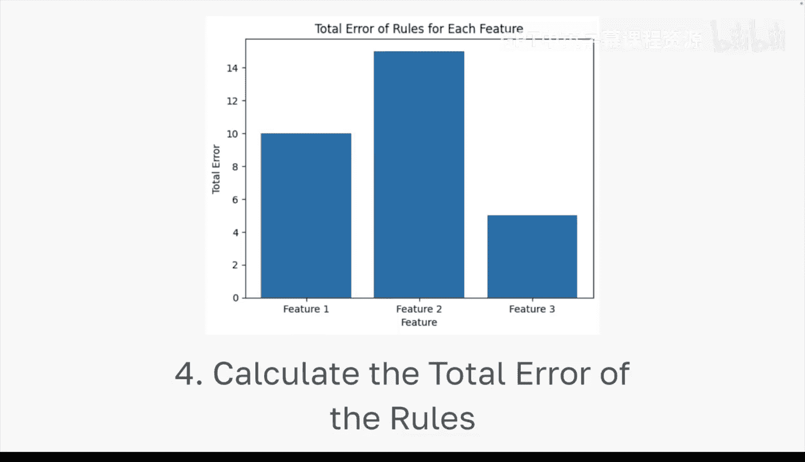

Finally， select the feature with the smallest total error in the event of a tie when two features result in the same total error。

1 R solves this by either taking the first feature with the lowest error or the one with the lowest P value of a chi squared test。

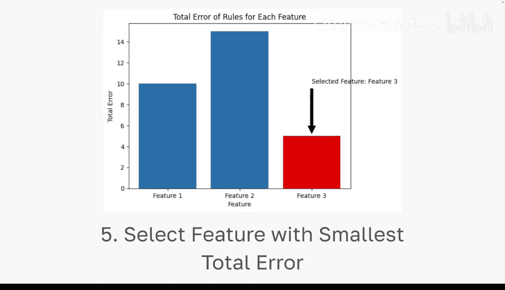

Sequential covering is a general procedure that iteratively learns rules and removes the data points that are covered by the new rule。

 This is a procedure used by many other decision rule algorithms， like Rpper。

Sequential covering uses a separate and conquer approach where you find a good rule that applies to some data points。

 then you remove all data points covered by the rule， whether classified correctly or not。

 and repeat the rule learning and removal of covered points until no points remain or some stop condition is met。

The process of sequential covering is rather straightforward。

 Start with an empty list rules or our list， learn a new rule R。

While rules are below our quality threshold or positive examples are not covered。

 we add a rule R to our list， remove data points covered by R。

 and learn another rule on the remaining data。Once we have achieved our quality threshold or stopping condition。

 we return the decision list。Let's evaluate the pros and cons of decision rules for interpretable machine learning。

Rules are very easy to interpret。 They are also more compact than decision trees and offer very fast predictions。

 They usually automatically generate sparse models。However。

 they are mostly used only for classification。 Feature need to be categorical or transformed。

 if not already categorical。 Some algorithms are prone to overfitting and similar to decision trees。

 they don't handle linear relationships well， because they create step functions。

 which for linear relationships are inefficient。

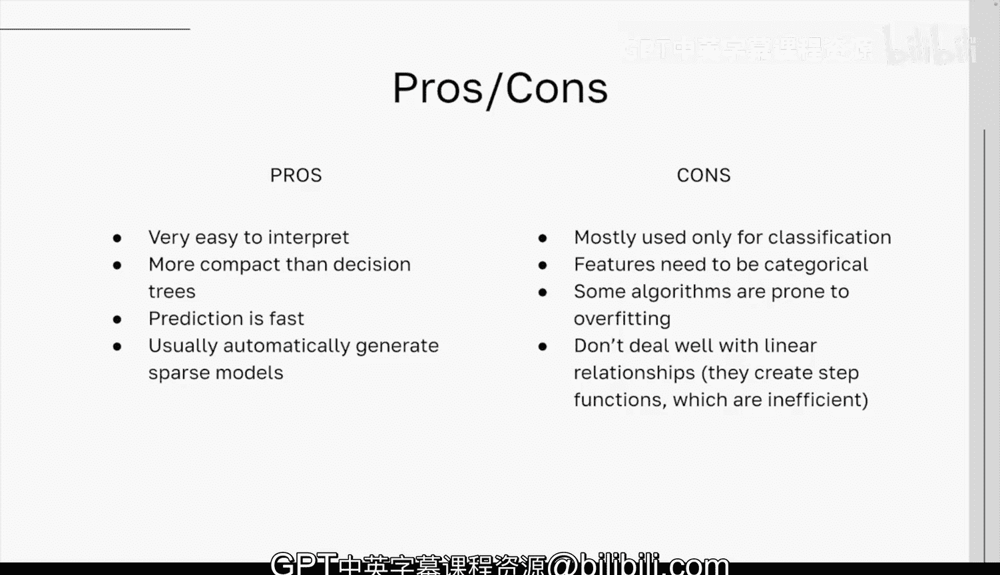