# 可解释人工智能：08_02_01：决策规则 📜

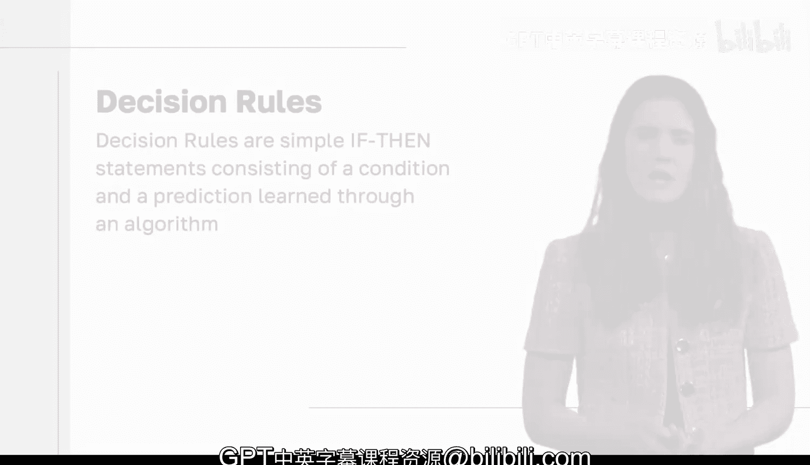

在本节课中，我们将要学习决策规则。决策规则是一种简单、直观且易于解释的机器学习方法，常用于分类任务。我们将探讨其基本概念、核心权衡、组合策略、学习算法以及优缺点。

---

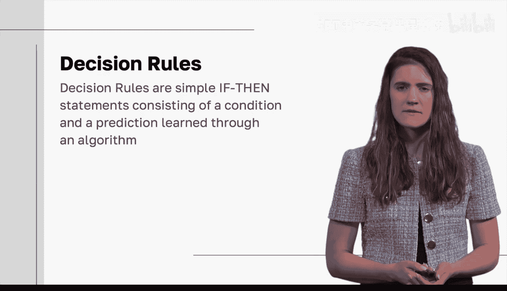

## 什么是决策规则？🤔

决策规则是简单的“如果-那么”语句，由一个**条件**和一个**预测**组成。

预测可以基于单个决策规则，也可以基于多个规则的组合。

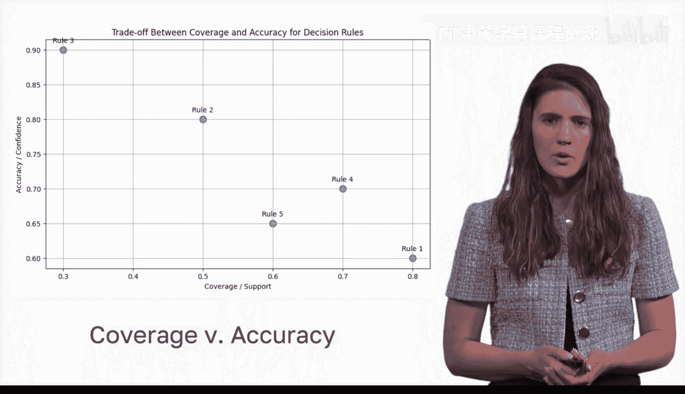

决策树是通过算法学习得到的决策规则集合。

---

## 核心权衡：覆盖率 vs. 准确率 ⚖️

在实现决策规则时，一个重要的概念是**覆盖率**与**准确率**之间的权衡。

*   **覆盖率**：指规则条件所适用的实例占总实例的百分比。
*   **准确率**：指对于规则条件适用的那些实例，规则预测正确类别的比例。

一个理想的规则通常希望同时拥有高覆盖率和高准确率，但这在实践中往往难以兼得。

---

## 组合多个规则 🧩

实现决策规则的一个挑战是如何组合多个规则。以下是两种主要的组合策略：

**决策列表**
决策列表为规则引入了顺序。对于一个给定的实例，我们从列表的第一条规则开始检查。如果第一条规则的条件为真，我们就采用它的预测。如果不为真，则继续检查下一条规则，依此类推。这种方法通过只返回列表中第一条适用的规则的预测，解决了规则重叠的问题。

**决策集**
在决策集中，规则要么是互斥的，要么存在解决冲突的策略，例如**多数投票**。多数投票可能会根据单个规则的准确率或其他质量指标进行加权。需要注意的是，当多条规则同时适用时，可解释性可能会受到影响。

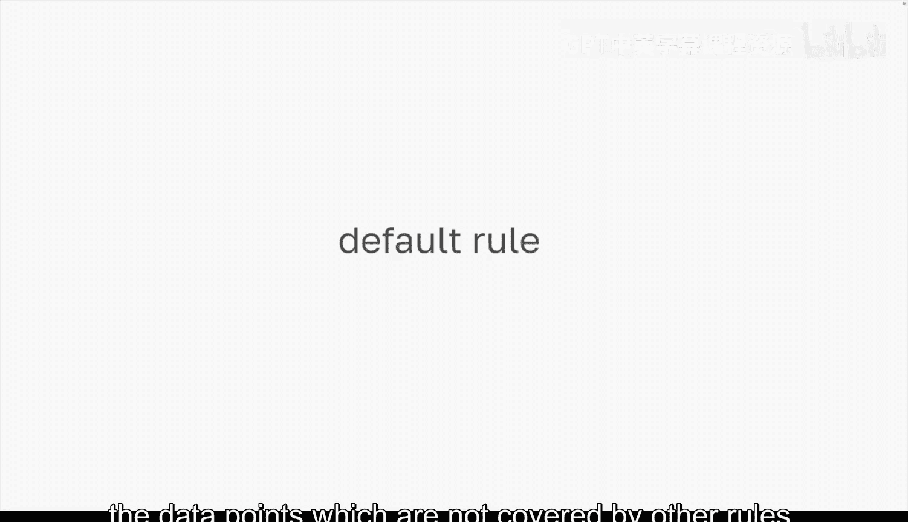

此外，我们还需要考虑当没有规则适用于某个实例时该怎么办。一种策略是使用**默认规则**，即当没有其他规则适用时生效的规则。默认规则的预测通常是未被其他规则覆盖的数据点中最常见的类别。

---

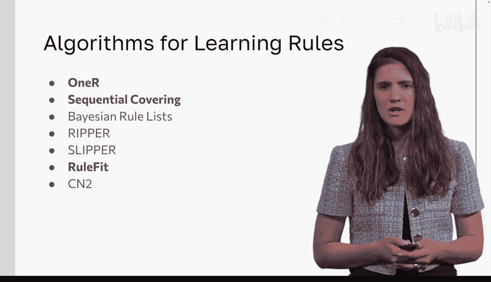

## 学习决策规则的算法 📚

有许多算法可以学习决策规则。以下是一些常见的流程和算法：

*   OneR
*   顺序覆盖算法
*   RIPPER
*   RuleFit

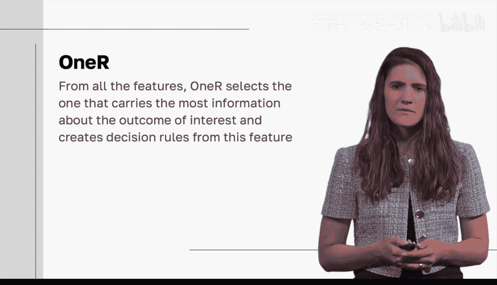

我们将在后续课程中更详细地讨论其中一些算法，并有一整节课专门讲解RuleFit。

---

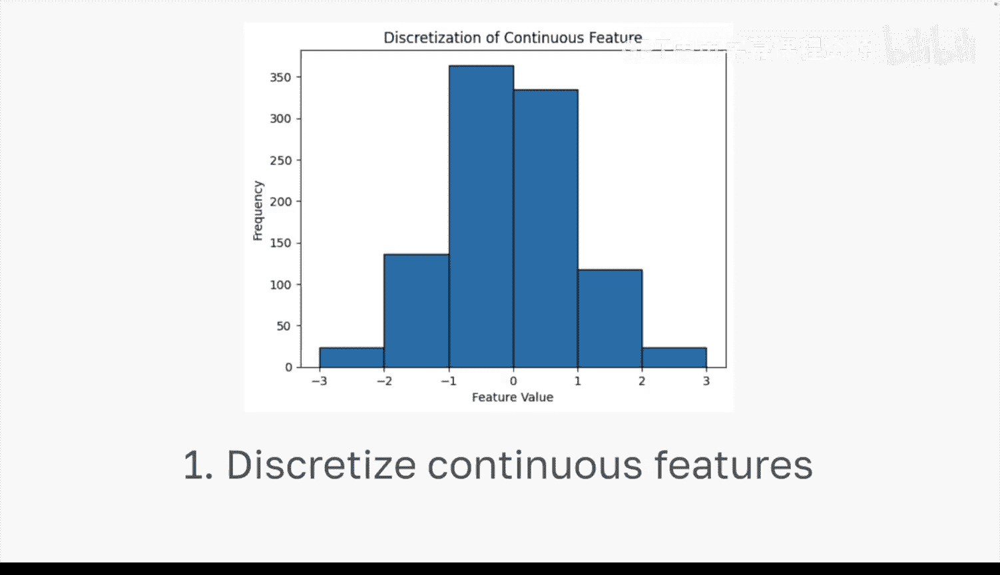

## OneR 算法详解 🎯

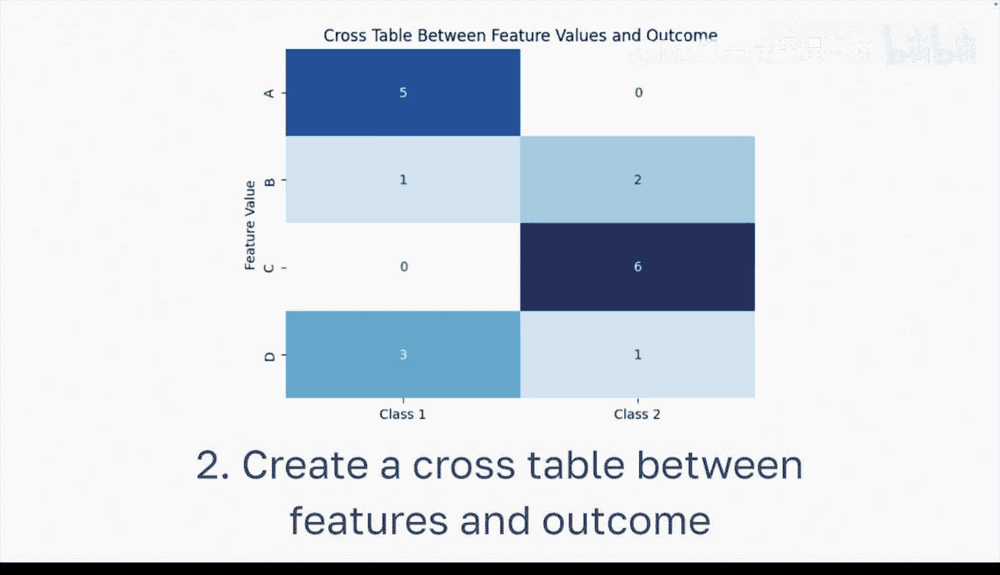

OneR是一种非常简单的方法，通常用作其他方法的基准。它从所有特征中，选择与目标结果最相关的一个，并基于这个特征创建决策规则。

以下是实现OneR的步骤：

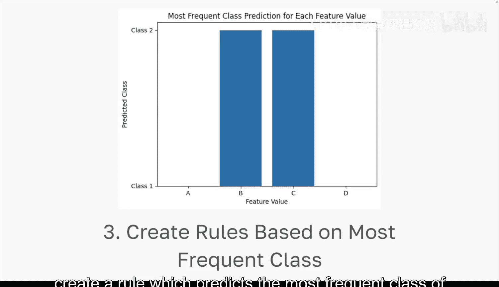

**第一步：离散化连续特征**
如果特征是连续的，首先需要将其离散化。为数据和感兴趣的领域选择合适的分组区间至关重要。

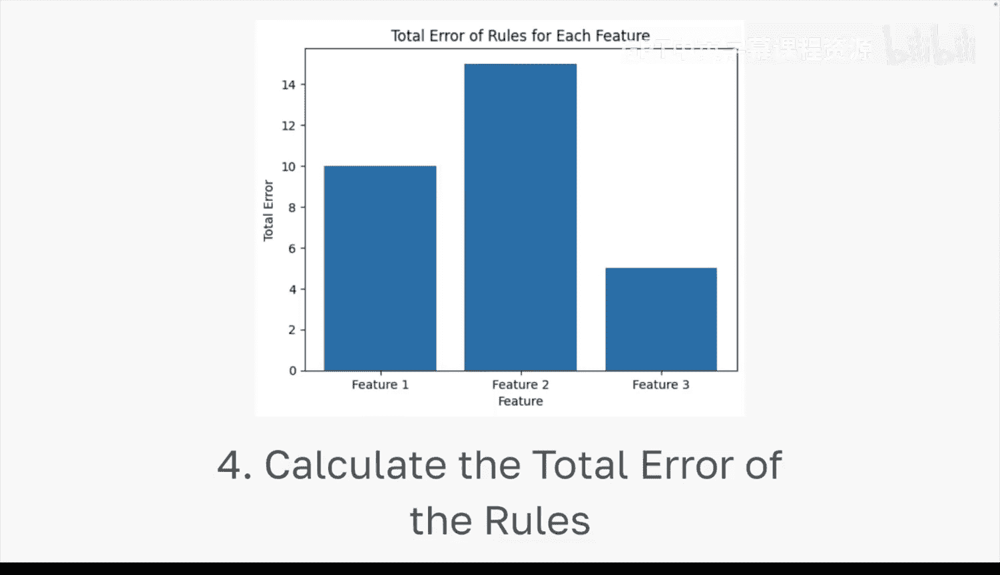

**第二步：为每个特征创建交叉表**
为每个特征，创建一个特征值与分类结果之间的交叉表。

**第三步：为每个特征值创建规则**
对于特征的每个取值，创建一条规则，预测具有该特定特征值的实例中最常见的类别。

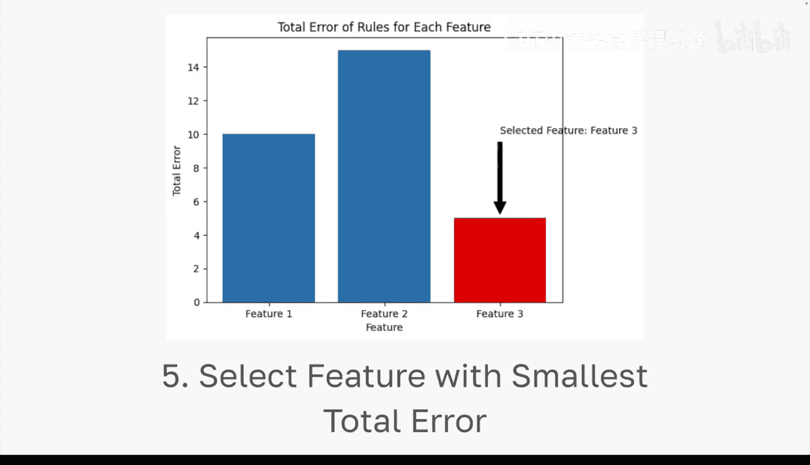

**第四步：计算特征的总误差**
计算该特征所有规则的总误差。

**第五步：选择总误差最小的特征**
选择总误差最小的特征。如果两个特征的总误差相同（出现平局），OneR通过选择第一个误差最低的特征，或选择卡方检验P值最小的特征来解决。

---

## 顺序覆盖算法详解 🔄

顺序覆盖是一种通用流程，它迭代地学习规则，并移除被新规则覆盖的数据点。许多其他决策规则算法（如RIPPER）都使用此流程。

它采用“分离-征服”的方法：首先找到一条适用于部分数据点的好规则，然后移除被该规则覆盖的所有数据点（无论分类正确与否），并在剩余数据点上重复规则学习和移除覆盖点的过程，直到没有数据点剩余或达到某个停止条件。

顺序覆盖的过程相当直接：
1.  从一个空的规则列表开始。
2.  学习一条新规则R。
3.  当规则质量低于阈值或仍有正例未被覆盖时：
    *   将规则R添加到列表中。
    *   移除被规则R覆盖的数据点。
    *   在剩余数据上学习另一条规则。
4.  一旦达到质量阈值或停止条件，返回决策列表。

---

## 决策规则的优缺点 ✅❌

现在，让我们评估一下决策规则在可解释机器学习中的优缺点。

**优点：**
*   **易于解释**：规则非常容易理解和解释。
*   **结构紧凑**：通常比决策树更紧凑。
*   **预测快速**：能提供非常快速的预测。
*   **自动稀疏性**：通常会自动生成稀疏模型。

**缺点：**
*   **适用范围**：主要用于分类任务。
*   **特征要求**：特征需要是分类的，否则需要进行转换。
*   **过拟合风险**：一些算法容易过拟合。
*   **处理线性关系**：与决策树类似，不能很好地处理线性关系，因为它们创建的是阶梯函数，这对于线性关系来说是低效的。

---

## 总结 📝

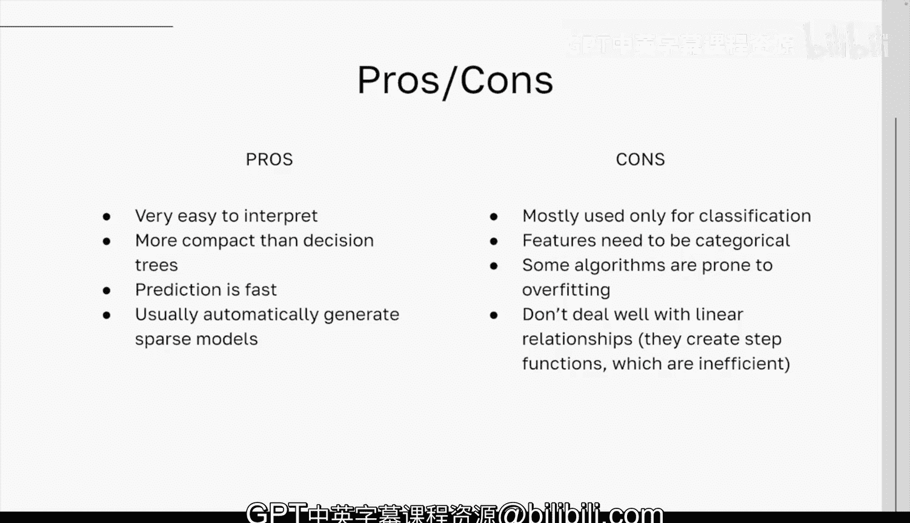

本节课中，我们一起学习了决策规则。我们从决策规则的基本定义开始，了解了其核心的覆盖率与准确率权衡。接着，探讨了如何通过决策列表和决策集来组合多个规则。然后，我们深入介绍了两种经典的学习算法：简单直观的OneR和迭代式的顺序覆盖算法。最后，我们总结了决策规则易于解释、结构紧凑等优点，也指出了其适用范围有限、可能过拟合等缺点。决策规则是构建可解释模型的一个强大而直接的工具。