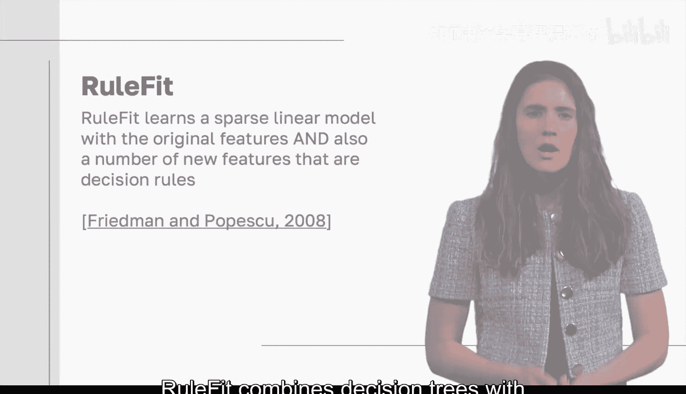
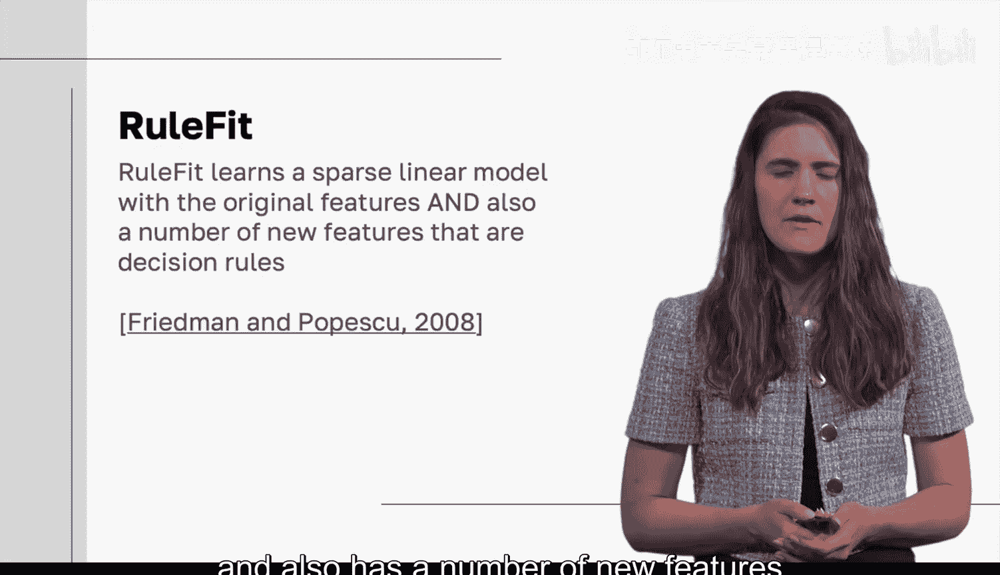
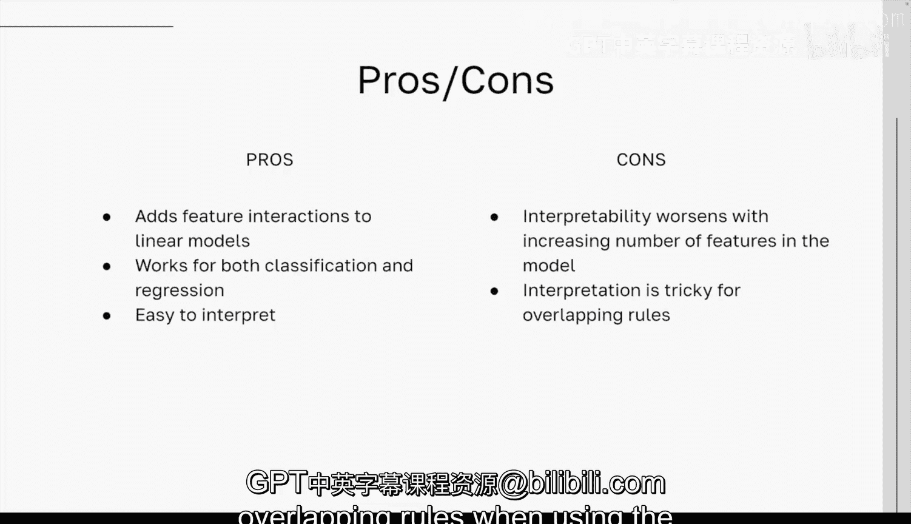

# 杜克大学《可解释人工智能｜Explainable AI (XAI)》中英字幕 p38 09_02_02_规则拟合.zh_en -BV1HnrBBmEon_p38-

Rule fit combines decision trees with linear models by generating rules from an ensemble of decision trees and then fitting a sparse linear model on those rules。

The Rule fit algorithm was introduced in 2008。 A fun fact is that this paper is a seminal paper that also introduces us to some explainable AI techniques。

 like feature importance and partial dependence plots。😊，Intuitively。

 RuleFt learns a sparse linear model with the original features and also has a number of new features in the model that are decision rules。

New features that are decision rules capture interactions between the original features。

 These features are generated from decision trees trained to predict the outcome of interest。

 Each path through a tree can be transformed into a decision rule by combining the split decisions into a rule。

 This figure from the original paper shows a decision tree。

 The rule corresponding to each node is given by the product of the indicator functions associated with all of the edges on the path from the root to that node。

Decision rules are binary features where1 equals all conditions of the ruler met， otherwise equals0。

There are two steps involved in the rule fit algorithm process。 Step 1 is rule generation。

 Rules are constructed by decomposing decision trees。

 where each path to a node becomes a rule by chaining the binary decisions with and。

Trees are fitted to predict the target outcome。 So the splits and resulting rules are optimized for that prediction task。

 Rules are created from all trees in the ensemble by combining the conditions that lead to each node。

A few notes on this step， any tree ensemble algorithm like bagging， random forest。

 Ada boost or mart can be used to generate the trees for rule fit。

 Rule fit extracts rules not just from leaf node， but from all nodes in the trees。

A trick is to learn trees with random depth， to create rules of different lengths and increase diversity。

The next step is creating the sparse linear model。 First。

 the generated rules with the original features are combined into a new feature matrix。

 Then a sparse linear model with Lassso is trained on this combined feature matrix。

 the original features are windsorized and normalized before including them。

 Winsorizing refers to a data transformation technique。

 where extreme values or outliers in the data are replaced with specified percentile values。

 specifically， in the context of the rule fit algorithm， it means for each original feature。

 values below the delta quantile are replaced by the deta quantile value and values above the one minus delta plus quantile are replaced by the 1 minus delta plus quantile of value。

 So if delta equals 0。05， for example， any values of the feature that are in the bottom 5% are set to the fifth percentile value。

And any values in the top 5% are set to the 95th percentile value。

This windsurine helps reduce the influence of extreme outlier values on the linear model fitting process。

 making it more robust。 It's an alternative to just removing the full outlier data points。

 Some notes on this step， the linear model has effects for both the original features and the rules。

 Laso forces some ways to be 0， reducing the number of rules。

The interpretability of rule fit depends on whether you are performing regression or classification In the case of regression。

 the interpretation is the same as linear regression models for decision rules which are binary features。

 if all conditions of a decision rule R sub K apply the predicted outcome changes by alpha sub K。

 which is the learned weight of rule R sub K in the linear model。For classification。

 the interpretation is the same as logistic regression models。

 If all conditions of the decision rule are sub K apply。

 the odds for event versus no event changes by a factor of alpha sub K。

 I wasn't kidding when I said linear regression was the foundation of many interpretable machine learning approaches。

Let's evaluate the pros and cons of rule fit for interpretable machine learning。

Rulefi adds feature interactions to linear models。 It works for both classification and regression。

 and it is easy to interpret。 However， as we have discussed before。

 interpretability worsens with increasing number of features in a model。

 There are typically more features in this model， making them inherently less interpretable。 Also。

 interpretation can be tricky for overlapping rules when using the rule fit algorithm for interpretability。

