# 杜克大学《可解释人工智能｜Explainable AI (XAI)》中英字幕 p39 10_02_01_神经网络可解释性.zh_en -BV1HnrBBmEon_p39-

When we think about neural networks， interpretability usually doesn't come to mind， In fact。

 neural networks are our prototypical example of black box machine learning models， however。

 the research community has invested a lot of effort into improving interpretability of neural networks and making models that are inherently interpretable。

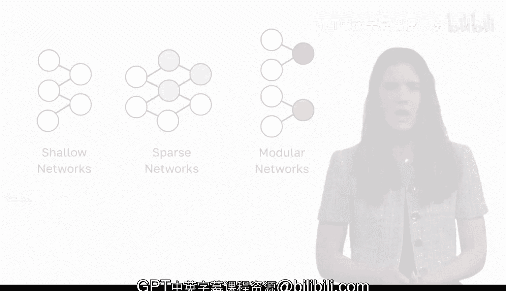

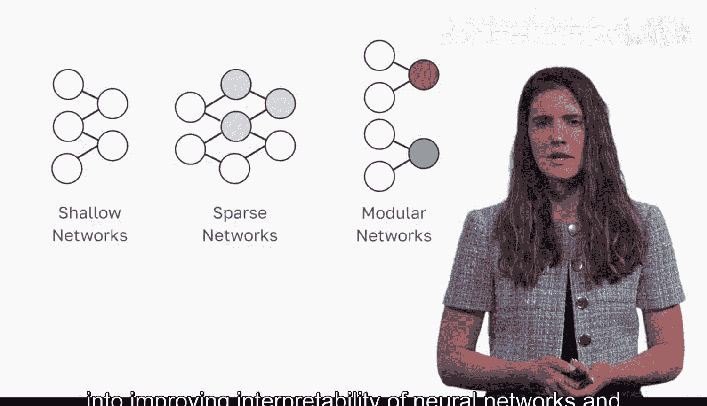

Improved interpretability in neural networks comes in the form of shallow neural networks。

 Sprse neural networks and modular neural networks。

 shallowow neural networks are simpler neural network architectures with fewerer layers and nodes that can be more interpretable than deeper and more complex models。

 The relationships between inputs and outputs are more readily apparent。

 Sprse neural networks are models that have many network connections pruned or set to0。

 and they can be more interpretable， as the remaining connections represent the most important features。

 and modular neural networks are models composed of specialized subcomps。 for example。

 object detection or classification or reasoning， These can be more interpretable than monolithic architectures。

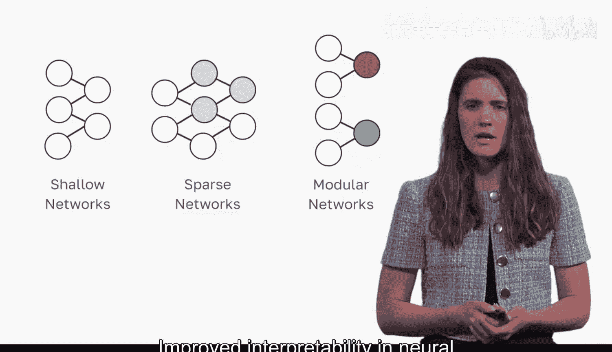

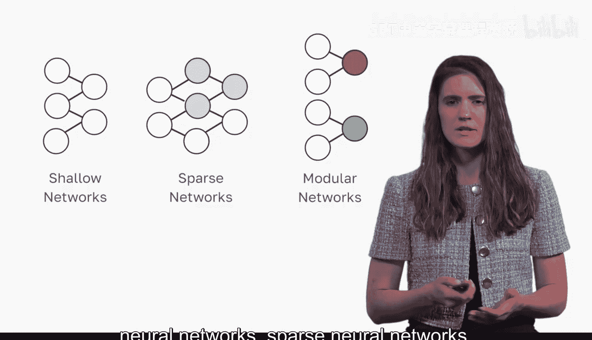

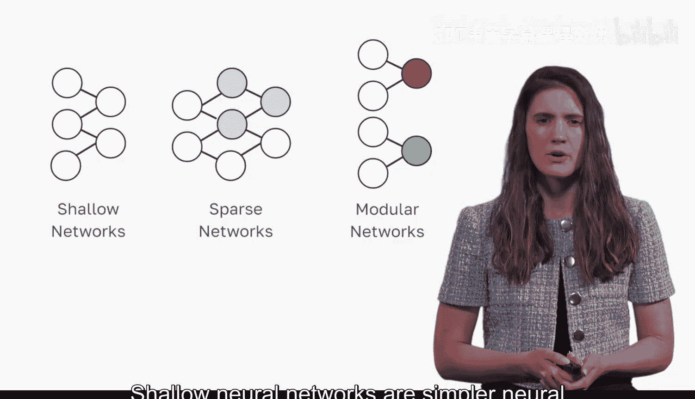

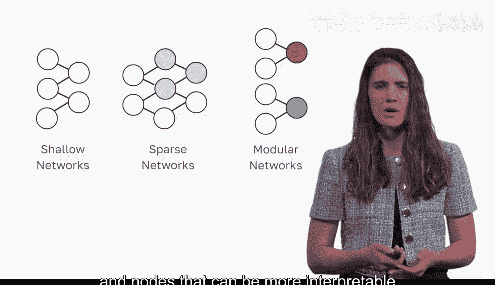

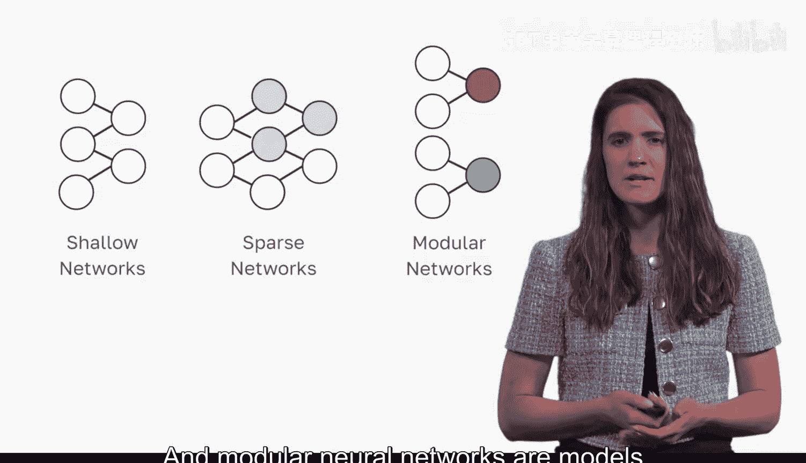

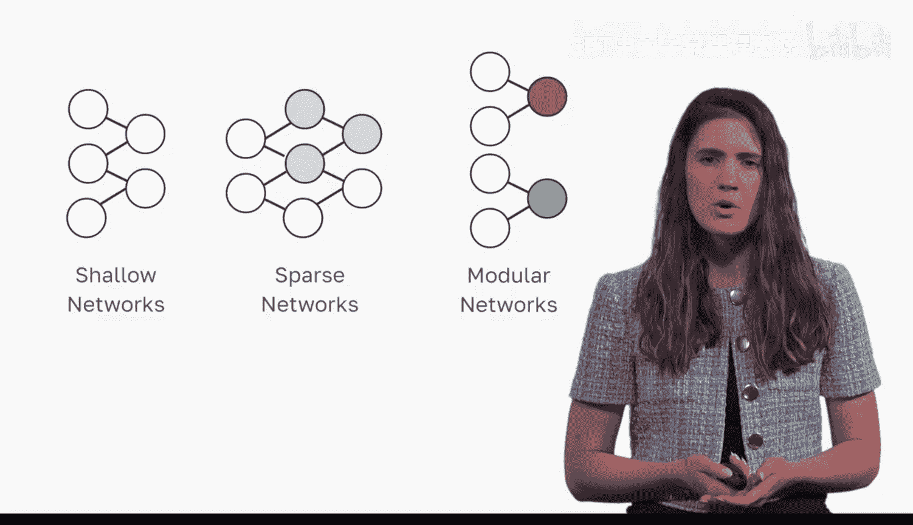

The topic we are interested in in this course is inherently interpretable models。

 and there has been research into inherently interpretable neural networks， broadly。

 disentangled neural networks， prototype based neural networks and monotonic neural networks。

 disentangled neural networks are models that learn representations where each neuron or feature map corresponds to a specific interpretable concept like edges。

 textures or object parts。 This can provide visibility into the models's internal reasoning。

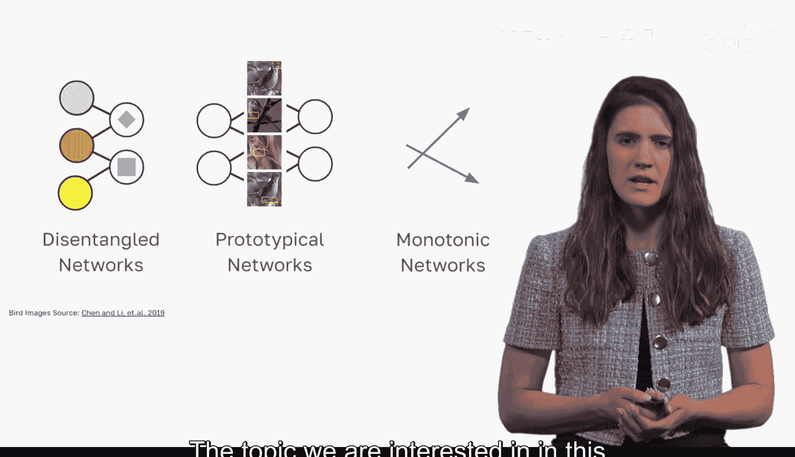

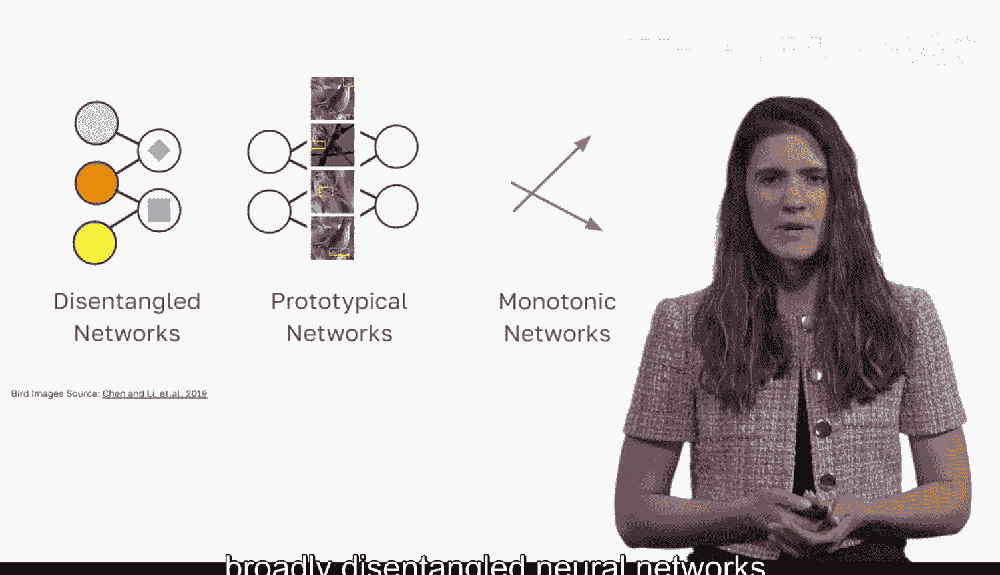

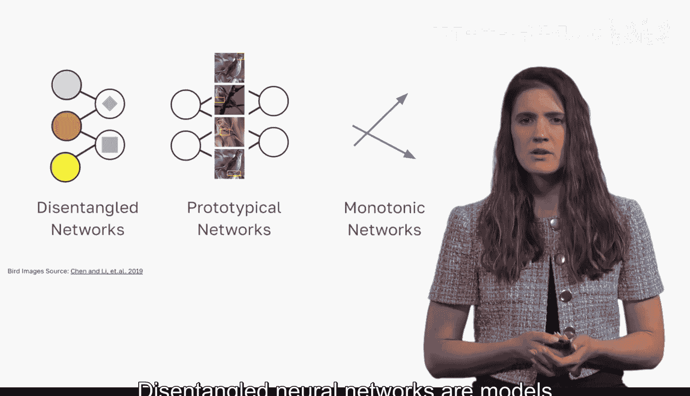

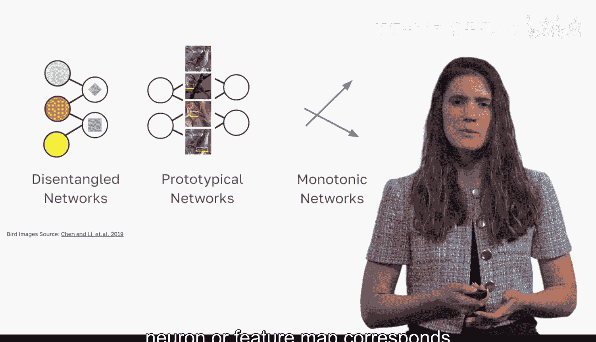

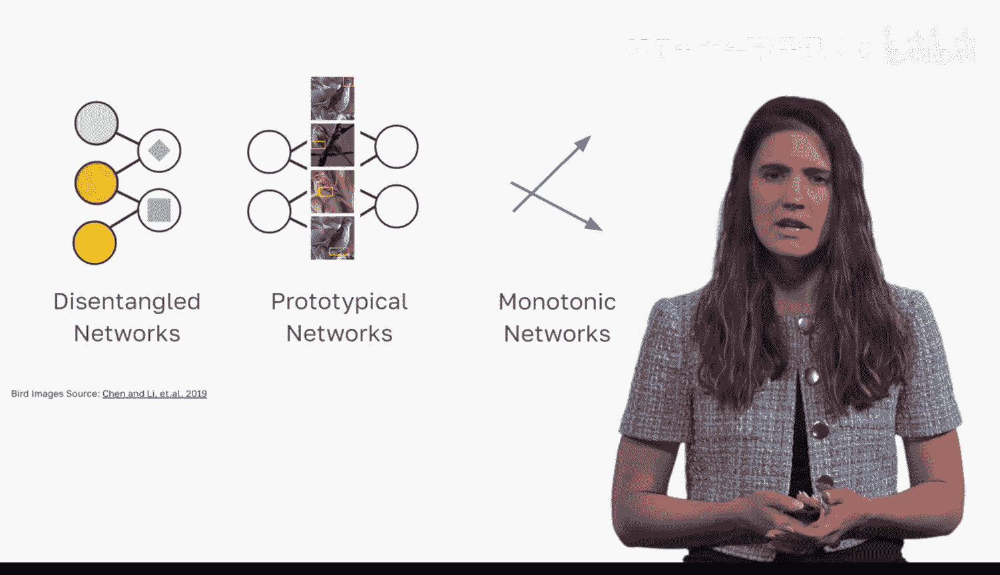

Prototype based neural networks are models that learn prototypical examples of each class and use similarity to these prototypes as the basis for predictions。

 which can be more interpretable than complex decision boundaries。

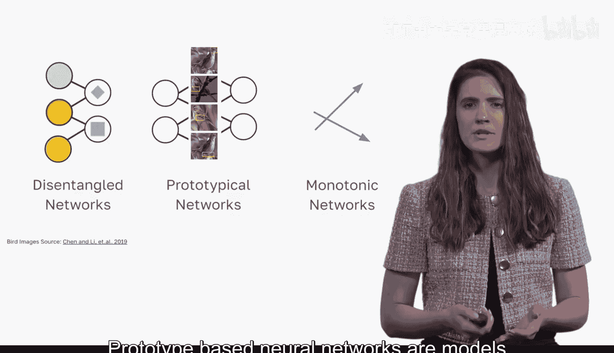

Monoonic neural networks are models that constrain the neural network to produce outputs that are monotonically increasing or decreasing with respect to the input features。

 this can make the model's behavior more intuitive and predictable。

We are going to discuss two recent implementations of inherently interpretable neural networks。

 ProtoPNe and monoNe。

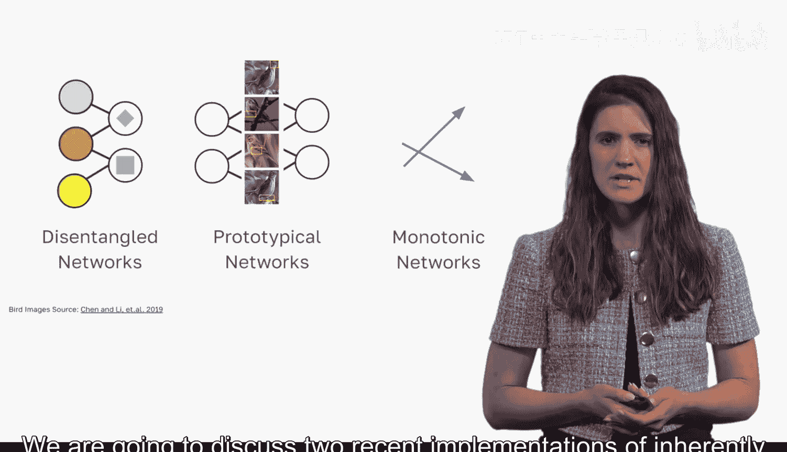

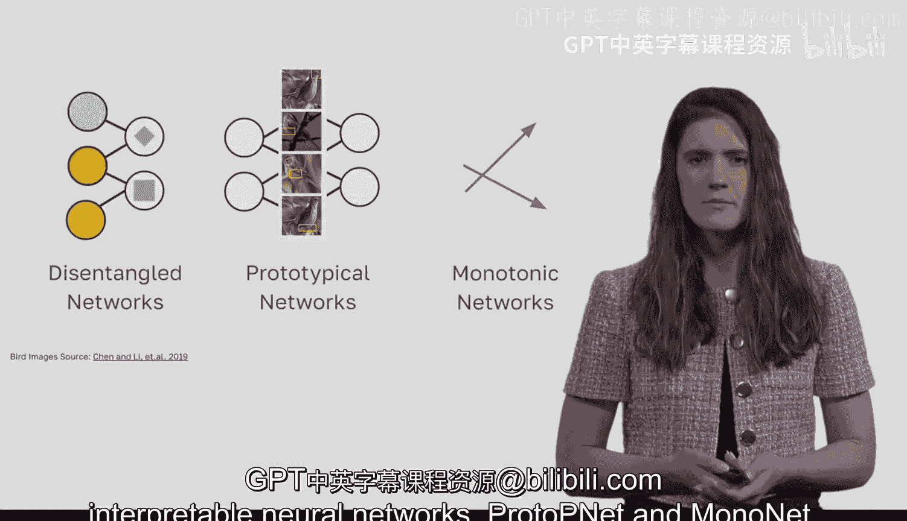