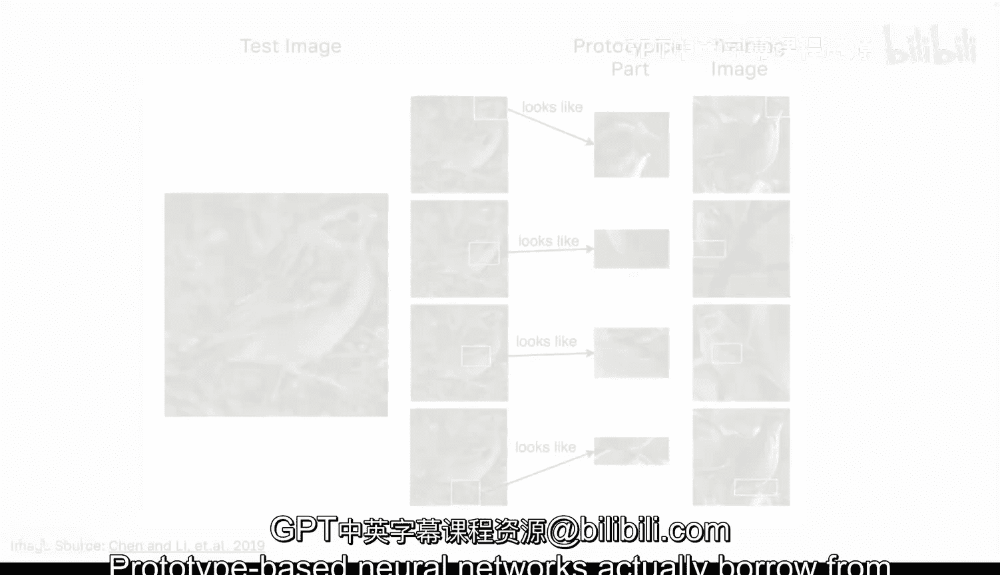
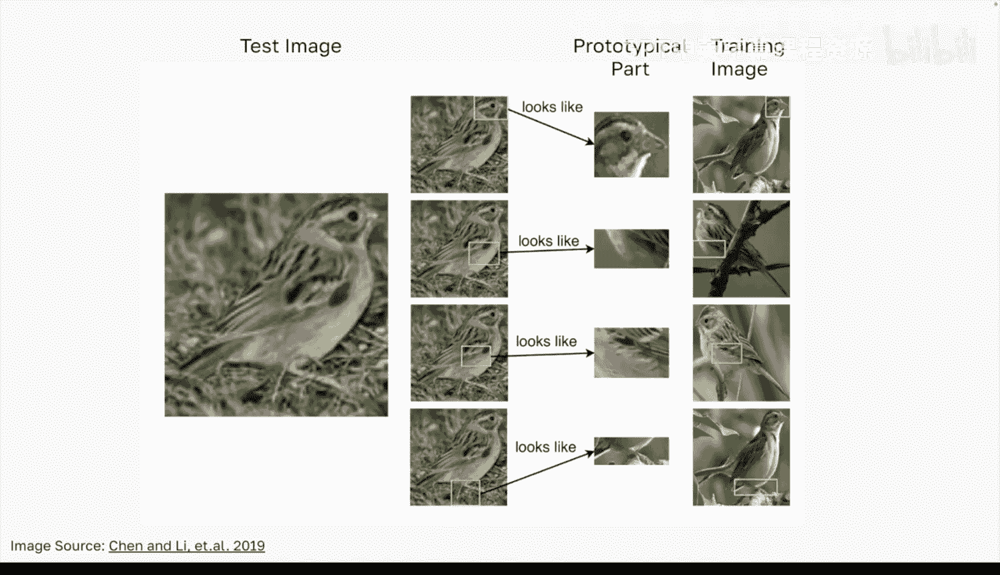
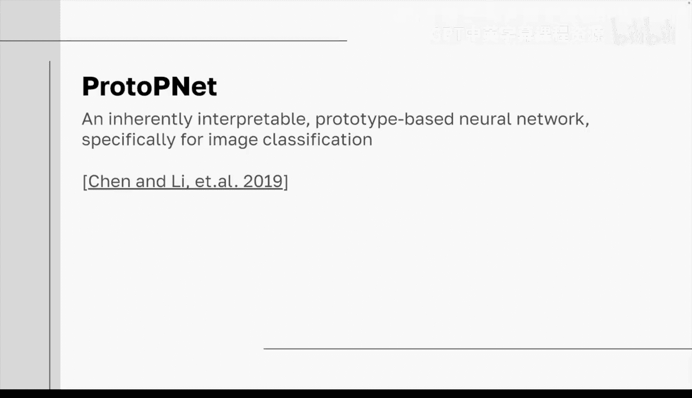
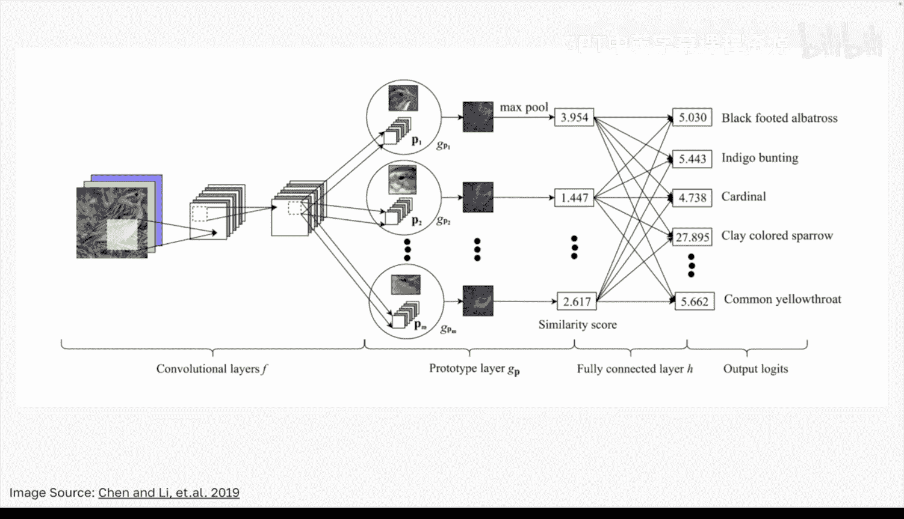
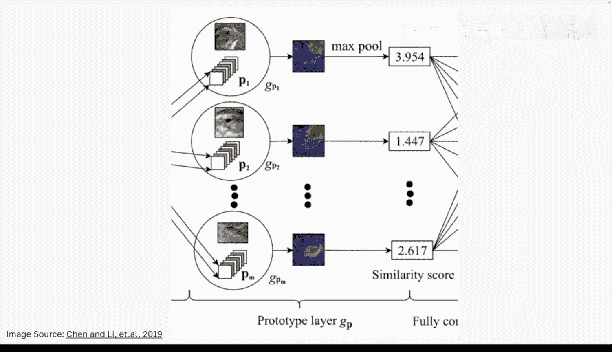
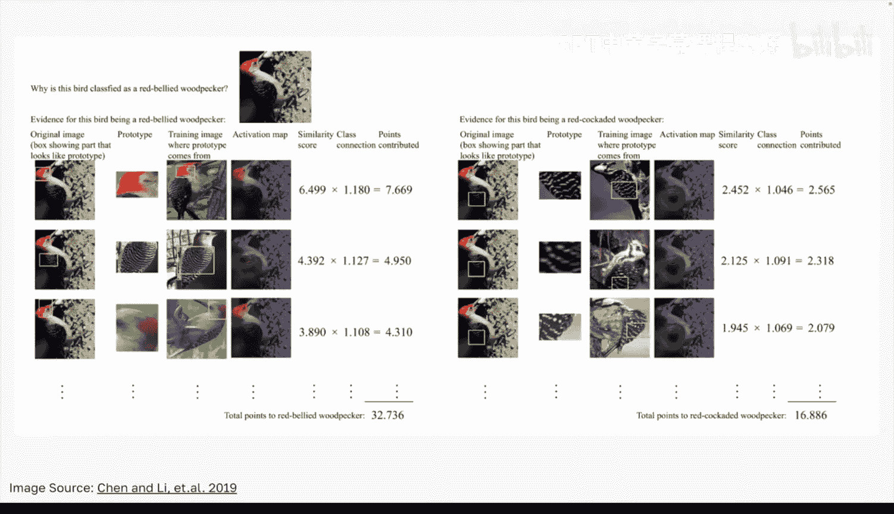
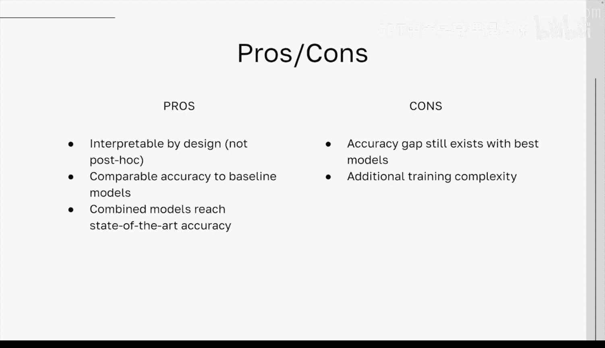

# 杜克大学《可解释人工智能｜Explainable AI (XAI)》中英字幕 p40 11_02_02_基于原型的神经网络-原型网络.zh_en -BV1HnrBBmEon_p40-

Prototype based neural networks actually borrow from an explainable AI example based explanation called prototype based explanations。

 Pro based explanations aim to explain the predictions of a black box model by identifying representative examples or prototypes from the data。

 The main thesis is that we represent the model's knowledge in terms of prototypical instances or patterns。

 When adding layers within your neural network that do this。

 you create an inherently interpretable model， rather than explaining the predictions of a black box model using prototypes。

😊。

In 2019， authors from Duke University introduced the prototypical Part network Proto Peet。

 This was an inherently interpretable prototype based neural network specifically for image classification。

 The idea behind protoPet was to explain the reasoning process in image classification similar to humans It does this by learning prototypical parts for each class。

 Classifying by comparing image parts to learn prototypes and providing interpretability by pointing to similar prototypical cases。

The architecture of proto peanutet is shown here in figure2 from the original paper。

 There are convolutional layers for feature extraction。

 then a prototype layer to learn prototypical parts。

 and finally a fully connected layer for classification。When training proto peanutet。

 stochastic gradient descent is used to learn a meaningful latent space and prototypes are projected to the nearest training patches。

 then convex optimization is used for the last layer weights。

If we zoom into the prototype layer， this is what it looks like。

 The prototype layer learns prototypical part representations by computing patch similarities and allocates prototypes per class to capture class specific prototypes learns a set of prototypes P Each prototype P of J has the same depth as a convolutional output。

 but smaller height and width This represents prototypetotypical activation pattern and image patches for each prototype P of J。

 we compute the squared Euclidean or L2 distances to all patches in the convolutional layer output。

 Then we invert distances to similarity scores and then produce an activation map of similarity scores。

Max pooling gives a single similarity score for piece of J。

 We allocate m sub K prototypes per class K， where m sub K is the number of prototypes for class K。

 for example， in the original paper， M sub K is equal to 10。

This is to learn discriminative prototypes for each class。

In regards to interpretability， Protoet provides part level attention and prototypical cases。

 it explains by pointing to similar learned prototypes。

 it enables visualization of prototypes as training patches and a qualitative reasoning process similar to humans。

Figure2 shows the reasoning process of proto peanutet in deciding the species of birds shown in the top image in the first column。

 we see boxes drawn around the parts of the image that look like the prototype the next column shows our prototype and then the next is the training image where the prototype comes from。

Finally， we show an activation map visualization， the final column in the table shows the points that indicate this image is of a redbelllied woodpecker。

 which is based on the similarity score between the original image and prototype multiplied by the class connection。

This gives us not only a way to visualize the model's reasoning， but also a way to quantify it。

Let's evaluate the pros and cons of protoPet for interpretable machine learning。

Proto peanutet is interpretable by design In the original paper。

 it showed comparable accuracy to baseline models and combined models reach state of the art accuracy。

However， an accuracy gap still exists with the best models and adding the prototype layer adds additional training complexity。

