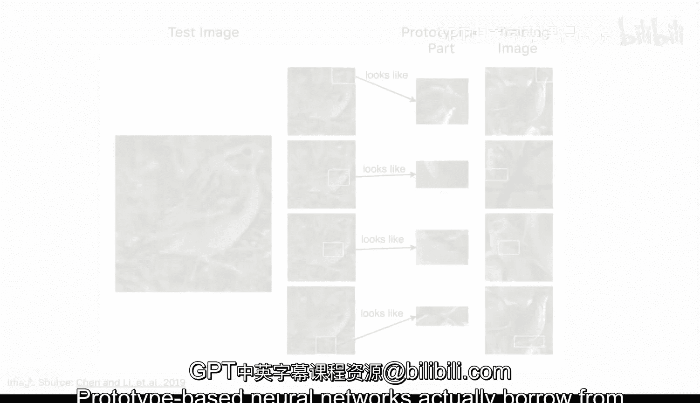
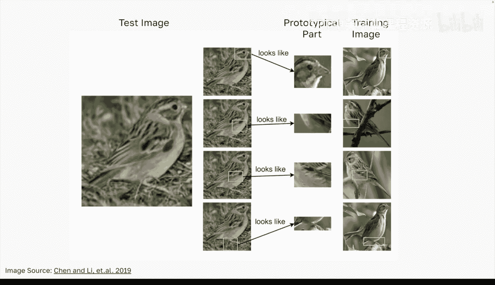
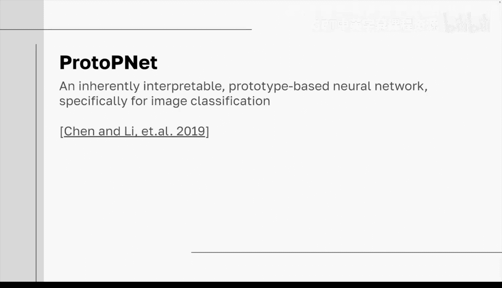
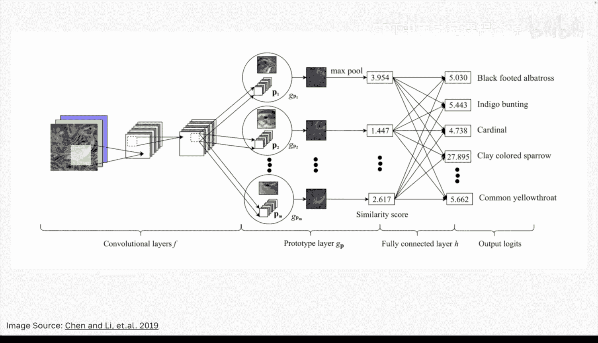
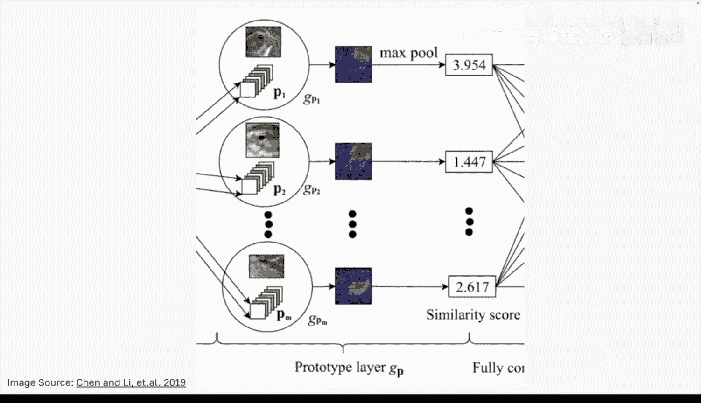
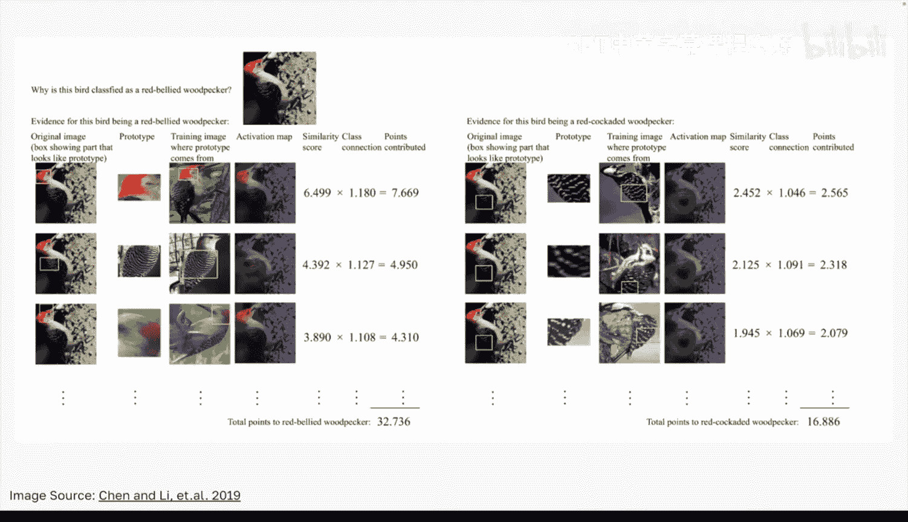
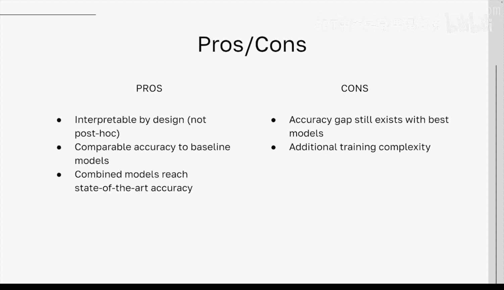

# 可解释人工智能：11_02_02：基于原型的神经网络-原型网络 🧠

在本节课中，我们将要学习一种名为“基于原型的神经网络”的可解释人工智能方法。我们将重点介绍一个具体的模型——原型网络，了解其工作原理、架构以及它如何通过原型来解释模型的决策过程。

---

## 基于原型的解释方法

基于原型的神经网络借鉴了一种名为“基于原型的解释”的可解释人工智能方法。

基于原型的解释旨在通过从数据中识别出代表性的样本或原型，来解释黑盒模型的预测结果。

其核心论点是，我们使用原型实例或模式来表示模型的知识。

当你在神经网络中添加执行此功能的层时，你创建的是一个本质上可解释的模型，而不是使用原型来解释一个黑盒模型的预测。

---

## 原型网络简介

上一节我们介绍了基于原型的解释方法，本节中我们来看看一个具体的实现——原型网络。

2019年，杜克大学的研究人员提出了原型网络。

这是一个本质上可解释的、基于原型的神经网络，专门用于图像分类任务。

原型网络背后的理念是，以类似于人类的方式解释图像分类的推理过程。它通过学习每个类别的原型部件来实现这一点。

它通过比较图像部件与学习到的原型进行分类，并通过指向相似的原型案例来提供可解释性。

---

## 原型网络架构

了解了原型网络的目标后，现在我们来看看它的具体架构。

原型网络的架构如下图所示（源自原论文图2）。

它包含用于特征提取的卷积层。

然后是一个用于学习原型部件的原型层。

最后是一个用于分类的全连接层。

在训练原型网络时，使用随机梯度下降来学习有意义的潜在空间，并将原型投影到最近的训练图像块。

然后使用凸优化来确定最后一层的权重。

---

## 原型层详解

上一节我们概述了整体架构，本节我们将深入探讨其核心——原型层。

如果我们放大原型层，它的结构如下所示。

原型层通过计算图像块的相似性来学习原型部件表示，并为每个类别分配原型以捕获类别特定的特征。

它学习一组原型 **P**。每个原型 **p_j** 与卷积层输出的深度相同，但高度和宽度更小。这代表了一个典型的激活模式。

对于每个原型 **p_j**，我们计算它与卷积层输出中所有图像块之间的平方欧几里得距离（L2距离）。

然后，我们将距离转换为相似度分数，并生成一个相似度分数的激活图。

最大池化操作为每个原型 **p_j** 生成一个单一的相似度分数。

我们为每个类别 **k** 分配 **m_k** 个原型，其中 **m_k** 是类别 **k** 的原型数量。

例如，在原论文中，**m_k = 10**。

这样做是为了为每个类别学习具有区分性的原型。

---

## 可解释性分析

了解了原型层如何工作后，我们来看看原型网络如何提供可解释性。

在可解释性方面，原型网络提供了部件级别的注意力和原型案例。

它通过指向学习到的相似原型来进行解释。

它支持将原型可视化为训练图像块，并提供类似于人类的定性推理过程。

图2展示了原型网络在判断第一列顶部图像中鸟类物种时的推理过程。

我们看到图像中与原型相似的部分被框出。下一列展示了我们的原型，再下一列展示了该原型来源的训练图像。

最后，我们展示了一个激活图的可视化。表格的最后一列显示了表明该图像是红腹啄木鸟的得分点。

这个得分基于原始图像与原型之间的相似度分数乘以类别连接权重。

这不仅为我们提供了一种可视化模型推理过程的方法，也提供了一种量化它的方式。

---

## 优缺点评估

我们已经了解了原型网络的工作原理和可解释性，现在我们来评估一下它的优缺点。

以下是原型网络在可解释机器学习方面的优缺点：

*   **优点**：
    1.  原型网络在设计上就是可解释的。
    2.  在原论文中，它展示了与基线模型相当的准确率。
    3.  组合模型可以达到最先进的准确率。

*   **缺点**：
    1.  与最佳模型相比，仍然存在准确率差距。
    2.  添加原型层增加了额外的训练复杂度。

---

## 总结

本节课中，我们一起学习了基于原型的神经网络，特别是原型网络。我们了解了其核心思想是通过学习数据中的原型部件来进行分类和解释。我们剖析了其架构，深入理解了原型层如何计算相似度并生成解释。最后，我们评估了这种方法的优势与面临的挑战。原型网络为我们提供了一种将深度学习的强大能力与人类可理解的推理过程相结合的有力途径。