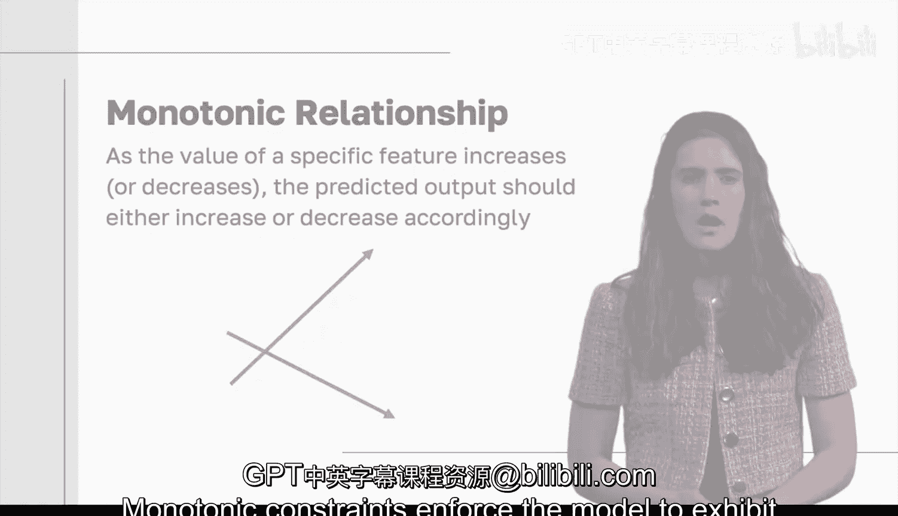
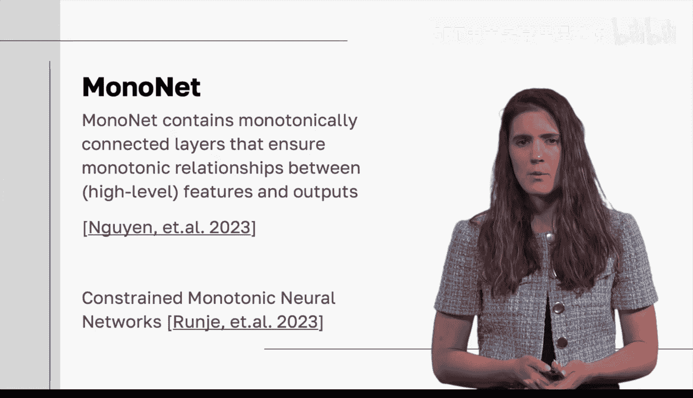
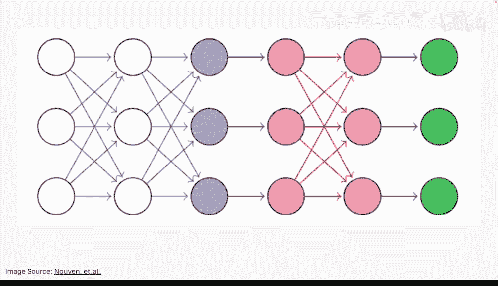
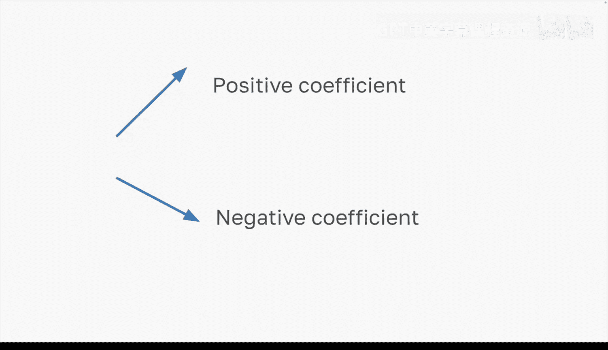
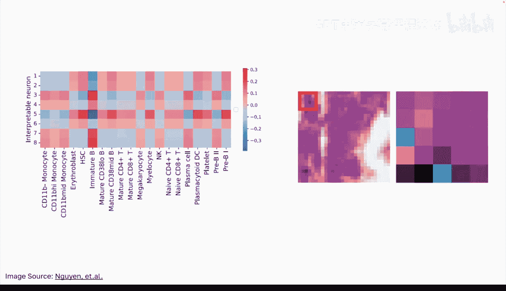
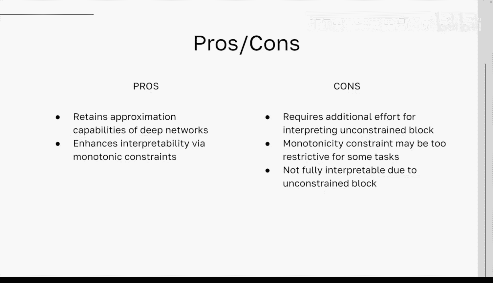

# 杜克大学《可解释人工智能｜Explainable AI (XAI)》中英字幕 p41 12_02_03_单调神经网络-单调网络.zh_en -BV1HnrBBmEon_p41-

Monetonic constraints enforce the model to exhibit a monotonic relationship between one or more input features and the target variable。

 A monotonic relationship assumes that as the value of a specific feature increases or decreases。

 the predicted output should either increase or decrease accordingly。

There are various approaches to incorporate monotonic constraints into machine learning models。

 constrained optimization techniques， monotonic gradient boosting models。

 and monotonic neural networks， which we are discussing in this lecture。

It is important to note that incorporating monotonic constraints may come at the cost of reduced model flexibility as it restricts the model's ability to capture nonmontonic relationships in the data。

Mononet introduced in 2023 by when at all， contains monotonically connected layers that ensure monotonic relationships between high level features and outputs。

 This is an emerging research area。 another paper called Constrained monotonic neural networkss was also released in 2023。

 You can review it for another variation on monotonic neural networks。

Modernnet consists of two different blocks， an unconstrained block。

 which learns arbitrary representations and a monotonic block that enforces a monotonic relationship between the hidden layer and output。

 Figure 1 from the original papers shows the unconstrained block in white。

 followed by the monotonic block in blue。 The pink layers。

 F and6 from the left are guaranteed to be monotonically increasing with respect to each other because they are connected by means of positive weights represented by the red arrows。

In the tabular form of mononet， a monotonic relationship between a chosen interpretable layer and the output is enforced。

 The monotonic block is constructed in two steps。 First， to ensure monotonically increasing layers。

 we compute the hidden layer h sub K plus 1 using the element wise exponential function。

 This formula ensures that the partial derivative of h sub K plus 1 with respect to h sub K is always greater than or equal to0。

 meaning H sub K plus1 is monotonically non- decreasingecreasing with respect to H to allow for arbitrary monotononicity。

 we introduce scaling factors to allow the final relationship between the hidden layer and the output to be either increasing or decreasing。

In a convolutional neural network， the monotonic relationship between the top K activations and the output is implemented by a monotonic block similar to the tabular mononet and a monotonic residual connection that directly connects the top K activations to the output。

This is shown in figure 6 from the original paper。 An unconstrained convolutional layer is used to generate different activation maps。

 These are shown as the colored planes For each activation map。

 the K most activated locations are computed and extracted。

 A monotonic relationship is implemented by summing a monotonic block together with a monotonic residual connection。

 the curvebarrowarrow， which basically sends the output of this layer directly to the last layer。

 skipping the layers in the middle with that residual connection。Unfortunately。

 that unconstrained block is not interpretable， so we can only use our posttaoc explainability methods to explain the learned representations。

On the other hand， the monotonic block is transparent by construction and has easy to interpret monotonic relationships。

 The process to interpret monotonic relationships between hidden layer and output。

 you compute the coefficient， rescaling factor for hidden neuron I B sub J is a rescaling factor for output neuron J。

 A positive coefficient means a monottonically increasing relationship and a negative coefficient means a monotically decreasing relationship。

 magnitude indicates strength of monotonic relationship。 For example。

 if hidden neuron activates for high values of a biomarker and has a positive monotonic relationship with a cell type。

 then that biomarker is indicative of that cell type。😊。

Here are some ways of visualizing mononet figure 5 from the original paper shows the correlation matrix between the interpretable neurons and Y labels In this example。

 cell types。 The matrix tells us whether the monotonic relationship is negative or positive between each interpretable neuron and each predicted class。

Figure 7 shows an example from the original paper of interpreting a monotonic C trained on Pa Mnist。

 They visualize a sample on the left and a high level feature on the right that they want to interpret by analyzing the monotonic block。

 They could determine that the feature is positively correlated to a particular class。

Let's evaluate the pros and cons of monoNe for interpretable machine learning。

Mononet retains the approximation capabilities of deep networks。

 but interpretability is enhanced via monotonic constraints。 However。

 mononet requires additional effort for interpreting in the unconstrained block。

 which can only be done using posttoc explainable AI techniques。

 so only part of the model is inherently interpretable due to that unconstrained block。 Additionally。

 monotonicity constraints may be too restrictive for some tasks。

