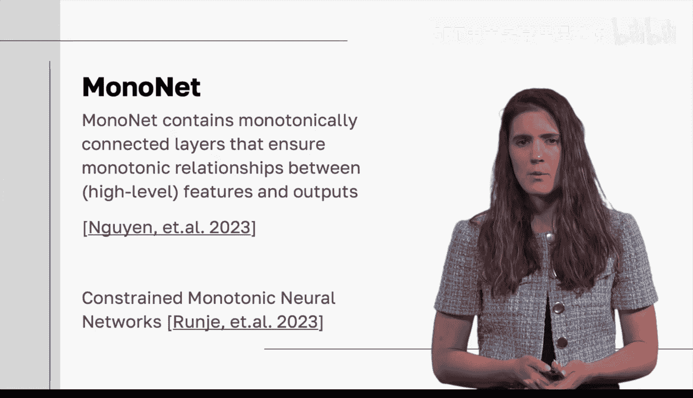
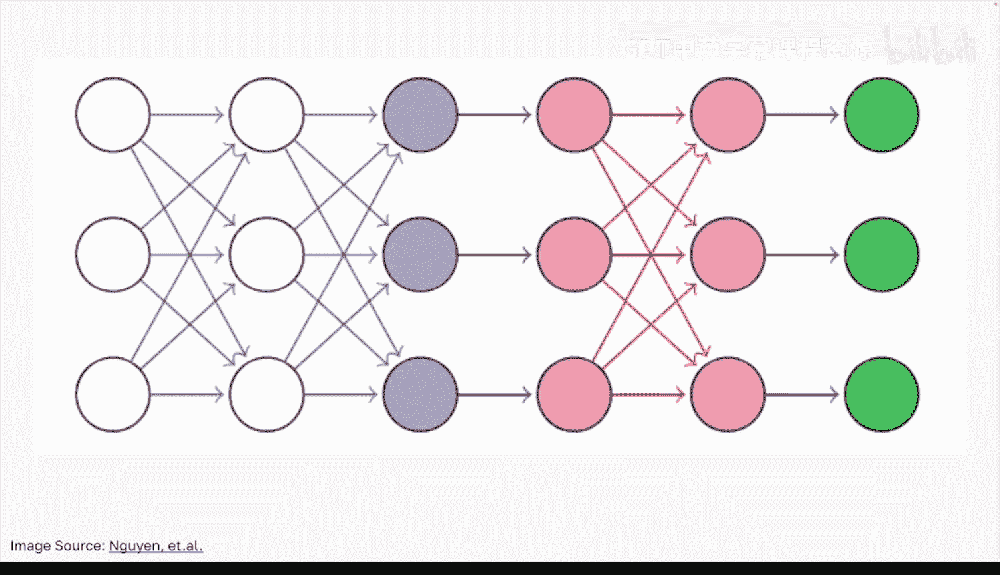
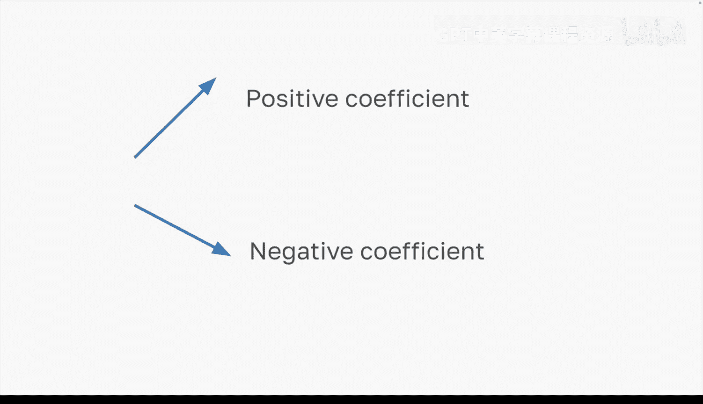
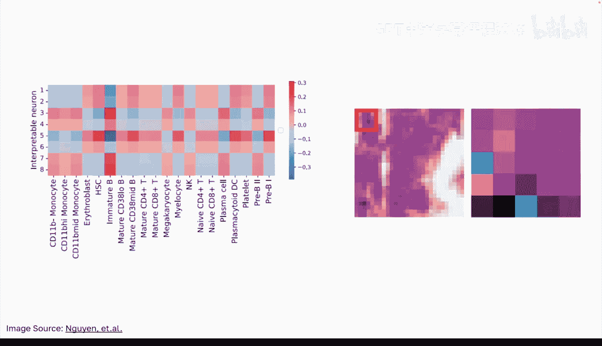
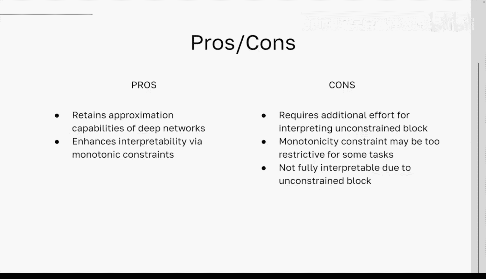

# 可解释人工智能：12：单调神经网络 🧠

在本节课中，我们将要学习一种特殊的神经网络结构——单调神经网络。这种网络通过施加单调性约束，使得模型的部分输入特征与输出目标之间保持明确的单调关系，从而增强了模型的可解释性。

## 单调性约束概述

单调性约束强制模型在一个或多个输入特征与目标变量之间表现出单调关系。单调关系假设当某个特定特征的值增加或减少时，模型的预测输出也应相应地增加或减少。

有多种方法可以将单调性约束融入机器学习模型，包括约束优化技术、单调梯度提升模型，以及我们本节课要讨论的单调神经网络。

需要注意的是，引入单调性约束可能会以降低模型灵活性为代价，因为它限制了模型捕捉数据中非单调关系的能力。

## Monotonic Net (Mononet) 简介

Mononet 由一篇2023年的论文提出，它包含单调连接层，确保了高层特征与输出之间的单调关系。这是一个新兴的研究领域。另一篇名为《Constrained Monotonic Neural Networks》的论文也在2023年发布，提供了单调神经网络的另一种变体。

Mononet 由两个不同的模块组成：一个**无约束模块**，用于学习任意的数据表示；以及一个**单调模块**，用于强制隐藏层与输出之间的单调关系。

## Mononet 的结构与原理

上一节我们介绍了Mononet的基本概念，本节中我们来看看它的具体结构和工作原理。

原始论文中的图1展示了Mononet的结构：白色的无约束模块在前，蓝色的单调模块在后。左侧的粉色层（F和6）被保证彼此之间单调递增，因为它们通过红色箭头表示的正权重连接。

在Mononet的表格形式中，模型强制在选定的可解释层与输出之间建立单调关系。单调模块的构建分为两步：

以下是构建单调模块的两个关键步骤：
1.  **确保层单调递增**：我们使用逐元素的指数函数计算隐藏层 \( h_{K+1} \)。公式 \( h_{K+1} = \exp(W_K h_K + b_K) \) 确保了 \( h_{K+1} \) 对 \( h_K \) 的偏导数始终大于等于0，意味着 \( h_{K+1} \) 相对于 \( h_K \) 是单调非递减的。
2.  **引入缩放因子**：为了允许隐藏层与输出之间的最终关系可以是递增或递减的，我们引入了缩放因子。

在卷积神经网络中，顶层K个激活值与输出之间的单调关系，是通过一个类似于表格型Mononet的单调模块，以及一个直接将顶层K个激活值连接到输出的单调残差连接来实现的。

原始论文中的图6展示了这一过程：首先使用一个无约束的卷积层生成不同的激活图（显示为彩色平面）。对于每个激活图，计算并提取K个激活值最高的位置。然后，通过将一个单调模块与一个单调残差连接（曲线箭头）求和来实现单调关系。这个残差连接将该层的输出直接发送到最后一层，跳过了中间层。

## 模型的解释性分析

了解了Mononet如何构建后，我们来看看如何解释它。

不幸的是，无约束模块本身是不可解释的，我们只能使用事后可解释性方法来解释其学习到的表示。

另一方面，单调模块在构造上是透明的，并且具有易于解释的单调关系。

以下是解释隐藏层与输出之间单调关系的步骤：
1.  计算系数，即隐藏神经元 \( i \) 的重新缩放因子 \( a_i \) 和输出神经元 \( j \) 的重新缩放因子 \( b_j \)。
2.  正系数意味着单调递增关系，负系数意味着单调递减关系。
3.  系数的大小表示单调关系的强度。

例如，如果一个隐藏神经元对某个生物标志物的高值有激活，并且与某种细胞类型呈正单调关系，那么该生物标志物就是该细胞类型的指示器。

## 可视化方法

为了更直观地理解Mononet，我们可以借助一些可视化手段。

原始论文中的图5展示了可解释神经元与Y标签（在此例中是细胞类型）之间的相关性矩阵。该矩阵告诉我们每个可解释神经元与每个预测类别之间的单调关系是负相关还是正相关。

图7展示了论文中一个解释在Pa Mnist数据集上训练的单调卷积神经网络的例子。他们在左侧可视化了一个样本，在右侧可视化了一个他们希望通过分析单调模块来解释的高级特征。他们可以确定该特征与某个特定类别呈正相关。

## 优缺点总结

本节课中我们一起学习了单调神经网络Mononet。最后，让我们评估一下它在可解释机器学习中的优缺点。

Mononet保留了深度网络的近似能力，并通过单调约束增强了可解释性。

然而，Mononet在解释无约束模块时需要付出额外努力，这只能使用事后可解释AI技术来完成，因此由于无约束模块的存在，只有部分模型是固有可解释的。此外，单调性约束对于某些任务来说可能限制性过强。