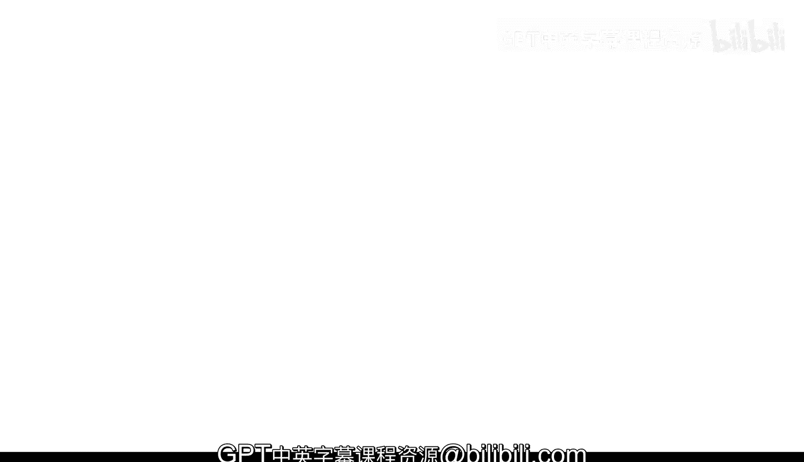
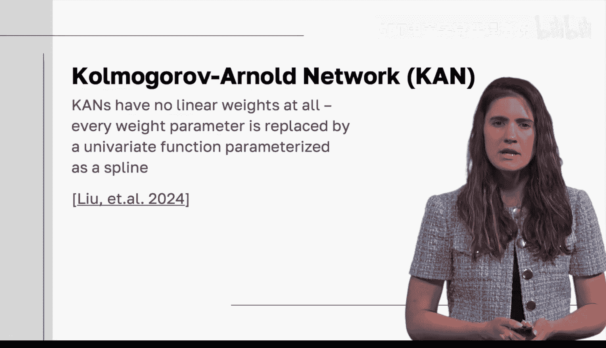
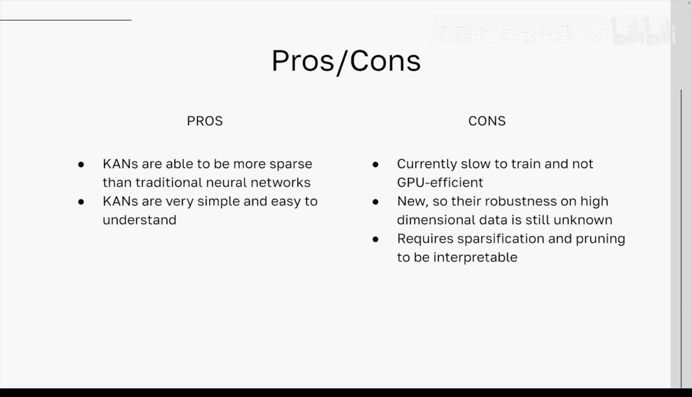

# 杜克大学《可解释人工智能｜Explainable AI (XAI)》中英字幕 p42 13_02_04_柯尔莫哥洛夫-阿诺德网络.zh_en -BV1HnrBBmEon_p42-

Commograrov Arnold networks or cans were introduced in spring 2024 by Luu at all。

 Cans have no linear weights at all。 Every weight parameter is replaced by a univvariate function。

 parameterized as a spline。 Cans can be intuitively visualized and can easily interact with human users。

😊。

Given a multivariate function， Y， we can pass inputs to unitivariate functions， sum them。

 and then pass the sum through another unitivariate function F。 This processed is repeated M times。

Each unitivariate function is parameterized as a spline as shown here。Specifically， B blinds。

 B blinds are piecewise polynomial curves defined by control points。

 They are continuous and differentiable and allow for local control。

 which means that changing a control point only affects a local area of the curve。

This is a visual representation of a can layer， we pass inputs to univariate function denoted by phi。

 and then we sum them。To train a can， we first randomly initialize parameters of be spines for each function in each layer。

 Then we forward pass X through the network。We calculate loss with respect to ground truth。

 and then we perform back propagation to update the beastbl parameters， and we repeat the process。

This image shows an example of how to do symbolic regression with can。 First。

 we train the can with sparsification。 Specifically， we take the L1 norm of the activation functions。

 We can also apply additional entropy regularization as necessary。 Then we pruner network。 Next。

 we perform symbolification。 in cases where we suspect that some activation functions are， in fact。

 symbolic， for example， a cosine or log。 We want to set them to be a specified symbolic form。However。

 we cannot simply set the activation function to be the exact symbolic formula since its inputs and outputs may have shifts and scalings。

 So we obtain pre activationivs X and post activations Y from the samples and fit a fine parameters。

 A， B， C and D， such that y is approximately C of F， A X plus B plus D。

 The fitting is done by iterative grid search of A， B and linear regression。😊，Finally。

 we train the aine parameters to reach machine precision and output an interpretable symbolic formula。

We can see examples here of cans which are interpretable for simple symbolic tasks， for example。

 let's take a look at subfigu A。For multiplication。

 we see that x Y is leveraging 2 xy equals x plus y squared minus x squared plus y squared x shown by a roughly linear spline。

 and y another roughly linear spline are added together and squared， shown by a quadratic spline。

X squared and y squared shown by a quadratic sps are added together。Altogether。

2 x y equals x plus y squared plus x squared plus y squared。

 Here is an example that shows that canNs can identify groups of dependent variables in an unsupervised problem。

 x1， x2 and x3 in C equals 0 and x4 in C equals 2024。

Let's evaluate the pros and cons of cans for interpretable machine learning。

 Cans are able to be more sparse than traditional neural networks。

 They're simple and easy to understand。 However， cans are very new。

 so they are currently slow to train and not GPU efficient。

 Their robustness on high dimensionional data is still unknown。

 and they do require sparsification and pruning to be interpretable。😊。

