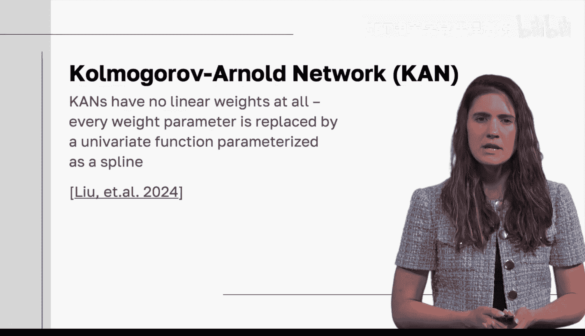
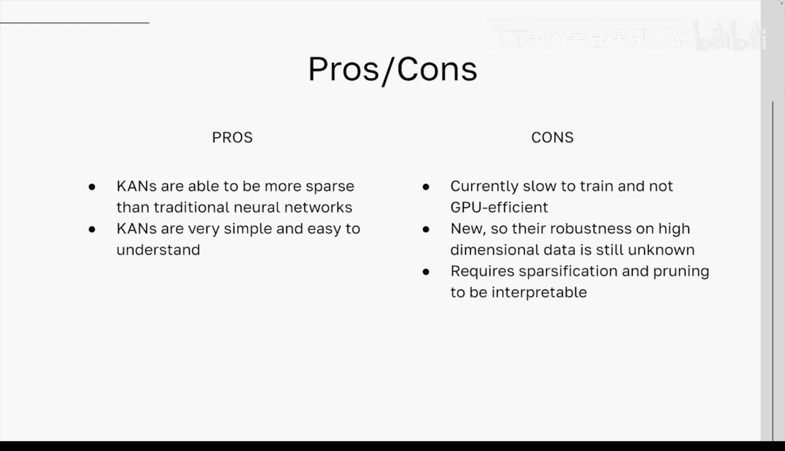

# 可解释人工智能：13：柯尔莫哥洛夫-阿诺德网络 (KAN) 🧠

在本节课中，我们将要学习一种新颖的神经网络架构——柯尔莫哥洛夫-阿诺德网络。这种网络完全摒弃了传统的线性权重，转而使用可学习的单变量函数，使其在数学上更直观，也更容易被人类理解和解释。

---

## 网络架构与核心思想

上一节我们介绍了可解释性的重要性，本节中我们来看看柯尔莫哥洛夫-阿诺德网络是如何构建的。

柯尔莫哥洛夫-阿诺德网络由 Lu 等人在 2024 年春季提出。这种网络完全没有线性权重，每一个权重参数都被一个单变量函数所取代。这些单变量函数被参数化为**样条**。

给定一个多元函数 **Y**，我们可以将输入传递给多个单变量函数，将它们的结果求和，然后再将和传递给另一个单变量函数 **F**。这个过程会重复 **M** 次。

每个单变量函数都被参数化为样条，具体来说，是 **B 样条**。B 样条是由控制点定义的分段多项式曲线。它们是连续且可微的，并允许局部控制，这意味着改变一个控制点只会影响曲线的局部区域。

这是一个 KAN 层的可视化表示：我们将输入传递给由 **φ** 表示的单变量函数，然后将它们的结果求和。

---

## 训练过程

了解了网络结构后，接下来我们看看如何训练一个 KAN。

训练 KAN 的步骤如下：
1.  首先，为每一层的每个函数随机初始化 B 样条参数。
2.  然后，将输入 **X** 前向传播通过网络。
3.  计算预测值与真实值之间的损失。
4.  执行反向传播，更新 B 样条参数。
5.  重复此过程。

---

## 符号回归应用

KAN 的一个强大应用是进行符号回归，即从数据中发现潜在的数学公式。以下是使用 KAN 进行符号回归的步骤：

1.  **稀疏化训练**：首先，在训练 KAN 时加入稀疏化约束。具体来说，我们对激活函数应用 **L1 范数** 惩罚。必要时还可以应用额外的熵正则化。
2.  **网络剪枝**：训练后，对网络进行剪枝，移除不重要的连接和函数。
3.  **符号化**：如果我们怀疑某些激活函数实际上是符号函数（例如，余弦或对数函数），我们希望将它们设置为指定的符号形式。然而，我们不能简单地将激活函数设置为精确的符号公式，因为其输入和输出可能存在平移和缩放。因此，我们从样本中获取预激活值 **X** 和后激活值 **Y**，并拟合参数 **A, B, C, D**，使得 **y ≈ C * f(Ax + B) + D**。拟合通过 **A, B** 的迭代网格搜索和线性回归来完成。
4.  **微调**：最后，微调网络参数以达到机器精度，并输出一个可解释的符号公式。

---

## 可解释性示例

让我们通过几个例子来直观感受 KAN 的可解释性。

以下是 KAN 在简单符号任务上可解释的示例：
*   **示例 A（乘法）**：对于乘法 **x * y**，KAN 利用了公式 **2xy = (x+y)² - (x² + y²)**。可以看到，**x** 和 **y**（由近似线性的样条表示）相加后平方（由二次样条表示）。**x²** 和 **y²**（由二次样条表示）也被相加。整体上，网络学习到了 **2xy = (x+y)² - (x² + y²)** 的关系。
*   **无监督分组**：另一个例子显示，KAN 可以在无监督问题中识别出依赖变量的分组，例如将 **x1, x2, x3** 识别为一组，将 **x4** 识别为另一组。

---

## 优势与局限

最后，我们来评估一下 KAN 在可解释机器学习方面的优缺点。

**优势**：
*   比传统神经网络更稀疏。
*   结构简单，易于理解。

**局限**：
*   作为一种非常新的方法，目前训练速度较慢，且对 GPU 计算不高效。
*   在高维数据上的鲁棒性尚不明确。
*   需要经过稀疏化和剪枝才能变得可解释。

---

本节课中，我们一起学习了柯尔莫哥洛夫-阿诺德网络。我们了解了它用可学习的单变量样条函数替代传统权重的核心思想，探索了其训练过程和在符号回归中的应用，并通过实例看到了其内在的可解释性，最后分析了这种新方法的优势与当前面临的挑战。KAN 为构建更透明、更易于理解的机器学习模型提供了一条有前景的新路径。