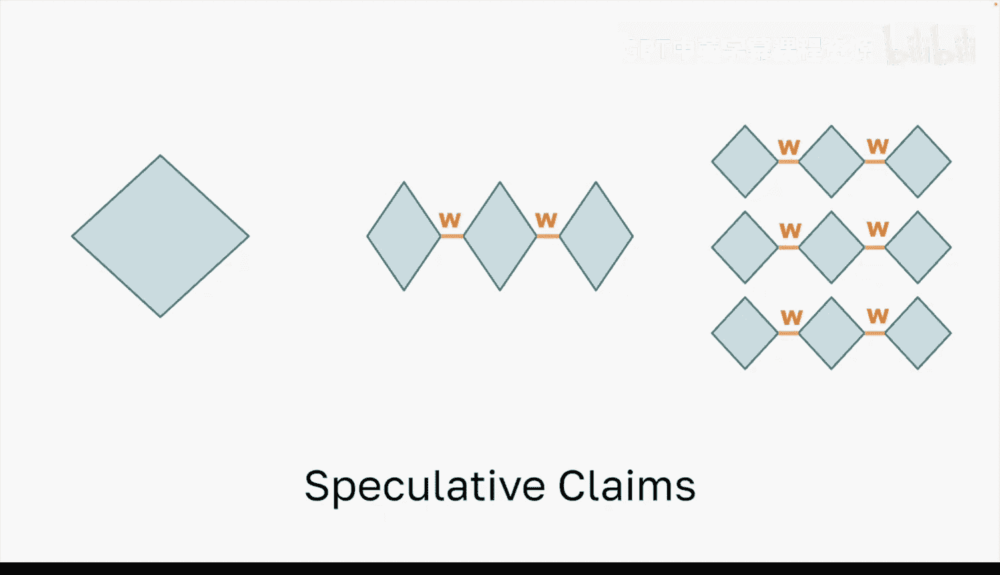

# 杜克大学《可解释人工智能｜Explainable AI (XAI)》中英字幕 p43 14_03_01_机制可解释性导论.zh_en -BV1HnrBBmEon_p43-

Welcome to our next topic， which will deviate significantly from the rest of interpretable machine learning。

 In this module， we will be introducing mechanistic interpretability。😊。

The mechanistic interpretability or MI hypothesis is that neural networks do learn understandable algorithms。

 but have no incentives to make these algorithms representable in a way that humans can understand。

So the core question of MI is， can we reverse engineer the algorithms that neural networks are learning？

Mechanistic interpretability then is the process of reverse engineering neural networks from learned weights down to human interpretable algorithms。

 This is not intuitive， but over the course of this module。

 we will cover the main set of hypotheses that allow us to be able to reverse engineer neural networks。

Despite being a new field， there are many areas of active research in mechanistic interpretability over the course of this module。

 we will discuss the foundational concepts and hypotheses of M。

 We will introduce the concept of circuits， discuss and provide evidence for the superposition hypothesis and finally discuss representation learning in M。

 which is what has recently enabled the exploration of what is under the hood of large language models。

Before we jump in a disclaimer that this topic will deviate significantly from our previous topics in this course。

 MI as a new field started around 2020， but that is an estimate。

 and there were likely people working on it but not publishing prior to 2020。

Due to it being such a new field， there are few researchers working on this subset of interpretability。

 Most of them are currently working for a small handful of companies， not due to its newness。

 but rather the concepts themselves is the fact that this field is fuzzy or ambiguous。

 There is a lot of weird stuff that happens when you model nonlinearities inside of a neural network。

 We will see some of those in this module。Another disclaimer， I myself am not an expert in M I。

 and I have， as of yet， not done M my research。 What I have done is condensed down an immense amount of information and conceptualization into a hopefully digestible introduction to inspire you to dive deeper。

 I will be providing resources for you to dive deeper over the course of this module。😊。

I think of MI research as the neuroscience of machine learning neural networks。

 With that comes the idea that more than any other machine learning topic， M is a science。

 What this means is that the hypotheses presented here may be disproven at some point。

 That's how science works。 and that is definitely how the field of MI works。

In line with our understanding that MI is a science。

 I will kick off our module on neural networks by introducing the speculative claims about neural networks。

 as presented by Neil Nanda， one of the primary MI researchers。

 The speculative claims about neural networks are as follows。 Features。

 Features are the fundamental unit of neural networks。

 They correspond to directions or a linear combination of neurons in a layer。

Circuits features are connected by weights， forming circuits。

 A circuit is a computational subgraph of a network。

 A circuit consists of a set of features and the weighted edges that go between them。

University universality poses that analogous features and circuits form across models and tasks。

We are going to dive much deeper into each of these topics in our concepts lecture。

