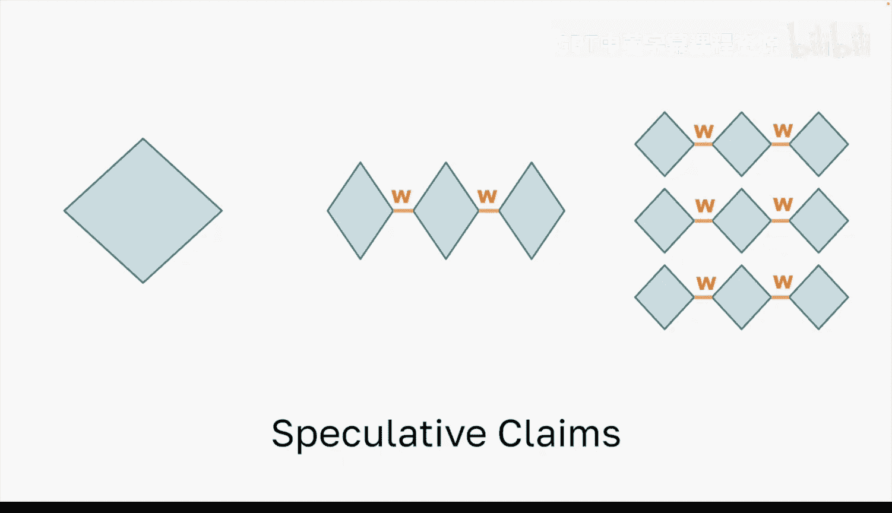

# 可解释人工智能：14：机制可解释性导论 🧠

在本节课中，我们将要学习一个与之前课程内容显著不同的新主题——机制可解释性。我们将探讨神经网络是否学习了人类可以理解的算法，并介绍如何通过逆向工程来揭示这些算法。

## 概述

机制可解释性是一个新兴的研究领域，它试图从神经网络学习到的权重出发，逆向工程出人类可理解的算法。本节将介绍该领域的核心假设、基本概念以及当前的研究方向。

## 核心假设与定义

上一节我们介绍了可解释机器学习的其他方面，本节中我们来看看机制可解释性的独特视角。

机制可解释性假设认为，神经网络确实学习了可理解的算法，但这些算法没有以人类易于理解的方式呈现出来。因此，该领域的核心问题是：**我们能否逆向工程出神经网络所学习的算法？**

机制可解释性本身，就是从学习到的权重出发，逆向工程神经网络以得到人类可解释算法的过程。这并不直观，但在本模块中，我们将介绍一系列允许我们进行这种逆向工程的主要假设。

## 研究现状与挑战

尽管是一个新兴领域，机制可解释性内部仍有许多活跃的研究方向。在本模块中，我们将讨论其基础概念和假设。

需要提前说明的是，本主题将与课程之前的主题有显著不同。机制可解释性作为一个新领域大约始于2020年，由于非常新颖，从事该领域的研究人员相对较少，且大多集中在少数几家公司。

另一个需要说明的是，我本人并非机制可解释性专家，也尚未进行相关研究。我所做的是将大量的信息和概念浓缩成一个易于理解的介绍，以期激发您深入探索的兴趣。在本模块中，我将提供供您深入学习的资源。

## 科学视角下的机制可解释性

我认为机制可解释性研究就像是机器学习神经网络的“神经科学”。这意味着，相比其他机器学习主题，它更像一门科学。科学意味着此处提出的假设未来可能被证伪，这正是科学的工作方式，也绝对是机制可解释性领域的工作方式。

基于机制可解释性是一门科学的理解，我将通过介绍该领域主要研究者之一尼尔·南达提出的关于神经网络的推测性主张，来开启我们的神经网络模块。

以下是关于神经网络的推测性主张：

*   **特征**：特征是神经网络的基本单元。它们对应于层中神经元的方向或线性组合。
*   **电路**：特征通过权重连接，形成电路。一个电路是网络的一个计算子图，由一组特征以及它们之间的加权边组成。
*   **普遍性**：普遍性主张认为，类似的**特征**和**电路**会在不同的模型和任务中形成。

在接下来的概念讲座中，我们将更深入地探讨每一个主题。

## 总结

本节课中我们一起学习了机制可解释性的基本概念。我们了解到这是一个通过逆向工程来理解神经网络内部算法的新兴科学领域，并初步认识了其特征、电路和普遍性三大核心推测主张。在后续章节中，我们将对这些概念进行更深入的探索。