# 杜克大学《可解释人工智能｜Explainable AI (XAI)》中英字幕 p44 15_03_02_机制可解释性概念.zh_en -BV1HnrBBmEon_p44-

Let's introduce some foundational concepts in mechanistic interpretability。

The first foundational concept we will discuss is the feature。

 This is not necessarily a feature in the traditional machine learning sense。

 The M definition extends this and maybe warps it a little bit。

 The linear representation hypothesis suggest that neural networks represent meaningful concepts or features as directions in their activation spaces。

 Features are a property of an input to the model or some subset of that input。

 like a token in the prompt given to a large language model or a patch of an image。

Features are the fundamental building blocks of models。

 The model's internal activations represent features。

 the model's weights and nonlinearities are used to apply computations to produce later features from earlier features。

Examples of features include this token is the name of a variable corresponding to a list in Python code。

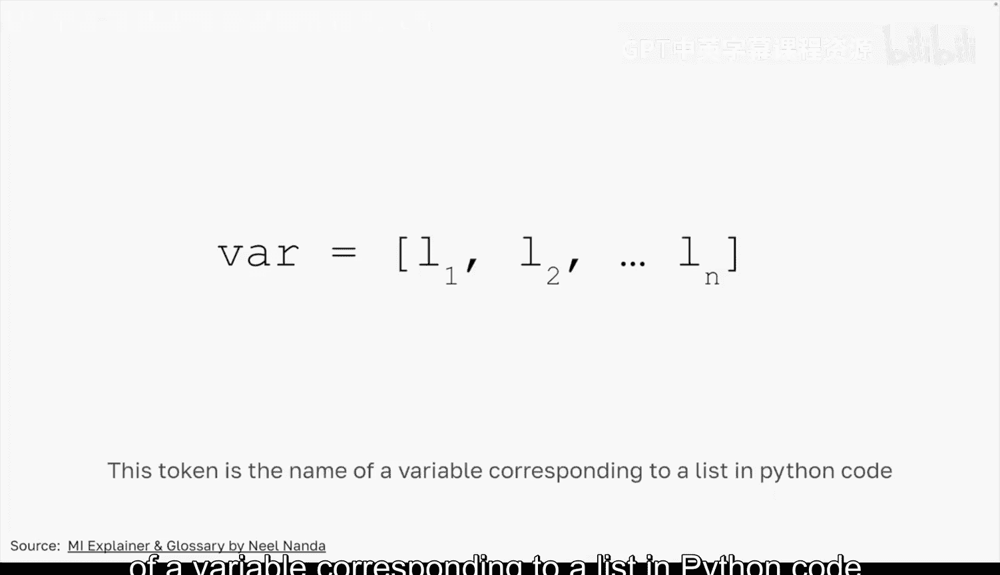

This token corresponds to a number that is being used to describe a group of people。

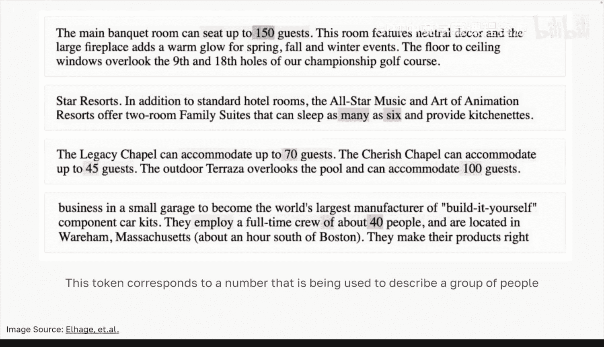

This part of the image contains a curve。

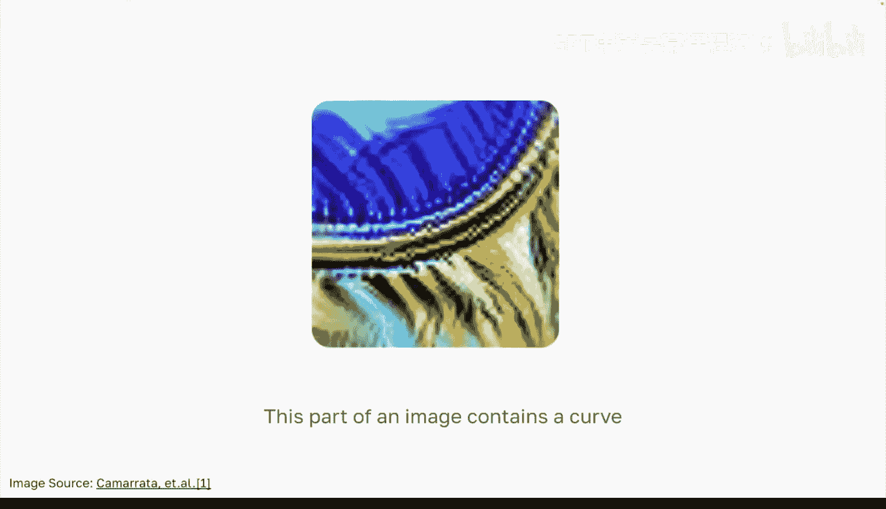

You'll notice the interesting form features take， this blank contains or corresponds to or is blank。

If you don't quite get it， don't worry， we are going to build more intuition about features over the course of the module。

A circuit is a subset of a model's weights and nonlinearities used to map a set of earlier features to a set of later features。

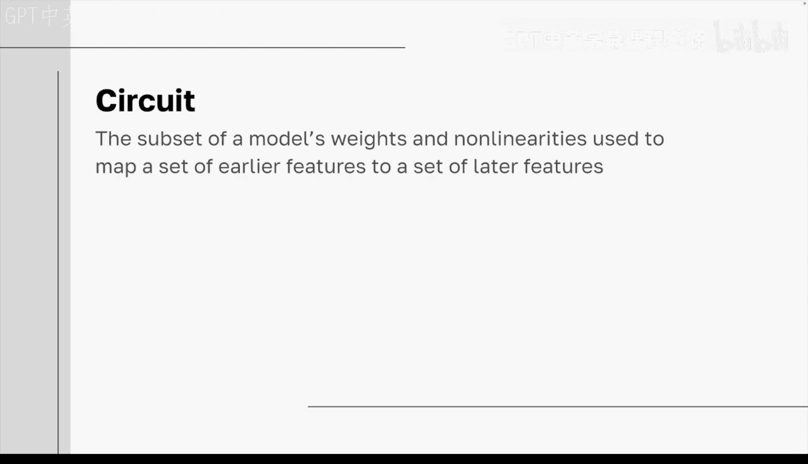

There are many examples of circuits in neural networks， including curve circuits。

 which identify parts of an image that contain curves and induction circuits。

 a circuit and generative language models that has two attention heads to detect and continue repeated subs sequenceequences。

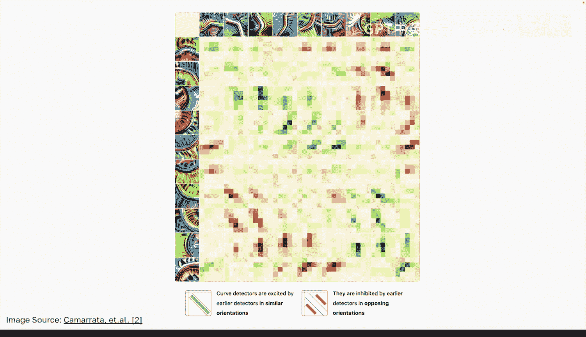

Now that we have defined features and circuits， let's talk about the core purpose of MI reverseverse engineering the neural network reverse engineering a physical device involves a systematic exploration and analysis of its structure and components。

 If we apply that to reverse engineering and neural network。

 what kind of structure should we expect neural network representations to have。

Because we cannot physically take a neural network apart to explore its structure。

 We must claim some assumptions about this structure in order to reverse engineer it。

 These assumptions are decomposability and linearity。

 Decomposability says that network representations can be described in terms of independently understandable features。

 and linearity says that features are represented by directions。

Neural network based computer vision models trained on imagenet perform well on tasks like image classification。

 It can accurately classify between 10 different objects like cats。

 dogs and peanut butter and jelly sandwiches。In a large neural network like the one described above。

 the model learns to extract and combine numerous feature representations from the input image data。

 For example， in early layers， it may learn low level features like edges and textures In deeper layers。

 It combines those into higher level features that represent more abstract concepts like shapes and objects。

The key intuition is that each of these feature representations is relatively independent and understandable on its own。

 so this says that feature representations from dogs are independent from cats。

 which are independent from PB&Js。This allows us to break down the model and not have to fit the entire thing in our heads。

 It also helps us avoid the dreaded curse of dimensionality。

A reminder that the curse of dimensionality refers to the challenges and complexities that arise when working with high dimensional data as the number of dimensions or features in a dataset set increases。

 the data becomes increasingly sparse in high dimensional space。

 The amount of data required to maintain the same density grows exponentially with the number of dimensions。

 Disance measures becomes less meaningful and discriminative in high dimensional spaces。

 So most data points appear to be almost equidistant from each other。

 and visualization and interpretation of high dimensional data becomes increasingly difficult。Now。

 neural networks are not fully decomposable， and we will talk more about that and what it means for MI later in this module。

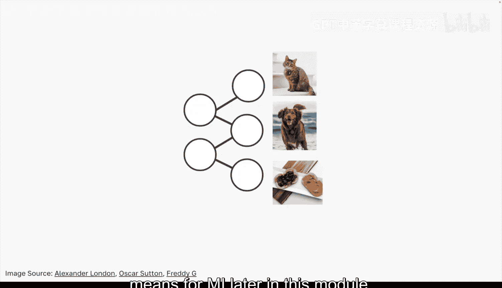

As we were reverse engineering the neural network， something interesting emerged。

 Many neurons in the early layers of the inception V1 model correspond to features shown here as one example。

 curve detector neurons， where each neuron encodes a curve in a specific orientation。

 This figure shows a visualization of each neuro's ideal curve。

 We can use feature visualization methods， which use optimization to find the input here an image to a neural network that maximizes a given objective。

 The objective shown here is to make the neuron fire as strongly as possible。😊。

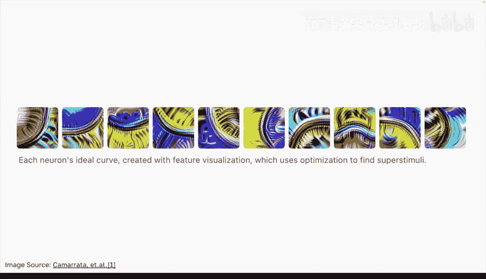

But there is a problem。 Sometimes this happens and other times it does not。

 neurons don't always match cleanly to one feature。The question you may be asking yourself is why？

M I has come up with two hypotheses， One privileged basis。

 This is the hypothesis that only some representations have a privileged basis。

 which encourages features to align with basis directions to correspond to neurons。

 You can see this in the top row of this figure。 nonprivileged basis can embed features in any direction。

 whereas in a privileged basis， there is an incentive for features to align with basis dimensions。

 Note， this doesn't necessarily mean that they will。

And our second hypothesis is the superposition hypothesis linearar representations can represent more features than dimensions using a strategy we call superposition This can be thought of as neural networks simulating larger networks which pushes features away from corresponding to neurons。

Under superposition， features cannot align with the basis because the model embeds more features than there are neurons。

 Polyseentticity is then inevitable。 What is polylyseentity。

 It is a term to describe what we would expect to observe if features were not aligned with a neuron。

 or in other words， when many features are mapped using the same neuron。

Here's another visualization of the superposition hypothesis。

 the superposition hypothesis states that the neural networks we observe are just simulations of larger networks where every neuron is a disentangled or independent feature。

The idea is that the network we observe shown in the bottom of this figure is a low dimensional projection of the larger network。

 This low dimensional projection includes polysemanticity。

 since it is essentially a compressed version of the larger network。If this is still confusing。

 don't worry， we will cover it in greater detail in the superposition lecture。

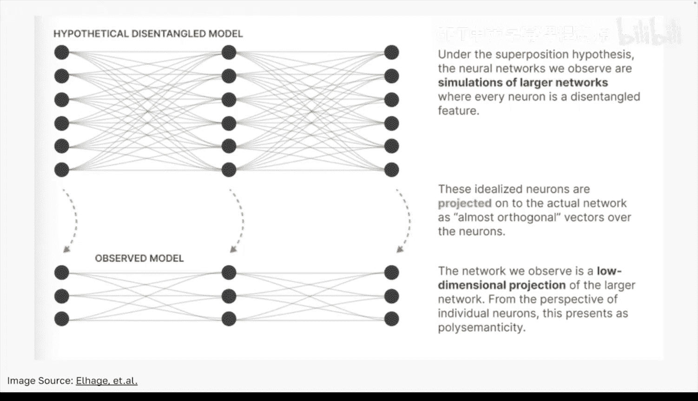

As we have started reverse engineering the neural network， we have taken inspiration from the brain。

 A study done in the human brain by corroga at all showed that neurons in the brain encode multimodal concepts。

 The same neuron that responds to a photo of Halleyberry will also respond to sketches of Hallberry and will even respond to text Halleyberry。

 So these concepts themselves are represented by this neuron。 Similarlyly。

 go at all showed that a neuron from a large multimodal embedding model called C would respond to photos of Spiderman Coms of Spiderman and the text Sp showing similar multimodality to the human brain。

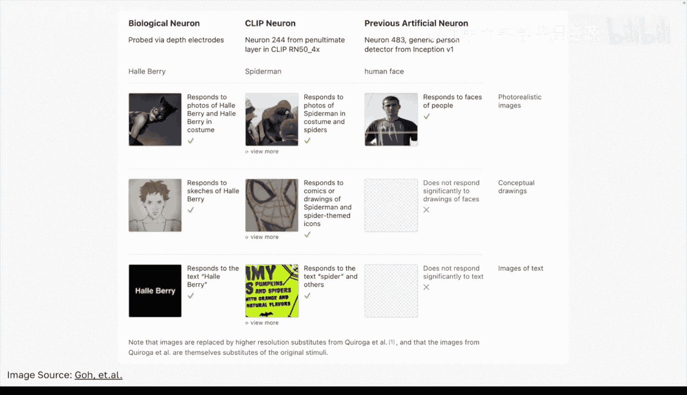

The next topic we will cover is the last of our speculative claims about neural networks。

 and that is universalverity。 Univerity is the hypothesis that the same circuits will show up in different models。

 Different models trained to do similar tasks on similar data with similar architectures are likely to converge。

 and the same way to represent some information。 Remember， the curve detectors we saw earlier。

 Those same curve detectors show up across different models。

 providing anecdotal evidence of universality in neural networks。

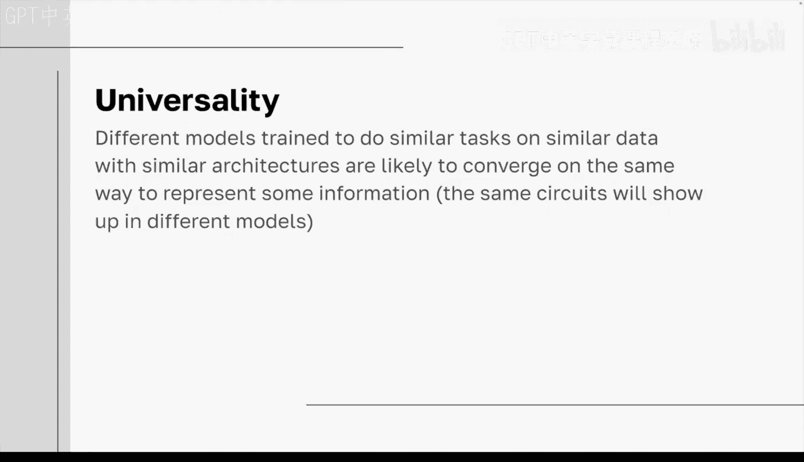

The last topic we will discuss in the concepts introduction to M is common Mi methods。 Well。

 we won't go into each of these methods in detail because they are quite extensive and require some background knowledge。

 We will give a high level overview of them so you can start to get a feel for what Mi researchers do。

 Common M methods include perturbation based methods。 outputs， attribution， Scorn probing methods。

 visualization and interpretation， representation， learning and architectural modifications。

Perturbation based methods involve perturbing or modifying the input。

 activations or internal components of the model to observe the changes in the output or behavior。

 thereby attributing importance or causality to specific components or features。

 Exles include ablation， activation patching， causal tracing， path patching and causal scrubbing。

Output attribution aims to attribute the final output。

 logics or loss to specific input features or internal components。

 providing insights into their contributions or importance。

 Exle methods here include logic difference per token loss， direct logic attribution and logic lens。

 scoring and probing methods compute scores or metrics that quantify certain properties or behaviors of the model。

 such as the degree of compositionality， or the inductive biases present in the model。

 A couple examples are the eigenvalue score and the prefix matching or induction score。

Visualization and interpretation methods involve visualizing or identifying the input features or examples that maximize or strongly activate specific components in the model we've already seen some examples of this which include feature visualization and max activating data set examples。

Representation learning methods like dictionary learning with sparse autoenrs learns interpretable representations or decompositions of the model's internal representations。

 potentially revealing the underlying factors or components that the model is relying on。Finally。

 architectural modifications like linearizing layer normm involves modifying or linearizing specific architectural components of the model to facilitate interpretability or disentanglement of the model's internal representations。

This is by no means an exhaustive list， and new approaches to MI are emerging all the time since this is an active area of research。

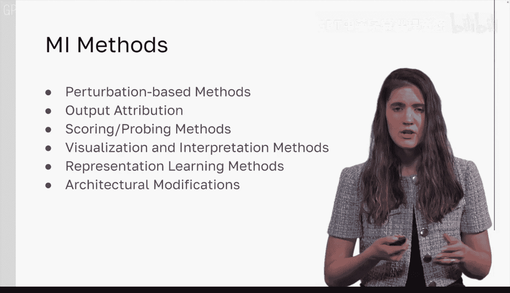

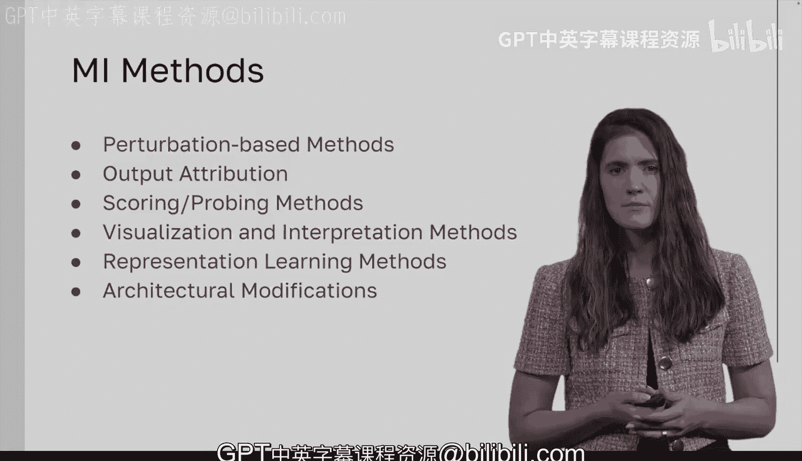