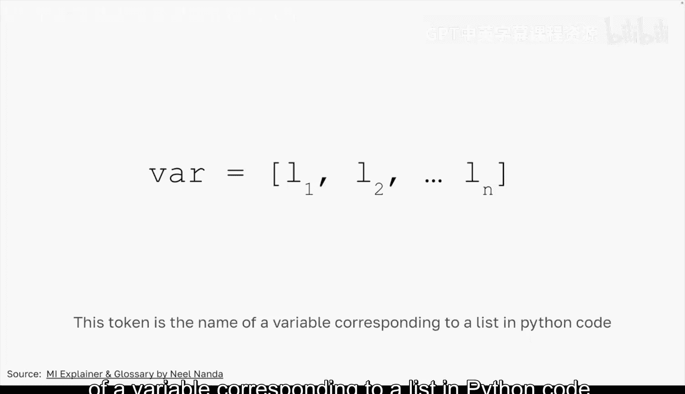
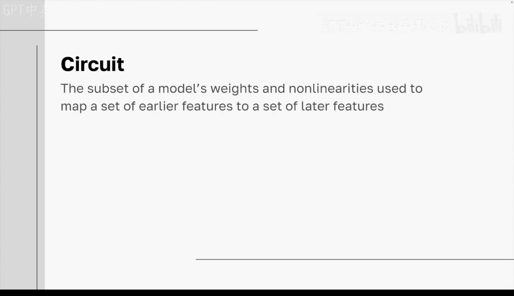
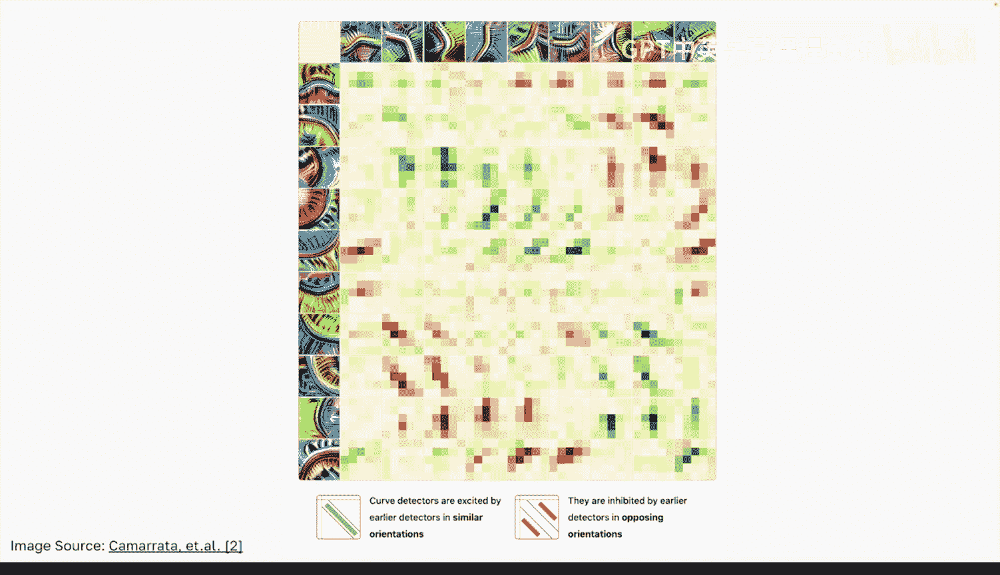
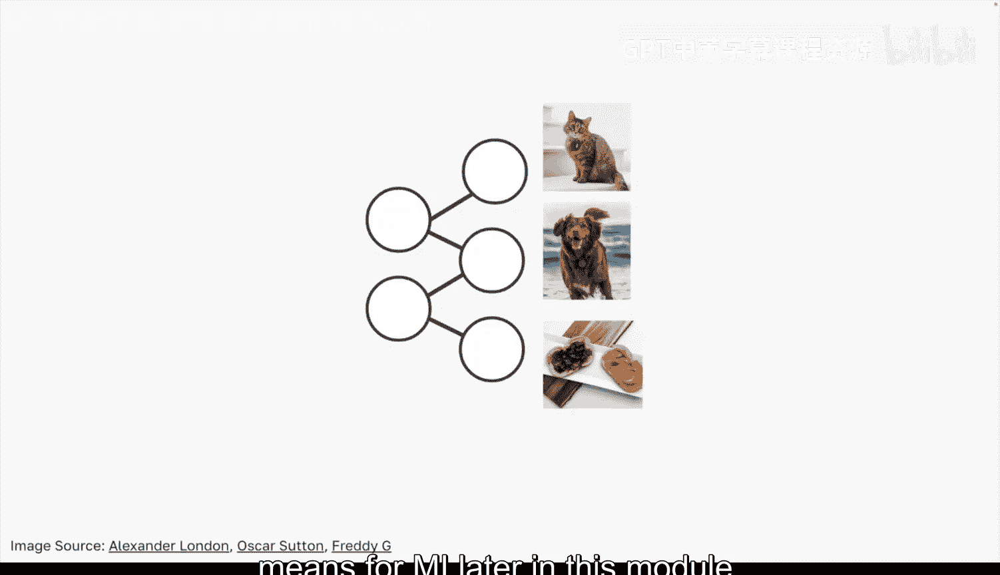
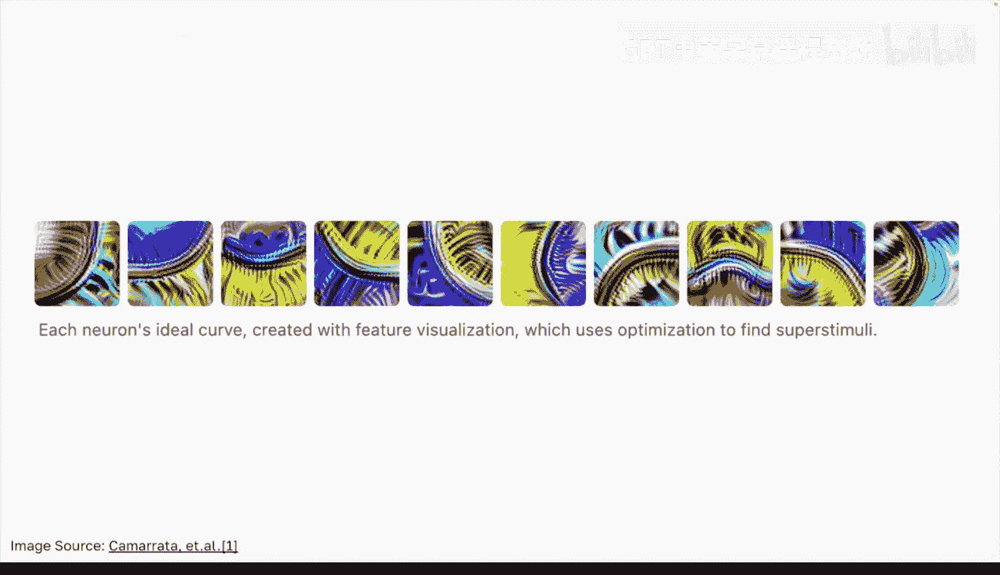
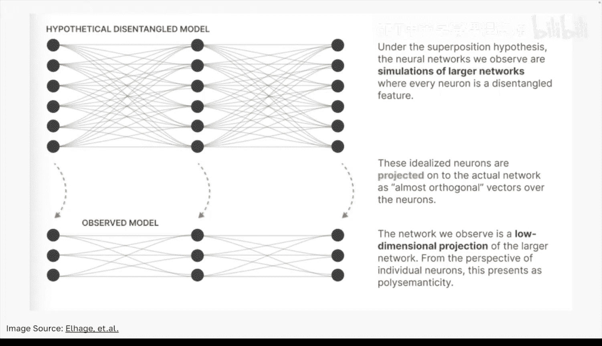
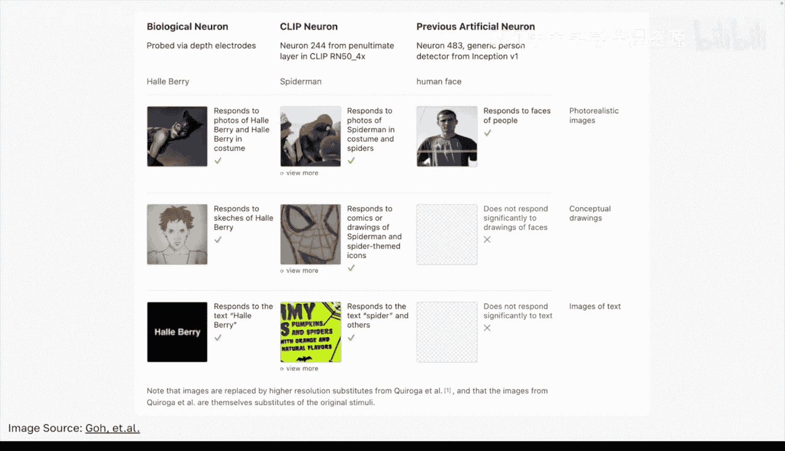
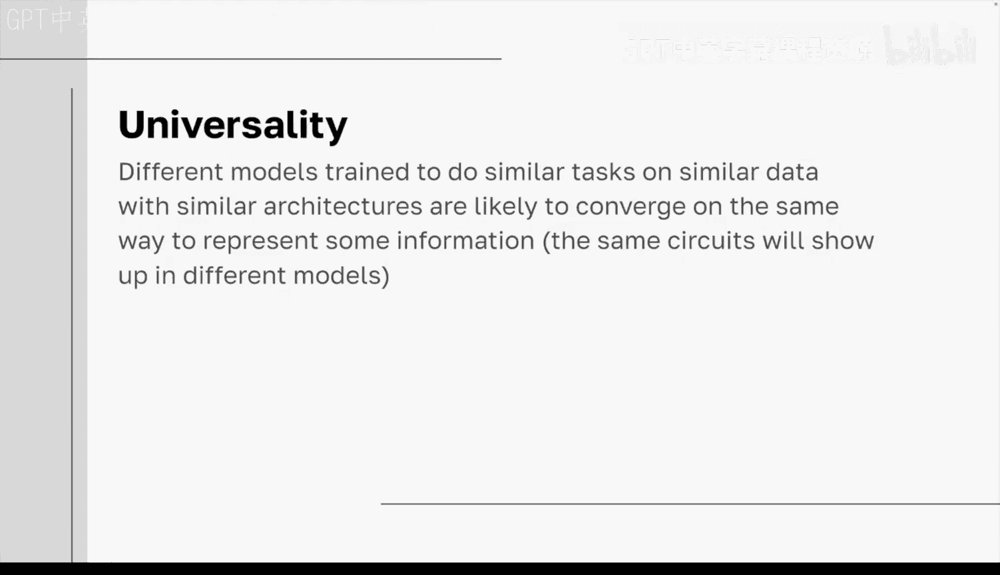
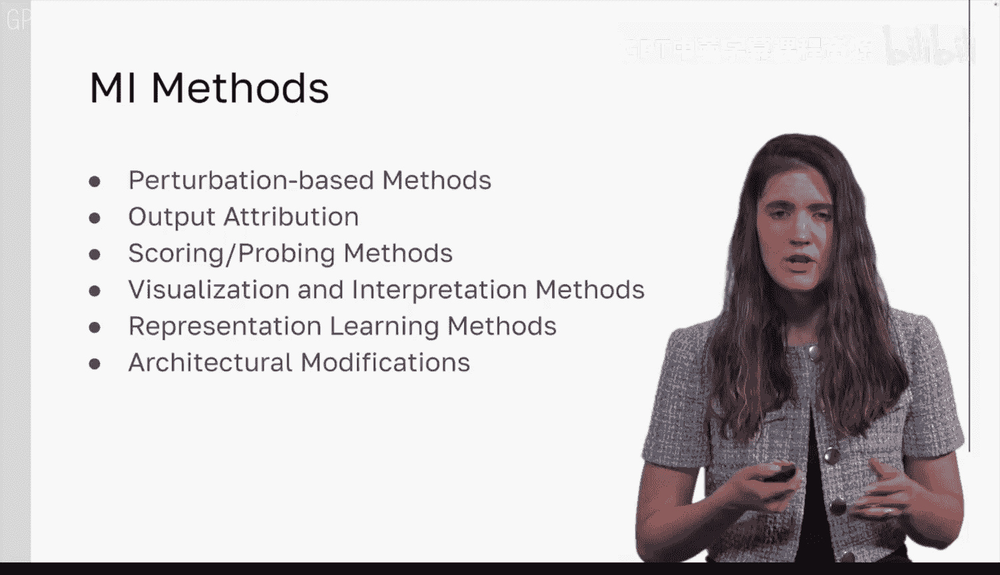
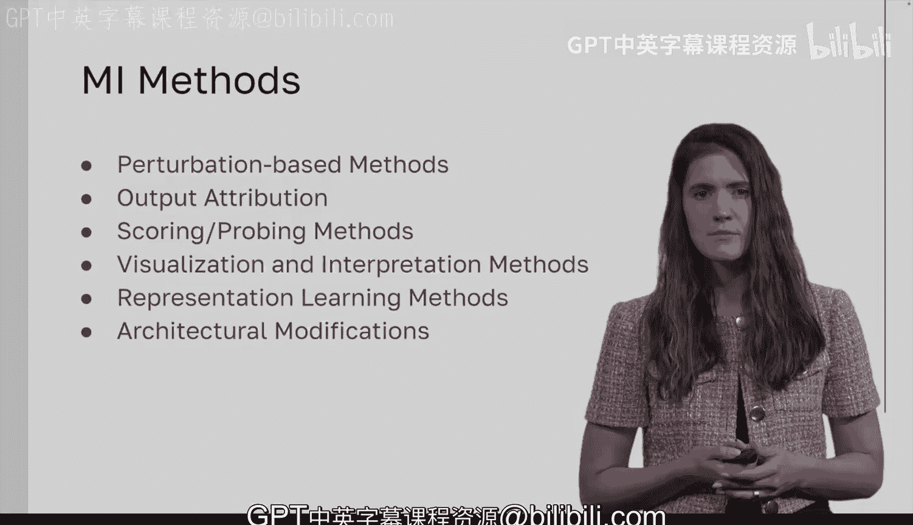

# 可解释人工智能：1：机制可解释性核心概念

在本节课中，我们将学习机制可解释性领域的一些基础概念。我们将从“特征”和“电路”的定义开始，探讨神经网络内部表示的结构性假设，并简要介绍该领域常用的研究方法。

## 特征

上一节我们介绍了课程目标，本节中我们来看看机制可解释性的第一个基础概念：特征。

这里的“特征”并非传统机器学习意义上的特征。机制可解释性扩展并重塑了这个概念。线性表示假说认为，神经网络将有意义的概念或特征表示为激活空间中的方向。特征是模型输入或其子集的属性，例如输入给大语言模型的提示中的一个词元，或图像中的一个补丁。

特征是模型的基本构建模块。模型的内部激活表示特征，模型的权重和非线性则用于进行计算，从早期特征生成后期特征。

以下是特征的一些例子：
*   这个词元是Python代码中对应列表的变量名。
*   这个词元对应一个用于描述人群的数字。
*   图像的这部分包含一条曲线。

你会注意到特征的有趣形式：“这个空白包含、对应或是空白”。如果现在还不完全理解，不必担心，我们将在整个模块中逐步建立对特征的直觉。

## 电路

既然我们已经定义了特征，接下来让我们探讨“电路”的概念。

电路是模型权重和非线性的一个子集，用于将一组早期特征映射到一组后期特征。

神经网络中存在许多电路示例，包括：
*   **曲线电路**：识别图像中包含曲线的部分。
*   **归纳电路**：生成式语言模型中的一个电路，它使用两个注意力头来检测并延续重复的子序列。

## 分解性与线性

现在我们已经定义了特征和电路，让我们来谈谈机制可解释性的核心目的：逆向工程神经网络。逆向工程一个物理设备涉及对其结构和组件进行系统性探索和分析。如果我们将此应用于逆向工程神经网络，我们应该期望神经网络的表示具有何种结构？

由于我们无法物理地拆解神经网络来探索其结构，我们必须对其结构提出一些假设才能进行逆向工程。这些假设就是**分解性**和**线性**。分解性指网络表示可以用独立可理解的特征来描述；线性指特征由方向表示。

基于神经网络、在ImageNet上训练的计算机视觉模型在图像分类等任务上表现良好。它可以准确地区分10种不同的物体，如猫、狗和花生酱果冻三明治。在这样的大型神经网络中，模型学习从输入图像数据中提取并组合众多特征表示。例如，在早期层，它可能学习低级特征，如边缘和纹理；在更深层，它将这些组合成代表更抽象概念（如形状和物体）的高级特征。

关键的直觉是，这些特征表示中的每一个都是相对独立且可单独理解的。这意味着来自狗的特征表示独立于猫的特征，而猫的特征又独立于花生酱果冻三明治的特征。这使我们能够分解模型，而不必在脑海中构建整个模型。它也有助于我们避免可怕的“维度诅咒”。

提醒一下，维度诅咒指的是处理高维数据时出现的挑战和复杂性。随着数据集中维度或特征数量的增加，数据在高维空间中变得越来越稀疏。维持相同密度所需的数据量随维度数量呈指数级增长。距离度量在高维空间中变得不那么有意义和区分度，大多数数据点彼此之间看起来几乎等距，并且高维数据的可视化和解释变得越来越困难。

然而，神经网络并非完全可分解的，我们将在本模块后面详细讨论这一点及其对机制可解释性的意义。

## 特征可视化与多义性

在我们逆向工程神经网络的过程中，出现了一些有趣的现象。Inception V1模型早期层的许多神经元对应于特定的特征，这里展示一个例子：曲线检测神经元，其中每个神经元编码特定方向的曲线。此图显示了每个神经元理想曲线的可视化。我们可以使用特征可视化方法，该方法通过优化来找到使给定目标最大化的神经网络输入（此处为图像）。这里显示的目标是使神经元尽可能强烈地激活。

但存在一个问题。有时这种情况会发生，有时则不会。神经元并不总是清晰地对应一个特征。你可能会问自己：为什么？

机制可解释性领域提出了两个假说：
1.  **特权基假说**：该假说认为只有某些表示具有特权基，这鼓励特征与基方向对齐以对应神经元。你可以在此图的顶行看到这一点。非特权基可以将特征嵌入任何方向，而在特权基中，特征有动机与基维度对齐。注意，这并不一定意味着它们一定会对齐。
2.  **叠加假说**：线性表示可以使用一种称为“叠加”的策略来表示比维度数量更多的特征。这可以被认为是神经网络在模拟更大的网络，从而将特征推离与神经元的对应关系。

在叠加作用下，特征无法与基对齐，因为模型嵌入的特征比神经元数量更多。多义性因此不可避免。什么是多义性？这是一个术语，用于描述当特征不与神经元对齐，或者换句话说，当许多特征使用同一个神经元进行映射时，我们预期会观察到的现象。

这是叠加假说的另一个可视化。叠加假说指出，我们观察到的神经网络只是更大网络的模拟，在更大网络中每个神经元都是一个解耦或独立的特征。其思想是，我们观察到的网络（如本图底部所示）是更大网络的低维投影。这个低维投影包含了多义性，因为它本质上是更大网络的压缩版本。如果这仍然令人困惑，不必担心，我们将在关于叠加的讲座中更详细地介绍。

## 跨模态与普遍性

在我们开始逆向工程神经网络时，我们从大脑中获得了灵感。Corroga等人对人类大脑进行的一项研究表明，大脑中的神经元编码多模态概念。对哈莉·贝瑞照片有反应的同一个神经元，也会对哈莉·贝瑞的素描有反应，甚至会对“哈莉·贝瑞”这段文字有反应。因此，这些概念本身由这个神经元表示。类似地，Go等人表明，来自一个名为C的大型多模态嵌入模型的神经元会对蜘蛛侠的照片、蜘蛛侠漫画和“蜘蛛侠”文字产生反应，显示出与人类大脑相似的多模态性。

我们将要讨论的下一个主题是我们关于神经网络的最后一个推测性主张，即**普遍性**。普遍性假说认为，相同的电路会出现在不同的模型中。用相似架构在相似数据上训练以执行相似任务的不同模型，很可能以相同的方式收敛来表示某些信息。还记得我们之前看到的曲线检测器吗？那些相同的曲线检测器出现在不同的模型中，为神经网络中的普遍性提供了轶事证据。

## 常见机制可解释性方法

我们将要讨论的最后一个主题是机制可解释性概念介绍中的常见方法。我们不会详细讨论每一种方法，因为它们内容广泛且需要一些背景知识。我们将对它们进行高层次概述，以便你开始了解机制可解释性研究人员的工作内容。

常见的机制可解释性方法包括：
*   **基于扰动的方法**：涉及扰动或修改模型的输入、激活或内部组件，以观察输出或行为的变化，从而将重要性或因果关系归因于特定组件或特征。示例包括：消融、激活修补、因果追踪、路径修补和因果擦洗。
*   **输出归因**：旨在将最终输出、逻辑或损失归因于特定的输入特征或内部组件，从而洞察其贡献或重要性。示例方法包括：逻辑差异、每词元损失、直接逻辑归因和逻辑透镜。
*   **评分与探测方法**：计算量化模型某些属性或行为的分数或指标，例如组合程度或模型中存在的归纳偏差。几个例子是：特征值评分和前缀匹配或归纳评分。
*   **可视化与解释方法**：涉及可视化或识别那些能最大化或强烈激活模型中特定组件的输入特征或示例。我们已经看到了一些例子，包括特征可视化和最大激活数据集示例。
*   **表示学习方法**：如使用稀疏自编码器的字典学习，学习模型内部表示的可解释表示或分解，可能揭示模型所依赖的潜在因素或组件。
*   **架构修改**：如线性化层归一化，涉及修改或线性化模型的特定架构组件，以促进模型内部表示的可解释性或解耦。

这绝非详尽无遗的列表，由于这是一个活跃的研究领域，新的机制可解释性方法一直在不断涌现。

---

本节课中我们一起学习了机制可解释性的核心概念。我们从“特征”和“电路”的定义出发，探讨了神经网络表示结构的核心假设（分解性与线性），并观察了特征可视化中出现的多义性现象及其可能的解释（特权基假说与叠加假说）。我们还了解了从神经科学中获得的跨模态灵感，以及关于神经网络学习普遍性电路的推测。最后，我们概览了机制可解释性领域常用的几类研究方法，为后续深入学习奠定了基础。