# 杜克大学《可解释人工智能｜Explainable AI (XAI)》中英字幕 p45 16_03_01_电路导论.zh_en -BV1HnrBBmEon_p45-

嗯。

Let's talk about circuits。 We can study the connections between neurons to find meaningful algorithms in the weights of neural networks。

 which is a core principle of M。 This section is based on a paper from Ola at all in 2020。

 You will have the opportunity to dive deep into the details of this paper in your reading。

 This figure is a great summary of what circuits are trying to do。

 We have units corresponding to windows， car bodies and wheels。

 and we can assemble these earlier units into a car detector。😊。

The idea behind this paper is to provide an introduction to circuits by way of trying to prove the speculative claims about neural networks that we were introduced to previously。

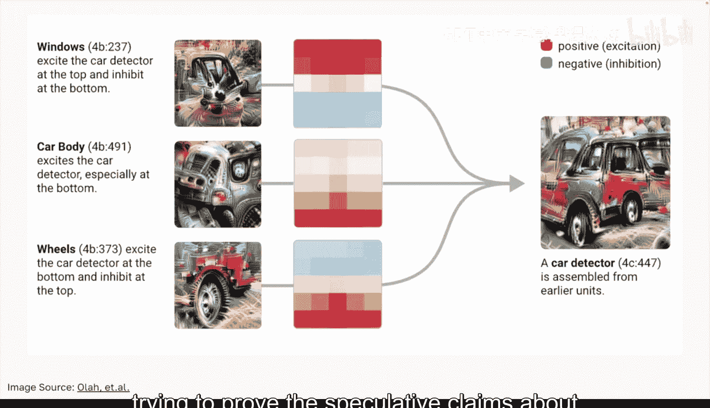

A reminder on those speculative claims， which can be broken down into features。

 circuits and universality。 First， we are going to talk about evidence for features。

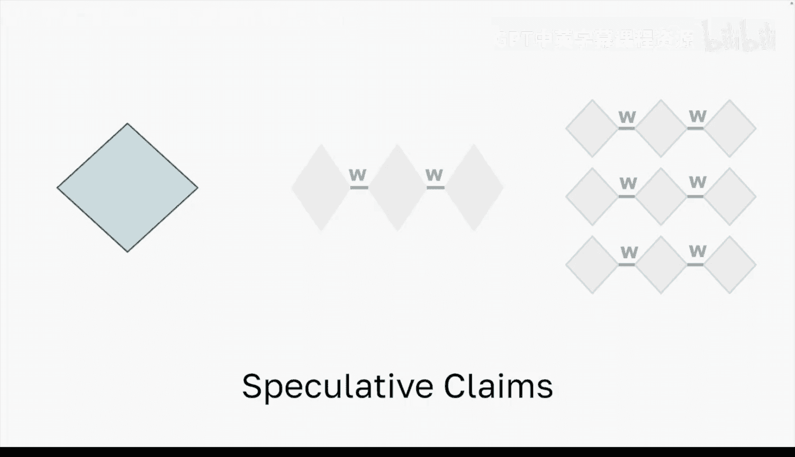

Let's dive into evidence for features。 The first evidence for features is one we have already discussed。

 Curd detectors， Curd detecting neurons can be found in every explored nontrivial vision model。

 We are going to share some arguments for curve detectors and note that we can use these same argument methods for all of our evidence。

 not just our evidence for curve detectors。😊，Feature visualization shows us that optimizing the input to cause curve detectors to fire reliably produces curves。

 This establishes a causal link since everything in the resulting image was added to cause the neuron to fire。

 We can see this in the top left image， which we've seen previously。😊，Next is data set examples。

 ImageNe images that cause these neurons to strongly fire are images of curves in a particular orientation。

 as shown in the second figure on the left。Synthetic examples can also be used。

 Curd detectors respond as expected to synthetic curve images shown in the third figure on the left。

Joint tuning can also provide an argument for curve detectors and evidence for features if we rotate curve images。

 at some point the neuron stops firing and curve detectors in the next orientation start firing。

These last three are what we call MI specific methods。

 which are research methodologies created explicitly for the purpose of MI research。

 feature implementation by looking at the circuit constructing the curve detectors。

 we can read a curve detection algorithm off the weights。 This is shown in the heat map。Feature use。

 The downstream clients of curved detectors are features that naturally involve curves like a circle。

 as shown here in the second figure on the right， The curved detectors are used by these clients in the expected manner。

And finally， handwritten circuits， we can hand set all weights to reimment curve detection。

 These weights are an understandable curve detection algorithm。

 and thus we reverse engineered curve detectors。

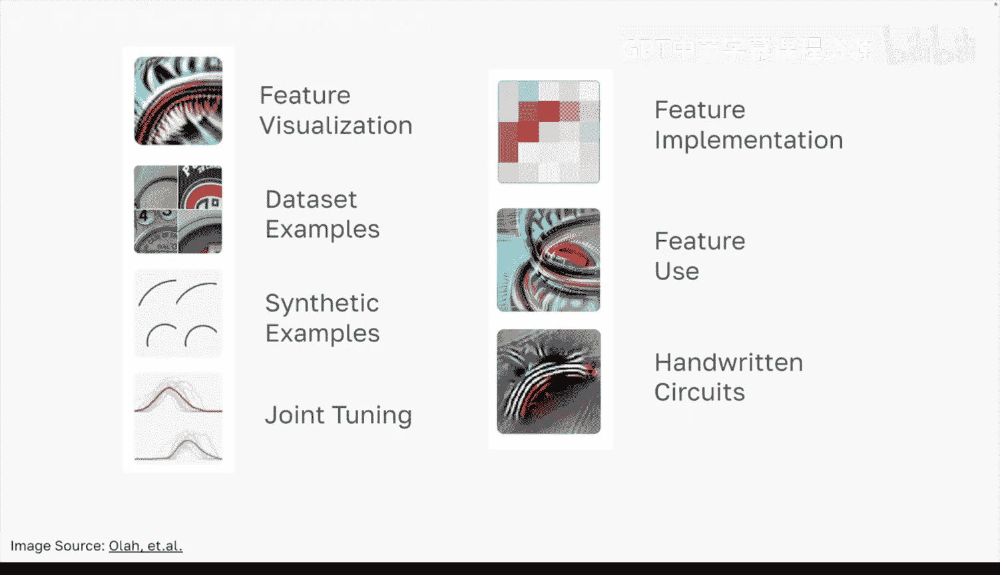

Here are some more images of curve detectors。 This image shows the neuron responses to rotated data set examples。

 You can clearly see that the neurons are encoding a representation of that curve。

 which we can quantify using degrees on the x axis。 In this study。

 they collected a data set of examples that maximally activated the neuron and rotated them in increments of one degree from 0 to 360 degrees and recorded the subsequent activations。

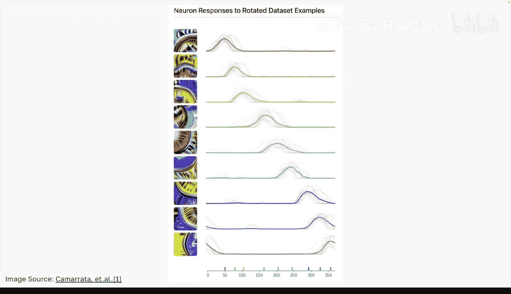

We can see images from our feature visualization on the top。

 and on the bottom are images from ImageNet that activated the neuron focused on this specific curve orientation。

The next evidence for features is high low frequency detectors。

 which look for low frequency patterns on one side of their receptive field and high frequency patterns on the other side。

 These are typically found in families of features that look for the same thing in different orientations。

From this， we can start to see that there appears to be heuristics for detecting boundaries of objects。

 especially when the background is out of focus as shown here。

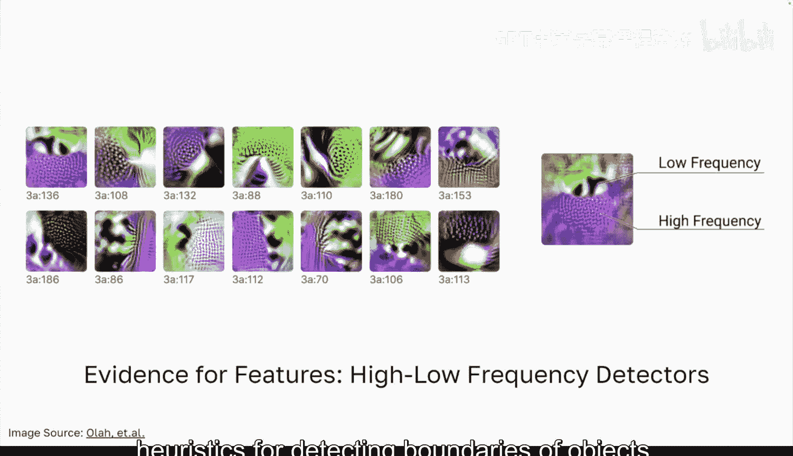

Another evidence for features is the pose invariant dog head detector Feature visualization allows us to establish a causal link shown in the left while data set examples test the neurons's use in practice and whether there are a second type of stimuli that it reacts to shown in the right。

This is all really great。 But what about that little thing about polysemantic neurons。

 Ne networks often contain polysemantic neurons that respond to multiple unrelated inputs like here。

 which is a neuron that responds to cat faces， fronts of cars and cat legs。

 No resolution for this yet， but we're getting there。😊，Next。

 we will talk about evidence for circuits。Curd detectors are also evidence for circuits because curved detectors are implemented from earlier curve detectors and line detectors as shown in this figure。

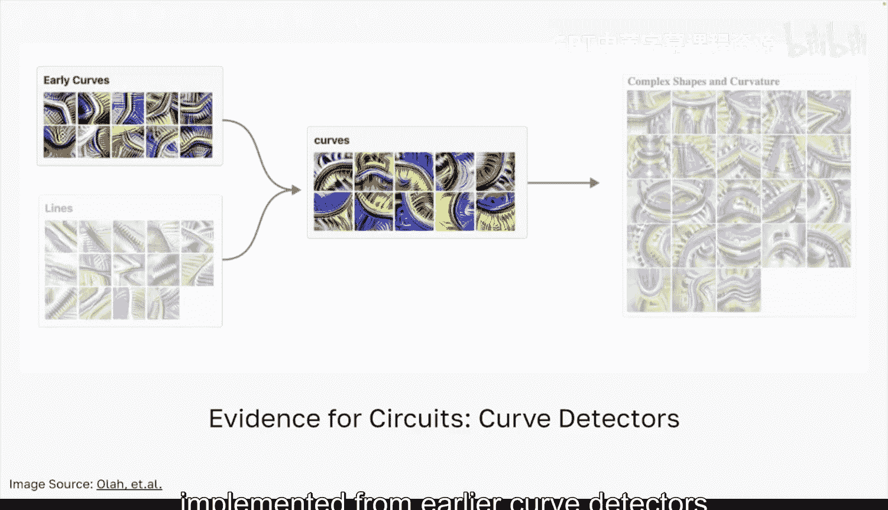

In this image， we can see that curved detectors are excited by earlier detectors shown in red。

 they are also inhibited by earlier detectors in opposing orientations。

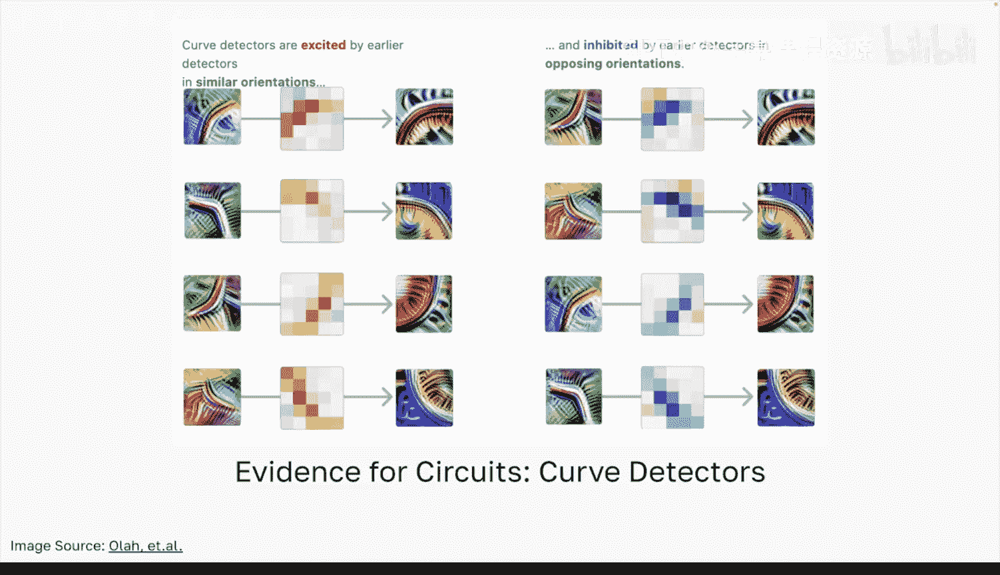

More evidence for circuits comes in the form of oriented dog head detection。

 When we take our oriented dog head detectors shown on the left and combine them as shown on the right。

 we get a pose invariant dog detector， which is excited by dogs oriented in either way。

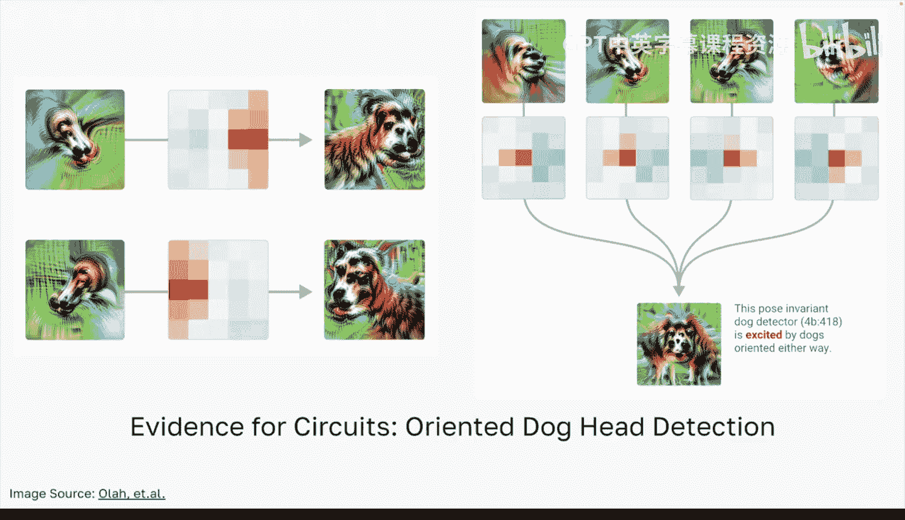

Cars in superposition is the last evidence for circuits that we will discuss。

 Car detecting neuron brings together features for windows， car bodies and wheels。

 as shown in the image on the left。But then if we look forward。

 it does something strange in the next layer， the feature is spread across many polysemantic neurons。

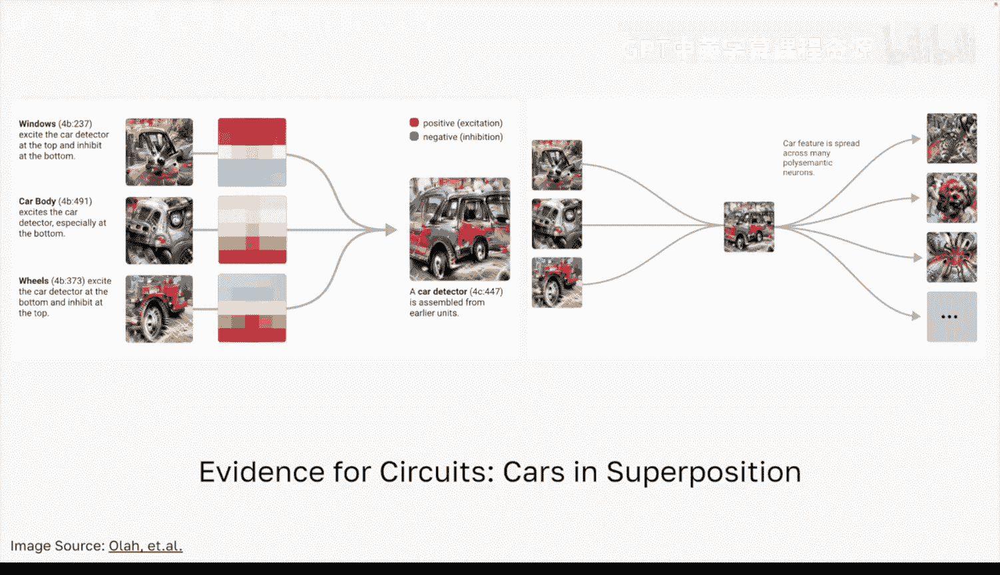

Another hint at what's to come in our superposition lecture。

 but the hypothesis is that superposition allows the model to use fewer neurons。

 conserving them for more important tasks。

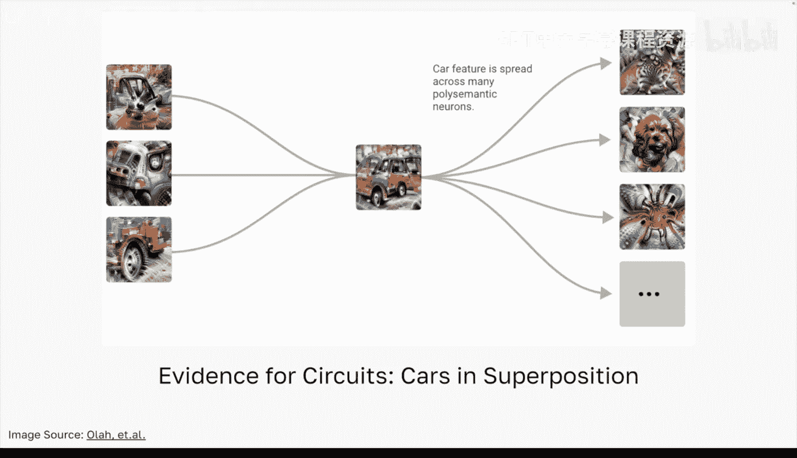

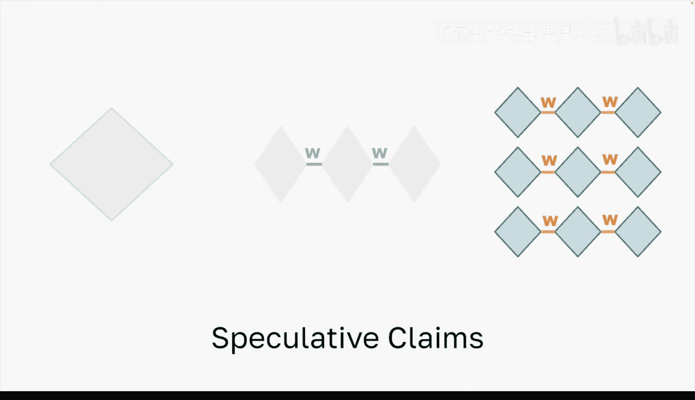

Next， we will discuss evidence for universality。We only have observational evidence for universality in the form of both our curve detectors and our high low frequency detectors。

 Univerity states that different neural networks can develop highly correlated neurons。

 and they learn similar representations in hidden layers。

 and we definitely see that in these two examples。 curved detectors show up across many models。

 including Alexnet Inception V1 VGg19 and Resnet V250。 These are all different architectures。

 but they all learn curve detectors。 In fact， as we mentioned previously。

 curve detecting neurons can be found in every explored non-trivial vision model。😊。

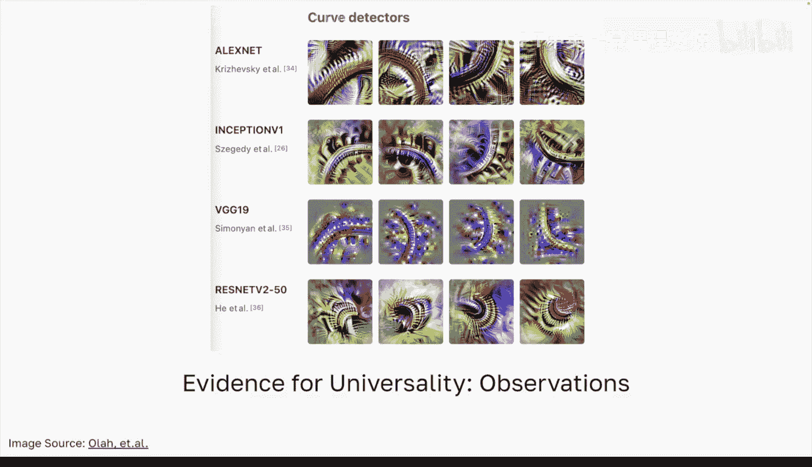

Similarly， high low frequency detectors show up in each of these models。

 While not resounding evidence of universality， these observations are pretty compelling。

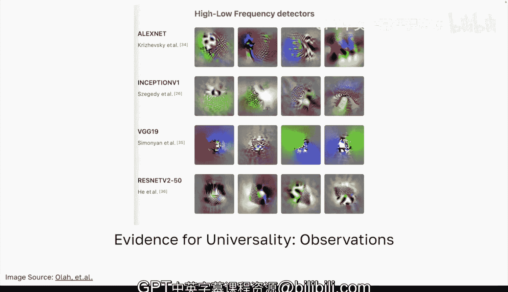