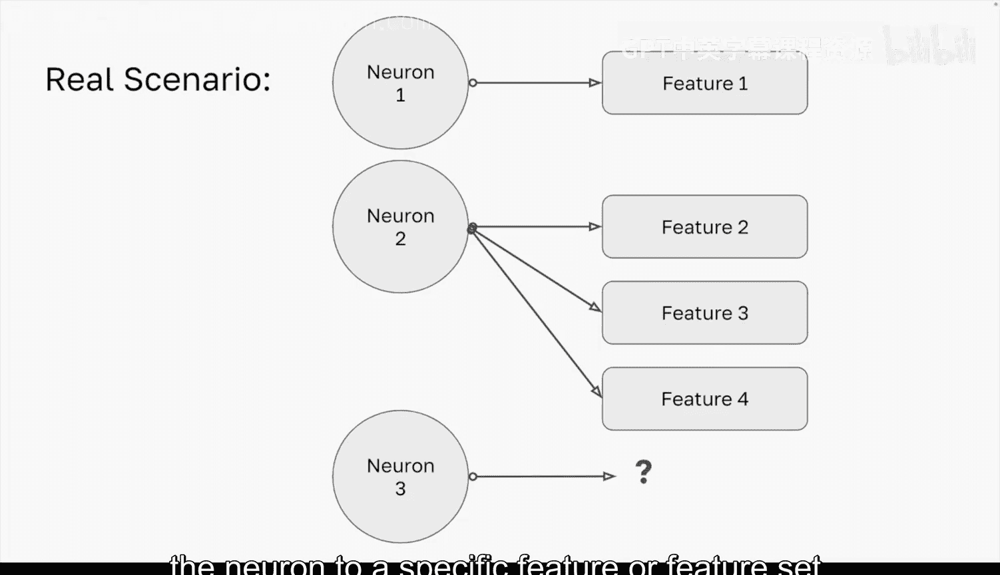
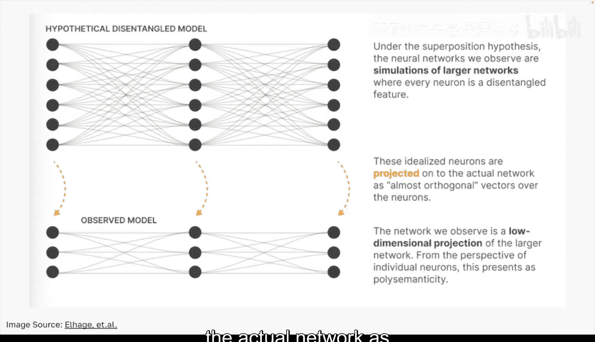
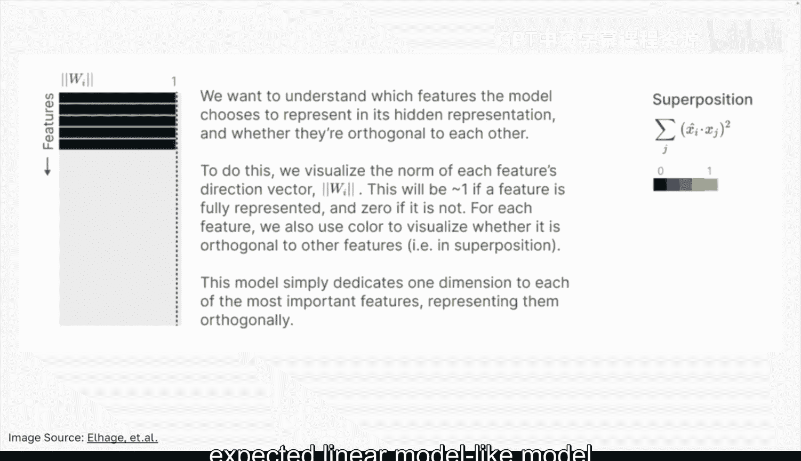
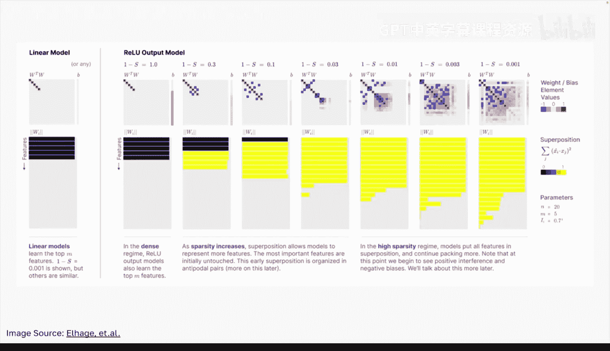
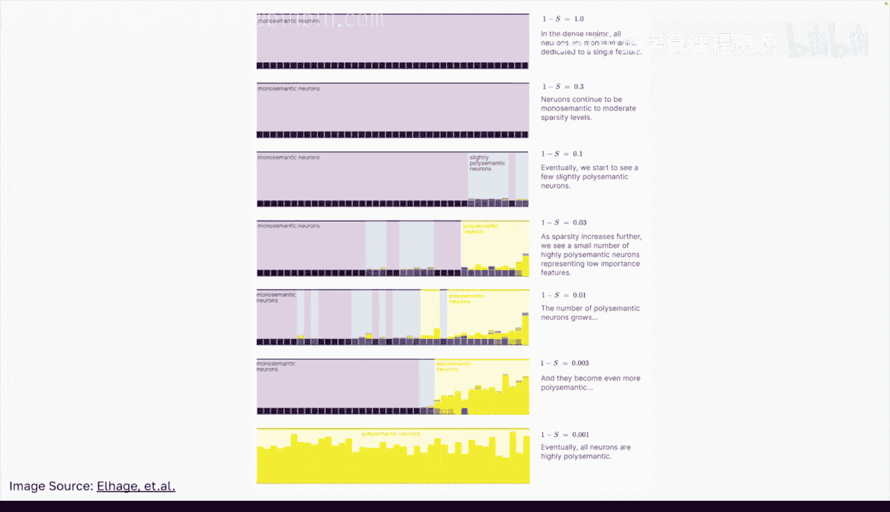
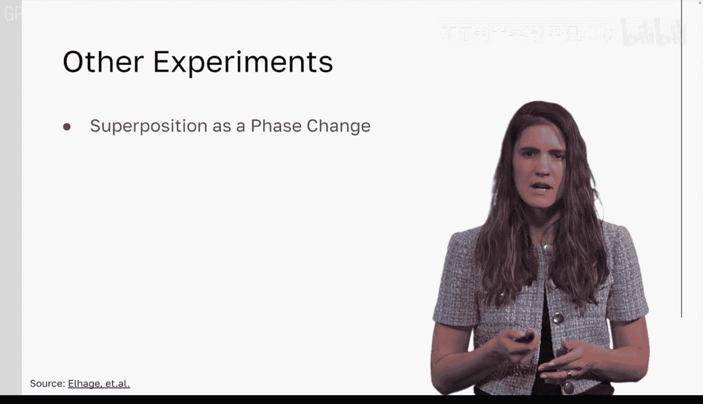
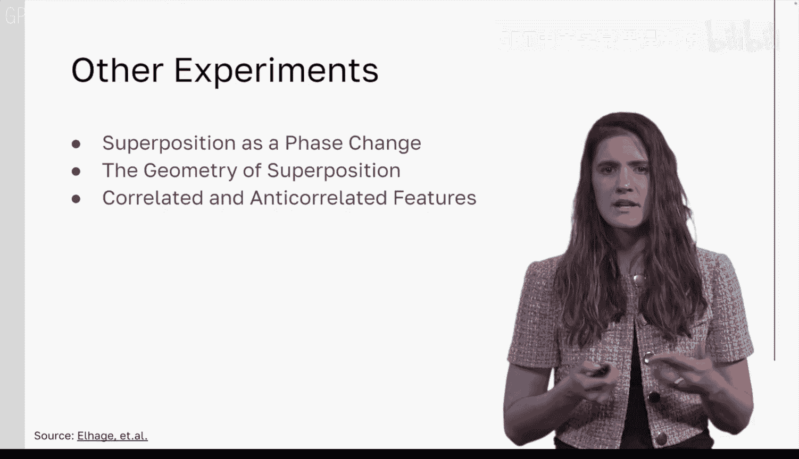
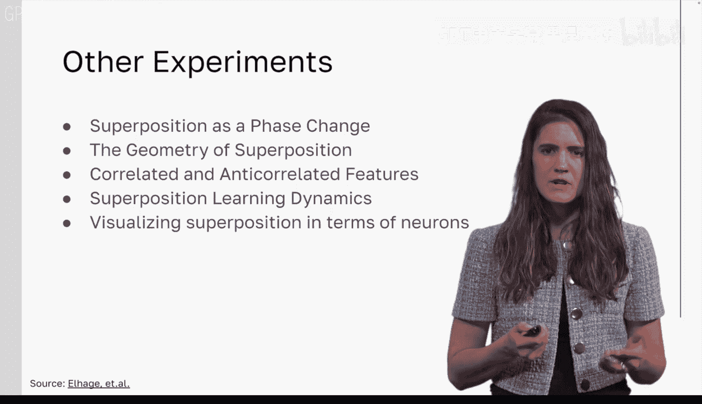
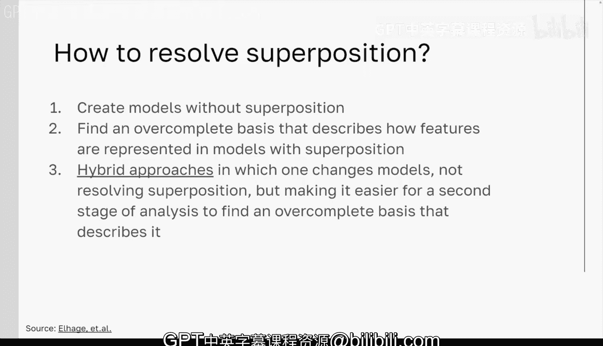

# 杜克大学《可解释人工智能｜Explainable AI (XAI)》中英字幕 p46 17_03_03_叠加假设.zh_en -BV1HnrBBmEon_p46-

嗯。All right， we have been teasing it for several lectures。

 let's get into the superposition hypothesis。In an ideal scenario。

 each neuron in a network would map to one of our features like we see in curve detectors。

 where each neuron corresponds to a curve of a specific orientation。However。

 neurons don't always or usually map cleanly to interpretable features。

 Sometimes it happens like with curved detectors。 Other times， we have polysemanity。

 where a neuron maps to many features that are seemingly unrelated。 Other times。

 we have no idea how to match the neuron to a specific feature or feature set。

 This is what really happens。

Enter the superposition hypothesis according to the superposition hypothesis， neural networks。

 as we observe them， are simulations of larger networks where each neuron is a disentangled feature。

We can pause here because this is pretty meta。 We are compressing a bunch of information into a neural network that is decompressing that data。

 learning it， and then compressing it back into the observed neural network。

According to the hypothesis， these idealized neurons are projected onto the actual network as almost orthogonal vectors over the neurons。

The rest of this lecture is based on the toy models of superposition paper by El Hage in 2022。

 This paper has so many interesting experiments， which you will explore in the reading。

 We are going to focus on the following experimental goals to provide evidence of superposition。😊。

The paper shows that as sparsity increases， models use superposition to represent more features than dimensions。

 This is shown in the explanatory figure from the paper here。 when the model has zero sparsity。

 the two most important features are given dedicated orthogonal dimensions。

 While other features are not embedded at 80% sparsity， we have four features represented。

 and at 90% sparsity， all five features are embedded as a pentagon。

 and there is now a concept of positive interference。 More on that in a moment。😊。

When looking to demonstrate evidence for superposition， we must first ask ourselves the question。

 can neural networks actually noisily represent more features than they have neurons？

To answer this question， the authors explored a linear model and a Raylu output model that adds non linearity。

 They visualized features by features matrix and a feature length vector B。

 Y a features by features matrix instead of just the features matrix。

 They found that it tended to be easier to visualize。

This is what this type of visualization might look like for a small model。

 n equals 10 and M equals 5， which behaves in the expected linear model like way。

 only representing as many features as it has dimensions。

The features by features matrix is an identity matrix for the most important features and 0 for less important ones。

 The bias is shown in the next subplot。 It is 0 for features learn to pass through and the expected value。

 a positive number for others。😊，Another informative visualization is to look at the norm of each feature's direction vector。

 This is approximately one if a feature is fully represented and0， if it is not。

 We can also measure the cosine similarity between two feature vectors and use color to visualize whether a feature vector is orthogonal to other features。

 For example， in superposition。 We can calculate the sum of squared dot products between two weight vectors。

 I and J。 a low value for this close to 0 indicates that the feature is unique and orthogonal to other features shown on the visualization as dark blue or black。

 While a high value greater than or equal to1。 suggests that the feature is highly correlated with or can be represented by a combination of other features shown on the visualization is bright yellow。

😊，In this figure of the same expected linear model like model we saw in the last slide。

 the model simply dedicates one dimension to each of the most important features representing them orthogonally。

In this feature， we have a linear model on the left side of the image。

 The Raylu output model that is so small and behaves similarly to the linear model is shown next from the left。

 This is the model that we have visualized on the previous slides。

 Here is where things get interesting。 As we move right along this figure。

 we are increasing the sparsity of the model， as shown in our features by features matrix。

 as sparsity increases。 we start to see superposition emerge。

 The model represents more features by having them not be orthogonal to each other。

 It starts with less important features， and gradually effects the more important ones。😊。

Here's another way to visualize this。 At the top， we have monosemanticity。 When our model is dense。

 all neurons are dedicated to a single feature。 As we increase sparsity。

 polysemantic neurons start to emerge， starting with features of the lowest importance。 Eventually。

 all neurons become highly polysemantic。😊。

We are just showing a small snapshot of this paper where they provide evidence for superposition。

 the model also runs experiments on superposition as a phase change， the geometry of superposition。

 correlated and anti correlated features， learning dynamics of superposition。

 and visualizing superposition in terms of neurons。

In summary， the paper toy models of superposition demonstrated evidence for the superposition hypothesis for interpretability。

 we need to be able to resolve superposition。The question is， how。

Am I researchers positive that you could do this in one of three ways。

 create models without superposition。Find an overcomplete basis that describes how features are represented in models with superposition。

Or hybrid approaches in which one changes models not resolving superposition。

 but making it easier for a second stage of analysis to find an overcomplete basis that describes it。

